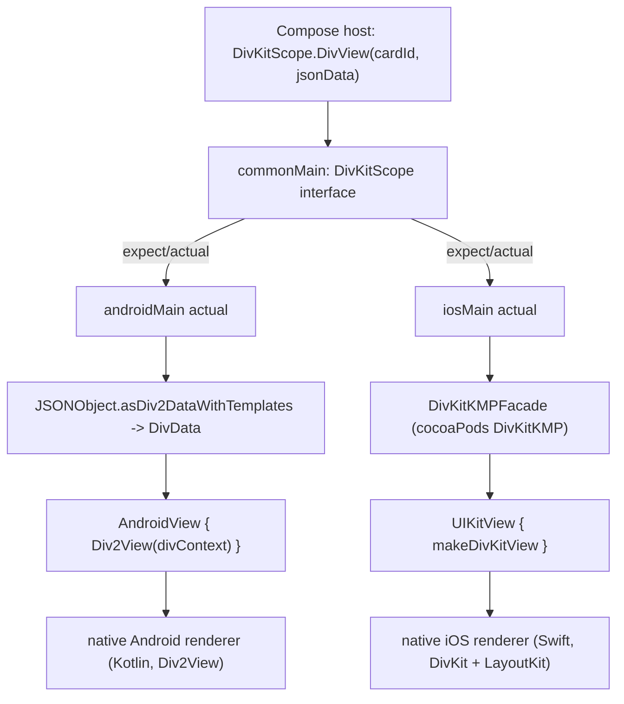

# 15 -- The Flutter and Kotlin Multiplatform clients: a port, and a wrapper

The last two clients answer the same question — "how does one DivKit card
render on a cross-platform framework?" — in two opposite ways. The Flutter
client is a **port**: it re-implements the renderer in Dart, with generated Dart
models for the schema and hand-written Flutter widgets for the views. The
Kotlin Multiplatform (KMP) client is the opposite: it is **not** a renderer at
all. It is a shared Compose application programming interface (API) that embeds
each platform's *native* DivKit renderer — the Android `Div2View`, the iOS
DivKit view — behind one `DivView` function. This document reads the Flutter
port first, then the KMP wrapper, and closes on why one project chose both.

# The Flutter client: a Dart port of the renderer

Flutter is Google's cross-platform framework; its widgets are Dart objects, not
the platform's native views. So DivKit on Flutter cannot reuse the iOS
`DivKit`/`LayoutKit` code or the Android Kotlin code. It must build the whole
renderer again in Dart. The entry point is `DivKitView`, a `StatelessWidget`:

```dart
// divkit/client/flutter/divkit/lib/src/core/divkit.dart (excerpt)
class DivKitView extends StatelessWidget {
  /// The data of layout that will be rendered.
  final DivKitData data;

  final DivVariableStorage? variableStorage;
  final DivActionHandler? actionHandler;
  final DivCustomHandler? customHandler;
  final DivFontProvider? fontProvider;
  final TextDirection? textDirection;
  final DivScale? scale;
  final Brightness? brightness;
  final bool showUnsupportedDivs;

  @override
  Widget build(BuildContext context) => Directionality(
        textDirection: textDirection ?? Directionality.of(context),
        child: provide(
          DivConfiguration(showUnsupportedDivs: showUnsupportedDivs),
          child: FocusScope(
            child: _DivKitView(
              data: data, scale: scale, fontProvider: fontProvider,
              variableStorage: variableStorage, actionHandler: actionHandler,
              customHandler: customHandler,
            ),
          ),
        ),
      );
}
```

`DivKitView` is a thin shell. It takes a `DivKitData` — the already-parsed card
— and the same pluggable parts the other clients have: a `DivVariableStorage`
for variables, a `DivActionHandler` for actions, a `DivCustomHandler` for
`div-custom`, a `DivFontProvider` for text. It builds a `DivConfiguration` and
hands everything to a private stateful `_DivKitView`. That inner widget calls
`DivRootContext.initialize(...)`, then renders a `DivRootWidget` — the Flutter
equivalent of the iOS `DivBlockProvider` plus `Root.svelte` on the web. When the
`data` or `variableStorage` changes, the stateful widget re-initializes the
whole context; a full re-render, matching the "every change is a new `DivData`"
rule from [12-ios-rendering.md](./12-ios-rendering.md).

The models are generated, exactly as on the other platforms. The `dart` codegen
target from [08-codegen.md](./08-codegen.md) emits Dart classes into
`lib/src/schema/`: 186 Dart files, one per schema type, plus a barrel export.
The names match the schema — `div_action.dart`, `div_accessibility.dart`,
`div_absolute_edge_insets.dart` — so the Dart model tree mirrors the JSON
tree. Parsing a card builds those generated classes, and the widget layer reads
them.

The widget layer has the same two-part split the Android client has, but in
Dart. One directory, `lib/src/core/widgets/`, holds one Flutter widget per
element type (`text`, `image`, `container`, `grid`, `gallery`, `pager`,
`input`, `state`, and so on). The other, `lib/src/core/converters/`, turns
schema values into Flutter values: `alignment.dart` maps Div alignment to
Flutter alignment, `size.dart` maps the Div size system to Flutter sizes,
`edge_insets.dart` maps paddings and margins, `content_alignment.dart` maps the
container content alignment, and `decoration.dart` builds the background and
border. The conversion step is the key: a generated model says "fixed size,
center-aligned"; a converter turns those two facts into the Flutter `SizedBox`
and `Align` widgets that realize them.

```mermaid
flowchart LR
    JSON["card JSON"] --> PARSE["generated Dart models (lib/src/schema/, 186 files)"]
    PARSE --> DTO["DivKitData (pre-built DTO)"]
    DTO --> VIEW["DivKitView (StatelessWidget)"]
    VIEW --> CTX["DivRootContext.initialize"]
    CTX --> ROOT["DivRootWidget"]
    ROOT --> CMP["widgets/ per-element Flutter widgets"]
    CMP --> CONV["converters/ schema value -> Flutter value"]
    CONV --> OUT["Flutter widget tree"]
```



# Expressions: a Dart parser, with an optional native shortcut

The expression language `@{...}` from
[06-variables-expressions.md](./06-variables-expressions.md) is implemented
twice in the Flutter client. The pure-Dart path is a hand-written parser built
on `petitparser` (a parser-combinator library), in
`lib/src/core/expression/parse.dart`, with an `analyzer.dart` and a
`resolver.dart` on top. It parses and evaluates an expression entirely in Dart,
so the Flutter renderer works with no native code at all.

The second path is a native shortcut. `div_expressions_resolver` is a separate
Flutter plugin that delegates expression evaluation to the *native* DivKit
engine through a platform message channel:

```dart
// divkit/client/flutter/div_expressions_resolver/lib/div_expressions_resolver.dart (excerpt)
Future<Object?> resolve(String expression, {Map<String, dynamic> context = const {}}) async {
  const channelName = 'div_expressions_resolver.NativeDivExpressionsResolver.resolve';
  final channel = BasicMessageChannel<Object?>(
    channelName,
    _channelCodec,
    binaryMessenger: _binaryMessenger,
  );
  final replyList = await channel.send(<Object?>[expression, context]) as List<Object?>?;
  ...
}
```

The channel name is fixed: `div_expressions_resolver.NativeDivExpressionsResolver.resolve`.
Flutter sends the expression and its variable context over a `BasicMessageChannel`
(a Flutter type, one of the platform-channel mechanisms) to a native handler —
the real DivKit expression engine on iOS or Android — and gets back the resolved
value. This is the same idea as the web client's Peggy grammar and the iOS
client's `ExpressionLink` parser, but here the *optional* native resolver exists
because the pure-Dart parser and the native engine must agree exactly on a
language that has many built-in functions. Running the native engine is the
shortcut to exact agreement.

The dependencies tell the rest of the story. `cached_network_image` loads
remote images (the Flutter answer to the iOS `DivImageHolderFactory` and the
Android `DivImageLoader`); `flutter_svg` draws vector images; `visibility_detector`
feeds the visibility actions; `rxdart` provides the reactive streams that carry
variable and action updates; `equatable` gives the models value equality, the
same kind of value-comparison `LayoutKit` blocks use to decide what re-renders.

# The KMP client: a shared DSL over native renderers

Kotlin Multiplatform lets one Kotlin codebase compile to Android, iOS, and
more. DivKit's KMP client uses it to expose a single Compose API — but it does
not port the renderer. The common code is one interface, `DivKitScope`, with
two functions:

```kotlin
// divkit/client/multiplatform/.../commonMain/.../DivKitScope.kt (whole file, trimmed)
interface DivKitScope {
    @Composable
    fun DivView(cardId: String, jsonData: String, modifier: Modifier = Modifier)

    @Composable
    fun <T : Any> variable(name: String, value: T): DivKitVariableState<T>

    @Deprecated("Use DivKitScope.variable(name, value) instead.")
    fun setGlobalVariables(variables: Map<String, Any>)
}
```

`DivView` is a `@Composable` function: a host writes `DivView(cardId = "...",
jsonData = "...")` inside a Compose tree and gets a rendered DivKit card.
`variable(name, value)` writes a global variable into the card. Both are
declared once in `commonMain`, and each platform supplies its own `actual`
implementation — the `expect`/`actual` mechanism Kotlin uses for platform code.

On Android, the `actual` embeds the native Android renderer. It parses the JSON
with the same `asDiv2DataWithTemplates` helper the standalone Android client
uses, builds a `Div2Context` and `DivConfiguration`, and drops a native
`Div2View` into the Compose tree through `AndroidView` interop:

```kotlin
// divkit/client/multiplatform/.../androidMain/.../DivKitScope.android.kt (excerpt)
val divData = remember(cardId, jsonData) {
    JSONObject(jsonData).asDiv2DataWithTemplates(cardId, dependencies.errorReporter)
}

AndroidView(
    factory = { Div2View(divContext) },
    update = { view -> view.setData(divData, DivDataTag(cardId)) },
    modifier = modifier
)
```

`AndroidView` is Compose's bridge to a classic Android `View`. The factory
creates the `Div2View` from [14-android-client.md](./14-android-client.md); the
`update` lambda calls `setData(divData, DivDataTag(cardId))` whenever the card
changes. The `DivConfiguration` in `makeDivContext` wires the same pluggable
pieces as the standalone client — an image loader, an action handler, the
`DivShimmerExtensionHandler`, and a `DivVariableController`.

On iOS, the `actual` does the same thing through `UIKitView`, but the native
view is the DivKit iOS renderer wrapped by a CocoaPod named `DivKitKMP`:

```kotlin
// divkit/client/multiplatform/.../iosMain/.../DivKitScope.ios.kt (excerpt)
private val divKitFacade = DivKitKMPFacade(actionHandler = ..., errorReporter = ...)

UIKitView(
    factory = {
        divKitFacade.makeDivKitView(jsonString = jsonData, cardId = cardId)
    },
    update = { view ->
        divKitFacade.updateDivKitView(view, jsonString = jsonData, cardId = cardId)
    },
    modifier = modifier,
    properties = UIKitInteropProperties(
        isInteractive = true,
        isNativeAccessibilityEnabled = true
    )
)
```

`UIKitView` is Compose's bridge to a `UIView`. `DivKitKMPFacade` is an
Objective-C wrapper class (from the `DivKitKMP` pod) that creates and updates
the real iOS DivKit view; the Kotlin code sees it through Kotlin/Native's
interop with Objective-C. So the same `DivView` call on Android produces a
`Div2View` (the Kotlin renderer), and on iOS produces a `UIView` backed by the
Swift renderer from [10-ios-architecture.md](./10-ios-architecture.md).



The variables work the same way. The common `variable(name, value)` composable
calls an `expect` `DivKit` interface; the Android `actual` maps a Kotlin value
to the correct `Variable.*` subtype through a `DivVariableController`, and the
iOS `actual` delegates to `divKitFacade.setGlobalVariables(...)`. In every case
the KMP layer only translates; the evaluation, the layout, and the view are the
native renderer's own.

# The Aha Moment

**Aha:** The two "cross-platform" clients are answers to two different
questions, and only one of them is a renderer. Flutter asks "how do I render a
DivKit card with no native views at all?" — the answer is a full port: 186
generated Dart model files, hand-written Flutter widgets per element, converters
from schema values to Flutter values, and a pure-Dart expression parser with an
*optional* native resolver for exactness. KMP asks "how do I get DivKit into a
Compose codebase?" — the answer is *not* to port anything, but to wrap: one
`DivView` function in `commonMain`, two `actual` implementations, and Compose's
`AndroidView`/`UIKitView` interop embedding the native renderer each platform
already ships. The proof is that the KMP `actual`s contain no layout code and no
expression engine — the Android one reuses `Div2View`, the iOS one reuses
`DivKitKMPFacade`. Flutter pays the cost of reimplementation and gains one
consistent widget tree; KMP pays nothing for a renderer and gains whatever the
native engines already do, at the cost of two native renderers to maintain. One
JSON contract, four renderers, and now a fifth and sixth way to reach them.

# Cross-References

- The `dart` codegen target that emits the 186 Flutter schema files: [08-codegen.md](./08-codegen.md).
- The Div size system and content alignment the `converters/` translate into Flutter: [04-layout-and-size.md](./04-layout-and-size.md).
- The `Div2View`, `DivConfiguration`, and `DivDataTag` the KMP Android `actual` embeds: [14-android-client.md](./14-android-client.md).
- The iOS `DivKit` + `LayoutKit` renderer behind `DivKitKMPFacade`: [10-ios-architecture.md](./10-ios-architecture.md) and [11-layoutkit.md](./11-layoutkit.md).
- The `@{...}` expression language both clients evaluate: [06-variables-expressions.md](./06-variables-expressions.md).

Continue to [16-json-builder.md](./16-json-builder.md).
