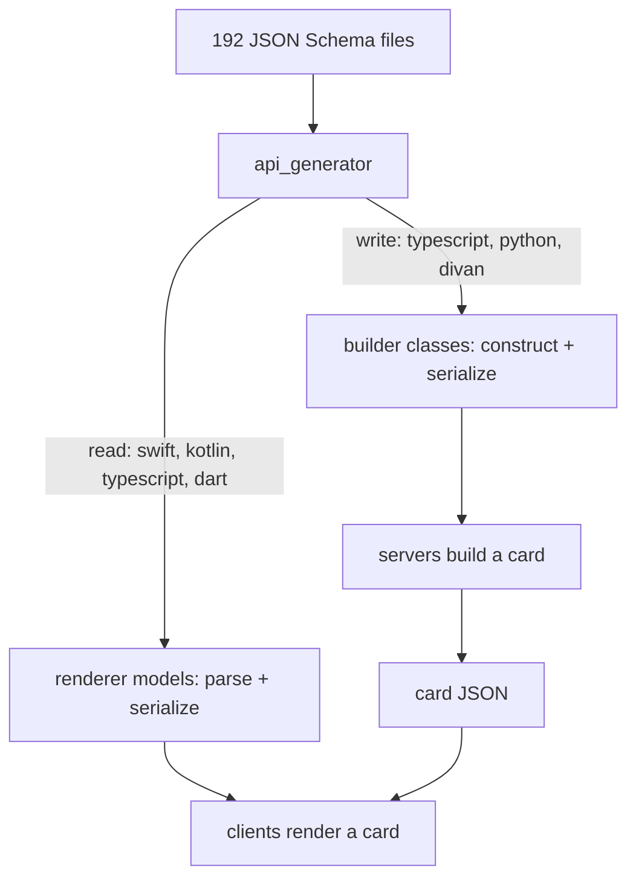
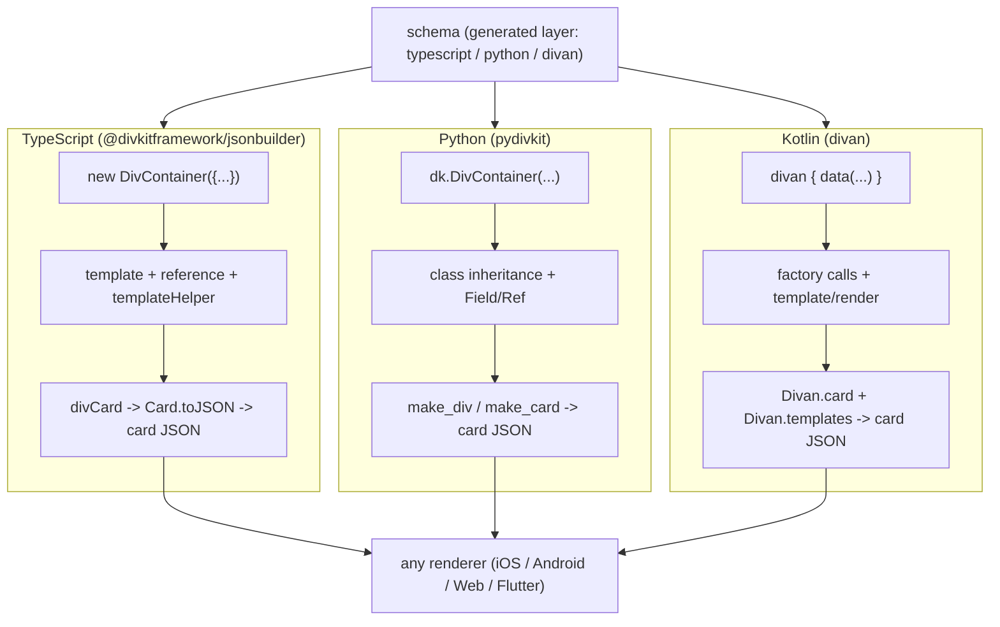

# 16 -- The JSON builders: the schema compiled in the other direction

Every document so far has followed the *read* direction: the schema generates
the models a renderer uses to parse a card and draw it. The `json-builder`
libraries are the *write* direction. They are server-side libraries that build
the card JSON from typed objects, so a backend can construct a DivKit card the
way it constructs any other data, and the schema's type system catches a bad
card before it ever reaches a device. There are three of them, one per common
backend language — TypeScript, Python, and Kotlin — and all three are produced
by the same `api_generator` as the renderer models, just with a different
`lang` that changes what the generated code *does*: instead of "parse JSON into
a model and serialize it back", it is "construct a model and serialize it to
JSON".

# One generator, two directions

`api_generator` reads the 192 schema files from
[09-schema.md](./09-schema.md) and can emit for six languages. Four are the
renderer models from [08-codegen.md](./08-codegen.md): `swift`, `kotlin`,
`typescript`, and `dart`, each generating classes with a parser and a
serializer. The other two are builder languages: `python` and `divan` (the
Kotlin DSL). And the `typescript` renderer language doubles as a builder
language — the TypeScript builder reuses the same generated element classes but
adds a hand-written template layer on top. So the three builders are:

| Builder | Language | Generated layer (`lang`) | Package |
|---|---|---|---|
| `@divkitframework/jsonbuilder` | TypeScript | `typescript` | `json-builder/typescript` |
| `pydivkit` | Python | `python` | `json-builder/python` |
| `divan` | Kotlin | `divan` | `json-builder/kotlin` |

Each builder is two layers. The **generated** layer is the schema types
re-shaped into builder classes: a constructor per element, a field per property,
a `dict()`/`toJSON`/serializer per class. The **hand-written** layer is the
machinery the schema does not describe: templates, references, expressions, and
the DSL sugar. The split is visible in the directories — the Kotlin builder has
`divan-dsl/src/generated/` (generated, `Text.kt`, `Input.kt`, `Transform.kt`)
next to `divan-dsl/src/main/` (hand-written, `Divan.kt`, `Template.kt`,
`Component.kt`), and the TypeScript builder generates `src/generated/` at build
time next to the hand-written `template.ts` and `div-utils.ts`.



# The TypeScript builder: classes plus a template helper

The TypeScript builder, `@divkitframework/jsonbuilder`, builds a card by
instantiating generated classes (`DivContainer`, `DivText`, `DivImage`) and
wrapping them in `divCard`. The template layer is the interesting part, because
templates are the DivKit deduplication mechanism from
[02-div-format.md](./02-div-format.md), and the builder must produce the
`$`-prefixed field references the format uses:

```ts
// divkit/json-builder/typescript/README.md (excerpt — the whole idea)
import { divCard, DivContainer, DivText, reference, rewriteRefs, template, templateHelper } from '@divkitframework/jsonbuilder';

const templates = {
  sampleBlock: new DivContainer({
    items: [
      template('header', { text: reference('title') }),
      template('header', { text: reference('subtitle') }),
    ],
  }),
  header: new DivText({ font_size: 24 }),
};

const tHelper = templateHelper(templates);

divCard(rewriteRefs(templates), {
  log_id: 'sample_card',
  states: [{ state_id: 0, div: tHelper.sampleBlock({ title: "Some Title", subtitle: "Some Subtitle" }) }],
});
```

The output is the exact `templates` + `card` envelope a renderer expects. A
`template('header', { text: reference('title') })` becomes a template reference
whose `$text` field names the template parameter; `tHelper.sampleBlock(...)` is
a *typed* function whose arguments are the template's parameters, so a missing
`title` is a compile error, not a broken card. `divCard(templates, card)`
returns a `Card` object whose `toJSON()` walks the tree and escapes expressions
(the `escapeCard` step in `template.ts`), converting booleans to the integer
`0`/`1` the Div format uses.

The generated classes are the same `DivText` and `DivContainer` the web client
renders, imported from `./generated` in `div-utils.ts`. The hand-written layer
adds the small constructors that make the classes ergonomic — `fixed(value)`,
`matchParent()`, `weighted(weight)`, `wrapContent()` — which map the Div size
system from [04-layout-and-size.md](./04-layout-and-size.md) onto
`DivFixedSize`, `DivMatchParentSize`, and `DivWrapContentSize`. The README is
explicit about what type safety does *not* cover: non-empty text, valid image
and action URLs, and non-empty arrays are the developer's responsibility, not
the type system's.

# The Python builder: objects, with templates via inheritance

`pydivkit` is the same idea in Python. The generated classes are `DivContainer`,
`DivText`, `DivGallery`, `DivSlider`, and so on; every object serializes with a
`dict()` method, and the whole card is a `DivData`:

```python
# divkit/json-builder/python/README.md (excerpt — object construction)
import pydivkit as dk

container = dk.DivContainer(
    items=[
        dk.DivGallery(
            items=[
                dk.DivText(text="Hello from pydivkit")
            ]
        )
    ]
)
```

The distinguishing feature of `pydivkit` is how it expresses templates. Instead
of a `template(...)` function, it uses Python class inheritance: subclass a
generated class, mark the parameterized fields with `dk.Field()`, and reference
them with `dk.Ref(...)`. A metaclass collects every such subclass into a
template registry at import time, and `dk.make_div(div)` assembles the
`templates` + `card` envelope:

```python
# divkit/json-builder/python/README.md (excerpt — templates via inheritance)
class CategoriesItem(dk.DivContainer):
    icon_url: str = dk.Field()
    text: str = dk.Field()

    width = dk.DivWrapContentSize()
    orientation = dk.DivContainerOrientation.HORIZONTAL
    items = [
        dk.DivImage(image_url=dk.Ref(icon_url), width=dk.DivFixedSize(value=20)),
        dk.DivText(text=dk.Ref(text), max_lines=1),
    ]

gallery = dk.DivGallery(items=[
    CategoriesItem(text="Food", icon_url=".../food.png"),
    CategoriesItem(text="Alcohol", icon_url=".../alcohol.png"),
])

print(json.dumps(dk.make_div(gallery), indent=1))
```

`make_div` produces the same `templates` + `card` shape, with the template named
`__main__.CategoriesItem` (the module plus class name, overridable with a
`__template_name__` attribute) and the card entries reduced to
`{ "type": "__main__.CategoriesItem", "icon_url": ..., "text": "Food" }`. The
`Field`/`Ref` pair is the Python spelling of the TypeScript
`reference`/`template` pair: a field is the declared parameter, a `Ref` is the
`$`-prefixed reference to it inside the template body. The generated `Div*`
classes live in `pydivkit/div/` (produced by `codegen.sh` from
`codegen_config.json`), while the infrastructure — `BaseEntity`, `BaseDiv`,
`Field`, `Ref`, `Expr`, `dump` — is the hand-written `pydivkit/core/`.

# The Kotlin builder: a DSL named divan

The Kotlin builder is a type-safe Kotlin DSL rather than object construction. Its
entry point is `divan { ... }`, and inside that scope every element is a factory
call — `text(...)`, `image(...)`, `column(...)`, `row(...)`, `stack(...)` — with
enum values inlined as plain words:

```kotlin
// divkit/json-builder/kotlin/README.md (excerpt — the DSL)
val divan = divan {
    data(
        logId = "my-layout-id",
        states = singleRoot(
            div = column(
                width = wrapContentSize(),
                height = wrapContentSize(),
                margins = edgeInsets(left = 10, right = 10, top = 5, bottom = 5),
                items = listOf(
                    text("Hello, world!", fontSize = 18),
                    image("https://my-image-link")
                )
            )
        )
    )
}
```

`divan { ... }` returns a `Divan` object with three fields: `card`, `templates`,
and `supplements`. `column`, `row`, and `stack` are shortcuts for `container`
with a fixed orientation, and `wrapContentSize()`, `matchParentSize()`,
`edgeInsets(...)`, and `solidBackground(...)` are the size/box helpers. The
factory calls are the generated layer (`lang: divan`, in
`divan-dsl/src/generated/`), and the DSL surface — the `DivScope`/`TemplateScope`
the factories hang off, plus `div + divProps` composition and `.override(...)` —
is the hand-written `Divan.kt`/`Component.kt`.

Templates use three pieces: a `reference` to declare a deferred property, a
`template` to build a `Template` whose body is a pure function, and `render` to
"bake" a template with bindings into a `Component`:

```kotlin
// divkit/json-builder/kotlin/README.md (excerpt — components)
private val titleRef = reference<String>("title")
private val headerTemplate = template("header-template") {
    text(fontWeight = bold, fontSize = 24, lineHeight = 28) + textRefs(text = titleRef)
}
fun DivScope.header(title: String) = render(headerTemplate, titleRef bind title)
```

Expressions and variables are first-class. `expression<T>` makes an evaluable
property, `.evaluate(alpha = "@{toNumber(alpha_var) / 255.0}")` attaches an
expression, and `integerVariable(name = "alpha_var", value = 0)` declares the
variable the expression reads. There is a separate `expression-dsl` module that
types the `@{...}` language itself — `Functions.kt`, `ArithmeticExpressions.kt`,
`CompareExpressions.kt`, `TernaryExpressions.kt` — so an expression is built as
a Kotlin object and only serialized to its string form at the end. A companion
`json-validator` package validates a finished card against the schema, and a
`legacy-json-builder` is the pre-DSL Kotlin builder, kept for compatibility.



# The Aha Moment

**Aha:** The builders are not a second, parallel API — they are the *same
codegen run in the opposite direction*. The renderer targets tell `api_generator`
"give me classes that parse this schema"; the builder targets tell it "give me
classes that *construct* this schema". The source of truth is identical in both
directions, which is why a `DivText` built in TypeScript, a `DivText` built in
Python, and a `text(...)` built in Kotlin all serialize to the exact JSON the
iOS and Android and web and Flutter renderers parse back into a `DivText` model.
The value the builders add over just writing JSON by hand is the schema itself:
a server author writes `new DivContainer({ items: [...] })` and the compiler
rejects a misspelled field, a wrong type, or a missing required property before
the card ships. DivKit's rule — "the schema is the single source of truth" — is
the same rule, twice: once to make reading a card safe, and once to make writing
a card safe.

# Cross-References

- The schema that all three builders compile, and the `codegen` blocks that steer them: [09-schema.md](./09-schema.md).
- The `api_generator` targets and how a `lang` changes the emitted code: [08-codegen.md](./08-codegen.md).
- The `templates` + `card` envelope and `$`-prefixed references the builders produce: [02-div-format.md](./02-div-format.md).
- The size system (`match_parent` / `wrap_content` / fixed) the builder helpers mirror: [04-layout-and-size.md](./04-layout-and-size.md).
- The `@{...}` expression language the `expression-dsl` module types: [06-variables-expressions.md](./06-variables-expressions.md).

Continue to [17-facade.md](./17-facade.md).
