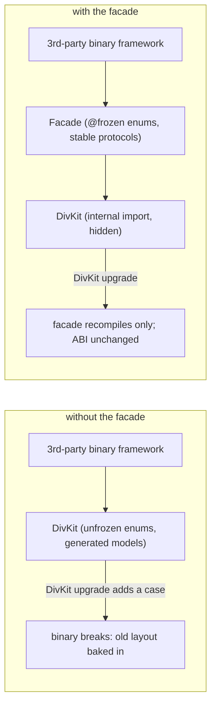
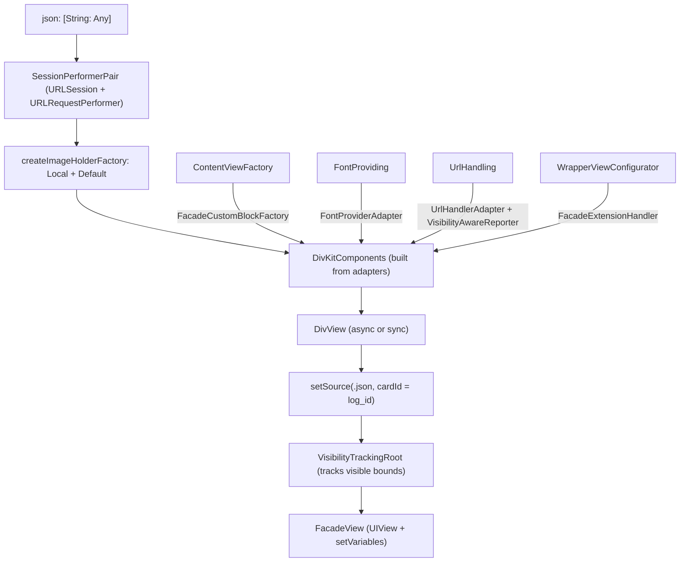

# 17 -- DivKitBinaryCompatibilityFacade: a stable ABI in front of DivKit

`divkit-ios-facade` is the smallest of the three repositories, and it exists for
one reason: Swift does not guarantee binary compatibility for a type that is not
`@frozen`, and DivKit's public types are not `@frozen`. A company that builds a
library *on top of* DivKit and ships that library as a binary framework (a
precompiled `.xcframework`, not source) is therefore fragile: if the host app
links a newer DivKit in which an enum gained a case or a struct changed layout,
the binary framework can break. `DivKitBinaryCompatibilityFacade` solves this by
putting a small, frozen-ABI wall in front of DivKit. Its public API exposes only
`@frozen` enums and Apple's own stable types; every DivKit type is hidden behind
an `internal import`, so the binary framework's ABI does not change when DivKit
does.

# The problem: Swift ABI and frozen types

Swift promises *source* compatibility across releases (old code recompiles), but
only *binary* compatibility for `@frozen` types (old compiled code keeps
working against new libraries). A non-frozen `enum` may add cases, and a
non-frozen `struct` may change its stored layout, in a later release. That is
fine for a framework shipped as source, because the compiler re-lays-out the
type. It is fatal for a framework shipped as a binary, because the precompiled
code already baked in the old layout and the old case count. DivKit is a normal
Swift library: its generated models and its enums (from
[08-codegen.md](./08-codegen.md)) are not `@frozen`, so a third party that
compiles against DivKit and distributes a binary framework inherits that
fragility. The facade is the standard answer: introduce a compatibility layer
whose public surface never changes, and confine the changing library behind it.



# The public surface: raw JSON in, a UIView out

The facade's whole public API is one function (two variants) and six small
protocols. `createView` takes raw JSON — not a `DivData` model — and returns a
`FacadeView`:

```swift
// divkit-ios-facade/DivKitBinaryCompatibilityFacade/DivKitBinaryCompatibilityFacade.swift (excerpt)
public protocol FacadeView: UIView {
  func setVariables(_ variables: [String: Any])
}

public enum DivKitFacade {
  public static func createView(
    json: [String: Any],
    localImageProvider: LocalImageProviding? = nil,
    fontProvider: FontProviding? = nil,
    customViewFactory: ContentViewFactory? = nil,
    wrapperConfigurators: [any WrapperViewConfigurator] = [],
    urlHandler: UrlHandling,
    urlSessionConfiguration: URLSessionConfiguration? = nil
  ) async -> FacadeView? { ... }

  public static func createViewSync( ... ) -> FacadeView? { ... }
}
```

`createView` is the async form (DivKit's `DivView` is created on the main actor);
`createViewSync` is the synchronous form for callers that are already on the main
thread. The parameters are all stable: `[String: Any]` for the card JSON,
`URLSessionConfiguration` for networking, and five optional protocols for the
host to plug in. The `FacadeView` it returns is a `UIView` with one extra
method, `setVariables`, which writes Div variables into the live card.

The six protocols are deliberately boring. Each exposes only Apple types
(`UIView`, `UIFont`, `UIColor`, `UIImage`, `URL`) and the facade's own frozen
enums:

```swift
// divkit-ios-facade/DivKitBinaryCompatibilityFacade/FontProviding.swift (excerpt)
@frozen
public enum FontWeight: String, CaseIterable {
  case light, medium, regular, bold
}
public protocol FontProviding {
  func font(family: String, weight: FontWeight, size: CGFloat) -> UIFont
}

// divkit-ios-facade/DivKitBinaryCompatibilityFacade/LocalImageProviding.swift (excerpt)
public protocol LocalImageProviding {
  func localImage(for url: URL) -> UIImage?
}

// divkit-ios-facade/DivKitBinaryCompatibilityFacade/ContentViewFactory.swift (whole file)
public protocol ContentViewFactory {
  func makeView(id: String, data: [String: Any]) -> UIView
}
```

The frozen enums are the point. `FontWeight` is `@frozen`, so its case list is
locked and a binary framework can compare `FontWeight.regular` without fear of a
future case. The same applies to `DivProperties`, the one value type the facade
exposes to custom views:

```swift
// divkit-ios-facade/DivKitBinaryCompatibilityFacade/DivProperties.swift (excerpt)
public class DivProperties {
  @frozen
  public enum AlignmentHorizontal { case left, center, right, start, end }

  @frozen
  public enum AlignmentVertical { case top, center, bottom, baseline }

  public class TextProperties {
    @frozen
    public enum FontWeight { case light, medium, regular, bold }
    public let fontSize: Int
    public let lineHeight: Int?
    public let fontFamily: String?
    public let textColor: UIColor
    ...
  }

  public let id: String?
  public let textProperties: DivProperties.TextProperties?
}
```

`DivProperties` is what a host's custom view receives: an `id` and, when the
wrapped Div element is a `div-text`, the resolved font size, line height, family,
weight, color, and alignment. The two alignment enums are `@frozen`, so the
facade's own ABI is stable.

# How it hides DivKit: internal import and adapters

The trick that keeps DivKit off the facade's public surface is the
`AccessLevelOnImport` experimental Swift feature, enabled in `Package.swift`.
Each file writes `internal import DivKit` (or `internal import LayoutKit` /
`internal import VGSL`), which imports those modules at the *internal* access
level. The facade can use DivKit's types freely in its own implementation, but
they never become part of the facade's public interface, because an
`internal import` cannot leak into `public` declarations. The facade's
`DivKitComponents` is assembled with a set of adapters, each of which converts a
host protocol into a DivKit protocol:

```swift
// divkit-ios-facade/DivKitBinaryCompatibilityFacade/DivKitBinaryCompatibilityFacade.swift (excerpt)
let divKitComponents = DivKitComponents(
  divCustomBlockFactory: customViewFactory.map(FacadeCustomBlockFactory.init),
  extensionHandlers: wrapperConfigurators.map(\.extensionHandler),
  fontProvider: fontProvider.map(FontProviderAdapter.init),
  imageHolderFactory: imageHolderFactory,
  requestPerformer: sessionPerformerPair.requestPerformer,
  reporter: VisibilityAwareReporter(urlHandler: urlHandler),
  urlHandler: UrlHandlerAdapter(handler: urlHandler)
)
```

Each adapter is a tiny class that bridges one protocol. `FontProviderAdapter`
wraps the host's `FontProviding` as a `DivFontProvider`, mapping the facade's
`FontWeight` to DivKit's `DivFontWeight`. `FacadeCustomBlockFactory` wraps the
host's `ContentViewFactory` as a `DivCustomBlockFactory`, turning a `div-custom`
element into a `GenericViewBlock` that renders the host's `UIView` (with a
`ViewCache` so a repeated custom view is built once, not per render).
`UrlHandlerAdapter` wraps `UrlHandling` as a `DivUrlHandler`, and
`VisibilityAwareReporter` is a `DivReporter` that forwards only the visibility
and disappear actions to the host's URL handler.

The image pipeline is built the same way. `createImageHolderFactory` wraps the
optional `LocalImageProviding` in a `LocalImageHolderFactory` that checks for a
local image first and falls back to a `DefaultImageHolderFactory`, which builds
a `RemoteImageHolder` over a `NetworkURLResourceRequester`. A `SessionPerformerPair`
owns the `URLSession` and its `URLRequestPerformer`, and carries a `Disposable`
that calls `urlSession.invalidateAndCancel()` when the card is disposed — the
facade handles the networking lifetime the host would otherwise have to manage.



# The view wiring

After `DivKitComponents` is built, `createView` creates the `DivView`, extracts
the card id from the JSON (`card.log_id`, the same `log_id` field from
[02-div-format.md](./02-div-format.md)), and calls `setSource` with a
`DivViewSource(kind: .json(json), cardId:)`. The `DivView` is then placed inside
a `VisibilityTrackingRoot`, a private `UIView` that the facade returns as the
`FacadeView`. That root does three jobs. It lays the `DivView` out to fill its
own bounds; it forwards visible-bounds changes (`onVisibleBoundsChanged`) to the
`DivView`, so Div's visibility actions still fire even though the facade owns
the container view; and it implements `setVariables` by appending the variables
to `divKitComponents.variablesStorage` under the card id:

```swift
// divkit-ios-facade/DivKitBinaryCompatibilityFacade/DivKitBinaryCompatibilityFacade.swift (excerpt)
extension VisibilityTrackingRoot: FacadeView {
  public func setVariables(_ variables: [String: Any]) {
    divKitComponents.variablesStorage.append(
      variables: variables.divVariables,
      for: divCardId
    )
  }
}
```

The `divVariables` helper maps the facade's raw Swift values (`String`, `Double`,
`Int`, `Bool`, `Color`, `URL`, `DivDictionary`, `DivArray`) onto DivKit's typed
`DivVariableValue`, which is exactly the variable mechanism from
[06-variables-expressions.md](./06-variables-expressions.md). So a host that
distributes a binary framework gets the full DivKit renderer — state, actions,
expressions, custom views, images — through a surface of frozen enums, raw JSON,
and a handful of one-method protocols.

# The Aha Moment

**Aha:** The facade is not a feature of DivKit; it is a *contract about
stability*, and the contract is enforced by Swift's own access control. DivKit's
power comes from its generated models and enums, and those are exactly the types
that are not `@frozen` — every schema change can change a layout. The facade
redraws the boundary: `@frozen` on every enum it exposes, `internal import
DivKit` on every file that uses DivKit, and a pile of one-method adapters to
convert between the stable surface and the unstable engine. A binary framework
that depends on the facade never sees a DivKit type, so a DivKit upgrade is the
facade's problem to recompile, not the framework's problem to crash. The whole
thing is twelve Swift files and one experimental compiler flag
(`AccessLevelOnImport`) — a small price to let third parties ship precompiled
DivKit libraries with confidence.

# Cross-References

- The generated models and enums whose instability motivates this facade: [08-codegen.md](./08-codegen.md).
- The `DivKitComponents` and `DivBlockModeling` pipeline the facade assembles and hides: [10-ios-architecture.md](./10-ios-architecture.md).
- The `LayoutKit` blocks (`GenericViewBlock`, `WrapperBlock`) the custom-view adapters produce: [11-layoutkit.md](./11-layoutkit.md).
- The `log_id`, `card`, and `@{}` variables the facade reads and writes: [02-div-format.md](./02-div-format.md) and [06-variables-expressions.md](./06-variables-expressions.md).

Continue to [18-tooling.md](./18-tooling.md).
