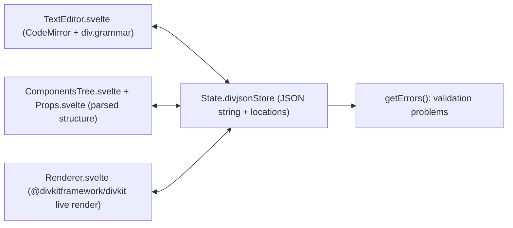
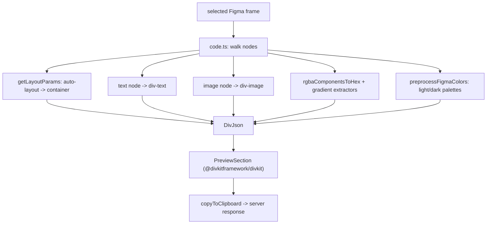

# 18 -- Tooling: editor, Figma plugin, and the compatibility matrix

The schema, the builders, and the renderers make Server-Driven UI *possible*.
Three tools make it *usable* day to day: a visual editor that authors a card and
shows a live render, a Figma plugin that turns a design into a card, and a
compatibility matrix that records which feature works on which platform since
which version. A fourth, hot reload, closes the developer loop. This document
reads each of them, all in the `divkit` repository under `visual-editor/`,
`figma-plugin/`, `compat_data/`, and `tools/hot_reload/`.

# The visual editor: code and preview in one screen

The visual editor is `@divkitframework/visual-editor`, a Svelte 5 component
built on two libraries the renderers already use: CodeMirror 6 (a code editor)
and `@divkitframework/divkit` (the web renderer from
[13-web-client.md](./13-web-client.md)). The public entry is one function:

```ts
// divkit/visual-editor/README.md (excerpt — the entry point)
import '@divkitframework/visual-editor/dist/divkit-editor.css';
import { DivProEditor } from '@divkitframework/visual-editor';

const instance = DivProEditor.init({
    renderTo: document.body,
    value: JSON.stringify({
        "card": {
            "log_id": "test",
            "states": [{ "state_id": 0, "div": {
                "type": "container", "orientation": "overlap",
                "items": [{ "type": "text", "text": "Hello world" }]
            }}]
        }
    })
});

instance.getValue();
```

`DivProEditor.init` returns an instance with `getValue()`, `getCard()`,
`getErrors()`, `setTheme`, `setLayout`, `setLocale`, `setReadOnly`,
`setCustomActions`, `setPaletteEnabled`, and `destroy`. The options (defined in
`visual-editor/src/lib.ts`) reveal what the editor is: a full card-authoring
surface, not just a JSON box. It accepts `extensions` (custom `DivExtensionClass`
values), `customComponents`, a column-based `layout` (panels named
`component-tree`, `palette`, `preview`, `component-props`, `code`, `timers`,
`custom-variables`, `sources-overview`, `tanker-overview`), `cardLocales` for
translation, `customActions`, a `palette` for light/dark colors, `sources`,
`fileLimits`, `customFontFaces`, a `direction` (left-to-right or right-to-left),
`safeAreaEmulation`, a `viewportList` of screen sizes, and `imageConversion`.

The internals are one Svelte store with two renderings of it. A `State` object
holds a `divjsonStore` — the card's JSON string *with source locations* (the
`stringifyWithLoc` utility) — plus the theme, palette, actions, and variables.
Every panel reads and writes that one store: the code panel (`TextEditor.svelte`)
edits the string through CodeMirror; the component tree (`ComponentsTree.svelte`)
and property inspectors (`Props.svelte`, `InplaceEditor.svelte`) edit the parsed
structure; and the preview (`Renderer.svelte`, the largest component at 159
kilobytes) renders the current store with the DivKit renderer. Editing any one
of them writes the store, and the other two re-derive. The `getErrors` method
returns the list of validation problems, so a broken card is flagged as it is
typed.

The code editor is not plain JSON. `src/lib/grammar/div.grammar` is a Lezer
grammar (compiled by `lezer-generator` at build time) that teaches CodeMirror
Div's structure, so autocomplete, lint, and syntax highlighting know the DivKit
schema — the same schema from [09-schema.md](./09-schema.md), but here it feeds
an editor instead of a code generator.



# The Figma plugin: a design becomes a card

The Figma plugin is `divkit-figma-plugin`, named "DivKit Layout Builder". Its
manifest declares the two halves every Figma plugin has — a `code.js` running in
the Figma document and a `ui.html` running in the plugin window:

```json
// divkit/figma-plugin/manifest.json (whole file)
{
  "name": "DivKit Layout Builder",
  "id": "1159051827053749482",
  "api": "1.0.0",
  "main": "./dist/code.js",
  "ui": "./dist/ui.html",
  "editorType": ["figma"],
  "enablePrivatePluginApi": true
}
```

The main-thread code (`src/code.ts`, 40 kilobytes) is a Figma-to-DivKit
translator. It walks the selected Figma nodes and maps each one to a Div element:
an auto-layout frame becomes a `div-container` (its `layoutMode` and
`primaryAxisAlignItems` become `orientation` and `content_alignment` via
`getLayoutParams.ts` and the `valueMaps` constants), a text node becomes a
`div-text` (its font, size, and color become the text style), an image node
becomes a `div-image` (`checkIsImageNode.ts`), and a line becomes a
`div-separator`. Colors go through `rgbaComponentsToHex`; gradients go through
`extractLinearGradientParamsFromTransform` and
`extractRadialOrDiamondGradientParams`; and `shouldSkipContainer.ts` flattens a
Figma frame that has no visual reason to become a container. The result is a
`DivJson` object typed by `src/types/divkit.d.ts`.

Two details show the plugin is built for real products. First, light and dark
themes: `preprocessFigmaColors` reads Figma color styles whose names carry a
light or dark prefix (configured in `figma.clientStorage`), so one Figma frame
produces a card with both a `light` and a `dark` palette. Second, the plugin
window (the Svelte `views/` — `App.svelte`, `MainSection`, `PreviewSection`,
`SettingsSection`, `ErrorsSection`) previews the generated card with
`@divkitframework/divkit` before the designer copies the JSON to a clipboard
(`copyToClipboard.ts`). So the loop is: design in Figma, preview the exact card
in the plugin, copy the JSON into a server response.



# The compatibility matrix: one contract, four schedules

The schema says a card *is* `div-text` with `auto_ellipsize`, `font_weight`, and
so on, but the four renderers did not implement every field at the same time.
`compat_data/` records that reality. It is 28 JSON files, one per feature area
(`div-text.json`, `div-image.json`, `actions.json`, `expressions.json`,
`methods.json`, `extensions.json`, `rtl.json`, and one `div-*.json` per
element). Each file is a list of `features`, and each feature carries a `compat`
map from platform to the version that added it:

```json
// divkit/compat_data/div-text.json (excerpt — one feature)
{
  "id": "text_auto_ellipsize",
  "name": "Text <code>auto_ellipsize</code> property",
  "compat": {
    "android": { "version_added": "1.0.0" },
    "web":     { "version_added": "29.2.0" },
    "flutter": { "version_added": "0.1.0" },
    "ios":     { "version_added": "31.3.0", "notes": "Default value is true" }
  }
}
```

The skew is the data. `auto_ellipsize` shipped on Android at `1.0.0` and on
Flutter at `0.1.0`, but on iOS only at `31.3.0`, and with a different default.
The `svg` image format shipped on the web at `1.0.0`, on Android at `30.0.0`,
and on iOS at `32.3.1`. A server team that writes a card must know these
differences, and the matrix is where they live.

The format also records partial implementations and deprecations. A `compat`
value can be an array instead of an object, when a feature was half-supported in
one version and finished in a later one:

```json
// divkit/compat_data/methods.json (excerpt — array form, partial then full)
{
  "id": "methods",
  "name": "Methods basic support",
  "compat": {
    "ios": [
      {
        "version_added": "29.14.0",
        "partial_implementation": true,
        "notes": "It does not support methods for intermediate values..."
      },
      { "version_added": "29.15.0" }
    ],
    "web":     { "version_added": "29.15.0" },
    "android": { "version_added": "30.0.0" }
  }
}
```

A feature can also carry a `status` block — `div-text.json` records that the
`truncate` property was "deprecated, and then lost this status and was
re-implemented." The matrix is therefore three things at once: a changelog of
which platform learned which feature, a set of notes about behavioral
differences (defaults, partial support), and the source of truth for the
compatibility tables on the documentation site in `site/`.

# Hot reload: edit a card live

The last tool, `tools/hot_reload/`, closes the loop for a developer. It starts a
local server and a bidirectional channel between the host editor and a running
DivKit client; editing the card's JSON on the host updates the card on the
device without rebuilding the app. The client must first enable its debug panel
(`DivConfiguration.Builder(...).enablePermanentDebugPanel(true)` on Android),
toggle "Hot Reload", and then `./run.sh` opens the live card in the editor. The
server either serves an existing layout file or receives the current layout from
the client and reflects edits back. It is a development convenience, but it
shares the same idea as the editor and the plugin: the card is JSON, so any tool
that can read and write JSON can be a DivKit tool.

# The Aha Moment

**Aha:** The tooling is the honest completion of the schema's promise. The
schema claims "one JSON, native views everywhere"; the renderers make that claim
true; but they do not make it true at the same moment. The compatibility matrix
is the admission of that: `auto_ellipsize` at `1.0.0` on Android and `31.3.0`
on iOS, the `svg` format at `1.0.0` on web and `32.3.1` on iOS. DivKit treats
platform drift not as a secret but as *data* — a checked-in JSON file per
feature area, consumed by the docs, so a server author can answer "can my users
see this?" with a version number instead of a guess. And the two authoring tools
both reduce to the same principle as the builders in
[16-json-builder.md](./16-json-builder.md): a card is just JSON, so a
CodeMirror editor with a Lezer grammar can author it, a Figma plugin can emit it
from a design, and a Svelte renderer can preview it — all four sharing one
format and one renderer.

# Cross-References

- The web renderer (`@divkitframework/divkit`) that powers both the editor and the plugin preview: [13-web-client.md](./13-web-client.md).
- The schema that the Lezer grammar and the Figma translator compile from: [09-schema.md](./09-schema.md).
- The builders that share the "a card is JSON" principle with these tools: [16-json-builder.md](./16-json-builder.md).
- The `div-container`, `div-text`, and `div-image` elements the Figma plugin maps Figma nodes onto: [03-elements.md](./03-elements.md).

Continue to [19-data-flow.md](./19-data-flow.md).
