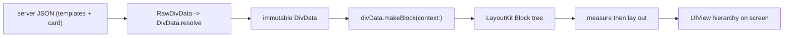
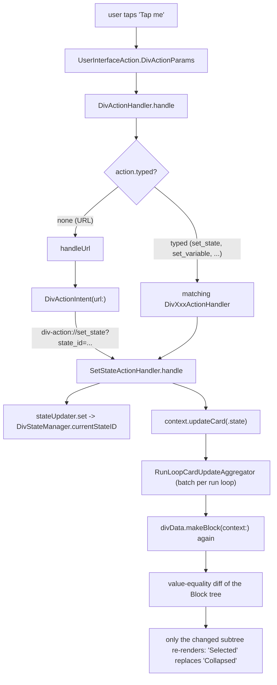

# 19 -- One card end to end: JSON to a tap, a tap to a re-render

Every earlier document covered one layer. This document threads them together:
one concrete card, followed from the server's JSON all the way through the iOS
renderer, one user tap, and the state change and re-render that tap causes. The
other three clients run the same contract, so the iOS path stands in for all of
them. The rule the whole trace rests on is the one from
[12-ios-rendering.md](./12-ios-rendering.md): **a card is immutable data, and
every change is a new `DivData`**.

# The card on the wire

A server sends this card. It has one `div-data` state (`state_id: 0`), a text
that says "Tap me", and a `div-state` named `detail` with two internal states.
The text carries a URL action that switches `detail` to its `selected` state:

```json
{
  "templates": {},
  "card": {
    "log_id": "demo_card",
    "states": [
      {
        "state_id": 0,
        "div": {
          "type": "container",
          "orientation": "vertical",
          "items": [
            {
              "type": "text",
              "text": "Tap me",
              "actions": [
                { "log_id": "open_detail", "url": "div-action://set_state?state_id=0/detail/selected" }
              ]
            },
            {
              "type": "state",
              "id": "detail",
              "states": [
                { "state_id": "collapsed", "div": { "type": "text", "text": "Collapsed" } },
                { "state_id": "selected",  "div": { "type": "text", "text": "Selected" } }
              ]
            }
          ]
        }
      }
    ]
  }
}
```

The path `0/detail/selected` names the target: div-data state `0`, then the
`div-state` whose `id` is `detail`, then the internal state `selected`. That is
the state-path notation from [05-actions-and-state.md](./05-actions-and-state.md).

# Parse: JSON becomes a DivData

The card enters through the serialization layer from
[12-ios-rendering.md](./12-ios-rendering.md). `RawDivData` separates the two
top-level keys, `templates` and `card`; `DivData.resolve(card:templates:)` then
parses the `card` into a `DivData` tree, applying any templates. The generated
`DivAction` model parses the `div-action://...` string as an ordinary URL — it
is not special at parse time. The result is an immutable `DivData`: a `log_id`,
a list of `states`, and a tree of `Div` models with the tap action attached to
the text's `actions` array.

# Model: DivData becomes a block tree and a view

`DivKitComponents` hands the `DivData` to a `DivBlockProvider`, which calls
`divData.makeBlock(context:)`. That modeling pass walks the `Div` tree and turns
it into `LayoutKit` `Block` objects (from [11-layoutkit.md](./11-layoutkit.md)):
the `div-container` becomes a `ContainerBlock`, the `div-text` a `TextBlock`,
and the `div-state` a `StateBlock` that, given the current state id, models only
one of its two child branches. The `Block` tree then runs the two-pass
measure-then-layout and produces the `UIView` hierarchy on screen — the container
with "Tap me" above, and "Collapsed" (the `div-state`'s first state) below.



# Tap: the action dispatch

When the user taps "Tap me", the text view reports a `UserInterfaceAction` with
a `DivActionParams` — the action's JSON, the element's `UIElementPath`, and the
source (a tap). `DivActionHandler.handle(params:sender:)` receives it, parses
the action into a `DivActionBase`, builds an `ExpressionResolver` for the card
(so any `@{...}` in the action's parameters is resolved), and checks
`action.resolveIsEnabled`. Then it looks at `action.typed`:

```swift
// divkit-ios/DivKit/Actions/DivActionHandler.swift (excerpt — the dispatch)
switch action.typed {
case let .divActionSetState(action):
  setStateActionHandler.handle(action, context: context)
case let .divActionSetVariable(action):
  setVariableActionHandler.handle(action, context: context)
// ... the other typed actions ...
case .divActionCustom:
  customActionHandler?.handle(context: context, sender: sender)
case .none:
  handleUrl(action, context: context, sender: sender)
}
```

Our tap has no typed action — its JSON is just a `url` string — so `action.typed`
is `.none` and it falls through to `handleUrl`. That is the fork in the road:
every DivKit action is either a *typed* action (one of the 25 from
[05-actions-and-state.md](./05-actions-and-state.md), dispatched to its own
handler) or a *URL* action, which is either a `div-action://` intent or an
external URL handed to the host.

# The URL intent: div-action becomes set_state

`handleUrl` takes the URL and asks `DivActionIntent` whether it is a built-in
intent. `DivActionIntent` recognizes the `div-action` scheme and switches on the
URL's host:

```swift
// divkit-ios/DivKit/Actions/DivActionIntent.swift (excerpt — the scheme and set_state)
static let scheme = "div-action"

init?(url: URL) {
  guard url.scheme == Self.scheme else { return nil }
  switch url.host {
  case "set_state":
    guard let divStatePath = url.divStatePath else { return nil }
    self = .setState(divStatePath: divStatePath, lifetime: url.lifetime)
  case "set_variable":
    guard let variable = url.variableInfo else { return nil }
    self = .setVariable(name: variable.name, value: variable.value)
  // ... set_current_item, show_tooltip, download, scroll_*, timer, video, ...
  default: return nil
  }
}
```

The host is `set_state`, and the `state_id` query parameter (`0/detail/selected`)
is parsed into a `DivStatePath`. The intent is `.setState(divStatePath:,
lifetime:)`. Back in `handleUrl`, that intent is dispatched to the same
`SetStateActionHandler` a typed `set_state` would use — so the URL action and
the typed action converge on one implementation.

# State change: write the state, then ask for a re-render

`SetStateActionHandler.handle` does two things. It resolves the path (handling
the tooltip-relative namespace, which is a detail a bare `0/...` path does not
hit), asks the state updater to change the state, and then signals a card
update:

```swift
// divkit-ios/DivKit/Actions/SetStateActionHandler.swift (excerpt — the effect)
let fullStatePath: DivStatePath = ...  // resolve tooltip-relative vs absolute
stateUpdater.set(
  path: fullStatePath,
  cardId: cardId,
  lifetime: lifetime
)
context.updateCard(.state(cardId))
```

`stateUpdater` (a `DivStateUpdater`, backed by `DivStateManager`) records the
new current state at that path. `DivStateManager` holds, per `DivStatePath`, an
`Item` with a `currentStateID` and a `previousState` — the `previousState` is
kept only so the `div-state` can run its transition animation between the old
and new branch:

```swift
// divkit-ios/DivKit/States/DivStateManager.swift (excerpt — the stored state)
public struct Item: Equatable {
  public let currentStateID: DivStateID
  public let previousState: PreviousState  // .empty / .initial / .withID(...)
}
```

Crucially, `SetStateActionHandler` does not touch the view. It writes the new
state id into the state manager and calls `context.updateCard(.state(cardId))`.
That call is the whole re-render request — a `DivCardUpdateReason`, not a view
mutation.

# Re-render: batched, and a new tree

`updateCard(.state(cardId))` goes into `RunLoopCardUpdateAggregator`, the
batching layer from [12-ios-rendering.md](./12-ios-rendering.md). It collects
every reason in the current run-loop turn, merges them, and flushes once — so
three `set_state` taps in one frame become one re-render, not three. The flush
re-runs `divData.makeBlock(context:)`. This time, the `StateBlock` for `detail`
reads its current state from `DivStateManager` and models the `selected` branch
instead of `collapsed`. The new `Block` tree is compared against the old one
(value equality, from [11-layoutkit.md](./11-layoutkit.md)); only the changed
subtree re-lays-out and re-renders, and the text "Selected" replaces
"Collapsed".



# The other two ways a card changes

A tap is one trigger. The same `updateCard` reason is produced by the other
mutation paths. A `set_variable` action writes to `DivVariablesStorage` and
signals `.variable`; a server patch is applied as a new `DivData` and signals
`.patch`; a timer tick and an external signal each signal their own reason. All
of them converge on the same line — `context.updateCard(.reason)` — and the same
consequence: the `DivData`/state/variables change, and the `makeBlock` pipeline
re-runs to produce a new tree and a new view. The `div-action://` URL scheme is
not a special networking layer; it is an *internal* command line, a
query-string-encoded action that travels inside the same JSON as the text it
sits next to.

# The Aha Moment

**Aha:** A tap does not change the view; it changes the data, and the view is
recomputed. Every piece of machinery in the chain is a translator into the same
conclusion. The tap becomes a `DivActionParams`; the URL becomes a
`DivActionIntent`; the intent becomes a `SetStateActionHandler` call; that call
writes one field (`currentStateID`) in a `DivStateManager` and emits one reason
(`updateCard(.state)`); the reason is batched and flushed; and the flush re-runs
the *same* `makeBlock` function that rendered the card in the first place, this
time reading the new state id. There is no imperative "change this view's text"
anywhere — the action handler's one job is to translate a tap into (a) a
mutation of some store and (b) a `DivCardUpdateReason`, and the renderer is a
pure function from data to view, run again. That is why the same card that can
be tapped can also be patched, re-serialized, and preloaded without a separate
code path for any of them.

# Cross-References

- The `DivData`/`makeBlock` pipeline and the modeling seam: [10-ios-architecture.md](./10-ios-architecture.md).
- The measure-then-layout pass and value equality that make the re-render incremental: [11-layoutkit.md](./11-layoutkit.md).
- The serialization and patch layers that parse the card and batch the update reasons: [12-ios-rendering.md](./12-ios-rendering.md).
- The state-path notation, typed actions, and `div-action://` scheme: [05-actions-and-state.md](./05-actions-and-state.md).

Continue to [20-cross-cutting.md](./20-cross-cutting.md).
