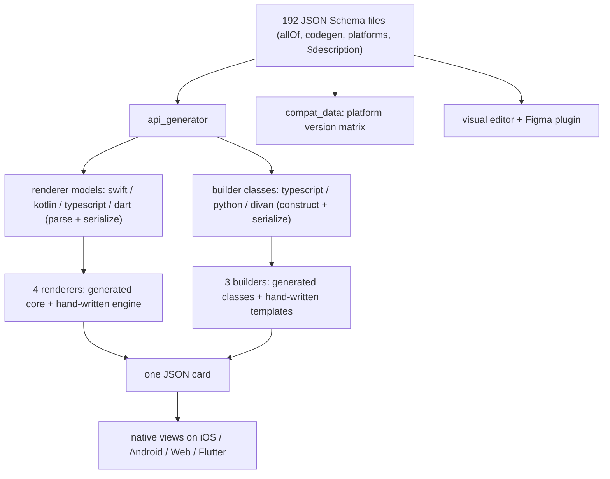
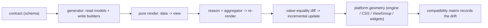

# 20 -- Cross-cutting: the idioms, the production concerns, and the recipe

The twenty-one documents before this one covered DivKit layer by layer. This
document steps back and names the patterns that repeat across every layer, then
the production concerns those patterns serve, then the recipe for building a
Server-Driven UI engine from first principles. It is a map of the territory, not
new territory.

# Idiom 1: the schema is the single source of truth

Every piece of DivKit — the four renderers, the three builders, the editor, the
Figma plugin, the compatibility matrix — traces back to `divkit/schema/`, the
192 JSON Schema files. That is not a slogan; it is an engineering decision
encoded in the files themselves. A schema is *composed*, not written whole:
`div-text.json` is a thin wrapper whose `allOf` pulls in `div-base.json`,
`div-actionable.json`, and `div-font-base.json`, then adds its own properties:

```json
// divkit/schema/div-text.json (excerpt — composition and per-platform steering)
{
  "allOf": [
    { "$ref": "div-base.json" },
    { "$ref": "div-actionable.json" },
    { "$ref": "div-font-base.json" },
    {
      "properties": {
        "type": { "type": "string", "enum": ["text"] },
        "auto_ellipsize": {
          "$ref": "common.json#/boolean_int",
          "platforms": ["android", "ios", "web", "flutter"]
        },
        "truncate": {
          "type": "string",
          "enum": ["none", "start", "end", "middle"],
          "default_value": "end",
          "platforms": ["android", "ios"],
          "unsupported_platforms": { "web": "There is no css implementation for this." }
        }
      }
    }
  ]
}
```

Three details here are the whole trick. A property can declare its `platforms`
(the renderers that support it) and its `unsupported_platforms` *with a reason*,
so the contract honestly records where each platform stands — that is the same
information `compat_data/` later turns into versioned tables. A property's
`$description` is not inline prose but a pointer
(`"translations.json#/div_text_truncate"`), so the documentation is localized
separately from the structure. And a separate `codegen` block steers each
language's generator — `div-base.json` says
`"swift": { "super_protocol": "DivBlockModeling" }` and `div-text.json` says
`"divan": { "forced_properties_order": ["text"] }` — so one schema, not four,
drives four renderer models and three builder languages.

# Idiom 2: immutable data, pure render, value equality

The runtime idiom is one line, stated in
[12-ios-rendering.md](./12-ios-rendering.md): a card is immutable data, and
every change is a new `DivData`. The renderer is a pure function from data to a
view, run again on every change. Two consequences follow. First, updates are
not mutations of a live tree but *reasons* — a `DivCardUpdateReason` — that
trigger a re-model; the `RunLoopCardUpdateAggregator` batches the reasons per
run loop, and `makeBlock` runs again. Second, re-renders are incremental because
the modeled `Block` tree compares by value, so an unchanged subtree reuses its
old block and view. The size system is the distilled form of the same idea: Div's
three size concepts collapse into one enum, and every behavior is a function of
which case a block carries:

```swift
// divkit-ios/LayoutKit/LayoutKit/Blocks/LayoutTrait.swift (excerpt — three cases, one enum)
public enum LayoutTrait: Equatable {
  case fixed(CGFloat)
  case intrinsic(constrained: Bool, minSize: CGFloat, maxSize: CGFloat)
  case weighted(Weight, minSize: CGFloat = 0, maxSize: CGFloat = .infinity)
}
```

# Idiom 3: a generated core, a hand-written adapter

DivKit never generates the whole program. It generates the *contract* — the
models, the serializers, the builder classes — and writes by hand the machinery
that has no schema. The renderers split into a generated model layer and a
hand-written engine (`DivKit` + `LayoutKit` on iOS, `Root.svelte` on the web,
`DivBinder`/`DivViewCreator` on Android). The builders split the same way: the
`divan`/`typescript`/`python` codegen targets produce the element classes, and
`template.ts`, `fields.py`, and `Divan.kt` are hand-written. Even the facade
from [17-facade.md](./17-facade.md) is a hand-written adapter around a generated
core, with `@frozen` enums and `internal import DivKit` drawing the boundary.
The invariant is always: *generate the part that mirrors the schema exactly,
hand-write the part that is judgment.*

# Idiom 4: hand geometry to the platform

The four renderers all honor one JSON contract, but none of them re-implements
layout when its platform already has one. iOS builds a hand-written engine,
`LayoutKit`, because `UIView` gives it no flexbox. The web compiles Div's size
and alignment fields to CSS flexbox and lets the browser do the arithmetic.
Android uses the platform's `ViewGroup` and `LayoutParams`, spending its own
code on view recycling and binding instead. Flutter ports the renderer to Dart
widgets, and the Kotlin Multiplatform client does not port at all — it embeds
each native renderer behind a shared Compose DSL. The lesson is not "reuse
whatever the platform has"; it is that *the contract is what must match, not the
machinery*.

# Idiom 5: one dispatcher, two kinds of action

Every action, on every client, funnels through one dispatcher that asks a single
question: is this a *typed* action or a *URL* action? The URL `div-action://`
scheme is an internal command line — `set_state`, `set_variable`,
`set_current_item`, `show_tooltip`, `download` — parsed by `DivActionIntent`:

```swift
// divkit-ios/DivKit/Actions/DivActionIntent.swift (excerpt — the internal command line)
static let scheme = "div-action"

init?(url: URL) {
  guard url.scheme == Self.scheme else { return nil }
  switch url.host {
  case "set_state": ... ; case "set_variable": ... ; case "download": ... ; ...
  default: return nil
  }
}
```

A typed `set_state` and a `div-action://set_state?state_id=...` URL both land in
the same `SetStateActionHandler`, because the URL is just a query-string encoding
of the same action. That is why the action layer can serialize a typed action
into a URL and back (the round-trip from
[12-ios-rendering.md](./12-ios-rendering.md)): the two forms are the same
thing, in different clothes.



# The production concerns

The idioms exist to serve concrete production needs, and DivKit addresses each
one explicitly rather than by luck:

- **Batching** — `RunLoopCardUpdateAggregator` merges many reasons into one
  re-render per run loop, so ten variable writes become one pass.
- **Recycling** — Android's `ViewPool` and the gallery's `RecyclerView` avoid
  allocating a view per item; iOS's value-equality diff avoids re-laying-out an
  unchanged subtree.
- **Caching and preloading** — the iOS image holder factory layers asset, cache,
  and in-memory caching, and `DivDataResourcesPreloader` fetches a card's images
  before the first frame asks for them.
- **Tolerance** — `ParsingContext` collects warnings instead of throwing, so a
  card with one bad field still renders; the compatibility matrix records
  partial implementations and different defaults so a server author knows what
  each platform will actually do.
- **ABI stability** — `DivKitBinaryCompatibilityFacade` freezes the public
  surface so third parties can ship binary frameworks against DivKit.
- **Latency** — the whole SDUI model exists to move UI change off the app-store
  release cadence and onto the server, so a card is changed by publishing JSON,
  not by shipping an app.

# Building an SDUI engine from first principles

Stripped to its skeleton, DivKit is six steps, and a team that builds its own
SDUI engine will rediscover each one:

1. **Write the contract as data.** Choose a schema language whose files can be
   composed (`allOf`) and annotated with per-platform support. The schema is the
   product; everything else compiles from it.
2. **Generate readers and writers from the same contract.** One generator, two
   directions: model classes that parse and serialize (renderers), and builder
   classes or DSLs that construct (servers). Never hand-write both.
3. **Make the renderer a pure function.** Card data in, view out. No mutation of
   a live tree; every change is a new data value.
4. **Turn every change into a reason, then batch.** Actions, timers, patches,
   and variables all emit a reason; a per-run-loop aggregator flushes them as
   one re-render.
5. **Diff by value for incremental updates.** Modeled nodes compare by value, so
   an unchanged subtree reuses its view and only the delta re-lays-out.
6. **Hand geometry to the platform, and record the drift.** Use each platform's
   layout system where one exists, write an engine only where it does not, and
   keep a compatibility matrix of which feature landed on which platform in
   which version.



# The Aha Moment

**Aha:** DivKit's depth is not in any one algorithm; it is in a single decision
made consistently everywhere — *the contract is data, and everything else is a
compiler, a pure function, or a reason.* The schema is data, so it can be
compiled into six languages and read by an editor and a Figma plugin. A card is
data, so the renderer is a pure function and re-rendering is just calling it
again. A change is a reason, so updates can be batched and diffed. A URL action
is a query string, so `div-action://set_state?state_id=0/detail/selected` is a
typed action in disguise. The four clients differ wildly — Swift and Kotlin and
Svelte and Dart — but they agree on the one thing that matters, because it is
the one thing that is shared: the JSON. Build the contract, generate both
directions, render purely, update by reason, and the rest is platform detail.

# Cross-References

- The schema's composition, `codegen` blocks, and `translations.json` in detail: [09-schema.md](./09-schema.md).
- The generator's two directions (renderer models and builders): [08-codegen.md](./08-codegen.md) and [16-json-builder.md](./16-json-builder.md).
- The pure-render + reason-based update loop, end to end: [19-data-flow.md](./19-data-flow.md) and [12-ios-rendering.md](./12-ios-rendering.md).
- The platform-leaning geometry of the four clients: [11-layoutkit.md](./11-layoutkit.md), [13-web-client.md](./13-web-client.md), [14-android-client.md](./14-android-client.md), [15-flutter-kmp.md](./15-flutter-kmp.md).
- The compatibility matrix that records platform drift: [18-tooling.md](./18-tooling.md).

Continue to [21-rendering-and-patch.md](./21-rendering-and-patch.md).
