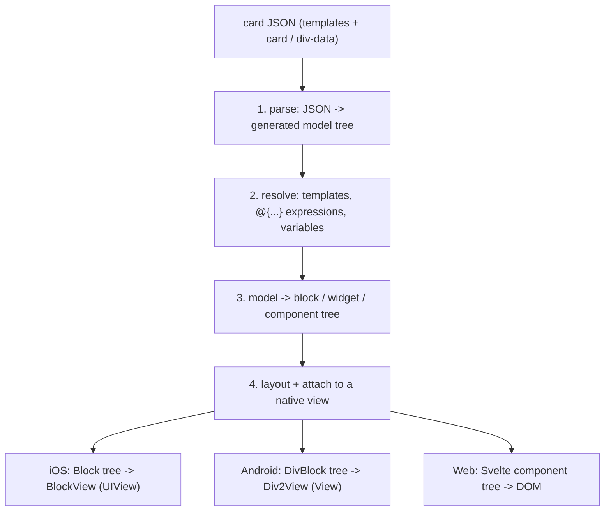

# 21 -- Rendering and Patch: from JSON to a view, and how a fragment updates it

Every document before this one explains one layer. This document joins two
layers into one continuous trace, because they are one mechanism on every
platform. First: how a JSON card becomes a view, stage by stage. Second: how a
fragment — a *patch* — reaches an already-rendered card and changes only the
part it names, without rebuilding the whole tree. The three renderers (iOS,
Android, Web) answer the same two questions with different machinery, and the
differences are the interesting part. This document reads the exact source of
each answer.

# The pipeline, once, with three endings

A card travels the same four stages on every platform. The first two stages are
shared in spirit; the last two are where the platforms diverge:



Stage 1 and stage 2 are identical in idea because the schema from
[09-schema.md](./09-schema.md) is the single source of truth: all three parsers
are generated from the same 192 JSON Schema files, so they all turn `div-data`
into a tree of element models, all resolve the `templates` envelope from
[02-div-format.md](./02-div-format.md), and all bind `@{}` expressions from
[06-variables-expressions.md](./06-variables-expressions.md) to a per-path
variable store.

The divergence starts at stage 3, and it is deliberate (the idiom from
[20-cross-cutting.md](./20-cross-cutting.md): hand geometry to the platform).
iOS has no flexbox in `UIView`, so it compiles the model into its own
`LayoutKit` `Block` tree, then into `BlockView`. Android has `ViewGroup` and
`LayoutParams`, so it compiles the model into a `DivBlock` tree and binds it
onto recycled platform views. The web compiles the model into Svelte components
and lets CSS flexbox do the arithmetic.

The iOS stage-3 source is the seam from
[10-ios-architecture.md](./10-ios-architecture.md):

```swift
// divkit-ios/DivKit/DivBlockModeling.swift (whole file)
public protocol DivBlockModeling {
  var id: String? { get }
  static var type: String { get }
  func makeBlock(context: DivBlockModelingContext) throws -> Block
}
```

`DivData.makeBlock(context:)` walks the resolved model and returns a `Block`
tree; `DivView.update(block:)` then turns that tree into a `BlockView`. The
Android stage-3 equivalent is a visitor that creates or reuses a native view:

```kotlin
// divkit/client/android/div/.../core/view2/DivViewCreator.kt (excerpt — create)
fun create(div: Div, resolver: ExpressionResolver): View {
    return if (validator.validate(div, resolver)) {
        visit(div, resolver).apply { background = NoOpDrawable }
    } else {
        Space(context)
    }
}

override fun defaultVisit(data: Div, resolver: ExpressionResolver): View =
    viewPool.obtain(viewTag(data, resolver))
```

`defaultVisit` does not construct a view; it asks a `ViewPool` for one, keyed by
a per-element-type tag. That is the first optimization, and it runs on the very
first render, not just on update.

# The patch: one contract, three engines

A patch is not a diff. It is a list of *id-keyed subtree replacements*. The
server names an element by its `id` and supplies the new subtree that takes its
place. The shape is the same on all three platforms because it is generated
from one schema, `div-patch.json`. On iOS the generated model is:

```swift
// divkit-ios/DivKit/generated_sources/DivPatch.swift (excerpt — the contract)
public final class DivPatch: Sendable {
  @frozen
  public enum Mode: String, CaseIterable, Sendable {
    case transactional = "transactional"
    case partial = "partial"
  }
  public final class Change: Sendable {
    public let id: String
    public let items: [Div]?
  }
  public let changes: [Change] // at least 1 elements
  public let mode: Expression<Mode> // default value: partial
  public let onAppliedActions: [DivAction]?
  public let onFailedActions: [DivAction]?
}
```

The same contract in the web client is a TypeScript interface:

```ts
// divkit/client/web/divkit/typings/common.d.ts (excerpt — the contract)
export interface PatchChange {
    id: string;
    items?: DivBase[];
}
export interface Patch {
    templates?: Record<string, DivBase>;
    patch: {
        mode?: 'transactional' | 'partial';
        changes: PatchChange[];
        on_applied_actions?: Action[];
        on_failed_actions?: Action[];
    };
}
```

Two details matter for the whole document. `mode` picks the semantics: in
`partial` mode every change that finds its target applies and the rest are
silently skipped; in `transactional` mode the patch is all-or-nothing — it
applies only if *every* change finds a valid target, otherwise it runs
`on_failed_actions` and changes nothing. And `on_applied_actions` /
`on_failed_actions` are themselves actions, so a patch can chain further
behavior after it succeeds or fails.

Every renderer applies this by *rewriting the data*, not by mutating a live
view. The three-tier pattern is: (1) produce a new immutable model tree where
only the changed branches are new, (2) decide whether the change is small enough
to keep the existing views, and (3) reconfigure or recycle the surviving views
in place. The rest of this document walks those three tiers on each platform.

# Tier 1 — the immutable rewrite

## iOS

The patch is applied to `DivData`, producing a new `DivData`. The entry point
is `applyPatchWithActions`, which records which element ids actually changed so
it can run the right callback and reset the changed elements' triggers:

```swift
// divkit-ios/DivKit/Extensions/DivData/DivDataPatchExtensions.swift (excerpt)
public func applyPatchWithActions(
  _ patch: DivPatch,
  context: DivBlockModelingContext
) -> DivData {
  var changedElementIds: [String] = []
  let callbacks = Callbacks(elementChanged: { id in changedElementIds.append(id) })
  let patchedData = applyPatch(patch, callbacks: callbacks)

  let allChangesApplied = changedElementIds.count == patch.changes.count
  let isTransactional = patch.resolveMode(context.expressionResolver) == .transactional
  let isPatchApplied = !isTransactional || allChangesApplied

  if isPatchApplied {
    for id in changedElementIds {
      context.triggersStorage?.reset(elementId: id)
    }
  }
  let actions = isPatchApplied ? patch.onAppliedActions : patch.onFailedActions
  actions?.forEach { action in
    context.actionHandler?.handle(action, path: ..., source: .callback, sender: nil)
  }
  return isPatchApplied ? patchedData : self
}
```

The rewrite itself is a recursive walk with three per-shape rules. A *leaf*
element (text, image, input, and the others with no children) either matches the
patch id and returns the single replacement item, or returns itself unchanged.
A *list* element (container, grid, gallery, pager) splices matched children
out of its `items`. A *state* or *tabs* element rewrites its nested states or
tab bodies. The key line for the data-level optimization is that an unchanged
branch returns `self` — the same element instance. The generated element models
(`DivContainer`, `DivText`, and the rest) are classes
(`public final class DivContainer: DivBase`), so the unchanged sub-trees are
*shared references*, not copies:

```swift
// divkit-ios/DivKit/Extensions/DivData/DivDataPatchExtensions.swift (excerpt)
fileprivate func applySingleItemPatch(_ patch: DivPatch, callbacks: DivPatchCallbacks) -> Div {
  if let id, let change = patch.getChange(id: id) {
    guard let items = change.items, items.count == 1 else {
      DivKitLogger.error("Patch contains multiple items, but single item is expected: \(id)")
      return self
    }
    callbacks.elementChanged(id)
    return items[0]
  }
  return applyPatchToChildren(patch, callbacks: callbacks)
}
```

## Android

Android applies the patch at the same data level, but keeps a *copies map* so
that repeated patching does not re-parse the same unchanged branches. The
`DivPatchApply` class walks the generated `Div` tree, matches by id through a
`DivPatchMap`, and returns either a new `List<DivData.State>` or `null` when a
transactional patch could not be fully applied:

```kotlin
// divkit/client/android/div-data/.../internal/patch/DivPatchApply.kt (excerpt)
private fun Div.applyPatch(resolver: ExpressionResolver): List<Div> {
    val divId = value().id
    if (divId != null && patch.patches.containsKey(divId)) return applyPatchForSingleDiv()

    val previousApplicationCount = applicationCount
    val updated = when (this) {
        is Div.Container -> applyPatch(value, resolver)
        is Div.Grid -> applyPatch(value, resolver)
        is Div.Gallery -> applyPatch(value, resolver)
        is Div.Pager -> applyPatch(value, resolver)
        is Div.State -> applyPatch(value, resolver)
        is Div.Tabs -> applyPatch(value, resolver)
        is Div.Custom -> applyPatch(value, resolver)
        is Div.GifImage, is Div.Image, /* ... leaves ... */ is Div.Video -> this
    }
    if (applicationCount == previousApplicationCount) return listOf(this)
    copies[value()] = updated.value()
    return listOf(updated)
}
```

The `copies: MutableMap<DivBase, DivBase>` records which old branches map to
which new ones, so the framework can release the old and retain the new without
walking the whole tree again. `DivPatchMap` is the id index — a flat
`Map<String, List<Div>>` built once from `patch.changes`, so every id lookup in
the walk is O(1).

The transactional gate is at the top of the walk:

```kotlin
// divkit/client/android/div-data/.../internal/patch/DivPatchApply.kt (excerpt)
if (patch.mode.evaluate(resolver) == DivPatch.Mode.TRANSACTIONAL
    && appliedPatches.size != patch.patches.size) {
    return null
}
```

## Web

The web has no persistent model tree to rewrite. Its "data" is the reactive
state of a Svelte component tree, so the rewrite is a targeted mutation of one
component's local `items` store. The engine keeps `parentOfMap`, an index from
an element `id` to the *parent* component's mutation methods:

```ts
// divkit/client/web/divkit/src/components/Root.svelte (excerpt — the index)
const parentOfMap: Map<string, ParentMethods> = new Map();

function registerParentOf(id: string, methods: ParentMethods): void {
    parentOfMap.set(id, methods);
}
```

`ParentMethods` is two members — `replaceWith` and `isSingleMode` — declared in
`src/context/root.ts`. Each container-ish component (`Outer.svelte`) registers
every child id it owns, so the patch applies as a flat lookup:

```ts
// divkit/client/web/divkit/src/components/Root.svelte (excerpt — applyPatchInternal)
json.patch.changes.forEach(change => {
    const methods = parentOfMap.get(change.id);
    if (methods) {
        methods.replaceWith(change.id, change.items);
    }
});
execAnyActions(json.patch?.on_applied_actions);
```

# Tier 2 — the replaceable gate

The second tier is the decision: can the existing views survive the change, or
must the subtree be rebuilt? All three renderers ask this by comparing the old
model to the new model, and the comparison is *value equality*, not identity.

## iOS: `canConfigureBlockView` and `isBestViewForReuse`

iOS does not diff two `DivData` trees. It re-models the whole patched `DivData`
into a fresh `Block` tree, and relies on two facts: `Block` is an
`AnyObject`-constrained protocol that exposes structural equality through
`equals(_:)`, and each `BlockView`
remembers the `Block` that produced it. The gate runs when the new `Block` tree
meets the existing `BlockView` tree, in `DivView.update(block:)`:

```swift
// divkit-ios/DivKit/Views/DivView.swift (excerpt — the gate)
if let blockView, block.canConfigureBlockView(blockView) {
  block.configureBlockView(blockView, observer: self, ...)
} else {
  blockView = block.makeBlockView(observer: self, renderingDelegate: renderingDelegate)
}
```

`canConfigureBlockView` is a type check: a `ContainerBlock` can reconfigure a
`ContainerBlockView`, a `TextBlock` can reconfigure a `TextBlockView`, and so
on. The recursive version of the same gate lives in `LayoutKit`, in
`Array+UIViewRenderable.swift`, and is the real engine of incremental re-render:

```swift
// divkit-ios/LayoutKit/LayoutKit/UI/Blocks/Array+UIViewRenderable.swift (excerpt)
private func calculateReusability(
  _ views: [BlockView],
  blocks: [UIViewRenderable]
) -> ReuseResult {
  var orphanViews = views
  var reusableViews = [Int: BlockView](minimumCapacity: blocks.count)
  for (blockIndex, block) in blocks.enumerated() {
    let reusableView = orphanViews.enumerated()
      .first { block.isBestViewForReuse($0.element) }
    if let (viewIndex, view) = reusableView {
      orphanViews.remove(at: viewIndex)
      reusableViews[blockIndex] = view
    }
  }
  // ... second pass uses canConfigureBlockView for same-type reuse ...
}
```

Two passes, two strengths of match. `isBestViewForReuse` is the strong match:
in `DecoratingBlock` it compares the view's previous source block to the new
block by value (`sourceBlock == self`), so a view whose block did not change is
reused without any reconfiguration. The second pass falls back to
`canConfigureBlockView` (same type, so the view can be reconfigured). Any view
that matches neither is removed from its superview. This is why a patch that
changes one text field reconfigures one `TextBlockView` and leaves every
sibling `BlockView` untouched.

## Android: `DivComparator` and `propertiesHash`

Android has two gates at two levels of ambition. The cheap gate,
`DivComparator.areDivsReplaceable`, decides whether the *whole* new `DivBlock`
tree is structurally replaceable by the old one — same Java class, same
overlap/wrap flags, same child count recursively:

```kotlin
// divkit/client/android/div/.../core/view2/animations/DivComparator.kt (excerpt)
fun areDivsReplaceable(
    old: DivBlock?,
    new: DivBlock?,
    reporter: DivComparatorReporter? = null,
): Boolean {
    if (old?.div?.javaClass != new?.div?.javaClass) {
        reporter?.onComparisonDifferentClasses()
        return false
    }
    if (old == null || new == null || old === new) {
        return true
    }
    return areValuesReplaceable(old, new, reporter) &&
        areChildrenReplaceable(extractChildren(old), extractChildren(new), reporter)
}
```

If it returns `true`, `DivViewBindingController` takes the *simple rebind* path:
it binds the new `DivBlock` onto the existing root view in place, without
touching the child views (`rebind` → `divBinder.bind(getChildAt(0),
newDivBlock, this)`). That is the Android analog of iOS reconfiguring a
`BlockView` in place.

If the gate fails but the feature flag is on, Android escalates to the *complex
rebind*, a true tree diff. Its equality is a hash: `Token.isCombinable` compares
`divHash == other.divHash && div.type == other.div.type`, where `divHash` is
`item.div.propertiesHash()`. Two divs with the same hash and type can share one
view, so the diff reuses an `ExistingToken` (an old view) for a `NewToken` (a
new subtree) instead of recreating it:

```kotlin
// divkit/client/android/div/.../core/view2/reuse/Token.kt (whole file)
internal abstract class Token(
    val item: DivBlock,
    val childIndex: Int,
) {
    val divHash: Int = item.div.propertiesHash()
    val div = item.div

    fun isCombinable(other: Token): Boolean {
        return divHash == other.divHash && div.type == other.div.type
    }
}
```

## Web: the id index

The web gate is the simplest because the index already did the work: the patch
applies only where `parentOfMap` holds the id. There is no tree comparison and
no hash. The only extra check is `isSingleMode`, which records that a parent
accepts exactly one replacement item (a single-slot element), so a patch that
supplies two items to a single-slot parent is rejected in transactional mode
before anything is mutated.

# Tier 3 — reconfigure, recycle, or recreate

The third tier is what actually happens to a view that survived the gate.

## iOS: reconfigure in place, or make a new view

`configureBlockView` writes the new model into the surviving view. The
`ContainerBlockView.configure` method is the canonical example: it checks
whether the model changed at all, and if it did, it reuses its child views via
the same `reused(with:)` pass, then re-runs layout:

```swift
// divkit-ios/LayoutKit/LayoutKit/UI/Blocks/ContainerBlock+UIViewRenderableBlock.swift (excerpt)
func configure(model: Model, observer: ..., overscrollDelegate: ..., renderingDelegate: ...) {
  guard model != modelAndLastLayoutSize.model || observer !== self.observer,
        !preventLayoutAndConfig
  else { return }

  applyAccessibilityFromScratch(model.accessibility)
  modelAndLastLayoutSize = (model: model, lastLayoutSize: nil)
  self.observer = observer
  ...
  preventLayoutAndConfig = true
  blockViews = blockViews.reused(
    with: model.children.map(\.content),
    attachTo: self,
    observer: observer,
    ...
  )
  preventLayoutAndConfig = false
  setNeedsLayout()
  ...
}
```

The guard `model != modelAndLastLayoutSize.model` is the last line of defense:
if the patch did not actually change this container's resolved properties, the
whole method returns early and nothing re-lays-out.

## Android: bind in place, recycle via the pool, release the removed

The simple rebind binds the new model onto the existing view, element by
element. The fast path inside `DivBinder.bind` skips the work entirely when the
complex-rebind pass already declared the node reusable:

```kotlin
// divkit/client/android/div/.../core/view2/DivBinder.kt (excerpt — the fast path)
fun bind(view: View, divBlock: DivBlock, divView: Div2View) = suppressExpressionErrors {
    divView.currentRebindReusableList?.pop(divBlock.div)?.let {
        return@suppressExpressionErrors
    }
    // ... per-type binder: bindText, bindImage, bindContainer, ...
}
```

The complex rebind (`RebindTaskImpl`) walks the old and new trees, pairs
combinable tokens, and classifies the result into five collections:
`bindingPoints` (nodes whose children changed, so they must be re-bound),
`idsToBind` (same id and class but changed values), `aloneExisting`,
`aloneNew`, and `aloneIds`. `rebind()` releases `aloneExisting` and `aloneIds`,
then binds `bindingPoints` and `idsToBind`:

```kotlin
// divkit/client/android/div/.../core/view2/reuse/RebindTask.kt (excerpt — rebind)
bindingPoints.forEach {
    if (bindingPoints.contains(it.parentToken)) return@forEach
    val divBlock = it.view.divBlock ?: return@forEach
    divBinder.bind(it.view, divBlock, div2View)
}
idsToBind.forEach {
    if (bindingPoints.contains(it.parentToken)) return@forEach
    val divBlock = it.view.divBlock ?: return@forEach
    divBinder.bind(it.view, divBlock, div2View)
}
```

Removed subtrees are released back to the `ViewPool`, which is the other half of
Android's optimization. `DivViewCreator.create` never constructs a view by hand
for the pooled types; it calls `viewPool.obtain(tag)`, and the pool keeps a
per-tag capacity (tunable via `ViewPreCreationProfile`) so a list can recycle
views instead of allocating them.

## Web: Svelte reactivity mutates one component

The web's tier 3 is Svelte 5's fine-grained reactivity. `Outer.svelte.replaceWith`
finds the target item in its local `parentOf` array, splices the new items into
a copy, and writes the copy back through `replaceItems`:

```ts
// divkit/client/web/divkit/src/components/utilities/Outer.svelte (excerpt — replaceWith)
function replaceWith(id: string, items?: DivBase[]): void {
    if (!Array.isArray(parentOf) || !replaceItems) return;

    if (parentOfSimpleMode) {
        const newItemsLen = Array.isArray(items) ? items.length : 0;
        if (newItemsLen !== 1) return;
    }

    const index = parentOf.findIndex(item => item?.id === id);
    const newItems = parentOf.slice();
    newItems.splice(index, 1, ...(items || [] as DivBase[]).map(it => ({
        json: it,
        id: it?.id as string | undefined
    })));

    parentOf = newItems;
    replaceItems(newItems.map(it => it?.json));
}
```

Writing `parentOf = newItems` (and calling `replaceItems`) invalidates only the
Svelte subscriptions that read that component's `items`. The unaffected
components are never re-rendered, because Svelte tracks dependencies per
component, not per tree. This is the web answer to iOS's `Block` value equality
and Android's `propertiesHash`: instead of diffing, it points the patch at one
component and lets the reactive runtime do the minimal re-render.

# When the patch lands: batching and threading

The last difference is *when* and *on which thread* the three tiers run.

iOS batches. A patch arrives as a `DivCardUpdateReason.patch`, and
`RunLoopCardUpdateAggregator` accumulates reasons and flushes them once per run
loop. Ten reasons in one frame become one re-model:

```swift
// divkit-ios/DivKit/RunLoopCardUpdateAggregator.swift (excerpt — the merge)
extension [DivCardUpdateReason] {
  fileprivate func merge() -> [DivCardUpdateReason] {
    var cards: [DivCardID: Set<DivVariableName>] = [:]
    let reasons: [DivCardUpdateReason] = compactMap {
      switch $0 {
      case let .variable(affectedCards):
        for (key, value) in affectedCards { cards[key] = cards[key]?.union(value) ?? value }
        return nil
      case .patch, .timer, .state, .external:
        return $0
      }
    }
    return reasons + (cards.isEmpty ? [] : [.variable(cards)])
  }
}
```

`DivBlockProvider.update(reasons:)` then consumes the batch, applies every
`.patch` for its card via `applyPatchWithActions`, and re-models once.

Android threads. Binding runs through a `BindingDispatcher` onto a background
binding thread, with a generation counter so a newer request cancels an older
one; `DivAsyncBindingController` wraps that in the `setDataAsync` /
`applyPatchAsync` API and reports binding phases. The dispatcher's
`MainThreadTaskPolicy` decides whether a concurrent update is deferred or
replaces the pending one (`DEFER` when the data is unchanged, `REPLACE` when a
new document arrived).

The web is synchronous. `applyPatch` mutates the Svelte store on the calling
thread, and Svelte schedules the resulting DOM updates in its own microtask
batch, so many synchronous mutations collapse into one DOM pass.

```mermaid
flowchart TB
    subgraph IOS["iOS (DivKit + LayoutKit)"]
        I1["DivPatch -> applyPatchWithActions"] --> I2["new DivData (unchanged branches shared)"]
        I2 --> I3["makeBlock -> new Block tree (classes, structural equality)"]
        I3 --> I4["canConfigureBlockView / isBestViewForReuse"]
        I4 -->|"match"| I5["configureBlockView in place"]
        I4 -->|"no match"| I6["makeBlockView + remove orphan"]
    end
    subgraph AND["Android (div-data + div)"]
        A1["DivPatchApply + DivPatchMap"] --> A2["new DivData (copies map)"]
        A2 --> A3["DivComparator.areDivsReplaceable"]
        A3 -->|"replaceable"| A4["rebind: DivBinder.bind in place"]
        A3 -->|"not"| A5["complexRebind: RebindTaskImpl token diff"]
        A5 --> A6["bindingPoints bound; rest reuse / ViewPool recycle"]
    end
    subgraph WEB["Web (Svelte)"]
        W1["applyPatchInternal"] --> W2["parentOfMap id -> ParentMethods"]
        W2 --> W3["Outer.svelte.replaceWith splices items"]
        W3 --> W4["Svelte fine-grained reactivity: one component re-renders"]
    end
```



# The Aha Moment

**Aha:** All three renderers optimize a patch with the *same three-tier recipe*,
and the recipe is independent of the platform's geometry. Tier one is an
*immutable rewrite*: a patch never mutates a live view; it produces a new model
tree where only the named branch is new (iOS shares the unchanged element
instances, Android keeps a `copies` map, the web splices one component's `items`
array).
Tier two is a *value-equality gate* that asks "can the old views survive?" (iOS
`canConfigureBlockView` / `isBestViewForReuse`, Android `DivComparator` and
`propertiesHash`, the web's `parentOfMap` id index). Tier three is
*reconfigure-or-recycle*: survivors are reconfigured in place, removed ones are
recycled, and only the changed nodes are rebuilt (iOS `configureBlockView`,
Android `DivBinder.bind` over the `ViewPool`, Svelte's per-component
reactivity). The reason DivKit ships the same optimization three times instead
of once is the same reason it exists at all: the *contract* — the JSON patch —
is portable, but the *machinery* that makes it fast is not. A server author
sends one `{ changes: [{ id, items }] }` document, and iOS, Android, and the web
each translate it into their own tier-one rewrite, tier-two gate, and tier-three
reconfigure, converging on the same outcome: a fragment updates only the part
of the screen it names.

# Cross-References

- The JSON-to-view pipeline on iOS, and the `DivBlockModeling` seam: [10-ios-architecture.md](./10-ios-architecture.md).
- The `Block`/`BlockView` value equality that tier two leans on: [11-layoutkit.md](./11-layoutkit.md).
- The patch/update path already sketched for iOS (images, preloading, reasons): [12-ios-rendering.md](./12-ios-rendering.md).
- The web `TYPE_MAP`, Svelte stores, and the React wrapper: [13-web-client.md](./13-web-client.md).
- The Android `DivViewCreator`/`DivBinder`/`ViewPool` and action dispatch: [14-android-client.md](./14-android-client.md).
- The immutable-data and reason-based update idioms this document instantiates: [20-cross-cutting.md](./20-cross-cutting.md).
- The schema that generates `DivPatch` and its `mode`/`changes` on every platform: [09-schema.md](./09-schema.md).

Continue to [22-web-rendering-hydration.md](./22-web-rendering-hydration.md).
