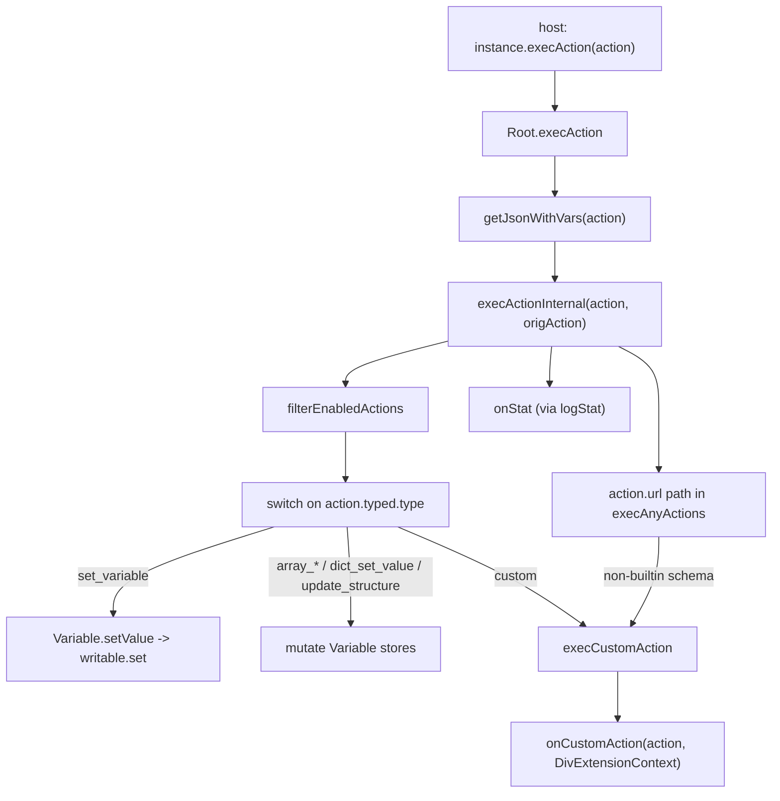

# 22 -- Web: rendering, hydration, and communication

This document explains the web client at the level of one host page. The host
writes HyperText Markup Language (HTML) on a server. The host then attaches the
DivKit web client to that HTML in a browser. This document covers three topics:
the three entry points, the server-to-client hand-off called hydration, and the
two-way communication between the host page and the card.

The web client is the Svelte renderer from
[13-web-client.md](./13-web-client.md). That document describes the renderer
and the React wrapper. This document does not repeat that. It traces the exact
code paths that the host page uses.

# The three entry points

The core package is `@divkitframework/divkit`. It has three entry files under
`client/web/divkit/src/`.

`client.ts` is the browser entry. It mounts a card into a live Document Object
Model (DOM) element. `server.ts` is the server entry. It renders a card to an
HTML string. `client-devtool.ts` is the debug entry. It returns the same handle
plus two functions that read the variable store.

All three share one Svelte component: `components/Root.svelte`. The entry files
differ only in the options they accept and the handle they return.

## client.ts -- the browser mount

The browser entry takes a `target` element, the card JSON (JavaScript Object
Notation), and an `id`. It constructs the Svelte `Root` component inside that
target. It returns a small handle. The handle is the only way the host talks to
the card:

```ts
// client/web/divkit/src/client.ts (excerpt)
const { target, hydrate, ...rest } = opts;

const instance = new Root({
    target: target,
    props: rest,
    hydrate: hydrate
});

return {
    $destroy() {
        instance.$destroy();
    },
    execAction(action) {
        instance.execAction(action);
    },
    setTheme(theme) {
        instance.setTheme(theme);
    },
    setData(newJson) {
        instance.setData(newJson);
    },
    applyPatch(patch: Patch) {
        return instance.applyPatch(patch);
    }
};
```

The handle has five methods. `$destroy` tears down the component. `execAction`
runs one action. `setTheme` switches the theme. `setData` replaces the whole
card. `applyPatch` applies one patch and returns a boolean.

The same file also exports the helper factories. It exports
`createGlobalVariablesController`, `createVariable`, `SizeProvider`, `Gesture`,
`lottieExtensionBuilder`, and `markdownExtensionBuilder`.

## server.ts -- the server-side render

The server entry has no target element. It returns a string:

```ts
// client/web/divkit/src/server.ts (excerpt)
// Root has client-side typings, not a server one
return (Root as any).render(opts).html;
```

`Root.render(opts)` is the Svelte server render. It returns an object with an
`html` property. The server entry returns only that string. The comment shows
why the cast exists: `Root.svelte` has client-side typing, but Svelte compiles
the same component to a server renderer too.

## client-devtool.ts -- the debug handle

The debug entry wraps the browser entry. Its handle extends the browser handle
with two extra methods, `getDebugVariables` and `getDebugAllVariables`. These
return the variable maps only when `process.env.DEVTOOL` is set. The debug
entry also exports `evalExpression`, `parseExpression`, and `functionNames`
for tooling that inspects expressions.

Two more files expose the entry points on the global object.
`client-globals.ts` sets `window.Ya.Divkit = window.Ya.DivKit = api` from
`client.ts`. `client-devtool-globals.ts` does the same from `client-devtool.ts`.

# Hydration: reusing server HTML

Hydration is the hand-off from `server.ts` to `client.ts`. The server produces
static HTML. The client reuses that HTML instead of building new DOM.

The `hydrate` option controls this. It is declared in the `render` options of
`client.ts` as `hydrate?: boolean`. It is passed straight to the Svelte
constructor:

```ts
new Root({
    target: target,
    props: rest,
    hydrate: hydrate
});
```

When `hydrate` is `true`, Svelte expects the target element to already contain
the server-rendered markup. Svelte adopts those existing DOM nodes. It attaches
event listeners and reactive subscriptions to them. It does not create new
nodes. When `hydrate` is `false` or omitted, Svelte creates fresh DOM inside the
target.

The flow is one line of shared contract:


For hydration to work, the server HTML and the client render must agree. The
host passes the same `json`, `id`, and provider options to both entries.

## The server-vs-client provider split

The two entries accept different option sets. The server entry accepts only
static, string-producing options. The client entry adds the interactive ones.

The server entry accepts: `json`, `id`, `globalVariablesController`, `mix`,
`customization`, `builtinProtocols`, `onError`, `typefaceProvider`, `platform`,
`theme`, `themeVariableName`, `customComponents`, `direction`, `store`,
`weekStartDay`, `pagerChildrenClipEnabled`, `videoPlayerProvider`.

The client entry adds: `hydrate`, `onStat`, `onCustomAction`, `onComponent`,
`extensions`, `fetchInit`, `tooltipRoot`, `pagerMouseDragEnabled`.

The split is deliberate. The server render is static. It has no callbacks for
statistics, custom actions, or component lifecycle. It has no extensions, no
`fetch` configuration, and no mouse drag flag.

The `videoPlayerProvider` prop has two different types. This is the clearest
example of the split. In `server.ts` it is `VideoPlayerProviderServer`:

```ts
// client/web/divkit/typings/common.d.ts (excerpt)
export interface VideoPlayerProviderServer {
    template: string | ((data: VideoPlayerProviderData) => string);
}

export interface VideoPlayerProviderClient {
    instance: (parent: HTMLElement, data: VideoPlayerProviderData) => VideoPlayerInstance | undefined | void;
}
```

On the server, the provider returns an HTML string or a function that produces
one. On the client, the provider returns a `VideoPlayerInstance` with `play`,
`pause`, `seek`, `update`, and `destroy`. The component `components/video/Video.svelte`
branches on `import.meta.env.SSR`. On the server it calls
`provider.template(data)` to get a string. On the client, in `onMount`, it calls
`provider.instance(parent, data)` to get a live player.

`pagerChildrenClipEnabled` is a boolean that both entries accept. It reaches the
pager through the context and sets `clip: rootCtx.pagerChildrenClipEnabled` in
`components/pager/Pager.svelte`. The host must pass the same value to both
entries, or the hydrated DOM will not match the server DOM.

`typefaceProvider` is a function `(fontFamily: string, opts?) => string`. It
maps a font family name to a concrete font. Both entries accept it, because a
font choice is part of the static markup. It flows through the context to text
styles in `utils/correctSliderTextStyle.ts` and `components/tabs/Tabs.svelte`.

# Communication

The host page and the card communicate in two directions. The host drives the
card through the `DivkitInstance` handle. The card reports back through the
callbacks the host passed in as options.

## The inbound handle: DivkitInstance

The full handle type is in `typings/common.d.ts`:

```ts
// client/web/divkit/typings/common.d.ts (excerpt)
export interface DivkitInstance {
    $destroy(): void;
    execAction(action: Action | VisibilityAction | DisappearAction): void;
    /** @deprecated */
    setTheme(theme: Theme): void;
    /** Experimental */
    setData(json: DivJson): void;
    applyPatch(patch: Patch): boolean;
}
```

`setTheme` is deprecated. `setData` is experimental. `$destroy`, `execAction`,
and `applyPatch` are the stable surface.

## The outbound callbacks

The host passes callbacks in the `render` options. They are all typed in
`typings/common.d.ts`:

- `onCustomAction` -- `CustomActionCallback` or `CustomActionCallbackWithTyped`.
  The callback receives the action and a `DivExtensionContext`.
- `onStat` -- `StatCallback`. It receives `{ type, action }`. It is called for
  every action that runs.
- `onError` -- `ErrorCallback`. It receives `{ error }` where `error` is a
  `WrappedError` with a `level` of `error` or `warn`.
- `onComponent` -- `ComponentCallback`. It receives `{ type, node, json,
  origJson, templateContext, componentContext, devapi }` on mount, update, and
  destroy of a component.
- `fetchInit` -- `RequestInit` or a function `(url) => RequestInit`. It
  configures the `fetch` call of a `download` action.

The old `CustomActionCallback` is deprecated. It forces a `url` field on the
action. `CustomActionCallbackWithTyped` drops that requirement.

## execAction to execActionInternal

The handle method `execAction` is a thin wrapper. In `Root.svelte` it resolves
the action's expressions and then dispatches:

```ts
// client/web/divkit/src/components/Root.svelte (excerpt)
export function execAction(action: MaybeMissing<Action | VisibilityAction | DisappearAction>): void {
    execActionInternal(getJsonWithVars(logError, action, undefined, true), action);
}
```

`getJsonWithVars` resolves every `@{...}` expression in the action against the
current variable store. `execActionInternal` then does the work. It first calls
`filterEnabledActions` to drop actions whose `is_enabled` is `0` or `false`. It
resolves the `scope_id` if present. Then it switches on `action.typed.type`.

Each typed action is one case. `set_variable` writes a `Variable` store.
`array_insert_value`, `array_remove_value`, and `array_set_value` call helpers
in `actions/array.ts`. `dict_set_value` calls `actions/dict.ts`.
`copy_to_clipboard` calls `actions/copyToClipboard.ts`. `update_structure`
calls `actions/updateStructure.ts`. `focus_element`, `animator_start`,
`show_tooltip`, `scroll_to`, `submit`, and the rest call their own handlers.



## How a custom action bubbles out

A custom action leaves the card in two ways. Both end in the same callback.

Way one is the typed action. The action has `typed: { type: 'custom' }`. The
switch case `custom` in `execActionInternal` calls `execCustomAction`.

Way two is the Uniform Resource Locator (URL) path. In `execAnyActions`, an action with a `url` that is not
a builtin schema (not `http`, `https`, `tel`, `mailto`, `intent`) and not the
`div-action` schema is treated as custom. It calls `execCustomAction` too.

`execCustomAction` is one line plus the call:

```ts
// client/web/divkit/src/components/Root.svelte (excerpt)
function execCustomAction(
    action: (Action | VisibilityAction) & { url: string },
    componentContext: ComponentContext | undefined
): void {
    onCustomAction?.(action, getExtensionContext(componentContext));
}
```

The optional call `onCustomAction?.` means the card is silent if the host did
not register the callback. When it is registered, the host receives the action
and a `DivExtensionContext`. The context gives the host `variables`, `direction`,
`processExpressions`, `derviedExpression`, `execAction`, `logError`, and
`getComponentProperty`. This lets the host read card state and run card actions
from inside its own handler.

The same `DivExtensionContext` is what a custom extension (`DivExtension`) gets
in its `mountView` and `updateView` hooks. One context type serves both the
extension application programming interface (API) and the outbound
custom-action callback.

# The expression and variable engine

The card binds data with `@{...}` expressions. The engine has two halves: a
parser and a reactive store. The parser turns expression text into an abstract
syntax tree (AST). The store makes the result re-evaluate when a variable
changes.

## Parsing with Peggy

The grammar is `client/web/divkit/src/expressions/expressions.peggy`. It is a
Parsing Expression Grammar (PEG). Peggy compiles it to a parser. The grammar has
two start rules. `start` parses a whole expression. `JsonStringContents` parses
interleaved text and `@{...}` blocks, which is how a card string uses the
syntax.

The grammar is precedence-climbing. `Expression` handles the ternary `?:`.
`Or` and `And` handle `||` and `&&`. `Equal` and `Comparison` handle equality
and ordering. `Try` handles the `!:` fallback operator. `Sum` and `Factor`
handle `+`, `-`, `*`, `/`, `%`. `UnaryExpression` handles `!`, `+`, `-`.
`Method` handles member calls like `value.getStringValue()`. `Call` handles
function calls like `getStringValue("x", 0)`.

`client.ts` never calls the parser directly. It calls `Root.svelte`, which calls
`prepareVars` in `expressions/json.ts`. That function walks the card JSON. For
every string it checks `hasExpressions`, which is:

```ts
// client/web/divkit/src/expressions/json.ts (excerpt)
function hasExpressions(str: string): boolean {
    return str.indexOf('@{') > -1 || str.indexOf('\\') > -1;
}
```

A string that contains `@{` is parsed with `parse(jsonProp, { startRule:
'JsonStringContents' })`. The result is wrapped in an `ExpressionBinding`. The
binding stores the AST and the original string. `gatherVarsFromAst` collects the
variable names the AST reads. Those names become the binding's dependencies.

`applyVars` then walks the prepared JSON. For each `ExpressionBinding` it calls
`evalExpression` in `expressions/eval.ts`. The evaluator resolves variables and
calls the built-in functions registered in `expressions/funcs/` (`std.ts`,
`math.ts`, `strings.ts`, `colors.ts`, `datetime.ts`, `array.ts`, `dict.ts`,
`stored.ts`, `trigonometry.ts`, `interval.ts`). The evaluator also returns a
`usedVars` set: the exact `Variable` instances that were read this time.

```mermaid
flowchart LR
    SRC["'@{getStringValue(\"x\", 0)}'"] --> HAS["hasExpressions: contains '@{'"]
    HAS --> PEG["parse(str, {startRule: 'JsonStringContents'})"]
    PEG --> BIND["ExpressionBinding(ast, str)"]
    BIND --> DEPS["gatherVarsFromAst -> names"]
    DEPS --> APPLY["applyVars -> evalExpression"]
    APPLY --> USED["usedVars: Set of Variable instances"]
    USED --> SUB["Variable.subscribe re-runs eval on change"]
```

## Variable: a reactive store

A `Variable` is in `expressions/variable.ts`. It is an abstract class with a
lazy Svelte `writable` store inside it. The store is created on the first
`subscribe`:

```ts
// client/web/divkit/src/expressions/variable.ts (excerpt)
subscribe(cb: Subscriber<ValueType>): Unsubscriber {
    if (!this.store) {
        this.store = writable(this.value);
    }

    return this.store.subscribe(cb);
}

setValue(val: ConvertedSetValue): void {
    const converted = this.convertValue(val);

    this.value = converted;

    if (this.store) {
        this.store.set(converted);
    }
}
```

`subscribe` registers a listener. `setValue` converts the value, stores it, and
notifies every listener through `store.set`. This is the whole reactivity
mechanism. A card string does not re-render. Its binding subscribes to the
variables it reads, and re-evaluates only when one of them calls `setValue`.

The concrete classes are `StringVariable`, `IntegerVariable`, `NumberVariable`,
`BooleanVariable`, `ColorVariable`, `UrlVariable`, `DictVariable`, and
`ArrayVariable`. `TYPE_TO_CLASS` maps each type name to its class.
`createVariable(name, type, value)` builds one. Each class validates and
converts its value type. `IntegerVariable` stores a `bigint`.
`BooleanVariable` accepts only `0`, `1`, `true`, or `false`.

The reactive loop lives in `Root.svelte` in `getDerivedFromVars`. For each
variable the expression reads, it calls `instance.subscribe(...)`. The callback
re-runs the evaluation. When an expression stops reading a variable, the
subscription is removed. The loop is per-component, not per-tree.

## GlobalVariablesController and Store

The host can own variables outside the card. The type is
`GlobalVariablesController` in `expressions/globalVariablesController.ts`:

```ts
// client/web/divkit/src/expressions/globalVariablesController.ts (excerpt)
export class GlobalVariablesController {
    private _vars: Map<string, Variable> = new Map();
    private _lastAddedVariable = writable('');

    setVariable(variable: Variable): void { ... }
    getVariable(variableName: string): Variable | undefined { ... }
    getVariables(): Map<string, Variable> { ... }
    getLastAddedVariableStore(): Readable<string> { ... }
}
```

`createGlobalVariablesController()` builds one. The host passes it into the
`render` options as `globalVariablesController`. `Root.svelte` merges these
global variables with the card's local variables into one `variables` map. It
subscribes to `getLastAddedVariableStore()`, so a variable added after mount is
picked up and wired into any expression that awaited it.

The local variables come from `json.card.variables`. `Root.svelte` builds them
with `declVariable` and stores them in `localVariables`. The merged map has
local variables taking precedence. A host-injected global variable of the same
name does not overwrite a local one.

`Store` is a separate persistence interface in `typings/store.d.ts`. The host
implements `get(name, type, scope?)` and `set(name, type, value, lifetime,
scope?)`. The card uses it for the `set_stored_value` typed action and for the
`getStored*Value` expression functions. The `lifetime` is in seconds. The old
`getValue` and `setValue` methods are deprecated.

# The TYPE_MAP dispatcher and O(1) patching

The renderer dispatches one JSON type name to one Svelte component. The map is
the whole registry:

```ts
// client/web/divkit/src/components/typeMap.ts (whole map)
export const TYPE_MAP: Record<string, ComponentType> = {
    text: Text,
    container: Container,
    separator: Separator,
    image: Image,
    gif: Image,
    grid: Grid,
    gallery: Gallery,
    tabs: Tabs,
    state: State,
    pager: Pager,
    indicator: Indicator,
    slider: Slider,
    input: Input,
    select: Select,
    video: Video,
    switch: Switch,
    custom: Custom
};
```

The map has 17 keys. `gif` is an alias: it maps to the same `Image` component as
`image`. So there are 17 JSON discriminators and 16 distinct components.

The dispatcher itself is `components/utilities/Unknown.svelte`. It reads
`TYPE_MAP[childJson.type]` and renders the result with
`<svelte:component this={component} />`. The name "Unknown" is the fallback: if
the type is not in the map, it logs "Unknown component" or "Recursive template".

Patching is covered in full in
[21-rendering-and-patch.md](./21-rendering-and-patch.md). The web half is one
index. `Root.svelte` keeps `parentOfMap`, a map from an element `id` to the
parent component's `ParentMethods`. `ParentMethods` is declared in
`context/root.ts` as `replaceWith(id, items?)` plus `isSingleMode`.

Each container component registers every child id it owns through
`registerParentOf`. The patch then applies as a flat lookup, without walking
the tree:

```ts
// client/web/divkit/src/components/Root.svelte (excerpt -- applyPatchInternal)
json.patch.changes.forEach(change => {
    const methods = parentOfMap.get(change.id);
    if (methods) {
        methods.replaceWith(change.id, change.items);
    }
});
execAnyActions(json.patch?.on_applied_actions);
```

The lookup `parentOfMap.get(change.id)` is constant time (O(1)). In
transactional mode, `applyPatchInternal` first checks every change: the id must
exist, and a single-slot parent must receive exactly one item. If any check
fails, it runs `on_failed_actions` and changes nothing.

# The Aha Moment

**Aha:** Hydration is the web client's answer to a problem the native clients do
not have. A native card renders directly onto a `UIView` or a `View`. There is
no intermediate string. The web card has two lifetimes: an HTML string that a
server sends, and a live Svelte component that a browser runs. The `hydrate`
flag joins the two. The server entry produces `Root.render(opts).html`. The
host writes that string into a DOM element. The client entry then mounts
`new Root({ target, hydrate: true })`, and Svelte adopts the existing nodes
instead of rebuilding them. The cost is a split provider surface: the server
accepts `VideoPlayerProviderServer` (a string template) while the client accepts
`VideoPlayerProviderClient` (a live player instance), because one runs where
only strings exist and the other runs where the DOM exists. The same card JSON
crosses that boundary unchanged. The communication surface is symmetric too:
five inbound methods on the handle (`$destroy`, `execAction`, `setTheme`,
`setData`, `applyPatch`) and five outbound callbacks (`onCustomAction`,
`onStat`, `onError`, `onComponent`, `fetchInit`). The contract is portable. The
machinery is not.

# Cross-References

- The Svelte renderer, the `TYPE_MAP` dispatcher, and the React wrapper:
  [13-web-client.md](./13-web-client.md).
- The full patch pipeline and how the web `parentOfMap`/`replaceWith` fits the
  three-tier recipe: [21-rendering-and-patch.md](./21-rendering-and-patch.md).
- The `@{...}` expression language and the `getXValue` functions:
  [06-variables-expressions.md](./06-variables-expressions.md).
- The typed actions the `execActionInternal` switch dispatches:
  [05-actions-and-state.md](./05-actions-and-state.md).
- The element discriminators that `TYPE_MAP` keys, including the `gif` alias:
  [03-elements.md](./03-elements.md).

Continue to [23-live-sync-sandbox.md](./23-live-sync-sandbox.md).
