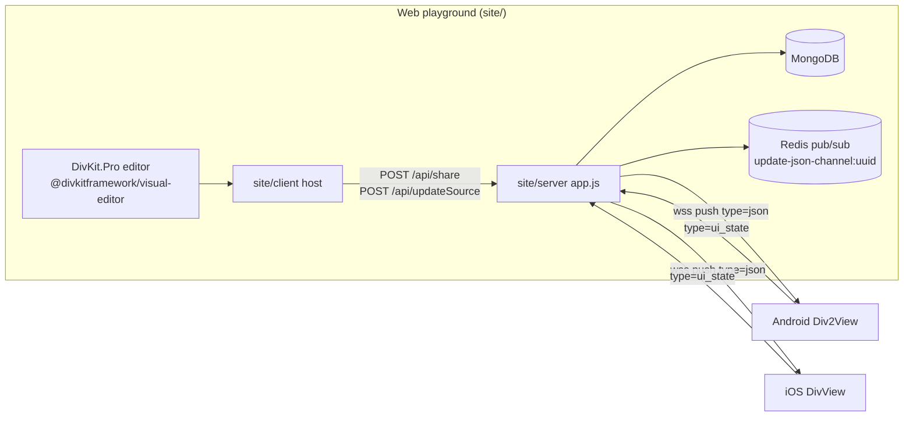
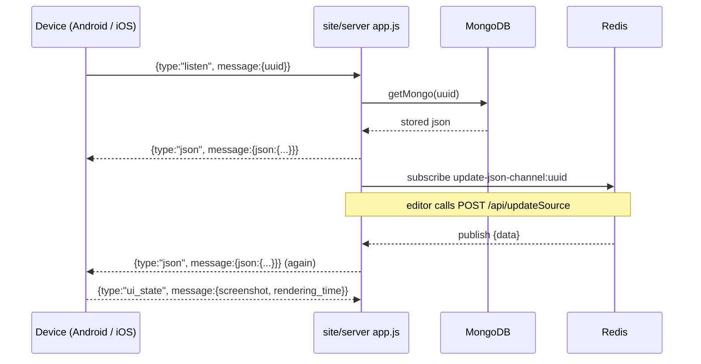

# 23 -- The Sandbox and Live Sync: one editor, two native renders

This document covers two parts of DivKit.

Part one is the sandbox. The sandbox is a web visual editor named DivKit.Pro.

Part two is live sync. Live sync is the path a card takes from the web editor to a native app over a WebSocket (WS).

The native apps are the Android demo app and the iOS playground.

The card is one JavaScript Object Notation (JSON) string. Three renderers show that same JSON:

- the web Document Object Model (DOM) renderer in the browser,
- the Android `Div2View`,
- the iOS `DivView`.

## 1. The sandbox: DivKit.Pro

The visual editor lives in `visual-editor/` at the repo root.

Its `package.json` declares the package `@divkitframework/visual-editor`, version `0.4.14`.

It is a Vite + Svelte web app:

- `visual-editor/vite.config.ts` registers the Svelte plugin and sets `server.host = true`.
- `visual-editor/svelte.config.js` uses `vitePreprocess()`.
- `visual-editor/index.html` has the title `DivKit.Pro` and loads `/src/dev.ts`.
- `visual-editor/src/dev.ts` mounts the editor and seeds it with a sample card.

Two build modes exist. `vite.config.ts` builds the dev app. `vite-lib.config.ts` builds the library. The library output is `dist/divkit-editor.js` and `dist/divkit-editor.css`. The library entry is `src/lib.ts`.

`src/lib.ts` exports the public entry `DivProEditor`. A host calls it like this:

```ts
const instance = DivProEditor.init({
    renderTo: document.body,
    value: JSON.stringify({
        "card": {
            "log_id": "test",
            "states": [{
                "state_id": 0,
                "div": {
                    "type": "container",
                    "orientation": "overlap",
                    "items": [{
                        "type": "text",
                        "text": "Hello world"
                    }]
                }
            }]
        }
    })
});
```

`DivProEditor.init` returns a `DivProEditorInstance`. Its main methods are `getValue()`, `getCard()`, `getErrors()`, and `setLayout()`.

The editor layout is a three-column `SplitView`. The default `layout` prop in
`src/App.svelte` is:

- column one: `new-component` and `component-tree`,
- column two: `preview`,
- column three: `component-props:code`.

The dev seed in `src/dev.ts` overrides column one with `new-component`,
`component-tree`, and `palette`.

The preview is `src/lib/components/Renderer.svelte`. It renders the card in the browser DOM. It calls `divkitRender` from `@divkitframework/divkit/client-devtool`. This is the same DivKit rendering engine that powers the web client. The `Renderer.svelte` file also implements drag, resize, rotate, and grid editing on top of the rendered DOM.

### The editor is only a front end

The `visual-editor/src` tree contains no WS server. It is a pure front end. A search for `WebSocket`, `wss://`, `messageListeners`, and `sendMessage` inside `visual-editor/src` returns nothing. The editor only produces card JSON and hands it to a host through `getValue()` or the `api.onChange` callback.

The actual host and relay live in `site/`. This directory is the "DivKit Web playground". Its client is `site/client`. Its server is `site/server`.

`site/client/src/components/Design.svelte` embeds the editor. It imports `DivProEditor` from `@divkitframework/visual-editor`. It wires the editor output into a shared store:

```ts
api: {
    onChange() {
        valueStore.set(instance.getValue());
    },
    ...
}
```

`site/client/src/data/editorModule.ts` does the import:

```ts
import '@divkitframework/visual-editor/dist/divkit-editor.css';
export { DivProEditor } from '@divkitframework/visual-editor';
```

So the chain is: DivKit.Pro editor -> `site/client` host -> `site/server` relay -> native apps.

The relay server is `site/server/app.js`. It uses Koa for HyperText Transfer Protocol (HTTP), the `ws` package for WS, MongoDB for storage, and Redis for publish/subscribe (pub/sub).

## 2. The transport

Every WS frame carries one JSON object. The object is an envelope with two fields: `type` and `message`.

The Android code names those fields in `DivEditorWebController.kt`:

```kotlin
private const val WEB_SOCKET_SCHEME = "wss"
private const val MESSAGE_PARAM = "message"
private const val TYPE_PARAM = "type"
```

The message types are constants in `DivEditorMessageType.kt`:

```kotlin
// Send types
const val LISTEN_MESSAGE = "listen"
const val UI_STATE = "ui_state"

// Receive types
const val JSON_MESSAGE = "json"
const val ERROR = "error"
```

The iOS side uses the same four strings. `Payload.swift` defines `ListenPayload` with `type = "listen"` and `UIStatePayload` with `type = "ui_state"`. `JSONPayload.swift` defines the received type. The server in `site/server/app.js` sends `type = "json"` and `type = "error"`.

### The Uniform Resource Locator (URL) and the wss scheme

A user opens a card URL in the demo app. The URL looks like this (from a comment in `DivEditorWebController.kt`):

```
https://divview-test.in.yandex.net/api/json?uuid=3fa06f2e-2cd9-44b1-ada8-baaaaff0166b
```

The native app does not fetch that URL over HTTP. It opens a WS instead. It converts the scheme.

Android builds the socket URI from the authority only. `DivEditorWebController.connect(url)` does:

```kotlin
val socketUri = Uri.Builder()
    .scheme(WEB_SOCKET_SCHEME)
    .authority(uri.authority)
    .build()
    .toJavaURI()
```

The scheme constant is `"wss"`. So `https://divview-test.in.yandex.net/...` becomes `wss://divview-test.in.yandex.net`.

iOS keeps the host and the path. `WebPreviewSocket.connect(httpUrl:)` does:

```swift
var result = URLComponents()
result.scheme = "wss"
result.host = source.host
result.path = source.path
```

Both platforms require a Universally Unique Identifier (UUID) query parameter named `uuid`.

### The Android WS client

Android uses the neovisionaries WS client. The class is `com.neovisionaries.ws.client.WebSocketFactory`.

`Container.kt` builds the shared factory:

```kotlin
val webSocketFactory: WebSocketFactory by lazy {
    WebSocketFactory()
        .setSSLContext(NaiveSSLContext.getInstance("TLS"))
        .setConnectionTimeout(TimeUnit.SECONDS.toMillis(15).toInt())
        ...
}
```

`NaiveSSLContext` trusts every certificate. This exists for self-signed development servers.

`SocketListener.kt` defines two classes. `SocketListener` is an abstract class that overrides every `WebSocketListener` method with an empty body. `SocketEventListener` extends it. It exposes two callbacks:

- `disconnectListener: ((uri: URI) -> Unit)?`
- `onTextMessageReceive: ((text: String) -> Unit)?`

`SocketEventListener` overrides `onTextMessage` for both `String` and `ByteArray` payloads. Both call `onTextMessageReceive`.

### The server relay

`site/server/app.js` creates one WS server on the Koa HTTP server:

```js
const wss = new WebSocket.Server({server});
```

On connection, the server parses the frame, checks the envelope, and dispatches on `type`. The `listen` case is the device handshake. A short exact excerpt:

```js
if (!json.type || !json.message) {
    return;
}

switch (json.type) {
    case 'listen': {
```

If the UUID is unknown, the server replies:

```js
ws.send(JSON.stringify({type: 'error', message: {text: 'missing uuid'}}));
```

If the UUID is known, the server registers the socket in `roomDevices`, sends the current card, and subscribes to Redis updates:

```js
ws.send(JSON.stringify({type: 'json', message: {json: data}}));
```

The server keeps two maps: `roomDevices` maps a UUID to a set of device sockets. `deviceToUuid` maps a socket back to its UUID.

Redis connects the HTTP write path to the WS push path. `site/server/src/redis.js` publishes to the channel `update-json-channel:<uuid>`. The server's `subscribeToJson(uuid)` subscribes to that channel and forwards each update to every device socket in that room.

The HTTP write path is two endpoints:

- `POST /api/share` creates a UUID and a write key, then stores the JSON in MongoDB.
- `POST /api/updateSource` updates an existing UUID. When the language is `json`, it calls `publishJsonUpdate(uuid, ...)`.

`GET /api/json?uuid=` returns the stored JSON. This URL is what the native apps receive as input.

One detail matters. The checked-in code has the device-feedback broadcast disabled. The server's `ui_state` case and the web client's `listen_room` flow are commented out in `site/server/app.js`, `site/client/src/data/externalViewers.ts`, and `site/client/src/data/sessionController.ts`. The native apps still send `ui_state`. The server currently does not re-broadcast it to the browser.

## 3. The Android path end to end

The Android demo app is `client/android/divkit-demo-app`.

`Div2ScenarioActivity.kt` owns the screen. Its `onCreate` builds these parts:

- `DivEditorUi` with a `Div2RendererFacade` bound to `binding.singleContainer`,
- `DivEditorPresenter`,
- `DivEditorWebController` built from `Container.webSocketFactory`.

`Div2RendererFacade` wraps a real native view:

```kotlin
private val divView = Div2View(divContext)
```

`Div2RendererFacade.setData` calls `divView.setData(data, tag)`.

The activity has three ways to load a card. `refresh()` tries them in order:

```kotlin
if (editorPresenter.subscribe(loadUrl) || editorPresenter.load(loadUrl) || editorPresenter.readAsset(loadUrl)) {
```

`subscribe` is the live-sync path. `load` is a plain HTTP GET. `readAsset` reads from the Android asset bundle. `subscribe` runs only when the URL contains the string `divview`. That string is the constant `WEB_EDITOR_URL = "divview"` in `DivEditorPresenter.kt`.

`subscribe` calls `webController.connect(userInput)` and then sends the `listen` handshake:

```kotlin
val listenPayload = JSONObject()
    .put("uuid", uuid)
    .addMetadata(context)
webController.sendMessage(MessageType.LISTEN_MESSAGE, listenPayload)
```

`addMetadata` adds a `device` object. It holds the application ID, version, OS, device model, screen size, density, orientation, and a random `client_id`.

The receive path is in `DivEditorWebController`. Its `init` block wires the socket listener:

```kotlin
socketEventListener.onTextMessageReceive = { text: String ->
    try {
        val response = JSONObject(text)
        logger.log("received message $text")
        val type = response.get(TYPE_PARAM)
            ?: throw IllegalStateException("there's no \"$TYPE_PARAM\" field in received message")
        val message = response.get(MESSAGE_PARAM) as? JSONObject
            ?: throw IllegalStateException("there's no \"$MESSAGE_PARAM\" field in received message")
        messageListeners[type]?.invoke(message)
    } catch (ignored: Exception) {
        logger.logError("Failed to parse message $text", ignored)
    }
}
```

`messageListeners` is a `MutableMap<String, (JSONObject) -> Unit>`. `DivEditorPresenter` registers two entries:

- `MessageType.JSON_MESSAGE` -> `receiveDivMessage`
- `MessageType.ERROR` -> `receiveErrorMessage`

`receiveDivMessage` reads the inner JSON with the key `json`. `JSON_PARAM = "json"` is a constant in `DivEditorPresenter.kt`. It then parses the card into native `DivData` objects:

```kotlin
private fun receiveDivMessage(message: JSONObject) {
    val json = message.opt(JSON_PARAM) as? JSONObject
    ...
    errorLogger.reset()
    parseDivDataList(json)
}
```

`parseDivDataList` calls `json.parseToDiv2List(errorLogger, DEMO_ACTIVITY_COMPONENT_NAME)`. The result is a `List<DivData>`. It publishes a `DivEditorState.DivReceivedState`.

`DivEditorUi.showDivReceivedState` takes the first card and calls `setRendererData(card, DivDataTag(card.logId))`. That reaches `Div2RendererFacade.setData` and then `Div2View.setData`.

The feedback loop is the `ui_state` message. `DivEditorUi` declares `onDiv2ViewDrawnListener`. The presenter sets it in its `init`:

```kotlin
divEditorUi.onDiv2ViewDrawnListener = this::sendUiState
```

A `DebounceOnViewDrawObserver` fires after the view draws. It updates render-time histograms and takes a screenshot. `sendUiState(bitmap)` builds the message. It contains the device metadata, the parsing exceptions, `device_key`, the screenshot as a Joint Photographic Experts Group (JPEG) base64 string, and a `rendering_time` object. The three render-time keys are `div_render_total`, `div_parsing_data`, and `div_parsing_templates`. The presenter sends it with `MessageType.UI_STATE`.

## 4. The iOS path end to end

The iOS playground is `client/ios/DivKitPlayground`.

`WebPreviewSocket.swift` is the WS client. It uses Apple `URLSessionWebSocketTask`, not a third-party library.

The entry point is `connect(httpUrl:)`. It parses the UUID and builds the `wss` URL. Then it calls `connect(url:uuid:)`:

```swift
let task = session.webSocketTask(with: url)
task.resume()
task.send(ListenPayload(uuid: uuid)) { [weak self] in
  ...
  self?.listen()
}
self.task = task
```

`ListenPayload` comes from `Payload.swift`. It encodes as `{ "type": "listen", "message": { "uuid": "..." } }`.

The receive loop is `listen()`:

```swift
task?.receive { [weak self] in
  switch $0 {
  case let .success(message):
    let dictionary = try! message.data.asJsonDictionary()
    let json = try! JSONPayload(dictionary: dictionary).message.json
    self?.responseSubject.send(json)
  ...
```

`JSONPayload` is in `JSONPayload.swift`. It is the exact mirror of the Android receive side:

```swift
enum `Type`: String {
  case json
}

struct Message: Deserializable {
  let json: [String: Any]
  ...
}

let type: `Type`
let message: Message
```

So iOS also expects `{ "type": "json", "message": { "json": {...} } }`.

`WebPreviewSocket` publishes a Combine subject `responsePublisher`. `WebPreviewView.swift` owns the SwiftUI screen. Its `WebPreviewModel` forwards that publisher to `WebPreviewViewRepresentable`. That wraps `WebPreviewViewController`.

`WebPreviewViewController` extends `DivViewController`. `DivViewController` (in `UI/DivView/DivViewController.swift`) subscribes to the JSON publisher:

```swift
jsonPublisher
  .filter { !$0.isEmpty }
  .sink { [weak self] value in
    if self?.divView == nil {
      self?.divView = self?.createDivView()
    }
    self?.setData(value)
  }
  .store(in: &cancellables)
```

`createDivView()` creates `DivView(divKitComponents: divKitComponents)`. `setData` calls:

```swift
await divView?.setSource(
  DivViewSource(
    kind: .json(data),
    cardId: cardId
  ),
  debugParams: debugParams,
  shouldResetPreviousCardData: true
)
```

`cardId` is the global constant `"DivViewCard"` from `DivViewProvider.swift`.

The iOS feedback loop reports render time. `WebPreviewView.swift` builds `debugParams`:

```swift
debugParams = DebugParams(
  isDebugInfoEnabled: true,
  processMeasurements: { [weak self] _, measurement in
    self?.renderingTime = measurement.renderingTime
  }
)
```

`RenderingTime.swift` maps DivKit measurements to the payload:

```swift
extension DebugParams.Measurements {
  var renderingTime: UIStatePayload.RenderingTime {
    UIStatePayload.RenderingTime(
      div_render_total: renderTime.webTime,
      div_parsing_data: divDataParsingTime.webTime,
      div_parsing_templates: templateParsingTime.webTime
    )
  }
}
```

Each `webTime` carries a `value` and a `histogram_type` of `cold` or `warm`.

The screenshot is taken in `WebPreviewViewController`. `viewDidLayoutSubviews` and `onViewUpdated` call `takeScreenshot`. It is throttled to one per second. It builds a `ScreenshotInfo` with the image data, density, width, and height.

`WebPreviewModel.sendScreenshot` then builds the payload with `UIStatePayloadFactory`:

```swift
socket.send(
  state: payloadFactory.makePayload(
    screenshotInfo: screenshotInfo,
    renderingTime: renderingTime
  )
)
```

`UIStatePayloadFactory.makePayload` fills the `device` object. It uses `DeviceInfo` (OS name, OS version, device model, orientation) plus the bundle name and version. It adds `screenshot`, `errors`, and `rendering_time`.

The user reaches this screen from `UrlInputView.swift`. It has two buttons: `load json` opens `PlaygroundView`, and `web preview` opens `WebPreviewView`. It also supports a Quick Response (QR) code scanner.

## 5. One JSON, two native renders

Both native apps consume the same message: `{ "type": "json", "message": { "json": {...} } }`.

Android turns `message.json` into `List<DivData>` and feeds a `Div2View`. iOS turns `message.json` into `[String: Any]` and feeds `DivView.setSource(.json(...))`.

The card JSON itself is platform-neutral. Sizes, states, actions, variables, and templates resolve the same way in both renderers. This is the core promise of DivKit: one card, many renderers.

The iOS playground adds two local capabilities on top.

### Local JSON samples

`PlaygroundJsonProvider` (in `Utils/PlaygroundJsonProvider.swift`) loads a card from any URL:

```swift
func load(url: URL) {
  Task {
    let data = try? await URLSession.shared.data(from: url).0
    let json = (try? data?.asJsonDictionary()) ?? [:]
    let palette = Palette(json: (try? json.getOptionalField("palette")) ?? [:])
    ...
    jsonSubject.send(json)
  }
}
```

It also extracts a `palette` and fills `DivVariableStorage` with theme variables.

`SamplesView.swift` lists the bundled samples. `SamplesModel` reads `TestData.samples`, which enumerates the `.json` files under the `samples/` bundle directory. Each sample renders in a `DivHostingView` with `DivViewSource(kind: .data(jsonData), cardId:)`.

### Local patches

`PlaygroundPatchProvider` (in `DivKit/PlaygroundPatchProvider.swift`) implements `DivPatchProvider`:

```swift
func getPatch(url: URL, completion: @escaping DivPatchProviderCompletion) {
  if url.scheme == "local" {
    completion(parsePatch(fileName: url.host ?? ""))
  } else {
    downloader.getPatch(url: url, completion: completion)
  }
}
```

A `local` URL reads the patch from `TestData.patchesPath`, which is `regression_test_data/patches`. Other URLs download the patch.

`AppComponents.makeDivKitComponents` wires `patchProvider: PlaygroundPatchProvider(...)`, the `playerFactory`, the `reporter`, and the extension handlers. This one factory builds the components used by the web preview, the playground, and the samples.

`AppRouter.swift` handles deep links. The scheme is `playground`. `playground://test?id=` opens a regression test. `playground://json?url=` opens `PlaygroundView` with a JSON URL.

### LayoutKitPlayground

`client/ios/LayoutKitPlayground` is a separate set of Swift `.playground` files. They demonstrate LayoutKit blocks directly, without a DivKit card. Examples are `Text.playground`, `Image.playground`, `Video.playground`, `GalleryScroll.playground`, and `Paddings.playground`. Each playground builds a `ContainerBlock` or similar and passes it to `LayoutKitPlaygroundViewController(blockProvider:)`. This is a teaching tool for the LayoutKit layer, not a live-sync surface.

## The message flow





## Aha moment

The editor does not talk to the phone. The phone does not poll the editor.

Three separate parts share one UUID:

1. The DivKit.Pro editor emits card JSON into the `site/client` host.
2. The `site/server` process stores that JSON in MongoDB and publishes it to Redis.
3. Each native app opens a `wss` socket and sends `listen`. The server then pushes the card to that socket on every save.

The native app never downloads the card over HTTP in live mode. It only needs the UUID. The WS is the delivery channel, and Redis is the fan-out. This is why the demo rejects URLs that do not contain `divview`: a plain JSON URL cannot be live-synced, only fetched.

The second insight is the symmetry of the feedback. Both apps send `ui_state` with a screenshot and three render-time numbers. The purpose is a visual comparison: the web preview, the Android render, and the iOS render should look identical for the same JSON. In the current checked-in code, that device feedback is not yet re-broadcast to the browser. The message format, however, is fully defined and still sent by both apps.

## Related documents

- The web DOM renderer (`client-devtool`) used by the editor preview: [13-web-client.md](./13-web-client.md).
- The Android `Div2View` and demo app structure: [14-android-client.md](./14-android-client.md).
- The iOS `DivView`, `DivKitComponents`, and patch providers: [10-ios-architecture.md](./10-ios-architecture.md).
- The wider JSON-to-view data path: [19-data-flow.md](./19-data-flow.md).

Continue to [24-native-rendering-performance.md](./24-native-rendering-performance.md).
