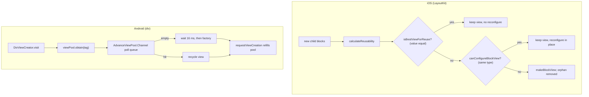
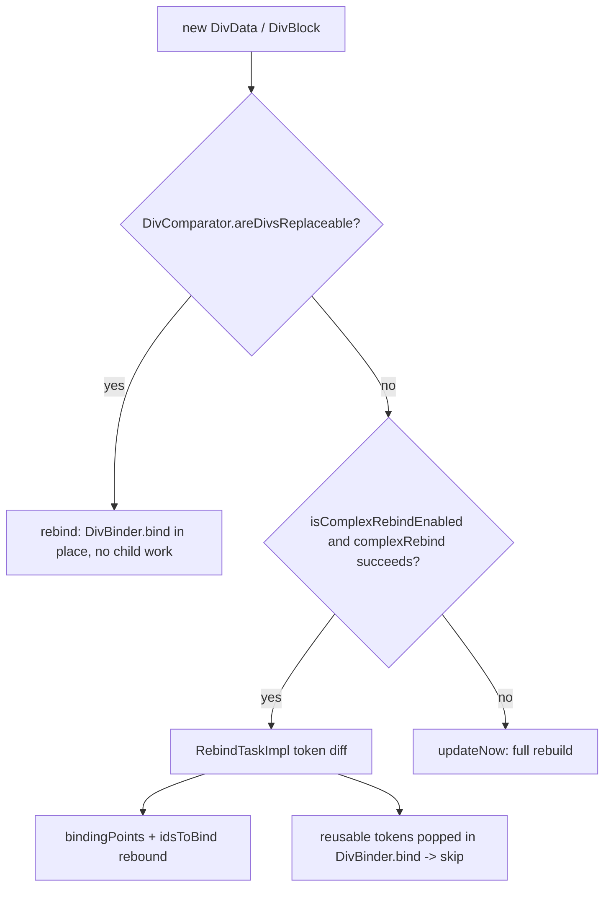
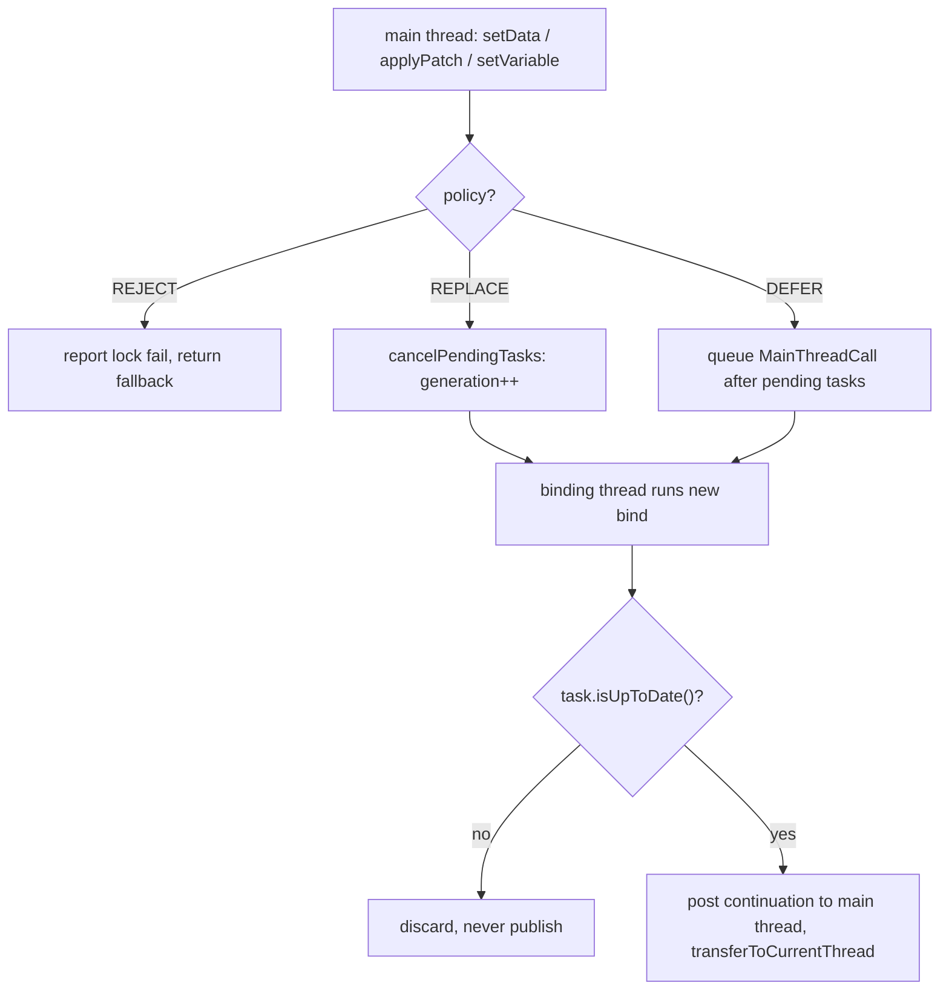

# 24 -- Native rendering optimization: the tricks that make it fast

The DivKit renderers for iOS and Android share one contract: JSON (JavaScript
Object Notation) becomes a card, and a card becomes a native view. [21-rendering-and-patch.md](./21-rendering-and-patch.md)
traces that path. This document covers what sits *behind* it: the optimizations
that make the path fast. The renderers are fast because they do three things.
They reuse views instead of making new ones. They skip work whose input did not
change. They batch many small changes into one pass and move the pass off the
main thread where they can.

Each trick has a WHY and a mechanism. The WHY is what it avoids. The mechanism
is the exact code. iOS and Android solve the same problems with different
machinery, so the document reads them side by side.

# View reuse and recycling

Creating a native view is expensive. It allocates memory, builds the widget's
internal state, and runs its first layout. A renderer that made a new view for
every re-render would spend most of its time allocating, not drawing. Both
clients therefore treat a view as a *reusable shell*: make it once, then write
new data into it many times. The shell is recycled by type.

## iOS: two passes over the old views

iOS reuses at the subtree level. A container has a list of child blocks and a
list of child views already on screen. When the blocks change, the container
does not throw the views away. It matches each new block to an old view, and it
removes only the views that match nothing. The engine is
`calculateReusability` in `LayoutKit/LayoutKit/UI/Blocks/Array+UIViewRenderable.swift`:

```swift
private func calculateReusability(
  _ views: [BlockView],
  blocks: [UIViewRenderable]
) -> ReuseResult {
  var orphanViews = views
  var reusableViews = [Int: BlockView](minimumCapacity: blocks.count)
  for (blockIndex, block) in blocks.enumerated() {
    let reusableView = orphanViews
      .enumerated()
      .first { block.isBestViewForReuse($0.element) }
    if let (viewIndex, view) = reusableView {
      orphanViews.remove(at: viewIndex)
      reusableViews[blockIndex] = view
    }
  }

  let reusability: [(UIViewRenderable, BlockView?)] = blocks
    .enumerated()
    .map { blockIndex, block in
      if let view = reusableViews[blockIndex] {
        return (block, view)
      }
      let reusableView = orphanViews
        .enumerated()
        .first { block.canConfigureBlockView($0.element) }
      if let (index, view) = reusableView {
        orphanViews.remove(at: index)
        return (block, view)
      }
      return (block, nil)
    }

  return ReuseResult(
    reusability: reusability,
    orphanViews: orphanViews
  )
}
```

Read the two loops as two strengths of match. The first loop asks
`isBestViewForReuse(_:)`. That is the *strong* match. The second loop asks
`canConfigureBlockView(_:)`. That is the *weak* match: same type, so the view
can be reconfigured. A block that matches neither makes a new view. The views
left in `orphanViews` at the end are removed from their superview. The caller,
`reused(with:attachTo:observer:overscrollDelegate:renderingDelegate:)`, then
runs `configureBlockViewWithReporting` on each matched view and
`makeBlockView` on each unmatched block.

The strong match is where the real saving is. The default
`isBestViewForReuse` in `LayoutKit/LayoutKit/UI/Blocks/UIViewRenderable.swift`
just falls back to `canConfigureBlockView`. `DecoratingBlock` overrides it to
compare by value, not by type, in
`LayoutKit/LayoutKit/UI/Blocks/DecoratingBlock+UIViewRenderableBlock.swift`:

```swift
func isBestViewForReuse(_ view: BlockView) -> Bool {
  guard let view = view as? DecoratingView,
        let sourceBlock = view.model.source.value as? DecoratingBlock else {
    return false
  }

  return isPreceded(by: sourceBlock) || sourceBlock == self
}
```

The `==` operator (defined in
`LayoutKit/LayoutKit/Blocks/Block.swift`) first checks identity with
`===` and then calls `Block.equals(_:)` for structural equality. So a view whose block did not change at all
is reused without reconfiguration. This is why [21-rendering-and-patch.md](./21-rendering-and-patch.md)
can say a patch that changes one text field touches one view: every sibling
whose block is equal by value is picked by the strong match and left alone.

The gallery adds a second layer of reuse on top of this. A gallery is a
`UICollectionView`. Each block has a `reuseId`
(`LayoutKit/LayoutKit/Blocks/Block.swift`, default `defaultReuseId`).
`CollectionCellRegistrator` registers one cell class per distinct `reuseId`,
and `GenericCollectionViewDataSource.cellForItemAt` calls
`collectionView.dequeueReusableCell(withReuseIdentifier: model.reuseId, ...)`.
So a long gallery scrolls with the platform's own cell recycling, and the cell
content itself reuses the `BlockView` inside it.

## Android: the pool and the profile

Android reuses at the single-view level. `DivViewCreator` never calls a widget
constructor directly for the pooled types. Its `defaultVisit` asks a `ViewPool`
for a view by a per-element tag:

```kotlin
override fun defaultVisit(data: Div, resolver: ExpressionResolver): View =
    viewPool.obtain(viewTag(data, resolver))
```

The tags and their capacities come from a `ViewPreCreationProfile`
(`div/src/main/java/com/yandex/div/internal/viewpool/ViewPreCreationProfile.kt`):

```kotlin
data class ViewPreCreationProfile(
    val id: String? = null,
    val text: PreCreationModel = PreCreationModel(20),
    val image: PreCreationModel = PreCreationModel(20),
    val gifImage: PreCreationModel = PreCreationModel(3),
    val overlapContainer: PreCreationModel = PreCreationModel(8),
    val linearContainer: PreCreationModel = PreCreationModel(12),
    // ... one PreCreationModel per element type ...
)
```

`DivViewCreator.init` registers every tag with its factory and capacity. The
profile is tunable: a card that is mostly images can allocate more image views
up front. The pool itself, `AdvanceViewPool`
(`div/src/main/java/com/yandex/div/internal/viewpool/AdvanceViewPool.kt`), keeps
one `Channel` per tag. A channel holds a `BlockingQueue` of pre-made views. On
`obtain`, the channel polls the queue; if the queue is empty it waits up to
`MAX_WAITING_TIME` (16 milliseconds) for a background pre-creation request, then
falls back to the factory. After every obtain it calls `requestViewCreation()` to
refill the pool back to capacity. So the pool both serves and replenishes.

The capacity is not only hand-tuned. `ViewPreCreationProfileRepository` loads a
profile persisted per identifier, and `ViewPreCreationProfileOptimizer.optimize` adjusts
each `PreCreationModel.capacity` from the previous session's obtain statistics:
if a tag repeatedly blocked (its queue ran dry), capacity rises; if a tag was
never exhausted, capacity falls. This is adaptive pre-allocation, not a static
guess.

## Android: the gallery and pager prebind the first screen

A gallery is a `RecyclerView`, so it already recycles. The extra DivKit trick is
*prebinding*: before the first layout, the binder builds and binds the first
visible holders on the background binding thread, so they are ready when the
view attaches. `CollectionPrebinding`
(`div/src/main/java/com/yandex/div/core/view2/divs/CollectionPrebinding.kt`)
does this. Its `prepare` runs only when the collection is not yet attached and
the binding dispatcher is collecting main-thread actions, and it caps the work
at `MAX_PREPARED_ITEMS` (8). The prepared holders are held by a
`PreparedCollectionViewHoldersPool` until their binding actions run or a
newer generation cancels them. The gallery binder triggers it at
`DivGalleryBinder.kt` with `itemBinding.prepare(initialPosition)`, and the pager
binder at `DivPagerBinder.kt` with `itemBinding.prepare()`.

The WHY for prebinding: the first frame of a gallery otherwise waits for both
binding and layout on the main thread. Prebinding moves the binding to the
background and detaches it from layout, so the first frame is shorter.



# Layout caching and short-circuit

The second class of optimization avoids work whose result is already known.
Reuse avoids *creating* views; short-circuit avoids *reconfiguring and
re-laying-out* views whose model did not change.

## iOS: `LayoutCaching`, the model cache, and reference equality

`LayoutKit` memoizes layout. The protocol `LayoutCaching`
(`LayoutKit/LayoutKit/Blocks/LayoutCaching.swift`) exposes `laidOut(for:)`, and
its result is a `LaidOutBlock` that freezes the size, so the measure pass never
runs twice for the same size. Text measurement, the most expensive single
measure, has its own cache in `LayoutKit/LayoutKit/Blocks/TextBlock.swift`:

```swift
private var cachedIntrinsicWidth: CGFloat?
private var cachedIntrinsicHeight: (width: CGFloat, height: CGFloat)?
```

`intrinsicContentWidth` returns `cachedIntrinsicWidth` when it is set, and
`calculateTextIntrinsicContentHeight(for:)` returns the cached height when the
width is approximately equal. Text is measured once per size, not once per
render.

The view side has two short-circuits, both in
`LayoutKit/LayoutKit/UI/Blocks/ContainerBlock+UIViewRenderableBlock.swift`. The
container stores `modelAndLastLayoutSize` and a `preventLayoutAndConfig` flag.
The `configure` entry is guarded:

```swift
func configure(
  model: Model,
  observer: ElementStateObserver?,
  overscrollDelegate: ScrollDelegate?,
  renderingDelegate: RenderingDelegate?
) {
  guard model != modelAndLastLayoutSize.model ||
    observer !== self.observer,
    !preventLayoutAndConfig
  else {
    return
  }
  ...
}
```

If the model is unchanged and the observer is unchanged, the whole reconfigure
returns early. Nothing re-lays-out. The `Model` type conforms to
`ReferenceEquatable` (`LayoutKit/LayoutKit/UI/Blocks/ReferenceEquatable.swift`),
whose `==` is identity on a `Variable<AnyObject?>` source:

```swift
extension ReferenceEquatable {
  static func ==(lhs: Self, rhs: Self) -> Bool {
    assert(lhs.source.value != nil || rhs.source.value != nil)
    return lhs.source.value === rhs.source.value
  }
}
```

So the `model != modelAndLastLayoutSize.model` check is a pointer comparison on
the source block, not a field-by-field walk. The `layoutSubviews` path has the
same guard: it returns when `preventLayoutAndConfig` is set or when
`bounds.size == lastLayoutSize`, so a view laid out once at a size is not laid
out again at the same size. `preventLayoutAndConfig` exists because
`blockViews.reused` mutates the hierarchy, which can trigger `layoutSubviews`
re-entrantly; the flag stops that re-entrancy from re-running layout during a
reconfigure.

## Android: the `DivComparator` gate and the reusable-list fast path

Android's short-circuit is a gate before binding. `DivComparator.areDivsReplaceable`
(`div/src/main/java/com/yandex/div/core/view2/animations/DivComparator.kt`)
decides whether the whole new `DivBlock` tree can reuse the old view structure:
same Java class, same overlap/wrap flags, same child count, recursively. If it
returns `true`, `DivViewBindingController.applyBindingStrategy` takes the
`rebind` path and binds the new model onto the existing views in place, without
touching child views. If it returns `false`, the controller falls to
`isComplexRebindEnabled && complexRebind(...)`, a true tree diff (the
`RebindTaskImpl` token walk from [21-rendering-and-patch.md](./21-rendering-and-patch.md)),
and finally to `updateNow`, a full rebuild.

The innermost short-circuit is one line in `DivBinder.bind`
(`div/src/main/java/com/yandex/div/core/view2/DivBinder.kt`):

```kotlin
fun bind(view: View, divBlock: DivBlock, divView: Div2View) = suppressExpressionErrors {
    divView.currentRebindReusableList?.pop(divBlock.div)?.let {
        return@suppressExpressionErrors
    }
    ...
}
```

During a complex rebind, `RebindTaskImpl` fills a `ReusableTokenList` with
`ExistingToken` objects whose subtree is already up to date. `pop` removes one
by hash and returns it; the presence of the token means "this node and its
children are already bound, skip". The hash is `item.div.propertiesHash()`, and
`Token.isCombinable` compares `divHash == other.divHash && div.type == other.div.type`.
Two nodes with the same properties hash and type can share one view. This is
the Android analog of iOS value equality: both avoid re-binding an unchanged
subtree, iOS by comparing block values, Android by comparing a properties hash.



# Batching and threading

A single interaction can cause many small changes: ten `set_variable` writes,
two patches, a timer tick. The renderers collapse these into one re-render, and
they run the re-render where it is cheapest.

## iOS: one re-render per run loop

iOS batches at the reason level. A change is a `DivCardUpdateReason`
(`DivKit/DivCardUpdateReason.swift`): `.patch`, `.timer`, `.state`,
`.variable([DivCardID: Set<DivVariableName>])`, or `.external`. The
`RunLoopCardUpdateAggregator` (`DivKit/RunLoopCardUpdateAggregator.swift`)
collects reasons into a `batch` under a lock and schedules one
`flushUpdateActions` per main-run-loop turn. The merge step collapses many
variable writes into one reason:

```swift
extension [DivCardUpdateReason] {
  fileprivate func merge() -> [DivCardUpdateReason] {
    var cards: [DivCardID: Set<DivVariableName>] = [:]

    let reasons: [DivCardUpdateReason] = compactMap {
      switch $0 {
      case let .variable(affectedCards):
        for (key, value) in affectedCards {
          cards[key] = cards[key]?.union(value) ?? value
        }
        return nil
      case .patch, .timer, .state, .external:
        return $0
      }
    }

    return reasons + (cards.isEmpty ? [] : [.variable(cards)])
  }
}
```

Ten variable writes for the same card become one `.variable` reason with a
union of variable names. The card re-models once, not ten times. `DivBlockProvider.update(reasons:)`
(`DivKit/Views/DivBlockProvider.swift`) then checks `needUpdateBlock(reasons:)`
to skip reasons that do not name this card, applies any patches, and re-runs
`divData.makeBlock(context:)` once. Because `Block` compares by value (the
previous section), the unchanged subtrees reuse their views, so the one
re-model is also a minimal re-render.

## Android: a background binding thread with generations

Android batches and threads at the bind level. `BindingDispatcher`
(`div/src/main/java/com/yandex/div/core/util/binding/BindingDispatcher.kt`)
runs binding tasks on a single background thread owned by
`BindingThreadExecutor` (a thread pool of exactly one thread). Tasks run
first-in-first-out, and the dispatcher keeps a `bindingGeneration` counter.
`cancelPendingTasks()` increments the generation, drops queued cancellable
tasks, and invalidates the running one. A task checks `isUpToDate()` (its
generation equals the current one) before and after entering the critical
section, so a superseded bind never publishes its result to the main thread.
This is the Android answer to "many updates, one winner": the newest update
replaces the older pending one, and the older one is discarded, not applied.

The main thread is protected by `BindingCriticalSection`
(`div/src/main/java/com/yandex/div/core/util/binding/BindingCriticalSection.kt`).
A main-thread call that arrives while the background bind holds the section must
not block (it would deadlock). `BindingDispatcher.withLock` uses a
`MainThreadTaskPolicy` (`div/src/main/java/com/yandex/div/core/util/binding/MainThreadTaskPolicy.kt`):

```kotlin
internal enum class MainThreadTaskPolicy {
    REJECT,
    DEFER,
    REPLACE,
}
```

`REJECT` reports the failure and returns a fallback (used by `applyPatch`, which
must not run against data bound later). `DEFER` queues the call to run after
all pending tasks (used by `setVariable`, `handleAction`, state switches).
`REPLACE` cancels the pending `DATA` tasks and runs the call on the binding
thread (used by `setData`, where the new document replaces the pending bind).
The critical section itself can `transferToCurrentThread()`: a bind enters the
section on the background thread and posts its continuation to the main thread,
which takes over ownership. This cross-thread ownership is the reason the
background bind and the main-thread user interface (UI) update can share one
lock without deadlocking.

The asynchronous application programming interface (API) sits on top:
`DivAsyncBindingController`
(`div/src/main/java/com/yandex/div/core/view2/DivAsyncBindingController.kt`)
wraps `setDataAsync`, `setDataAsyncWithPhases`, and `applyPatchAsync`. Each
request records the generation it was created under, and
`replaceBindingRequest` cancels the previous request. A request has one terminal
phase (`APPLIED`, `CANCELLED`, or `FAILED`), and the phases report the bind's
progress to the host.



# Preloading and caching

The expensive resources are images. Both clients fetch them before the frame
needs them, and both reuse the holders they already have.

## iOS: preloading and the holder cache layers

`DivDataResourcesPreloader` (`DivKit/ResourcesPreloader/DivDataResourcesPreloader.swift`)
walks the model tree and warms the cache. `downloadStaticResources(for:maxPrefetchedImageCount:)`
fetches only the static (non-expression) image uniform resource locators
(URLs), which is safe before any
expression context exists; `DivBlockProvider.update(divData:)` calls it with
`maxPrefetchedImageCount: 50`. `downloadResources(for:filter:context:completion:)`
walks every state and child, collecting image, video, and extension URLs, and
fetches them through the same `URLResourceRequesting` interface the renderer
uses. The `filter` is `all` or `onlyRequired` (only the URLs an element marks
as required for its layout). The traversal reuses the renderer's `flatMap`,
including `item_builder` loops and `div-state` trees, so it discovers the URLs
a dynamically generated subtree will need.

The holder cache is layered in `DivImageHolderFactory`
(`DivKit/Images/DivImageHolderFactory.swift`). `withAssets()` adds a local
asset layer for `divkit-asset://` URLs. `withInMemoryCache(imageCountLimit:)`
memoizes a holder by URL plus placeholder key. `withBackgroundModeling()` makes
the factory safe to call on a background thread. The layer that matters for
re-renders is `withCache(_:)`:

```swift
public func withCache(_ cachedImageHolders: [ImageHolder]) -> DivImageHolderFactory {
  if cachedImageHolders.isEmpty {
    return self
  }
  return CachedImageHolderFactory(
    imageHolderFactory: self,
    cachedImageHolders: cachedImageHolders
  )
}
```

`CachedImageHolderFactory.make` looks for a cached holder whose
`reused(with:placeholder:remoteImageURL:)` is non-nil, and returns it instead of
fetching. The source of those cached holders is the previous render:
`DivBlockProvider.makeCurrentContext()` calls
`divKitComponents.makeContext(viewId: id, cachedImageHolders: block.getImageHolders(), ...)`.
`block.getImageHolders()` walks the current block tree and returns every
`ImageHolder` it already has. So a re-render that touches the same image reuses
the same holder and never re-fetches it. `DivKitComponents.makeContext` wires
this by calling `imageHolderFactory.withCache(cachedImageHolders)`.

A smaller cache of the same shape is `DivAccessibilityElementsStorage`
(`DivKit/DivAccessibilityElementsStorage.swift`). It records the ordered chain
of accessibility element IDs once per render, and `getOrderedIds()` replays
that order on later renders, so the accessibility tree is not recomputed from
the view hierarchy every time.

## Android: image preloading and adapter diffing

Android's preloading is `DivImagePreloader`
(`div/src/main/java/com/yandex/div/core/view2/DivImagePreloader.kt`). Its
`PreloadVisitor` walks a `Div` subtree and calls `imageLoader.loadImage(...)`
with `DivImagePriority.IMAGES_PRIORITY_PRELOAD`, honoring a
`DivPreloader.PreloadFilter` (`ONLY_PRELOAD_REQUIRED_FILTER` by default). The
same filter decides whether a background or content image is preloaded.

The gallery and pager get a second form of caching: `DivCollectionAdapter`
(`div/src/main/java/com/yandex/div/core/view2/divs/DivCollectionAdapter.kt`)
diffs item lists. `getItemViewType` uses the element's `reuseId` hash as the
view type, and `setItems` runs `DiffUtil.calculateDiff` with
`areItemsTheSame` comparing `reuseId` values (falling back to content equality)
and `areContentsTheSame` comparing two `Div` values by expression value. The
result is a minimal set of insert/remove/move updates, so scrolling and
re-rendering a list never rebinds items that did not change.

Per-card runtime objects are cached by `DivDataComponentStore`
(`div/src/main/java/com/yandex/div/core/DivDataComponentStore.kt`), a
`@DivScope` map from a `DivDataTag` string to a `DivDataComponent`. `getOrPut`
builds the component once per tag and reuses it on later renders of the same
tag. The component holds the runtime stores, view-state stores, error
collectors, state manager, and visibility dispatcher, so re-rendering a card
does not rebuild its runtime state.

# Constant-folded expressions

Expressions are the biggest per-frame cost on Android: a field like `width` can
be an expression such as `@{variable}`, and evaluating it walks the expression
engine. Most fields are not expressions. They are literals. Android detects
those at parse time and turns them into a value that needs no evaluation.

The core is `Expression.ConstantExpression`
(`div-data/src/main/java/com/yandex/div/json/expressions/Expression.kt`):

```kotlin
open class ConstantExpression<T : Any>(val value: T) : Expression<T>() {

    override val rawValue
        get() = value as Any

    override fun evaluate(resolver: ExpressionResolver): T = value

    override fun observe(resolver: ExpressionResolver, callback: (T) -> Unit): Disposable {
        return Disposable.NULL
    }
    ...
}
```

A literal parses into `ConstantExpression`, whose `evaluate` returns the stored
value and whose `observe` subscribes to nothing. The runtime check
`Expression<T>.isConstant()` (`div-data/src/main/java/com/yandex/div/json/expressions/Expressions.kt`)
is simply `this is Expression.ConstantExpression<T>`. So a constant is
evaluated once, at parse time, and never again per frame.

The composite helpers use that check. `DivDataExtensions.kt`
(`div/src/main/java/com/yandex/div/core/util/DivDataExtensions.kt`) defines
`isConstant()` and `equalsToConstant()` for every structured field: `DivSize`,
`DivEdgeInsets`, `DivBorder`, `DivShadow`, `DivTransform`, `DivBackground`, and
the rest. Each `isConstant` recursively checks its sub-fields with
`isConstant()` or `isConstantOrNull()`. `DivSize?.isConstant()` is typical:

```kotlin
internal fun DivSize?.isConstant(): Boolean {
    return when (this) {
        null -> true

        is DivSize.Fixed -> value.value.isConstant() && value.unit.isConstant()

        is DivSize.MatchParent -> {
            value.weight.isConstantOrNull()
                && value.minSize?.value.isConstantOrNull()
                && value.minSize?.unit.isConstantOrNull()
                && value.maxSize?.value.isConstantOrNull()
                && value.maxSize?.unit.isConstantOrNull()
        }

        is DivSize.WrapContent -> { /* ... same pattern ... */ }
    }
}
```

The binders use these two directions. A binder can skip subscribing to a field
that `isConstant()` (there is nothing to observe), and it can compare two
models by `equalsToConstant()` (constant values compared by raw value, not by
expression re-evaluation). The WHY: the bind path stops paying the expression
engine for values that never change, and the diff path compares literals as
plain values.

# Instrumentation

Fast is not enough. The renderers must show *where* the time goes, so a slow
card can be fixed.

## Android: histograms around measure, layout, draw, and bind

`Div2View` (`div/src/main/java/com/yandex/div/core/view2/Div2View.kt`) wraps
every platform callback with a start and a finish on its
`Div2ViewHistogramReporter`:

```kotlin
override fun onMeasure(widthMeasureSpec: Int, heightMeasureSpec: Int) {
    histogramReporter.onMeasureStarted()
    super.onMeasure(widthMeasureSpec, heightMeasureSpec)
    histogramReporter.onMeasureFinished()
}

override fun draw(canvas: Canvas) {
    drawWasSkipped = false
    histogramReporter.onDrawStarted()
    super.draw(canvas)
    histogramReporter.onDrawFinished()
    drawWasSkipped = true
}
```

`onLayout` and `dispatchDraw` are wrapped the same way. The reporter
(`div-histogram/src/main/java/com/yandex/div/histogram/Div2ViewHistogramReporter.kt`)
records `bindingStartedTime`, `bindingPausedTime`, `rebindingStartedTime`, and
the measure/layout/draw times as uptime deltas. `onBindingFinished` reports a
`DIV_BINDING_HISTOGRAM` duration (accounting for a pause/resume pair), and the
draw finish reports render metrics (`DIV_RENDER_TOTAL`, `DIV_RENDER_MEASURE`,
`DIV_RENDER_LAYOUT`, `DIV_RENDER_DRAW`) through the configured
`HistogramReporter`. The pause/resume pair matters because a bind can be
deferred until the view attaches (`bindOnAttachEnabled`); the histogram
subtracts that wait so the bind duration measures only the bind.

`DivViewBindingController` adds the bind-level markers: `updateNow` calls
`onBindingStarted()` on the first bind and `onRebindingStarted()` /
`onRebindingFinished()` on later ones, and `beginBinding` calls
`onRenderStarted()`. So the reporter separates first bind, rebind, measure,
layout, and draw into distinct histograms.

## iOS: render time in `DivBlockProvider`

iOS measures the model pass, not the platform callbacks. `DivBlockProvider`
(`DivKit/Views/DivBlockProvider.swift`) holds three `TimeMeasure` values:
`divDataParsingTime`, `renderTime`, and `templateParsingTime`. The render is
timed around `makeBlock`:

```swift
block = try measurements.renderTime.updateMeasure {
  try divData.makeBlock(
    context: context
  )
}
```

The parsing is timed the same way in `parseDivDataWithTemplates` with
`measurements.divDataParsingTime.updateMeasure`. `debugParams.processMeasurements`
then hands the per-card values to the host. iOS separates the cost of parsing a
card from the cost of turning it into a block tree, which is the part that
runs on every re-render.

# The Aha Moment

**Aha:** Every optimization in this document is a form of *memoization, keyed
by value*. iOS reuses a view when the new block `equals` the old one. Android
skips a bind when the new node's `propertiesHash` matches a reusable token. The
container skips re-layout when `model != modelAndLastLayoutSize.model` is
false, and that check is a pointer comparison on the source block. Text is
measured once per size and cached. A constant expression is a
`ConstantExpression` whose `evaluate` returns a stored value. The reason all of
this works is the invariant from [12-ios-rendering.md](./12-ios-rendering.md)
and [21-rendering-and-patch.md](./21-rendering-and-patch.md): **a card is
immutable data, and a change produces a new `DivData` or a new `DivBlock` tree
where the unchanged branches are shared.** Because unchanged branches are the
same object (iOS) or carry the same value hash (Android), equality is cheap,
and cheap equality is what lets every layer above it skip work. The renderers
do not diff the screen; they diff values, and they only touch the views whose
values changed.

# Cross-References

- The iOS `Block` value equality and the measure/layout engine these caches sit on: [11-layoutkit.md](./11-layoutkit.md).
- The iOS patch, preloading, and reason-batching path that re-runs this machinery: [12-ios-rendering.md](./12-ios-rendering.md).
- The Android `DivViewCreator`/`DivBinder`/`ViewPool` split and the create/bind contract: [14-android-client.md](./14-android-client.md).
- The three-tier replaceable-gate recipe that the reuse and short-circuit tricks instantiate: [21-rendering-and-patch.md](./21-rendering-and-patch.md).

Continue to [25-issues-prs-delivery.md](./25-issues-prs-delivery.md).
