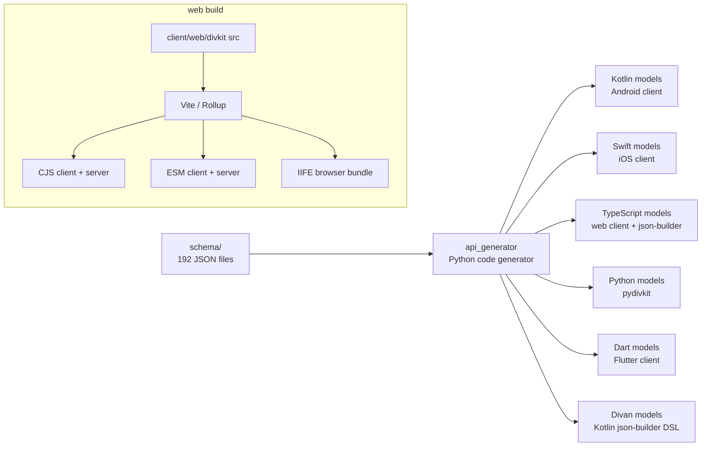
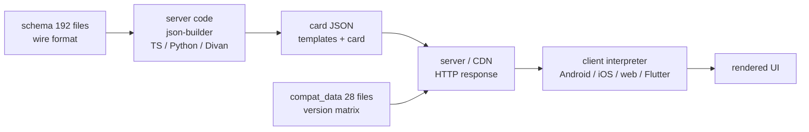

# 25 -- Issues, pull requests, bundle size, and server delivery

This file covers the engineering history of DivKit: the fixes for bugs, the performance work, the bundle-size work, and the server delivery path.

The source is three local git checkouts:

- `divkit` (main repository, remote `github.com/divkit/divkit`): 6573 commits, current version 33.9.0.
- `divkit-ios` (remote `github.com/divkit/divkit-ios`): 232 commits, almost all of them squashed `Release X.Y.Z` snapshots, latest `Release 33.8.0`.
- `divkit-ios-facade` (remote `github.com/divkit/divkit-ios-facade`): 20 commits.

## A note on identifiers

These checkouts are mirrors of an internal monorepo named "arcadia". The commit subjects carry an original hash, for example `Tree-shaking rebuild 944949f5fa870c7bfe4b69efc9b741862a5871a6`. The changelogs have no links. The local history has no GitHub issue numbers and no pull request (PR) numbers. Two commit subjects in the main repository contain a `#2` string, but it is an internal review iteration marker, not an issue number.

For this reason this file identifies work by **version** and by **commit subject**. Version numbers come from the changelogs, the `version` file (33.9.0), and the `Release X.Y.Z` commits. I did not invent issue or PR numbers. Where a statement is a general observation rather than a quoted entry, I say so.

---

## Engineering history

### Performance

The performance history falls into two groups. The first group is deliberate optimization of the Android renderers. The second group is bug fixes that removed accidental repeated work.

Verified changelog entries, grouped by version:

- 33.5.0 (Android): "Optimized Android visibility action tracking by binding only views with sight actions."
- 33.3.0 (Android, Compose renderer): "Improved initial rendering performance of `div-tabs` in the Compose renderer by avoiding unnecessary measurement of inactive tabs."
- 33.2.0 (Android):

```text
* Improved `DivView` performance by adding expression cache.
```

- 33.0.0 (Android, `lottie` extension): "Improved `lottie` extension startup performance: inline `lottie_json` compositions are now parsed and cached during preload, images embedded as base64 data URIs are decoded on a background thread instead of the main thread during the first draw, and Lottie async frame updates move keyframe evaluation off the main thread."
- 32.53.0 (Android): "Fixed an issue with `gallery` where continuous layout invalidations occurred during scrolling, causing performance degradation and high CPU usage." CPU is the central processing unit.
- 32.53.0 (Android): "Optimized `DecoratingView.Model` with Heap Boxing pattern to avoid expensive copying."
- 32.34.0 (iOS): "The slider is optimized for working with large ranges of values."
- 32.31.0 (Android): "Added bitmap size limiting to prevent Canvas rendering crash when loading large images and GIFs." GIF is the graphics interchange format.

Verified commit subjects that match this theme (main repository, Android renderers):

- `Optimized the performance of tabs when scrolling.` (`ade36f491`)
- `Improved tabs rendering performance` (`95dc99cb0`)
- `Performance fixes in layouts` (`6dd48dc65`)
- `Performance optimizations` (`d99f756e1`)
- `list parsing optimizations` (`43f792c32`, `1da82205e`)
- `ExpressionResolver optimization` (`41d2dccf0`, `20f01d19b`)
- `Optimized DivLastVisibleBoundsCache` (`8c7e7f7aa`)
- `Modifiers optimization` (`16f6ee51f`, `04974eccc`)
- `Border drawing optimization` (`d870119ac`)
- `Optimized dashed border rendering` (`4b00d94d4`)
- `Optimzed container separators rendering` (`c0f2def57`)
- `Optimized clipping of containers` (`00d80b5b2`)
- `Optimized network monitoring for image loading in the Compose renderer` (`7fe1958c6`)

General observation, not a quoted entry: the Android code base has two renderers, the legacy View renderer and the newer Compose renderer. A large share of the performance commits target Compose, because Compose re-runs composition and layout more freely than the View renderer. The repeated theme is to remove work that is not needed for the current state, such as measuring inactive tabs, re-copying a model, or tracking visibility on views that have no visibility actions.

### Memory leaks

Memory-leak fixes are the largest single bug theme in the history. Verified commit subjects (main repository, Android):

- `Fix memory leaks in core components` (`ebf720f78`)
- `Fix memory leak in ReleaseManager` (`d019ebd11`)
- `Fix memory leak in DivBaseBinder by properly removing the pre-draw listener from ViewTreeObserver on detach` (`336539d81`), later reverted (`037a7fd4b`)
- `Fix memory leak in DivVariableController by preventing duplicate declarationObserver` (`e59d3b3da`)
- `Fix variables memory leak` (`06587fc6f`, `b06985144`)
- `Fixed memory leak in DivStateManager` (`51d571108`)
- `Fixed memory leak in DivFunctionsStorage` (`514066aa4`, `4c0f17c96`)
- `Fix memory leak in timers` (`a2ee68b44`, `801b5befd`)
- `Fixed memory leak in VisibilityActionPerfromers` (`8040e8ee6`)
- `Fixed a memory leak related to a strong reference to layoutReporter in a closure` (`fef28a6c5`)
- `LoadableImageView bitmap leak fix when view is placed into view pool` (`cadef1850`)
- `Fix video cache leakage` (`63c4b42b2`)
- `Fix video player leaking when Div2View cleanup by ReleaseManager` (`64827a0ea`)
- `Improved memory consumption during parsing.` (`e1b25181c`, `24931c981`)

Verified changelog entries for leaks:

- 32.52.0: "Fixed Retain Cycle in `FunctionsProvider` that caused `DivKitComponents` memory leak."
- 32.46.0: "Fixed memory leak in case when `Div2View` is destroyed earlier than corresponding `Div2Context`."
- 32.23.0: "Fixed memory leak in DivVariableController by preventing duplicate declarationObserver subscriptions when variable sources are added or restored."
- 32.7.0: "Remove view from TriggerExecutor's attachedViews when view is detached from window to prevent memory leaks."
- 32.5.0: "Fixed memory leak for LoadableImageView after release call."
- 31.3.0: "Fixed memory leak in `DivStateManager`."
- 30.23.0: "Fixed memory leak in timers."
- 30.6.0: "Fixed memory leak in VisibilityActionPerfromers."

The iOS facade also has one: `Memory leak fixed` (`d182cd0` in `divkit-ios-facade`).

General observation, not a quoted entry: the leaks share one shape. A listener, an observer, or a closure captures a long-lived object such as a view, a context, a manager, or an activity. The fix removes the capture on detach, removes a duplicate subscription, or stores a disposable so it can be released. This is the same failure mode repeated across binders, variable storage, timers, and caches.

### Crashes, ANR, and concurrency

ANR is "application not responding", the Android term for a frozen main thread.

Verified changelog entries:

- 33.9.0: "Fixed a crash when cancelling an OkHttp-backed network request with an unread response body on the main thread."
- 33.8.0 (Android): "Fixed a crash caused by the built-in SVG loader delivering image callbacks off the main thread, for example for SVG images in `div-text` and `div-tabs` title delimiters." SVG is scalable vector graphics.
- 33.0.0: "Fixed a crash in `div-custom` when a state switch was triggered while another state switch was still being bound: `bindView()` was called for an already attached custom view without `release()`/`createView()`."
- 32.59.0: "Fixed a crash when entering emoji in a `div-input` with a mask configured."
- 32.58.0: "Fixed crash in `div-input` with currency mask when text input is empty."
- 32.53.0: "Fixed ANR at `ErrorCollector.notifyObservers()` method call."
- 32.47.0, 32.39.0, 32.36.1: "Fixed `ConcurrentModificationException` at ErrorCollector.notifyObservers() call." (the same class of fix appears in several versions)
- 32.44.0: "Fixed ANR at `RuntimeStoreImpl` initialization."
- 32.24.0: "Fixed memory leak in DivBaseBinder by properly removing the pre-draw listener from ViewTreeObserver on detach."
- 32.24.0: "Fixed crash when using empty gallery with paging scroll mode."
- 32.17.0: "Fixed a crash in the gallery when deleting items."
- 32.16.0: "Fixed crash in empty `pager` with `indicator`."
- 32.15.0: "Fixed the cause of the application crash when entering Cyrillic characters in the input field with a mask."
- 31.13.0: "Fixed views popping to the foreground when performing animation in overlap containers."

Verified commit subjects for the concurrency class:

- `fix ConcurrentModificationException at ErrorCollector.notifyObservers() call` (`94f4c233b`, `b639aab2d`, `61901af4c`, `de991f9c8`)
- `fix ANR at ErrorCollector.notifyObservers() method call` (`8ce4fd269`, `20b11211e`)
- `Remove error observer on view detach` (`1fe8f28c0`)
- `Use thread-safe ObserverList` (`d8f45a00e`)
- `do not copy variable observer lists on main thread` (`ff39f9619`, `02c632ab7`)
- `fix div-custom crash on nested state switch during state binding` (`f27f9e942`, `915bcf439`)
- `Fix crash in empty pager with indicator` (`8e0d21fab`, `34371946c`)

General observation, not a quoted entry: the `ErrorCollector` and observer-list fixes are one problem. An observer list is copied or iterated while another thread mutates it. The fix is either a thread-safe collection or a move of the copy off the main thread.

### Delivery and compatibility

The delivery history is recorded in `compat_data`, a directory of 28 JSON files plus one schema, `compat_data.schema.json`. Each feature file lists which client version first supported a feature on each platform. The release flow updates these files with commits titled `Compat upd`, for example `Compat upd 32.42.0`. There is also `Compat data json validation` (`62eeef47f`), backed by `json-builder/json-validator/json_validator.py`.

The changelogs record the other half of delivery: forward compatibility. In 33.0.0:

- "`div-action.log_id` has become optional. Warning! Actions without `log_id` are ignored by the clients that use pre-33 DivKit version. Consider keeping `log_id` in the backend response for forward compatibility."
- "`div-image.image_url` and `div-gif-image.gif_url` has become optional. Warning! Images without urls are ignored by the clients that use pre-33 DivKit version. Consider keeping `image_url` / `gif_url` in the backend response for forward compatibility."
- "`div-shape-drawable.color` is deprecated and has become optional. Use `shape` property instead. Warning! Drawables without `color` are ignored by the clients that use pre-33 DivKit version."

These entries tell the server author the rule: a field can become optional only when the server keeps sending it for old clients.

---

## Bundle size

The bundle-size machinery has three parts: the web build, the visual editor build, and the code generator.

### Web client build

The web client is `client/web/divkit`, package `@divkitframework/divkit` version 33.9.0. It is built with Vite and Rollup. See [13-web-client.md](./13-web-client.md) for the runtime details and [18-tooling.md](./18-tooling.md) for the surrounding tooling.

The build (`client/web/divkit/vite.config.mts`) produces several artifacts from one source tree by reading environment variables. `FORMAT` selects CommonJS (CJS), ECMAScript module (ESM), or immediately invoked function expression (IIFE). `HYDRATABLE` and `DEVTOOL` select extra variants. A server-side rendering (SSR) build uses a different entry.

```ts
const FORMAT = (process.env.FORMAT || 'cjs') as LibraryFormats;
...
lib: isSsrBuild ? {
    entry: 'src/server.ts',
    formats: [FORMAT]
} : {
    entry: `src/client${DEVTOOL ? '-devtool' : ''}${FORMAT === 'iife' ? '-globals' : ''}`,
    formats: [FORMAT],
    name: 'unused'
},
minify: true,
```

The package declares `sideEffects: ["dist/client.css"]`. A bundler may then drop every JavaScript module that the application does not import. The package also exposes subpath exports, so an application that only needs the client does not import the server code:

```json
"sideEffects": [
  "dist/client.css"
],
"main": "./dist/server.js",
"module": "./dist/esm/server.mjs",
"exports": {
  ".": { "types": "./typings/server.d.ts", "require": "./dist/server.js", "import": "./dist/esm/server.mjs" },
  "./client": { "types": "./typings/client.d.ts", "require": "./dist/client.js", "import": "./dist/esm/client.mjs" },
  "./client-hydratable": { ... },
  "./client-devtool": { ... },
  "./server": { ... }
}
```

The build scripts in `package.json` enumerate every format and variant: `build:prod:cjs-client`, `build:prod:es-client`, `build:prod:iife-client`, each with `-hydratable` and `-devtool` variants, plus `--ssr` server builds.

The history of this machinery, from the web changelog (`client/web/divkit/CHANGELOG.md`):

```text
* Breaking change. The build was redone using Vite/Rollup. This changes the situation a bit:
  there is no longer a css map, and the ESM file versions are no longer minimized.
  Browser and CJS versions with global variables are still minimized.
```

That entry is version 31.0.0. A later entry, 33.0.0, is:

```text
* Breaking change. `package.json` exports were updated to support newer Node.js versions.
  Node.js 14+ is now required.
```

A separate tree-shaking change is visible in git for the React wrapper (`client/web/divkit-react`). The commit `Tree-shaking rebuild` (`3e7c1de59`) split `divkit.tsx` into `divkit-client.tsx` and `divkit-server.tsx` and updated `webpack.config.js`. A client-only application can then drop the server entry. This predates the Vite/Rollup rebuild of the core package.

### Visual editor build

The visual editor is `visual-editor`, package `@divkitframework/visual-editor` version 0.4.14. It uses three build files:

- `vite.config.ts` builds the development playground.
- `vite-lib.config.ts` builds the library. It bundles `src/lib.ts` into one ES module, `dist/divkit-editor.js`, and minifies it with Terser through a custom `minifyES` plugin.
- `rollup-typings.config.ts` bundles the type declarations into one file, `dist/divkit-editor.d.ts`, with `rollup-plugin-dts`.

The editor also generates a grammar before building: `lezer-generator src/lib/grammar/div.grammar -o src/lib/grammar/div.js`. The editor changelog records the minification step in version 0.1.18: "Made minification for files. The names of the dependencies have changed, but this should not affect anything."

### Code generation and per-platform models

The schema is 192 JSON files under `schema/`. They define the wire format. See [09-schema.md](./09-schema.md).

The code generator is `api_generator`, a Python program. It reads those 192 schema files and a small config, and emits model code per language. The generator directory `api_generator/api_generator/generators/` has one subdirectory per target:

- `kotlin` and `kotlin_dsl` for Android
- `swift` for iOS
- `type_script` for the web and the TypeScript json-builder
- `python` for `pydivkit`
- `dart` for Flutter
- `divan` for the Kotlin json-builder domain-specific language (DSL)
- `documentation`

Because the models are generated per platform, each platform ships only its own model code. The Android client does not carry Swift models. The web client does not carry Kotlin models. This is the main code-size consequence of code generation. See [08-codegen.md](./08-codegen.md) for the generator internals.

The generator also supports a parser-only Kotlin mode. With `generateModels: false` it reuses existing models and emits only the JSON parsers, which keeps the generated surface smaller. The generator itself has been optimized: commit `Optimized api-generator` (`9ac84b75f`).



### The compatibility matrix

`compat_data.schema.json` defines the format. A file has a `features` array. Each feature has an `id`, a `name`, and a `compat` object. Each platform entry in `compat` has a `version_added` or a `version_removed`. The version format is enforced: `^[0-9]+\.[0-9]+\.[0-9]+$`.

A real entry from `compat_data/div-base.json`:

```json
{
  "id": "base_component_variables",
  "name": "Base component property <code>variables</code>",
  "compat": {
    "ios": { "version_added": "30.8.0" },
    "android": { "version_added": "30.14.0" },
    "web": { "version_added": "30.19.0" }
  }
}
```

This is the versioning story in one record: the `variables` base property arrived in iOS 30.8.0, Android 30.14.0, and web 30.19.0. A server that must support all three can look up the minimum version and decide whether to send the field.

---

## Server delivery

### The json-builder libraries

The server side builds card JSON with three libraries under `json-builder/`. See [16-json-builder.md](./16-json-builder.md).

- TypeScript: `json-builder/typescript`, package `@divkitframework/jsonbuilder` version 33.9.0. It builds with Rollup to CJS, ESM, and bundled `.d.ts`. Its code is generated from the schema by `codegen.sh`, which calls `api_generator` with `generator_config.json` (`"lang": "typescript"`) and writes to `src/generated`.
- Python: `json-builder/python`, package `pydivkit` version 33.9.0. Its `codegen.sh` also calls `api_generator` with `"lang": "python"` and writes to `pydivkit/div`.
- Kotlin: `json-builder/kotlin`, a DSL named Divan. Its Gradle modules are `core`, `divan-dsl`, `expression-dsl`, `legacy-json-builder`, and `lint-rules`. The `divan-dsl` sources are generated by `api_generator` into `divan-dsl/src/generated`.

There is also `json-builder/json-validator`, a Python validator for generated card JSON.

The TypeScript builder shows the contract in its README. The builder composes templates and a card, then serializes:

```typescript
import { divCard, DivContainer, DivText, reference, rewriteRefs, template, templateHelper } from '@divkitframework/jsonbuilder';
// ... build templates ...
console.log(JSON.stringify(
  divCard(rewriteRefs(templates), {
    log_id: 'sample_card',
    states: [ { state_id: 0, div: tHelper.sampleBlock({ title: 'Some Title', subtitle: 'Some Subtitle' }) } ]
  })
));
```

The output is the card envelope.

### The card envelope

A DivKit card is one JSON object with two keys. `templates` is optional and holds named reusable blocks. `card` is the div-data: it holds `log_id` and a `states` array, where each state has a `state_id` and a `div`. A real sample, `test_data/samples/state/button.json`, uses the same shape. A template parameter is marked with a `$` prefix in the property name:

```json
{
  "templates": {
    "text_block": { "type": "text", "width": { "type": "match_parent" }, "font_size": 14 }
  },
  "card": {
    "log_id": "sample_card",
    "states": [
      { "state_id": 0, "div": { "type": "container", "orientation": "vertical", "items": [ { "type": "text_block", "text": "This is first state" } ] } }
    ]
  }
}
```

This matches the contract described in the repository `AGENTS.md`, which shows `templates` plus `card` as the required shape.

### How a server changes the UI without an app-store release

The client is a fixed interpreter. It renders whatever card JSON the server sends. The UI (the user interface) is data, not compiled code. A server can change the layout, the text, the colors, or the state logic by changing the JSON it returns. No binary update is needed.

The wire format is versioned through `compat_data`. When the schema changes, the changelog marks fields optional or deprecated and states which client versions understand them. The server keeps old fields in the payload until every supported client is new enough. The `Compat upd` commits keep the matrix current with each release.



CDN is a content delivery network. HTTP is the hypertext transfer protocol.

---

## Aha moment

Three patterns explain most of the engineering history.

First, the performance and memory work is mostly the removal of accidental work. The bugs are not new algorithms. They are listeners that stay attached, observers that subscribe twice, inactive tabs that get measured, and layout that invalidates in a loop during scroll. The fixes are deletions, not additions.

Second, code generation is a bundle-size strategy, not only a correctness strategy. The generator emits the same model in seven languages, and each platform ships only its own generated files. The web package then adds a second layer: `sideEffects` and subpath exports let the bundler drop whole modules the application never imports.

Third, delivery is versioning. `compat_data` turns a monorepo of several client versions into a queryable matrix, and the changelogs turn every schema change into a rule for the server: keep the old field in the response until the last old client is gone. The server, not the app store, is where UI releases happen.

---

Continue to [26-platform-geometry-compilation.md](./26-platform-geometry-compilation.md).
