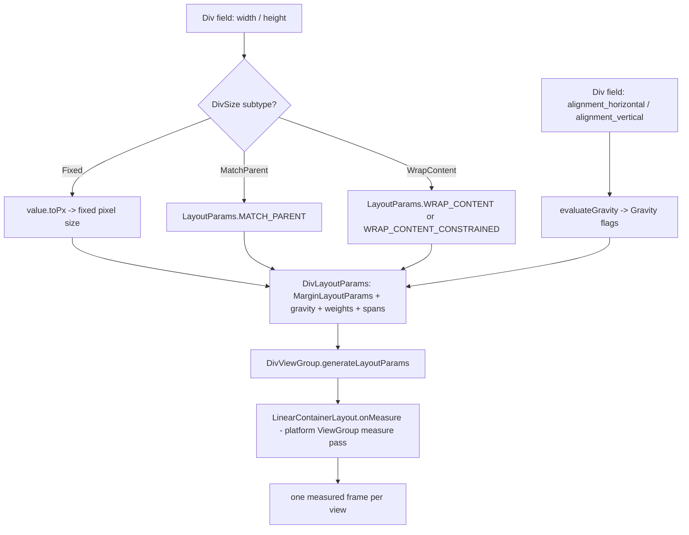
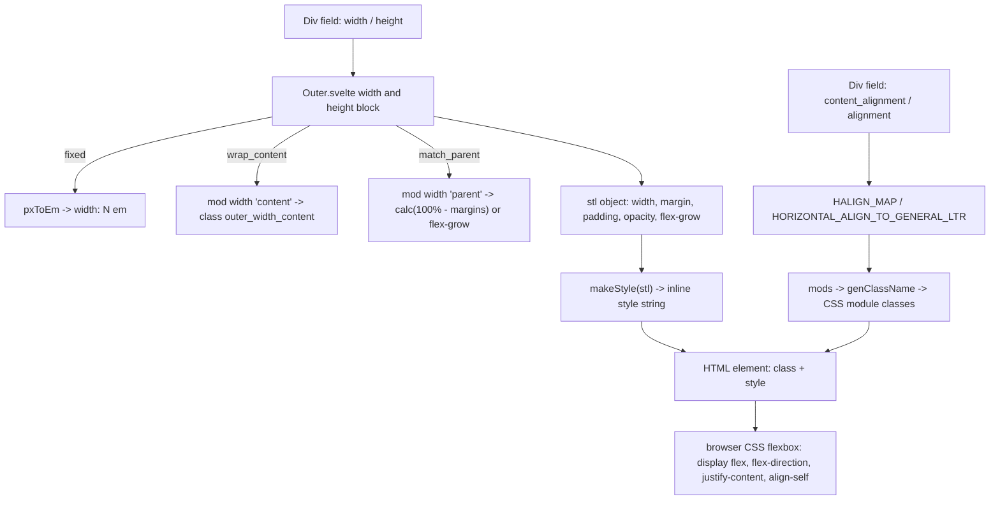

# 26 -- Platform geometry: three authorities, one layout

The Div schema names the same geometry fields on every platform: `width`,
`height`, `alignment_horizontal`, `alignment_vertical`, `margins`, `paddings`,
`alpha`, and `background`. The three renderers answer these fields with three
different geometry authorities. iOS compiles them into a hand-written
measure-then-layout engine, `LayoutKit`. Android writes them into the platform
`ViewGroup` measure pass, `LayoutParams`, and `Gravity`. The web writes them
into Cascading Style Sheets (CSS) flexbox.

One field, three translations. A `match_parent` width is a `LayoutTrait.weighted`
on iOS, an Android `LayoutParams.MATCH_PARENT`, and a CSS `width` plus
`flex-grow` on the web. This document traces the Android and the web
translation. The iOS translation is the subject of
[11-layoutkit.md](./11-layoutkit.md); this document cross-references it, it
does not re-explain it.

Android paths are relative to the `client/android/` directory of the `divkit`
checkout. Web paths are relative to the `divkit` checkout. iOS paths are
relative to the `divkit-ios` checkout.

# The iOS authority, in one paragraph

iOS has no flexbox in `UIView`. `DivKit` turns JavaScript Object Notation
(JSON) into `Block` objects, and `LayoutKit` turns a `Block` tree into frames.
A block never picks its own size. It stores two `LayoutTrait` values and
answers queries. The parent container does the arithmetic in two passes, a
measure pass and a layout pass. `match_parent`, `wrap_content`, and fixed sizes
are three cases of one enum, `LayoutTrait`. The weighted distribution reuses
the web flexbox "resolve flexible lengths" step by hand. The full engine is in
[11-layoutkit.md](./11-layoutkit.md).

# Android: the ViewGroup measure pass

Android does not compute frames by hand. It hands each field to the platform.
The width and height trait becomes a `LayoutParams`. The alignment becomes
`Gravity`. The margins become `MarginLayoutParams` fields. The paddings become
`setPadding`. The alpha becomes `View.alpha`. The background becomes a
`Drawable`. A custom `ViewGroup` then runs the platform measure pass over those
values.

## The size trait becomes LayoutParams

The data side is the generated sealed type `DivSize`, carried by
`DivBase.width` and `DivBase.height`. The renderer wraps each generated `Div`
in a `DivBlock` (`div-data/src/main/java/com/yandex/div/internal/core/DivBlock.kt`),
a sealed class that pairs the model with its expression resolver and its state
path. The width and height fields stay on the generated `DivBase` model; a
binder reads them through `divBlock.div.value()`.

The mapping is one function in `DivUtil.kt`. It turns the three `DivSize` cases
into the three Android `LayoutParams` size codes:

```kotlin
// div/src/main/java/com/yandex/div/core/util/DivUtil.kt
internal fun DivSize?.toLayoutParamsSize(
    metrics: DisplayMetrics,
    resolver: ExpressionResolver,
    lp: ViewGroup.LayoutParams? = null
): Int {
    return when (this) {
        null -> ViewGroup.LayoutParams.WRAP_CONTENT
        is DivSize.MatchParent -> ViewGroup.LayoutParams.MATCH_PARENT
        is DivSize.Fixed -> value.toPx(metrics, resolver)
        is DivSize.WrapContent -> when {
            value.constrained?.evaluate(resolver) != true -> ViewGroup.LayoutParams.WRAP_CONTENT
            lp is DivLayoutParams -> DivLayoutParams.WRAP_CONTENT_CONSTRAINED
            else -> ViewGroup.LayoutParams.WRAP_CONTENT
        }
    }
}
```

The `when` is exhaustive without an `else`. That is the proof that the Android
`DivSize` has exactly three cases plus null. There is no `percentage` case in
the element width and height trait. Percentage is a separate size type that
only the pager uses (see the web section). The same mapping also serves the
tooltip and tabs builders, which import `toLayoutParamsSize` directly.

The target is not the plain `ViewGroup.LayoutParams`. It is `DivLayoutParams`,
a subclass of `MarginLayoutParams` that adds the fields the Div container
needs: gravity, weights, grid spans, and size limits:

```kotlin
// div/src/main/java/com/yandex/div/internal/widget/DivLayoutParams.kt
class DivLayoutParams: MarginLayoutParams {

    var gravity = DEFAULT_GRAVITY
    var isBaselineAligned = false

    var verticalWeight = DEFAULT_WEIGHT
    var horizontalWeight = DEFAULT_WEIGHT

    var columnSpan by PositiveNumberDelegate(DEFAULT_SPAN)
    var rowSpan by PositiveNumberDelegate(DEFAULT_SPAN)
    var maxHeight = DEFAULT_MAX_SIZE
    var maxWidth = DEFAULT_MAX_SIZE
    // ...
    companion object {
        const val DEFAULT_GRAVITY = Gravity.START or Gravity.TOP
        const val DEFAULT_WEIGHT = 0f
        const val DEFAULT_SPAN = 1
        const val WRAP_CONTENT_CONSTRAINED = -3
        const val DEFAULT_MIN_SIZE = 0
        const val DEFAULT_MAX_SIZE = Int.MAX_VALUE
    }
}
```

`WRAP_CONTENT_CONSTRAINED` is `-3`, a value that does not exist in the Android
framework. The custom container reads it back during its measure pass. It is
the Div `wrap_content` with `constrained: true`, which shrinks to fit the
offered space.

Every child of a Div container carries a `DivLayoutParams`. The parent is
`DivViewGroup`, whose three `generateLayoutParams` overrides all construct one:

```kotlin
// div/src/main/java/com/yandex/div/internal/widget/DivViewGroup.kt
override fun checkLayoutParams(p: LayoutParams?): Boolean = p is DivLayoutParams

override fun generateLayoutParams(attrs: AttributeSet?): LayoutParams = DivLayoutParams(context, attrs)

override fun generateLayoutParams(lp: LayoutParams?): LayoutParams = when (lp) {
    is DivLayoutParams -> DivLayoutParams(lp)
    is MarginLayoutParams -> DivLayoutParams(lp)
    else -> DivLayoutParams(lp)
}

override fun generateDefaultLayoutParams(): LayoutParams =
    DivLayoutParams(LayoutParams.WRAP_CONTENT, LayoutParams.WRAP_CONTENT)
```

## Who applies it during bind

The bind order is fixed. `DivBaseBinder.bind` calls the geometry binders in a
line: layout params, margins, alignment, alpha, background, paddings:

```kotlin
// div/src/main/java/com/yandex/div/core/view2/divs/DivBaseBinder.kt
bindLayoutParams(div, oldDiv, resolver, divView, subscriber)
bindMargins(div, oldDiv, resolver, subscriber)
bindAlignment(div, oldDiv, resolver, subscriber)
// ...
bindAlpha(div, oldDiv, resolver, subscriber)

bindBackground(div, oldDiv, resolver, divView, subscriber, true, backgroundUnderlay, null)
bindBorder(div, resolver, divView)
bindPaddings(div, oldDiv, resolver, subscriber)
```

`bindLayoutParams` delegates to `DivLayoutParamsBinder`. That binder splits the
work by axis. `bindWidth` and `bindHeight` each call `applyWidthProperties` and
`applyHeightProperties`, which write the size, the weight, and the min and max
limits. The size write is the `toLayoutParamsSize` call above:

```kotlin
// div/src/main/java/com/yandex/div/core/view2/divs/DivLayoutParamsBinder.kt
private fun View.applyWidth(div: DivBase, resolver: ExpressionResolver): Boolean {
    val width = div.width.toLayoutParamsSize(resources.displayMetrics, resolver, layoutParams)
    if (layoutParams.width == width) return false

    layoutParams.width = width
    return true
}
```

The same binder writes the `match_parent` weight into `DivLayoutParams`:

```kotlin
// div/src/main/java/com/yandex/div/core/view2/divs/DivLayoutParamsBinder.kt
private fun DivSize.getWeight(resolver: ExpressionResolver) =
    (this as? DivSize.MatchParent)?.value?.weight?.evaluate(resolver)?.toFloat() ?: DivLayoutParams.DEFAULT_WEIGHT
```

Those weight fields are custom additions on top of `MarginLayoutParams`. The
custom container reads `verticalWeight` and `horizontalWeight` in its measure
pass and distributes the leftover space. The binder also subscribes to non-constant sizes, so an
expression that changes width re-runs `applyWidthProperties` on the next
update.

## Alignment becomes Gravity

Two mappings exist. The child alignment (`alignment_horizontal` and
`alignment_vertical`) maps through one overload of `evaluateGravity`; the
container content alignment (`content_alignment_horizontal` and
`content_alignment_vertical`) maps through another. The child version is:

```kotlin
// div/src/main/java/com/yandex/div/core/util/DivUtil.kt
internal fun evaluateGravity(horizontal: DivAlignmentHorizontal?, vertical: DivAlignmentVertical?): Int {
    val horizontalGravity = when (horizontal) {
        DivAlignmentHorizontal.LEFT -> Gravity.LEFT
        DivAlignmentHorizontal.CENTER -> Gravity.CENTER_HORIZONTAL
        DivAlignmentHorizontal.RIGHT -> Gravity.RIGHT
        DivAlignmentHorizontal.START -> Gravity.START
        DivAlignmentHorizontal.END -> Gravity.END
        else -> Gravity.START
    }

    val verticalGravity = when (vertical) {
        DivAlignmentVertical.TOP -> Gravity.TOP
        DivAlignmentVertical.CENTER -> Gravity.CENTER_VERTICAL
        DivAlignmentVertical.BOTTOM -> Gravity.BOTTOM
        else -> Gravity.TOP
    }

    return horizontalGravity or verticalGravity
}
```

`DivAlignmentHorizontal` and `DivAlignmentVertical` are Div names.
`Gravity.LEFT`, `Gravity.CENTER_HORIZONTAL`, and the rest are Android flags.
The mapping is a `when`, one Div name to one Android flag.

The content alignment has one extra case: the `space-between`, `space-around`,
and `space-evenly` values, which Android does not have in `Gravity`. The renderer
adds them as extra bits shifted onto the gravity axes:

```kotlin
// div/src/main/java/com/yandex/div/internal/widget/DivGravity.kt
private const val AXIS_SPACE_AROUND = 0x01000000
private const val AXIS_SPACE_BETWEEN = 0x02000000
private const val AXIS_SPACE_EVENLY = 0x04000000

const val SPACE_AROUND_HORIZONTAL = AXIS_SPACE_AROUND shl Gravity.AXIS_X_SHIFT
const val SPACE_AROUND_VERTICAL = AXIS_SPACE_AROUND shl Gravity.AXIS_Y_SHIFT
const val SPACE_BETWEEN_HORIZONTAL = AXIS_SPACE_BETWEEN shl Gravity.AXIS_X_SHIFT
const val SPACE_BETWEEN_VERTICAL = AXIS_SPACE_BETWEEN shl Gravity.AXIS_Y_SHIFT
const val SPACE_EVENLY_HORIZONTAL = AXIS_SPACE_EVENLY shl Gravity.AXIS_X_SHIFT
const val SPACE_EVENLY_VERTICAL = AXIS_SPACE_EVENLY shl Gravity.AXIS_Y_SHIFT
```

`DivGravity` is a source-only `@IntDef` annotation with companion constants.
`DivUtil.evaluateGravity` maps `DivContentAlignmentHorizontal.SPACE_BETWEEN` to
`DivGravity.SPACE_BETWEEN_HORIZONTAL`. The custom container then decodes those
bits back out of the gravity integer during layout.

The result lands in `DivLayoutParams.gravity`. The entry point is
`applyAlignment`, which composes the two axes and writes the field:

```kotlin
// div/src/main/java/com/yandex/div/core/view2/divs/BaseDivViewExtensions.kt
internal fun View.applyAlignment(
    horizontal: DivAlignmentHorizontal?,
    vertical: DivAlignmentVertical?
) {
    applyGravity(evaluateGravity(horizontal, vertical))
    applyBaselineAlignment(vertical == DivAlignmentVertical.BASELINE)
}

private fun View.applyGravity(newGravity: Int) {
    when (val lp = layoutParams) {
        is DivLayoutParams -> if (lp.gravity != newGravity) {
            lp.gravity = newGravity
            requestLayout()
        }
        else -> Log.e("DivView", "tag=$tag: Can't cast $lp to get gravity")
    }
}
```

A container child gets its gravity from `DivContainerBinder.applyChildAlignment`.
The child's own `alignment_horizontal` wins. If the child has none, the parent
`content_alignment_horizontal` wins, converted through `toAlignmentHorizontal`:

```kotlin
// div/src/main/java/com/yandex/div/core/view2/divs/DivContainerBinder.kt
val childAlignmentHorizontal = child.div.value().alignmentHorizontal
val alignmentHorizontal = when {
    childAlignmentHorizontal != null -> childAlignmentHorizontal.evaluate(child.expressionResolver)
    parentDiv.isWrapContainer(parentResolver) -> null
    else -> parentDiv.contentAlignmentHorizontal.evaluate(parentResolver).toAlignmentHorizontal()
}
// ...
applyAlignment(alignmentHorizontal, alignmentVertical)
```

## The container: a LinearLayout with DivLayoutParams

A `div-container` becomes one of three widgets. `DivViewCreator.viewTag` picks
the widget from the orientation and layout mode, and the pre-creation profile
registers each one with a factory:

```kotlin
// div/src/main/java/com/yandex/div/core/view2/DivViewCreator.kt
is Div.Container -> when {
    div.value.isWrapContainer(resolver) -> TAG_WRAP_CONTAINER
    div.value.orientation.evaluate(resolver) == Orientation.OVERLAP -> TAG_OVERLAP_CONTAINER
    else -> TAG_LINEAR_CONTAINER
}
```

```kotlin
// div/src/main/java/com/yandex/div/core/view2/DivViewCreator.kt
register(TAG_OVERLAP_CONTAINER, { DivFrameLayout(context) }, overlapContainer.capacity)
register(TAG_LINEAR_CONTAINER, { DivLinearLayout(context) }, linearContainer.capacity)
register(TAG_WRAP_CONTAINER, { DivWrapLayout(context) }, wrapContainer.capacity)
```

`DivLinearLayout` (`div/src/main/java/com/yandex/div/core/view2/divs/widgets/DivLinearLayout.kt`)
extends `LinearContainerLayout`, a custom `ViewGroup`. `DivWrapLayout` extends
`WrapContainerLayout`. `DivFrameLayout` extends `FrameContainerLayout`. The
binder then writes the orientation and the content alignment onto that widget:

```kotlin
// div/src/main/java/com/yandex/div/core/view2/divs/DivContainerBinder.kt
private fun DivLinearLayout.bindProperties(
    newDiv: DivContainer,
    oldDiv: DivContainer?,
    resolver: ExpressionResolver,
    errorCollector: ErrorCollector,
) {
    bindOrientation(newDiv, oldDiv, resolver) { orientation ->
        this.orientation = orientation.toOrientationMode()
    }
    bindContentAlignment(newDiv, oldDiv, resolver) { horizontalAlignment, verticalAlignment ->
        gravity = evaluateGravity(horizontalAlignment, verticalAlignment)
    }
    // ...
}
```

`toOrientationMode` maps `HORIZONTAL` to `LinearLayout.HORIZONTAL` and
everything else to `LinearLayout.VERTICAL`. That is the whole orientation
translation: one Div enum to one Android constant.

The measure pass lives in `LinearContainerLayout.onMeasure`
(`div/src/main/java/com/yandex/div/core/widget/LinearContainerLayout.kt`). It
is a real `ViewGroup.onMeasure`: it receives two `MeasureSpec` values from the
parent and measures children with margins and weights. It is the Android
geometry authority. It does not parse Div values; it reads `DivLayoutParams`,
the values the binders wrote earlier. This is the split that makes the system
work: the binders translate Div to platform values once, and the platform
measure pass does the arithmetic.



## Margins, paddings, alpha, background

Margins land in `MarginLayoutParams`. `applyMargins` evaluates each edge and
writes `topMargin`, `bottomMargin`, and either the start and end margins or the
left and right margins:

```kotlin
// div/src/main/java/com/yandex/div/core/view2/divs/BaseDivViewExtensions.kt
internal fun View.applyMargins(insets: DivEdgeInsets?, resolver: ExpressionResolver) {
    val metrics = resources.displayMetrics
    val lp = layoutParams as? ViewGroup.MarginLayoutParams ?: return
    // ...
    if (lp.leftMargin != leftMargin || lp.topMargin != topMargin
        || lp.rightMargin != rightMargin || lp.bottomMargin != bottomMargin
        || (startMargin != null && lp.marginStart != startMargin)
        || (endMargin != null && lp.marginEnd != endMargin)) {
        lp.topMargin = topMargin
        lp.bottomMargin = bottomMargin
        if (startMargin != null || endMargin != null) {
            lp.marginStart = startMargin ?: 0
            lp.marginEnd = endMargin ?: 0
        } else {
            lp.leftMargin = leftMargin
            lp.rightMargin = rightMargin
        }
        requestLayout()
    }
}
```

Paddings land on the view directly. `applyPaddings` calls `setPadding` or
`setPaddingRelative`, depending on whether the Div insets use `start` and `end`
or `left` and `right`:

```kotlin
// div/src/main/java/com/yandex/div/core/view2/divs/BaseDivViewExtensions.kt
internal fun View.applyPaddings(insets: DivEdgeInsets?, resolver: ExpressionResolver) {
    if (insets == null) {
        setPadding(0, 0, 0, 0)
        return
    }

    val metrics = resources.displayMetrics
    val unit = insets.unit.evaluate(resolver)
    if (insets.start != null || insets.end != null) {
        setPaddingRelative(
            insets.start?.evaluate(resolver)?.toPx(unit, metrics) ?: 0,
            insets.top.evaluate(resolver).toPx(unit, metrics),
            insets.end?.evaluate(resolver)?.toPx(unit, metrics) ?: 0,
            insets.bottom.evaluate(resolver).toPx(unit, metrics)
        )
    } else {
        setPadding(
            insets.left.evaluate(resolver).toPx(unit, metrics),
            insets.top.evaluate(resolver).toPx(unit, metrics),
            insets.right.evaluate(resolver).toPx(unit, metrics),
            insets.bottom.evaluate(resolver).toPx(unit, metrics))
    }
}
```

Alpha maps to the platform `View.alpha` float. `applyAlpha` is one line plus a
border invalidation:

```kotlin
// div/src/main/java/com/yandex/div/core/view2/divs/DivBaseBinder.kt
private fun View.applyAlpha(alpha: Double) {
    this.alpha = alpha.toFloat()
    (this as? DivBorderSupports)?.invalidateBorder()
}
```

Background maps to an Android `Drawable`. The Div background list compiles to a
`LayerDrawable` and is set on the view:

```kotlin
// div/src/main/java/com/yandex/div/core/view2/divs/DivBackgroundBinder.kt
private fun View.updateBackground(drawable: Drawable?) {
    val drawables = mutableListOf<Drawable>()

    drawable?.let { drawables.add(it) }
    // ...
    background = LayerDrawable(drawables.toTypedArray())
    // ...
}
```

Each of these is the platform value for one Div field. The binders never
compute geometry. They translate.

# Web: CSS flexbox in the browser

The web has no layout engine of its own. It compiles the same fields into CSS.
Svelte components build a Document Object Model (DOM) tree, and the browser's
CSS flexbox engine computes the frames. Every element's geometry is either a
CSS class from a module or an inline style string produced by `makeStyle`.

## The style compiler

`makeStyle` is the whole inline-style compiler. It walks an object of rules and
joins them into a CSS declaration string:

```ts
// client/web/divkit/src/utils/makeStyle.ts
export function makeStyle(styles?: Record<string, string | number | undefined>): string | undefined {
    if (!styles) {
        return undefined;
    }

    let res = '';
    for (const key in styles) {
        if (styles.hasOwnProperty(key)) {
            if (!styles[key] && styles[key] !== 0) {
                continue;
            }
            if (res) {
                res += ';';
            }
            res += key + ':' + String(styles[key]);
        }
    }
    return res || undefined;
}
```

It does not know about Div. It is generic. The Div knowledge lives in the
object that calls it. That object is `Outer.svelte`, the shared shell that
wraps every Div element.

## Width and height become width, flex, and calc

The web size trait is a TypeScript union. It has the same three cases as
Android, and a separate `PercentageSize` that is not part of the element width
and height trait:

```ts
// client/web/divkit/src/types/sizes.d.ts
export interface FixedSize {
    type: 'fixed';
    value: number;
}

export interface MatchParentSize {
    type: 'match_parent';
    weight?: number;
    min_size?: ConstraintSize;
    max_size?: ConstraintSize;
}

export interface WrapContentSize {
    type: 'wrap_content';
    constrained?: BooleanInt;
    min_size?: ConstraintSize;
    max_size?: ConstraintSize;
}

export type Size = FixedSize | MatchParentSize | WrapContentSize;

export interface PercentageSize {
    type: 'percentage';
    value: number;
}
```

`Outer.svelte` reads the width type and builds three things: a CSS width value,
a min and max value, and a `Mods` record of class names. `fixed` becomes an `em`
value through `pxToEm`. `wrap_content` becomes a `content` mode. `match_parent`
becomes a `parent` mode:

```ts
// client/web/divkit/src/components/utilities/Outer.svelte
const type = componentContext.json.width?.type;

if (type === 'fixed') {
    widthNum = correctNonNegativeNumber(($jsonWidth as FixedSize)?.value, widthNum);
    newWidth = pxToEm(widthNum);
} else if (
    type === 'wrap_content' ||
    (type === 'match_parent' || !type) && layoutParams.parentHorizontalWrapContent
) {
    widthType = 'content';
    if (
        type === 'wrap_content' && ($jsonWidth as WrapContentSize)?.constrained ||
        (type === 'match_parent' || !type) && layoutParams.parentHorizontalWrapContent
    ) {
        newWidthMods['width-constrained'] = true;
        if (layoutParams.parentContainerOrientation === 'horizontal') {
            newFlexShrink = 1;
        }
    }
```

`match_parent` is the interesting case. Along the container's cross axis it
becomes a width of `calc(100% - margins)`. Along the main axis it becomes a
flex weight, `flex-grow`:

```ts
// client/web/divkit/src/components/utilities/Outer.svelte
} else {
    widthType = 'parent';
    // ...
    const totalWidth = `calc(100% - ${pxToEmWithUnits(leftMargin + rightMargin)})`;
    // ...
    newWidth = totalWidth;
    // ...
} else if (layoutParams.parentContainerOrientation === 'horizontal') {
    newFlexGrow = ($jsonWidth && 'weight' in $jsonWidth && $jsonWidth.weight || 1) *
        (layoutParams.multiplyGrow || 1);
    // ...
}
```

The `match_parent` `weight` field is read here and multiplied into
`flex-grow`. That is the web answer to Android's `DivLayoutParams.horizontalWeight`
and iOS's `LayoutTrait.weight`: the browser distributes leftover space by
flex-grow.

The final style object collects width, height, margins, paddings, opacity,
flex-grow, and flex-shrink, and hands it to `makeStyle`:

```ts
// client/web/divkit/src/components/utilities/Outer.svelte
$: stl = {
    ...style,
    ...backgroundStyle,
    ...borderStyle,
    width,
    'min-width': widthMin,
    'max-width': widthMax,
    height,
    'min-height': heightMin,
    'max-height': heightMax || style?.['max-height'],
    'grid-area': gridArea,
    padding,
    margin,
    opacity,
    transition: actionAnimationTransition,
    'transform-origin': transform ? '0 0' : undefined,
    transform,
    'flex-grow': widthFlexGrow || heightFlexGrow || undefined,
    'flex-shrink': (widthFlexShrink || heightFlexShrink) ? 1 : undefined,
    'flex-basis': flexBasis,
    // ...
};
```

The template applies the class names and the style string to the element:

```svelte
// client/web/divkit/src/components/utilities/Outer.svelte
<Actionable
    {componentContext}
    id={componentContext.json.id}
    use={useAction}
    cls="{cls} {genClassName('outer', css, mods)}"
    style={makeStyle(stl)}
```

Two compilers, two outputs. `genClassName` turns the `mods` record into CSS
module class names. `makeStyle` turns the `stl` record into inline CSS.

The `mods` record carries the non-numeric geometry: the width and height mode,
the self alignment, and the parent orientation. `genClassName` turns a mode
like `width: 'parent'` into the class `outer_width_parent`:

```ts
// client/web/divkit/src/utils/genClassName.ts
for (const key in mods) {
    if (mods.hasOwnProperty(key)) {
        const val = mods[key];
        if (val) {
            const cssKey = `${component}_${key}` + (typeof val === 'string' ? `_${val}` : '');
            push(res, css[cssKey]);
        }
    }
}
```

The class definitions are plain CSS. `width: 'content'` becomes
`width: max-content`, and the constrained wrap becomes `max-width: 100%`:

```css
/* client/web/divkit/src/components/utilities/Outer.module.css */
.outer_width_content {
    width: max-content;
}

.outer_width-constrained {
    max-width: 100%;
}

.outer_height-constrained {
    max-height: 100%;
}
```

Percentage appears only in the pager. The pager `layout_mode: percentage` and
its `page_width` become a CSS `calc()`:

```ts
// client/web/divkit/src/components/pager/Pager.svelte
} else if ($jsonLayoutMode?.type === 'percentage') {
    let pageWidth = $jsonLayoutMode.page_width?.value;
    if (typeof pageWidth !== 'number' || pageWidth < 0) {
        pageWidth = 100;
    }
    autoSizeVal = `calc(${(pageWidth / 100).toFixed(2)} * (100% + ${paddingStart} + ${paddingEnd}))`;
    templateSizeVal = '';
}
```

## Alignment becomes justify-content and align-self

Alignment is the clearest case of the split. The container main axis becomes
`justify-content`. The child cross axis becomes `align-self`. The Div names map
once in JavaScript and once in CSS.

The child mapping is in `Outer.svelte`. Div `left`, `center`, and `right` become
CSS `start`, `center`, and `end`, flipped for right-to-left text direction:

```ts
// client/web/divkit/src/components/utilities/Outer.svelte
const HORIZONTAL_ALIGN_TO_GENERAL_LTR = {
    left: 'start',
    center: 'center',
    right: 'end',
    start: 'start',
    end: 'end'
};

const VERTICAL_ALIGN_TO_GENERAL = {
    top: 'start',
    center: 'center',
    bottom: 'end',
    baseline: 'baseline'
};
```

The width block applies the result as a `halign-self` mod, and the CSS module
turns it into `justify-self` or `align-self`. The `stretch` mode for a
`match_parent` child is the same mechanism:

```css
/* client/web/divkit/src/components/utilities/Outer.module.css */
.outer_halign-self_stretch {
    justify-self: stretch;
}

.outer_valign-self_center {
    align-self: center;
}

.outer_valign-self_stretch {
    align-self: stretch;
}
```

The container alignment is separate. `Container.svelte` maps the Div
`content_alignment_horizontal` and `content_alignment_vertical` into a
`halign` and `valign` mod. The `space-*` values collapse to `start` for the
cross axis in a wrap container:

```ts
// client/web/divkit/src/components/container/Container.svelte
const HALIGN_MAP = {
    start: 'start',
    center: 'center',
    end: 'end',
    // 'space-*' values doesn't supported for cross-axis in wrap-container
    'space-between': 'start',
    'space-around': 'start',
    'space-evenly': 'start'
} as const;
```

The container CSS then maps the halign and valign names to `justify-content`
for the main axis. `space-between`, `space-around`, and `space-evenly` survive
here because CSS has them:

```css
/* client/web/divkit/src/components/container/Container.module.css */
.container {
    display: flex;
}

.container_orientation_vertical {
    flex-direction: column;
}

.container_orientation_vertical.container_valign_center {
    justify-content: center;
}

.container_orientation_horizontal.container_halign_space-between {
    justify-content: space-between;
}

.container_orientation_horizontal.container_halign_space-around {
    justify-content: space-around;
}

.container_orientation_horizontal.container_halign_space-evenly {
    justify-content: space-evenly;
}
```

The Div names pass through two small normalizers first.
`correctContentAlignmentVertical` turns `top` into `start` and `bottom` into
`end`, and passes the `space-*` names through. `correctContentAlignmentHorizontal`
turns `left` and `right` into `start` and `end` according to text direction.

## Orientation becomes flex-direction

The container orientation is one enum: `vertical`, `horizontal`, or `overlap`.
`correctContainerOrientation` validates it and falls back to the default:

```ts
// client/web/divkit/src/utils/correctContainerOrientation.ts
export function correctContainerOrientation(
    orientation: string | undefined,
    defaultVal: ContainerOrientation
): ContainerOrientation {
    if (
        orientation === 'vertical' ||
        orientation === 'horizontal' ||
        orientation === 'overlap'
    ) {
        return orientation;
    }

    return defaultVal;
}
```

`Container.svelte` puts the result into `mods.orientation`. The CSS module does
the rest. `vertical` becomes `flex-direction: column`. `horizontal` becomes the
default `flex-direction: row` (no rule needed). `overlap` is not flex at all:
it becomes a grid with one row and one column:

```css
/* client/web/divkit/src/components/container/Container.module.css */
.container_orientation_overlap {
    display: grid;
    grid-template-rows: 100%;
    grid-template-columns: 100%;
}
```

The whole web translation is this small. Div names become CSS names, and the
browser flexbox engine resolves them into frames.



## Margins, paddings, alpha, background

Margins and paddings share one compiler. `edgeInsertsToCss` turns a Div
`EdgeInsets` into the four values of a CSS `margin` or `padding` shorthand. The
start and end edges are resolved to left and right according to text direction:

```ts
// client/web/divkit/src/utils/edgeInsertsToCss.ts
export function edgeInsertsToCss(
    edgeInsets: MaybeMissing<EdgeInsets>,
    direction: Direction
): string {
    const top = edgeInsets.top || 0;
    const right = ((direction === 'ltr' ? edgeInsets.end : edgeInsets.start) ?? edgeInsets.right) || 0;
    const bottom = edgeInsets.bottom || 0;
    const left = ((direction === 'ltr' ? edgeInsets.start : edgeInsets.end) ?? edgeInsets.left) || 0;

    if (top === 0 && right === 0 && bottom === 0 && left === 0) {
        return '';
    }

    return pxToEm(top) +
        ' ' +
        pxToEm(right) +
        ' ' +
        pxToEm(bottom) +
        ' ' +
        pxToEm(left);
}
```

`Outer.svelte` feeds it the paddings and the margins. The paddings also add the
separator's extra padding. The result lands in the `stl` object as the `padding`
and `margin` keys:

```ts
// client/web/divkit/src/components/utilities/Outer.svelte
$: padding = edgeInsertsToCss(sumEdgeInsets(selfPadding, additionalPaddings), $direction);

$: {
    margin = correctEdgeInserts($jsonMargins, $direction, margin);
}
```

Alpha becomes CSS `opacity`. The Div `alpha` value is a number from 0 to 1, so
the mapping is direct, and `1` is dropped because it is the default:

```ts
// client/web/divkit/src/components/utilities/Outer.svelte
$: {
    alpha = correctAlpha($jsonAlpha, alpha);
    opacity = alpha === 1 ? undefined : alpha;
}
```

Background becomes a group of CSS background properties. The Div background
list compiles through `getBackground` into a color, an image, a size, and a
position, and `Outer.svelte` writes them into `backgroundStyle`:

```ts
// client/web/divkit/src/components/utilities/Outer.svelte
if (!hasSeparateBg) {
    const res = getBackground(background, $direction);
    backgroundStyle['background-color'] = res.color;
    backgroundStyle['background-image'] = res.image;
    backgroundStyle['background-size'] = res.size;
    backgroundStyle['background-position'] = res.position;
    backgroundStyle['background-repeat'] = 'no-repeat';
}
```

`getBackground` in turn compiles a solid Div background into a CSS color via
`correctColor`, and a gradient into a CSS `linear-gradient`. The `backgroundStyle`
object is spread into `stl`, so it reaches `makeStyle` like every other rule.

## One more concrete mapping

Two small compilers show the same shape on smaller fields. `joinTemplateSizes`
compresses a run of equal track sizes into a CSS `repeat()` template, and
`fontWeightToCss` turns a Div font weight name into a CSS number:

```ts
// client/web/divkit/src/utils/joinTemplateSizes.ts
export function joinTemplateSizes(sizes: string[]): string {
    const result: string[] = [];
    let temp = sizes[0];
    let counter = 1;

    for (let i = 1; i <= sizes.length; i++) {
        if (sizes[i] !== temp) {
            result.push(counter > 1 ? `repeat(${counter}, ${temp})` : temp);
            temp = sizes[i];
            counter = 1;
        } else {
            counter++;
        }
    }

    return result.join(' ');
}
```

```ts
// client/web/divkit/src/utils/fontWeightToCss.ts
export function fontWeightToCss(fontWeight?: FontWeight | undefined): number | undefined {
    if (
        fontWeight === 'light' ||
        fontWeight === 'medium' ||
        fontWeight === 'bold' ||
        fontWeight === 'regular'
    ) {
        if (fontWeight === 'medium') {
            return 500;
        } else if (fontWeight === 'bold') {
            return 700;
        } else if (fontWeight === 'light') {
            return 300;
        }

        return 400;
    }
}
```

`light` is 300, `regular` is 400, `medium` is 500, and `bold` is 700. One Div
name to one CSS number, the same shape as every other mapping in this document.

# The Aha Moment

**Aha:** The three renderers do not share a geometry algorithm. They share a
*translation boundary*. Each platform defines the boundary at the exact point
where its own geometry engine starts. Android draws it at `LayoutParams` and
`Gravity`: the binders write platform values, and a custom `ViewGroup` runs the
platform `onMeasure`. The web draws it at CSS: `makeStyle` and `genClassName`
produce CSS, and the browser flexbox engine runs. iOS draws it at `Block`: the
model becomes a `LayoutTrait`, and `LayoutKit` does both passes by hand. The
Div field names are identical on all three platforms because the schema from
[09-schema.md](./09-schema.md) generates them. Only the boundary moves. That is
why the same patch machinery from [21-rendering-and-patch.md](./21-rendering-and-patch.md)
works unchanged across the three: a patch rewrites data, and each platform
re-runs its own translation at its own boundary. The Div schema specifies the
geometry. It does not specify the arithmetic. The arithmetic is the platform's
own, and the renderer's whole job is to get the names across the boundary
correctly.

# Cross-References

- The iOS measure-then-layout engine this document cross-references instead of re-explaining: [11-layoutkit.md](./11-layoutkit.md).
- The Div size system (`match_parent` / `wrap_content` / fixed) whose names all three renderers translate: [04-layout-and-size.md](./04-layout-and-size.md).
- The JSON-to-view pipeline and the three-tier patch recipe that re-runs these translations on every update: [21-rendering-and-patch.md](./21-rendering-and-patch.md).
- The Android `DivViewCreator`/`DivBinder`/`ViewPool` split and the widget types the container binders fill: [14-android-client.md](./14-android-client.md).
- The schema that generates `DivSize`, `DivAlignmentHorizontal`, and the rest on every platform: [09-schema.md](./09-schema.md).

Continue to [README.md](./README.md).
