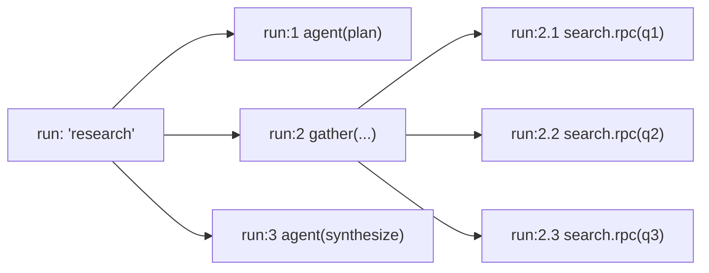
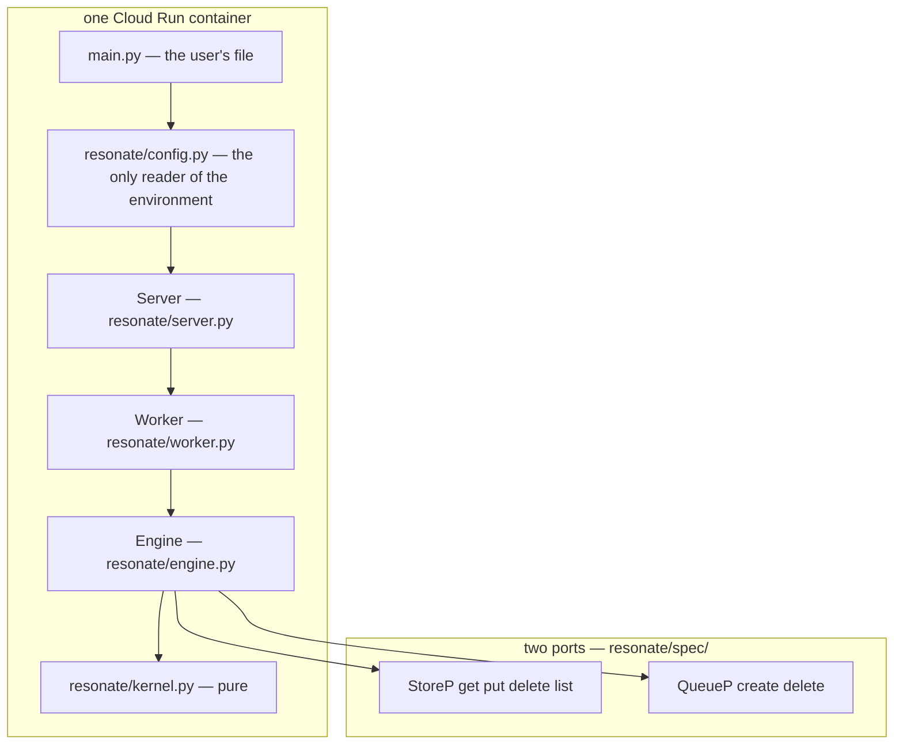

# 00 -- Overview: One Primitive, Three Claims, Five Thousand Lines

A function that runs in milliseconds, is deterministic, and has no side effects can simply be run
again when its process crashes halfway through. A function that runs for minutes, is non-deterministic,
and has side effects cannot: the second run pays again and may not do the same thing. Durable execution
is the guarantee that such a function *does* survive its process — crash the machine mid-flight,
redeploy, lose a region, and the run picks up where it left off, with no retry, checkpoint, or
recovery logic in the user's code. This codebase builds that guarantee from exactly one primitive, the
**durable promise**, and proves it against a 93-entry conformance catalogue. This document is the map:
what the program is, what the three claims are, and where each of the five thousand lines lives.

The whole thing is one file from the user's side:

```python
# main.py — the whole program (code/final/README.md)
from resonate import gather, resonate, serve

@resonate
async def research(question: str):
    queries = await agent(f"Plan the searches for: {question}")   # a durable call, in this process
    results = await gather(search.rpc(q) for q in queries)        # fan-out, on other machines
    return await agent(f"Write a cited report. {question}: {results}")

handler = serve()
```

Nothing in it mentions promises, tasks, leases, retries, or recovery. The public surface is seven
names — `serve`, `resonate`, `gather`, `sleep`, `external`, `Failed`, `Durable` — and that is all of
`resonate/__init__.py`. `handler = serve()` is the whole of the wiring: Google's buildpack looks for a
module-level function named `handler`, and `serve()` builds the service from the environment and
returns one.

# Part 1 -- The Primitive and What It Buys

A function call has an identity, arguments, and either an outcome or nothing yet. Bundle those into a
durable promise — not the JavaScript kind, but an in-memory promise with an id, kept in a database
instead of a variable. It has two operations, `create` and `settle`, both **first-writer-wins** and
therefore idempotent, which is what makes replay work: a restarted program calls `create` on an id from
a previous life and gets back what happened last time.

Calls are memoized by **position**, not by arguments. A run has an id, its first durable call is `:1`,
its second `:2`, and a call made from inside `:2` is `:2.1`. The ids are hierarchical, they sort in the
order the execution unfolds, and the same call gets the same id on every replay. Keying by arguments
would be wrong: with side effects, the same call with the same arguments twice is two events — charging
the same card twice is two charges.



A remote call is the same promise with `create` here and `settle` over there. The running frame raises
`Blocked(id)` to unwind the stack, the task suspends on the promise, and a later settle re-queues the
task, which is re-run from the top. Replay reads the settled promises back instead of calling, so the
model is prompted once per logical step, never once per attempt.

# Part 2 -- The Three Claims

The whole design rests on three claims, each visible in the code (`code/final/ARCHITECTURE.md`):

1. **The kernel does no I/O.** It is a pure function from a document, a request, and an instant to a
   list of effects and a reply. It reads no clock, generates no id, and calls nothing. That is why the
   same decision can be replayed, graded against the catalogue, and explored exhaustively — none of
   which is possible for code that has already written to a bucket.
2. **Everything outside is two ports.** Four operations for a store (`get`, `put`, `delete`, `list`),
   two for a queue (`create`, `delete`), and that is the entire surface the engine is allowed to touch.
   The memory implementations are not mocks; they are held to the same contracts as the Google ones.
3. **Cloud Tasks pushes, so a worker is an endpoint.** There is no loop anywhere waiting for work. The
   queue delivers by POSTing, which is why `server.py` exists, why `execute` and `timeout` are messages
   to an endpoint rather than function calls, and why the whole thing fits in a container that may not
   exist between two steps of the same run.

And one rule the arrows do not show: **arm the deadline → commit → disarm the old → send**. Every
crash window in between leaves the run recoverable, which is the difference between durable and merely
persistent.



# Part 3 -- The Codebase at a Glance

`code/final/` is the real engine: roughly 5,500 lines of production code and 5,200 lines of tests. The
production package `resonate/` breaks into four layers, and the map is worth keeping in front of you:

| file | lines | what it is |
|---|---|---|
| `resonate/__init__.py` | 84 | the public surface: `serve`, `resonate`, `gather`, `sleep`, `external`, `Failed`, `Durable` |
| `resonate/sdk.py` | 508 | the programming model: `@resonate`, durable calls memoized by position, `.rpc`, `gather`, `sleep`, `external`, `Blocked`, versions |
| `resonate/kernel.py` | 671 | the protocol's state machine as pure functions: fifteen operations, `sweep`, `commit`, `handle_external`, `handle_internal` |
| `resonate/types.py` | 332 | the protocol: fifteen requests, the reply, the queue's messages (`Execute`, `Unblock`, `Timeout`), `parse_request` |
| `resonate/engine.py` | 98 | `Engine.process`: load, decide, arm, commit, disarm, send; and the document's `doc_key`, `encode`, `decode` |
| `resonate/worker.py` | 109 | `Worker.run`: claim a task, run the function until it blocks, decide the outcome |
| `resonate/server.py` | 105 | `Server`: one route `POST /`, dispatched on the body's `kind` |
| `resonate/config.py` | 90 | `serve()` and `build()`: the service from the environment |
| `resonate/spec/*.py` | 305 | what the three interfaces are: `EngineP`/`StoreP`/`QueueP`, each with `…C`/`…M` layers |
| `resonate/errors.py` | 13 | `Conflict` and `Unavailable`, the two ways a port refuses |
| `resonate/store_gcp.py` | 146 | a store in Cloud Storage: generation preconditions, measured write rates |
| `resonate/queue_gcp.py` | 58 | a queue in Cloud Tasks: the OIDC token, service-chosen names, the 30-day horizon |
| `resonate/testing/*.py` | ~2,200 | simulators, faults, the 93-entry catalogue, the exhaustive search, the conformance suites |

The evidence methodology is the other half of the story and is unusual enough to get its own documents.
The catalogue in `resonate/testing/properties.py` is transcribed from `resonatehq/resonate-specification`
(`spec/02-abstract/properties.lean`): **43 state and 50 transition entries**. The store contract has 11
claims, the queue contract 8. A kernel step is checked as two abstract halves — the sweep and the
operation — and the fused result must equal their composition. Every one of those numbers is verified
in [14-properties.md](./14-properties.md) and [13-conformance.md](./13-conformance.md).

# Part 4 -- What a Run Costs

One document per origin, written whole, means one conditional write per transition, so a run's
transitions are serialised on a single object. Measured against a real bucket on 2026-09-22 rather than
assumed (`resonate/store_gcp.py`): 30 sequential conditional writes to one object ran at 2.1 writes/sec,
and 8 concurrent writers each doing 5 read-modify-writes moved the counter no faster than one — 2.0
writes/sec, 40 of 40 landed with zero lost updates, and the extra concurrency turned into 106 conflicts
rather than throughput. A run needing more than that is a run whose fan-out should be its own origin.

# The Aha Moment

**Aha:** The entire runtime collapses to one invariant — a durable function is just a function whose
calls are memoized by position in a database instead of a call stack. Everything that looks like
engineering (replay, suspension, fan-out, leases, deadlines) is a consequence of that one move. The
stack is never saved; it is rebuilt from the only thing that survived, the settled promises. A
suspension is a crash you chose, and recovery is reading ids you already have.

# Cross-References

- The primitive in detail: create/settle, first-writer-wins, and positional ids: [01-the-promise.md](./01-the-promise.md).
- The programming model and what it asks of your code: [02-programming-model.md](./02-programming-model.md).
- The engine's shape and the one rule, with diagrams: [04-architecture.md](./04-architecture.md).
- The catalogue and how the search proves the claims: [14-properties.md](./14-properties.md) and [15-explore-and-machine.md](./15-explore-and-machine.md).

Continue to [01-the-promise.md](./01-the-promise.md).
