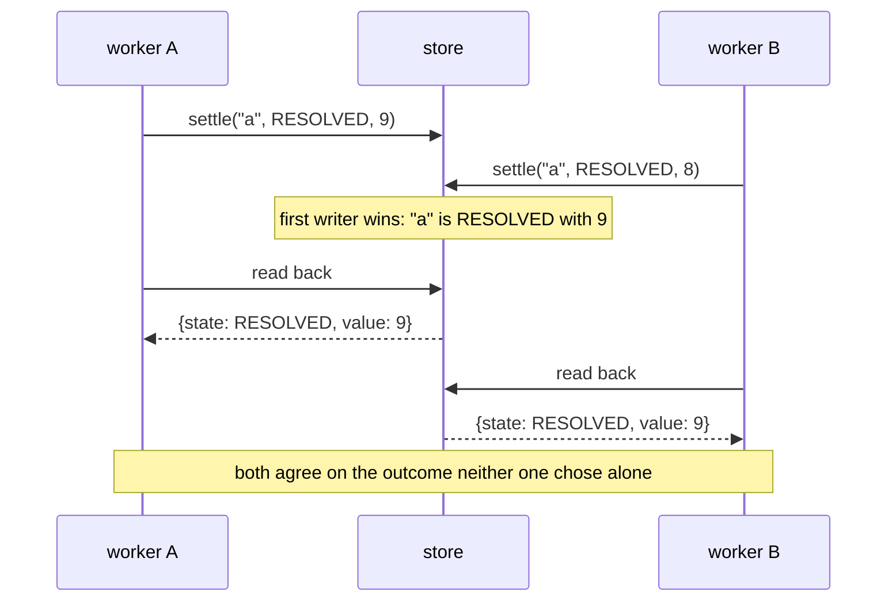
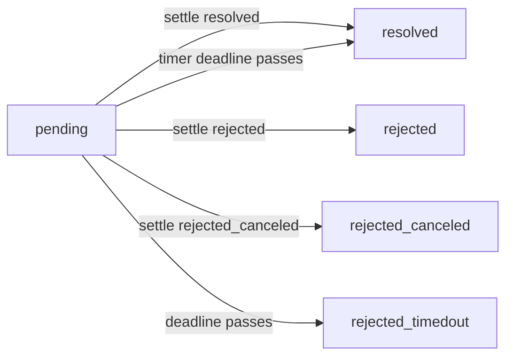

# 01 -- The Promise: create, settle, first-writer-wins

The whole of durable execution rests on one data structure and two operations. A **promise** is a call
identity plus its arguments plus its outcome (or nothing yet); **`create`** and **`settle`** are the two
operations, and both are first-writer-wins, so both are idempotent. That single property is what makes
replay correct: a restarted program calls `create` on an id from a previous life and gets back what
happened last time, and a retried `settle` cannot overwrite an outcome another worker already recorded.
This document builds the promise from the smallest dict-based store up to the full record the kernel
actually carries, and pins down exactly why "keyed by position, not by arguments" is the load-bearing
decision.

Start from the version in the design post (`design/content/writing/001-from-ephemeral-to-durable.mdx`),
where the promise is a dataclass and the store is a dict:

```python
# design/content/writing/001-from-ephemeral-to-durable.mdx (listing 2 and 3)
PENDING, RESOLVED, REJECTED = "pending", "resolved", "rejected"

@dataclass(frozen=True)
class Promise:
    id: str
    state: str = PENDING
    param: Any = None
    value: Any = None

class Store:
    def __init__(self):
        self._db: dict[str, Promise] = {}

    def create(self, id: str, param: Any) -> Promise:
        return self._db.setdefault(id, Promise(id, param=param))

    def settle(self, id: str, state: str, value: Any) -> Promise:
        p = self._db[id]
        if p.state == PENDING:
            self._db[id] = Promise(id, state, p.param, value)
        return self._db[id]
```

`create` uses `setdefault`, so the first writer's param wins and every later writer's is discarded.
`settle` writes only if the promise is still pending, so the first outcome wins and every later one is
discarded. Over one session:

```python
# design/content/writing/001-from-ephemeral-to-durable.mdx (listing 4)
s.create("a", 1)                # Promise("a", PENDING, 1)
s.create("a", 2)                # Promise("a", PENDING, 1)      <- 2 discarded
s.settle("a", RESOLVED, 9)      # Promise("a", RESOLVED, 1, 9)
s.settle("a", RESOLVED, 8)      # Promise("a", RESOLVED, 1, 9)  <- 8 discarded
```

# Part 1 -- First-Writer-Wins Is the Whole Point

First-writer-wins is not a convenience; it is the correctness property. The three consequences named in
the posts each carry a real mechanism in the engine:

1. **Idempotent `create`** makes a duplicated dispatch harmless. The far side of an at-least-once
   `send` calls `create` on the same id twice, and the second call changes nothing.
2. **First-writer-wins settlement** stops a retried remote call from overwriting the answer we already
   woke up on.
3. **Reading back** makes a resumed run agree with whoever settled the promise.

The one subtlety the post flags with `p =` on every branch: `settle` returns whatever is in the store
*after* the write, and if another worker beat you to it, that is their outcome, not yours. So you return
or raise from what came back, never from your local result. Drop the assignment and the code still
passes tests while quietly disagreeing with the store exactly when two workers overlap.



# Part 2 -- The Record the Kernel Actually Carries

The production `Promise` is richer than the post's two-field dataclass, because it has to survive being
swept by a deadline and being the subject of callbacks and listeners (`resonate/kernel.py`):

```python
# resonate/kernel.py (shape, abbreviated)
PENDING = "pending"
RESOLVED = "resolved"
REJECTED = "rejected"
REJECTED_CANCELED = "rejected_canceled"
REJECTED_TIMEDOUT = "rejected_timedout"

@wire
@dataclass
class Promise:
    state: str = PENDING
    param: Value = field(default_factory=Value)
    value: Value = field(default_factory=Value)
    tags: dict[str, str] = field(default_factory=dict)
    timeout_at: int = 0
    created_at: int = 0
    settled_at: int | None = None
    callbacks: list[str] = field(default_factory=list)
    listeners: list[str] = field(default_factory=list)
```

Every field exists because a promise is not just a slot for a return value. `param` and `value` are
`Value` records (headers plus a JSON string) so anything serialisable travels. `timeout_at` and
`created_at` let the sweep settle a promise whose deadline passed. `settled_at` is stamped so the
catalogue can assert "settled iff not pending". `callbacks` holds the ids of tasks suspended on this
promise; `listeners` holds addresses to notify (`Unblock`) when it settles. The five states matter: a
promise can be `resolved`, `rejected`, `rejected_canceled`, or `rejected_timedout` — the last three are
all rejections, told apart so a replay reads back the *kind* of failure it must raise.

The two `Promise` methods that decide deadline behaviour:

```python
# resonate/kernel.py (shape, abbreviated)
def is_external(self) -> bool:
    return (
        self.tags.get(TAG_SCOPE) == "global"
        or self.tags.get(TAG_EXTERNAL) == "true"
        or TAG_TARGET in self.tags
        or self.tags.get(TAG_TIMER) == "true"
    )

def timeout_state(self) -> str:
    return RESOLVED if self.tags.get(TAG_TIMER) == "true" else REJECTED_TIMEDOUT
```

A promise is "external" — meaning a deadline must be armed for it — if it is not a purely local call. A
timer (`sleep`) resolves when its deadline passes; everything else rejects with `rejected_timedout`.
That single `timeout_state` branch is the difference between "the passage of time is the answer" and
"nobody answered".



Settlement is one-way: a settled promise has a `settled_at` and no edge out, which is the catalogue
assertion "settled iff not pending" made visible.

# Part 3 -- Position, Not Arguments

Memoization is usually keyed by arguments, which works only for mathematical functions. With side
effects, the same call with the same arguments can be two events, so the id comes from **position**. The
mechanism is the `_Call` frame in `resonate/sdk.py`:

```python
# resonate/sdk.py (shape, abbreviated)
@dataclass
class _Call:
    id: str
    n: int = 0

    def child(self) -> str:
        self.n += 1
        sep = "." if ":" in self.id else ":"
        return f"{self.id}{sep}{self.n}"
```

A bare root joins its first lineage segment with `:`; anything that already carries lineage joins deeper
segments with `.`. So `research` produces `research:1`, then `research:2`, and a call inside `research:2`
produces `research:2.1`, `research:2.2`, and so on. The counter is shared by everything that call makes,
including concurrent branches, which is what keeps `:1`, `:2`, `:3` in the order the program asked for
them. In the kernel the same id is compared as a "Dewey" order — numeric segments sort numerically,
so `research:2` precedes `research:10`:

```python
# resonate/kernel.py (shape, abbreviated)
def dewey(id: str) -> tuple[tuple[int, Any], ...]:
    return tuple(
        (0, int(seg)) if seg.isdigit() else (1, seg) for seg in re.split(r"[:.]", id)
    )
```

The document keeps its objects sorted by Dewey id (`Document.insert` uses `bisect.insort`), which is
why a store that lists lexicographically can serve the document in numeric order.

# Part 4 -- The Origin, the Document, and One Write

The promise's id has a first segment, the **origin** (`run` in `run:1`). Every promise and task of one
run lives in one origin, and the whole origin lives in one object in the bucket, written whole. The
origin is what makes one conditional write enough to commit any transition:

```python
# resonate/kernel.py (shape, abbreviated)
def origin_of(id: str) -> str:
    return id.split(":", 1)[0]
```

A `Document` holds the objects of one origin, its clock, its generation counter, and its one armed
deadline (`timer_at` / `timer_name`). The write law is simple: a decision that changed nothing writes
nothing, and a transition is one conditional write. This is the seam the rest of the engine is built
on, and [07-engine.md](./07-engine.md) follows it to the store.

# The Aha Moment

**Aha:** A promise is not a synchronization primitive, it is a *database record that happens to have an
id*. All of durable execution falls out of that re-framing: recovery is "read the ids you already
have", fan-out is "many ids", a timeout is "a promise settled by a clock", and an RPC is "a promise
someone else settles". The JavaScript kind is a variable in one process's memory; this kind is a row in
a bucket that outlives every process. First-writer-wins is what lets two workers overlap without ever
disagreeing.

# Cross-References

- What the promise buys at the program level: [02-programming-model.md](./02-programming-model.md).
- `.rpc`, `Blocked` suspension, and `gather` fan-out, which are all promises pulled apart: [03-rpc-and-gather.md](./03-rpc-and-gather.md).
- The kernel's operations that read and write the promise record: [06-kernel.md](./06-kernel.md).
- The catalogue entries that assert the promise's shape is well-formed: [14-properties.md](./14-properties.md).

Continue to [02-programming-model.md](./02-programming-model.md).
