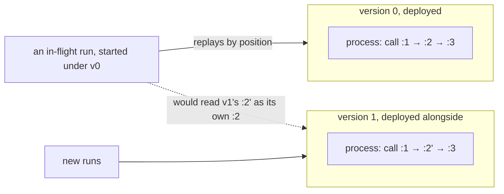
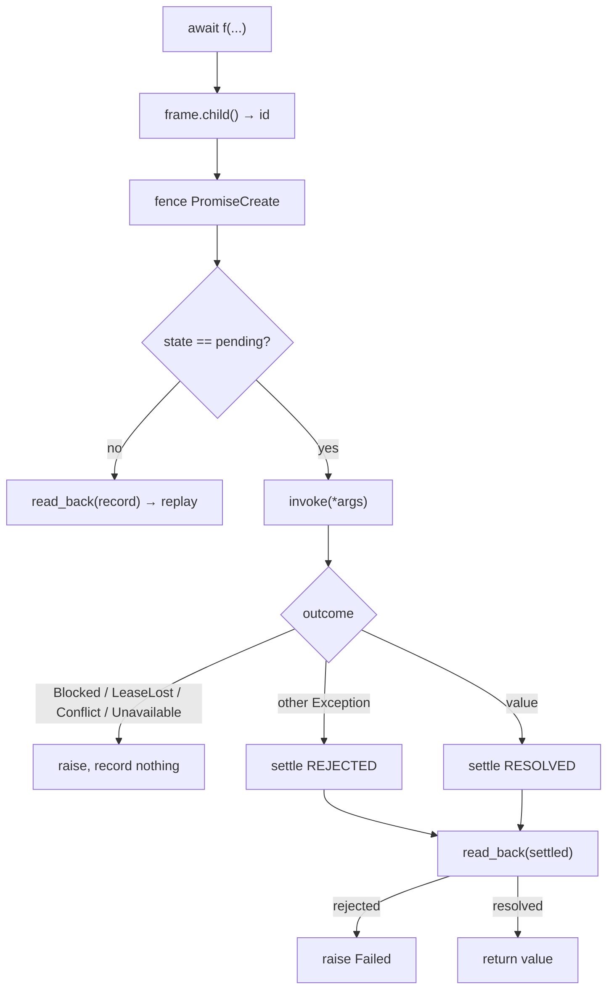

# 02 -- The Programming Model: ordinary async/await, one decorator

The entire user-facing claim of this codebase is the docstring at the top of `resonate/sdk.py`:

```python
# resonate/sdk.py (module docstring, verbatim)
@resonate
async def research(question: str):
    # Plan the searches
    queries = await agent(f"Plan the searches for: {question}")

    # Fan out the searches
    results = await gather(search.rpc(q) for q in queries)

    # Synthesize the results
    return await agent(f"Write a cited report. {question}: {results}")
```

No state machines, no workflow DSL, no context object threaded through every call. `await agent(...)`
runs durably in this process; `search.rpc(q)` runs durably in another one, the same function on a
different machine; `gather` does what it always did. This document is the contract behind those three
lines: what the decorator turns your function into, what deriving an id asks of your code, and why
`async` is load-bearing rather than cosmetic.

# Part 1 -- What the Decorator Turns a Function Into

`@resonate` is a 24-line function whose whole job is to build a `Durable` object and put it in a
registry. The syntax is deliberately two spellings, and nothing else:

```python
# resonate/sdk.py (shape)
def resonate(fn: Callable | None = None, *, version: int = UNVERSIONED):
    if fn is None:
        return lambda f: Durable(f, f.__name__, version)
    return Durable(fn, fn.__name__, version)
```

`@resonate` bare means version zero, "and you need never think again"; `@resonate(version=1)` is a
second generation deployed alongside the first. The version exists for one reason: a run replays from
the top and reads its previous calls back by *position*, so inserting a call or reordering two moves
every position after it, and an in-flight run resuming into the changed body reads somebody else's
answer. Deploying the new body under a new version leaves the old one to finish the runs that started
under it. What does *not* need a version is anything replay cannot see — a faster query, a fixed typo
in a prompt, a different model behind the same call. Position is what matters, not behaviour.



Insert a call or reorder two and every later position shifts; a run started under `v0` must finish on
`v0`, which is the entire reason a version exists.

The `Durable` object the decorator builds registers itself by `(name, version)` in the process-wide
`REGISTRY`, and raises `DuplicateFunction` if two *different* functions claim one pair:

```python
# resonate/sdk.py (shape, abbreviated)
class Durable:
    def __init__(self, fn, name, version=UNVERSIONED):
        if not isinstance(version, int) or isinstance(version, bool) or version < 0:
            raise ValueError(f"{name}: a version is a non-negative integer, not {version!r}")
        self.fn, self.name, self.version = fn, name, version
        self.where = _where(fn)
        prior = REGISTRY.get(self.key)
        if prior is not None and prior.where != self.where:
            raise DuplicateFunction(...)
        REGISTRY[self.key] = self
```

The name is not a label; it is the protocol's identifier. A promise carries `{"f": "process"}` and a
worker looks the code up by it, so two modules each defining `process` would mean a task created for
one executes the other's body. `_where` pins each function to its source file and qualified name, so a
file loaded twice by the framework (once as `main`, once as an import) is recognised as a re-import,
not a collision.

# Part 2 -- A Durable Call: create, run, settle, read back

Awaiting a durable function runs `Durable.__call__`, which is the whole of the local-call protocol in
one method:

```python
# resonate/sdk.py (shape, abbreviated)
async def __call__(self, *args) -> Any:
    inv, frame = current()
    id = frame.child()
    _, data = inv.fence(PromiseCreate(
        id, inv.now() + DEFAULT_TIMEOUT, call_param(self, args), {}))
    record = data["promise"]
    if record["state"] != PENDING:
        return read_back(record)

    token = _FRAME.set(_Call(id))
    try:
        try:
            value, state = dumps(await self.invoke(*args)), RESOLVED
        except (Blocked, *PLATFORM):
            raise                                   # not an answer; unwind
        except Exception as e:
            value, state = dumps(describe(e)), REJECTED   # an unwelcome answer
    finally:
        _FRAME.reset(token)
    _, data = inv.fence(PromiseSettle(id, state, value))
    return read_back(data["promise"])
```

Five decisions, each meaningful:

1. `id = frame.child()` — the id is a position, derived from the enclosing call, never from the
   arguments. The `_Call` frame's counter is shared by everything that call makes, including branches
   running concurrently, which is what keeps `:1`, `:2`, `:3` in program order.
2. `inv.fence(PromiseCreate(...))` — the create does not go directly to the store; it goes *through the
   task's fence*, so every write a running function makes carries the task's version and a worker that
   lost its lease cannot write. `fence` raises `LeaseLost` when the reply's status is not 200.
3. `if record["state"] != PENDING: return read_back(record)` — this is replay. If the promise already
   settled in a previous life, the function body is never entered; the recorded outcome is returned
   (or raised) instead.
4. The `try` splits the possible outcomes into exactly three kinds. `Blocked` and the platform
   exceptions (`LeaseLost`, `Conflict`, `Unavailable`) are *not answers* — nothing is recorded and the
   attempt unwinds. Any other `Exception` is an answer and an unwelcome one, so it is recorded as a
   rejection: the next run reads the same rejection rather than calling again.
5. `return read_back(data["promise"])` — settlement reads what the store returns, never the local
   result, because if another worker got there first, that outcome is the one that counts.

The outcome of a rejected promise is re-raised as `Failed` with the recorded type and message, because
"the rejection *is* the result, and a result is the one thing replay must not change" (the `Failed`
docstring). The round trip from an exception to a record and back:

```python
# resonate/sdk.py (shape)
@dataclass
class Rejection:
    type: str = "rejected"
    message: str = ""

def describe(e: BaseException) -> dict:
    return record(Rejection(type(e).__name__, str(e)))

def read_back(settled: dict) -> Any:
    value = loads(settled["value"])
    if settled["state"] == RESOLVED:
        return value
    why = adapter(Rejection).validate_python(value if isinstance(value, dict) else {})
    raise Failed(f"{settled['id']}: {why.type}: {why.message}")
```



# Part 3 -- What This Asks of Your Code

The one thing the model requires, stated in the docstring: **"Read a clock or roll dice inside a
durable call, never between two of them."** The id counter has to land on the same number on every
replay, so everything up to a durable call must be deterministic. Inside a call is fine — the call is
made exactly once; its value is recorded. Between calls is not — that code runs on every replay, and if
it branches differently it takes a different number of calls and the positions no longer line up with
the history.

Two further obligations follow from the same shape. Side effects must be idempotent at the granularity
of a durable call, because the settle itself may be retried (though first-writer-wins makes the *record*
idempotent, your code may still run again on a `LeaseLost`). And values must be serialisable, because
every argument and every result becomes a JSON `Value` — the `dumps` helper is just `json.dumps`:

```python
# resonate/sdk.py (verbatim)
def dumps(x: Any) -> Value:
    return Value(data=json.dumps(x))
```

The programming model is deliberately narrow. There is no cancellation primitive in the SDK: `halt`
and `continue` exist at the protocol level ([05-types-and-protocol.md](./05-types-and-protocol.md))
but the user-facing surface is exactly seven names, and the rest of the engine is how those seven names
are made to survive the process. A durable function may be `async def` or a plain `def` — a leaf that
only prompts a model has nothing to await, and `invoke` handles both:

```python
# resonate/sdk.py (verbatim)
async def invoke(self, *args) -> Any:
    result = self.fn(*args)
    return await result if inspect.isawaitable(result) else result
```

# Part 4 -- Why async Is Not a Detail

`gather` has to dispatch every branch before anything blocks, or the branches run one at a time. In
async that falls out: each branch is a coroutine, they all run up to the point where their value is
not there yet, and only then is there anything to wait for. A synchronous model would need the dispatch
and the read to be two calls the programmer writes separately — and then the program would not be the
one above. The two context variables that make this work, rather than a stack object, are the other
consequence of leaning on asyncio:

```python
# resonate/sdk.py (shape, abbreviated)
_INVOCATION: ContextVar[Invocation | None] = ContextVar("invocation", default=None)
_FRAME: ContextVar[_Call | None] = ContextVar("frame", default=None)

def current() -> tuple[Invocation, _Call]:
    inv, frame = _INVOCATION.get(), _FRAME.get()
    if inv is None or frame is None:
        raise RuntimeError("a durable function was called outside a durable execution")
    return inv, frame
```

`asyncio` copies the context into each task it creates, so concurrent branches get their own current
frame for free and cannot tread on each other's counters. A call made outside a durable execution —
without an invocation — raises immediately instead of doing something undefined.

# The Aha Moment

**Aha:** The whole programming model is a rename. An async function you wrote normally is already a
workflow; `@resonate` just makes the *call stack* durable by giving each frame a database id. That is
why there is no DSL and nothing to learn: you were already describing the graph, one `await` per edge.
The only new obligation — determinism between calls — is the price of turning a stack you must keep
alive into a stack you can rebuild from ids you already have.

# Cross-References

- What a promise is, and why first-writer-wins makes the `read_back` in `__call__` correct: [01-the-promise.md](./01-the-promise.md).
- How `gather` and `.rpc` are the same create/block/read-back, pulled apart: [03-rpc-and-gather.md](./03-rpc-and-gather.md).
- The worker that calls `invoke` and turns `Blocked` into a suspension: [08-worker.md](./08-worker.md).
- Versions and the registry, seen from the deployment side: [17-deployment.md](./17-deployment.md).

Continue to [03-rpc-and-gather.md](./03-rpc-and-gather.md).
