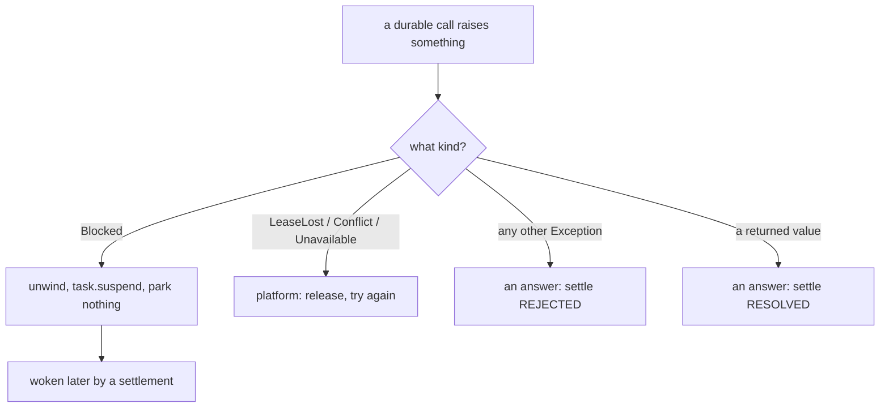
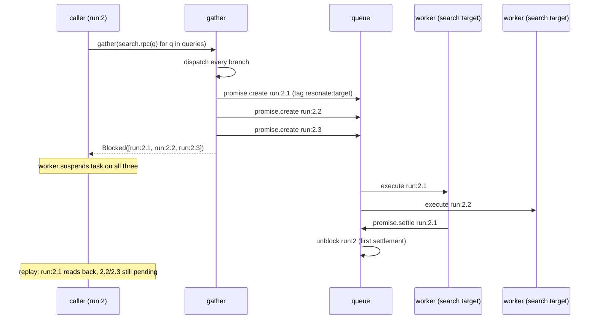

# 03 -- .rpc and gather: one promise, created here, settled there

A remote call and a fan-out are not two new primitives. They are the same durable promise pulled apart
in space and in number: `.rpc` is `create` here and `settle` over there, and `gather` is many promises
blocked on at once. The one genuinely new thing either introduces is `Blocked` — a control-flow
exception that is *not* an error but a frame's way of saying "I cannot make progress, and neither can
anyone above me". Everything about suspension, replay, and fan-out follows from that single move, and
this document traces it from the SDK down to the boundary where the worker takes over.

# Part 1 -- rpc: dispatch, then block

`Durable.rpc` differs from `Durable.__call__` in exactly one field and one statement. The create
carries a target tag, and instead of running the body, it raises `Blocked`:

```python
# resonate/sdk.py (shape, abbreviated)
async def rpc(self, *args) -> Any:
    target = TARGETS.get(self.name)
    if target is None:
        raise RuntimeError(f"{self.name} is not routed anywhere, so it cannot be called remotely")
    inv, frame = current()
    id = frame.child()
    _, data = inv.fence(PromiseCreate(
        id, inv.now() + DEFAULT_TIMEOUT, call_param(self, args),
        {TAG_TARGET: target}))
    record = data["promise"]
    if record["state"] == PENDING:
        raise Blocked([id])
    return read_back(record)
```

`TARGETS` maps a function name to where it runs — deployment, not definition, so the same function is a
local call on one machine and a remote one from another, and only the wiring knows which. `route`
populates it:

```python
# resonate/sdk.py (verbatim)
def route(fn: Durable, target: str) -> None:
    TARGETS[fn.name] = target
```

The `TAG_TARGET` (`resonate:target`) tag is what the kernel later reads to decide whether this promise
needs a task and a deadline. On the far side, the target's worker does the same `PromiseCreate` — the
id already exists, so it gets the settled (or pending) promise back — and if pending it *runs* the
function body locally, which is exactly `Durable.__call__` again. The same id is the address on both
machines; that is the whole of the RPC.

# Part 2 -- Blocked: unwind the stack, park nothing

`Blocked` is defined with a docstring that says what it is and is not:

```python
# resonate/sdk.py (verbatim)
class Blocked(Exception):
    """Not an error: how a frame says *I cannot make progress, and neither
    can anyone above me*. The only thing it does is unwind."""

    def __init__(self, ids: list[str]) -> None:
        super().__init__(", ".join(ids))
        self.ids = list(dict.fromkeys(ids))
```

When `rpc` raises `Blocked([id])`, it unwinds through every `await` above it — through `__call__`'s
`except (Blocked, *PLATFORM): raise`, out of the user's function, and into the worker, which catches
it and turns it into one `task.suspend` naming every id. Nothing waits anywhere: no coroutine parked on
a socket, no thread, no row marked in progress. What is left is a pending promise in a bucket and a
note to wake this task when it settles. `dict.fromkeys` deduplicates the ids, because two branches can
block on the same promise.

The distinction between "an answer" and "not an answer" is the load-bearing line in the SDK, and it is
a tuple, not scattered checks:

```python
# resonate/sdk.py (verbatim)
PLATFORM = (LeaseLost, Conflict, Unavailable)
```

Everything else a durable function raises is its result, recorded as a rejection. These three mean the
attempt could not produce a result at all, so the task goes back and somebody tries again. `Blocked`
sits alongside them in the `__call__` handler as the fourth "not an answer", though it is ordinary
where the other three are not.



The split is the whole SDK: three kinds of exception and a return value, and only the two "answers" are
recorded; the two "not answers" throw the attempt away and let someone try again.

# Part 3 -- gather: fan-out, blocked once

`gather` is `asyncio.gather` with one thing added — all the pending ids are collected into a single
`Blocked`:

```python
# resonate/sdk.py (verbatim)
async def gather(*awaitables) -> list[Any]:
    if len(awaitables) == 1 and not inspect.isawaitable(awaitables[0]):
        awaitables = tuple(awaitables[0])   # a generator, as the README passes one
    outcomes = await asyncio.gather(*awaitables, return_exceptions=True)
    blocked = [id for o in outcomes if isinstance(o, Blocked) for id in o.ids]
    if blocked:
        raise Blocked(blocked)
    for o in outcomes:
        if isinstance(o, BaseException):
            raise o
    return list(outcomes)
```

Why the single `Blocked` matters: a fan-out suspends *once* rather than once per branch, and the run is
woken by the *first* settlement rather than walked through them one at a time. Each `search.rpc(q)` is
a coroutine; `asyncio.gather` starts them all, each dispatches its create, and each raises its own
`Blocked`. `gather` then folds those into one `Blocked([run:2.1, run:2.2, run:2.3])`, and the worker
suspends the task on all three. The kernel's `task_suspend` registers the task as a callback on every
awaited promise, so the first one to settle re-queues the task.

The second subtlety is the ordering of the two loops. A branch that failed does not propagate while
another is still pending: its rejection is recorded and is raised on the *next* run, after the picture
is complete. Acting on half of a fan-out would mean acting on something the next replay might disagree
with — so the block check comes first, and only when nothing is pending are the recorded exceptions
raised.



# Part 4 -- sleep and external: the other two ways to block

`rpc` is not the only thing that raises `Blocked`. `sleep` and `external` are the same shape — a
`PromiseCreate` with a tag, and block if still pending:

```python
# resonate/sdk.py (shape, abbreviated)
async def sleep(ms: int) -> None:
    if ms < 0:
        raise ValueError("a sleep cannot be negative")
    inv, frame = current()
    id = frame.child()
    _, data = inv.fence(PromiseCreate(
        id, inv.now() + ms, dumps({"sleep": ms}), {TAG_TIMER: "true"}))
    if data["promise"]["state"] == PENDING:
        raise Blocked([id])
    return None
```

A durable sleep is a promise that *resolves* rather than rejects when its deadline passes — the
kernel's `resonate:timer` tag — so the passage of time settles it and the settlement wakes whoever
awaited it. It carries no target, because there is nothing to dispatch, and `promise_create` refuses a
timer that names one. Because it takes a position like any other call, a run that sleeps and is
replayed reads the same promise back rather than sleeping again: a sleep already elapsed costs nothing
on replay; one still running blocks exactly as an unfinished `rpc` does.

`external` is the human-in-the-loop variant: wait for something outside the system to answer, with the
same create/block/read-back shape and a `resonate:external` tag. Its docstring is worth quoting at
length because it states the design's whole philosophy in one place:

```python
# resonate/sdk.py (docstring, excerpt)
    A person clicking approve, a webhook, another service, a form nobody
    has filled in yet. The run suspends: no coroutine parked, no thread, no
    row marked in-progress, no container kept alive. What is left is a
    pending promise in a bucket, and whoever has the answer settles it:

        POST /  {"kind": "promise.settle",
                 "data": {"id": "<the promise's id>", "state": "resolved",
                          "value": {"data": "\"yes\""}}}

    ... There is no handler because there is nothing to hold state in: the
    promise *is* the state, and it is in the bucket rather than in a process's memory.
```

An external promise is not a timer, so an unanswered one is *rejected* rather than resolved when it
expires, and the `await` raises `Failed` — a confirmation nobody gave is not a confirmation. Its id is
a position like every other call, so it is the same on every replay and a client can find it by reading
the document rather than by being told.

# The Aha Moment

**Aha:** `Blocked` is suspension, and suspension is a crash you chose. When `rpc` raises it, the worker
throws away the entire Python stack without saving a byte of it, because every piece of state the run
needs was already committed to the store as a promise record. Recovery never reconstructs a stack — it
re-runs from the top and reads the promises back. A remote call, a timer, and a human's approval are
the same object with a different tag, and `gather` is just "block on all of these at once" rather than
"run these in parallel". There is no scheduler; there is only the promise and the note attached to it.

# Cross-References

- The promise these operations create, and the tags the kernel reads back: [01-the-promise.md](./01-the-promise.md).
- The `@resonate` decorator whose `__call__` unwinds on `Blocked`: [02-programming-model.md](./02-programming-model.md).
- The kernel's `task_suspend` and `trigger_settlement`, the far side of `Blocked`: [06-kernel.md](./06-kernel.md).
- The worker that catches `Blocked` and hands the task back: [08-worker.md](./08-worker.md).

Continue to [04-architecture.md](./04-architecture.md).
