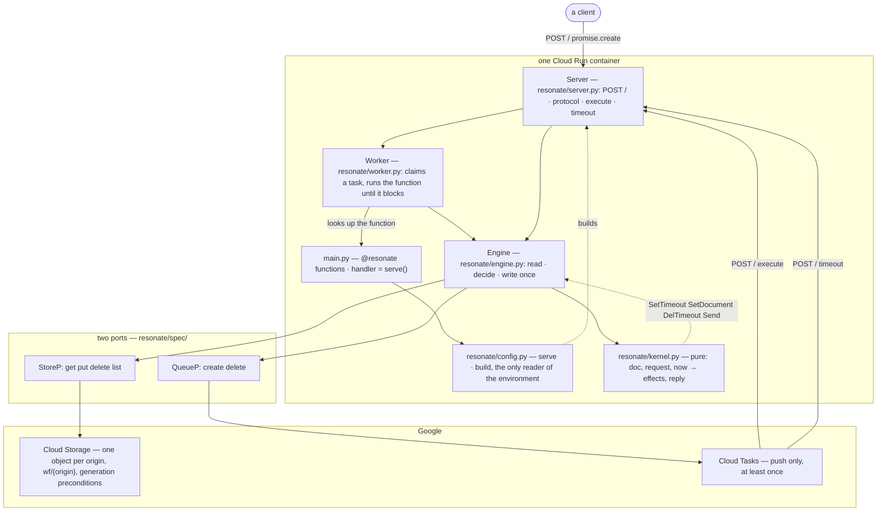
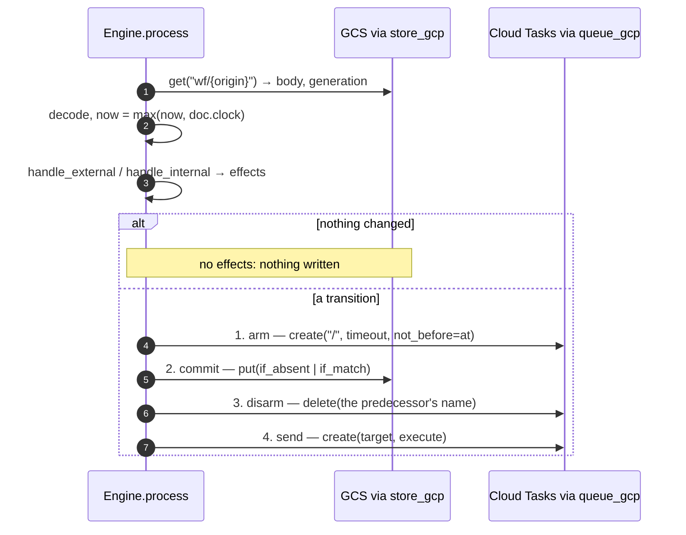

# 04 -- Architecture: read, decide, write once

The engine is not a service with moving parts; it is one route, one pure function, and one rule about
the order effects happen in. A client POSTs a request, the server parses it, the engine reads one
object, the kernel decides what changed, and the engine writes the whole object back with a single
conditional write. The container that answers a request may never have seen the run before, and may
not exist for the next step of it — because everything the run *is* lives in one object in the bucket,
not in any process. This document fixes the shape (`code/final/ARCHITECTURE.md`), then follows one
request through `Engine.process` to the four effects whose order is the difference between durable and
merely persistent.

# Part 1 -- The Shape

The canonical picture, with every name taken from the code:



Two things in this picture are worth pausing on. First, `Worker` is an *object, not a service* — it is
`Server.worker`, built by `config.py` beside the engine and called in-process. Cloud Tasks is
push-only, so nothing polls for work; a delivery arrives as an HTTP request, the handler hands it to
`Worker.run`, and the worker's whole life is that one call. Two "workers" running at once are two
containers, each with its own `Server`, sharing nothing but the bucket. Second, the only arrows that
leave the container are the four store operations and the two queue operations. The engine is the only
thing in the diagram allowed to do I/O.

# Part 2 -- The Three Claims

The shape is an argument in three claims, each falsifiable in the code:

**The kernel does no I/O.** It is a function from a document, a request and an instant to a list of
effects and a reply. It reads no clock, generates no id, and calls nothing. Each operation returns a
reply and the objects it changed; `commit` turns those into effects, and a decision that changed
nothing has none, so a read writes nothing. That is why the same decision can be replayed, graded
against the catalogue, and explored exhaustively — none of which is possible for code that has already
written to a bucket.

**Everything outside is two ports.** Four operations for a store, two for a queue, and that is the
entire surface the engine is allowed to touch. The memory implementations in `resonate/testing/` are
not mocks; they are held to the same contracts as the Google ones, by `python -m
resonate.testing.conformance.check`. Nothing else in the diagram changes when you swap them, which is
the test of whether the line was drawn in the right place.

**Cloud Tasks pushes, so a worker is an endpoint.** There is no loop anywhere in this system waiting
for work. The queue delivers by POSTing, and that single fact is why `resonate/server.py` exists, why
`execute` and `timeout` are messages to an endpoint rather than function calls, and why the whole thing
fits in a container that may not exist between two steps of the same run.

# Part 3 -- The One Rule the Arrows Do Not Show

Effects happen in an order, and the order is not a style choice: **arm the deadline → commit → disarm
the old → send**. The `Engine.process` method writes that order literally:

```python
# resonate/engine.py (shape, abbreviated — the effect order is the point)
def process(self, msg, now):
    origin = origin_of_msg(msg)
    key = doc_key(origin, self.prefix)
    found = self.store.get(key)
    version = None if found is None else found[1]
    doc = Document() if found is None else decode(found[0])
    now = max(now, doc.clock)

    if isinstance(msg, Timeout):
        fx, reply = handle_internal(doc, now, self.cfg), Reply.ok({})
    else:
        fx, reply = handle_external(doc, msg, now, self.cfg)
    if not fx:
        return reply
    new = next(e.doc for e in fx if isinstance(e, SetDocument))

    new.clock, new.gen = now, doc.gen + 1
    for e in fx:
        if isinstance(e, SetTimeout):
            new.timer_name = self.queue.create(
                HERE, encode_message(Timeout(origin)), not_before=e.at)   # 1. arm
    if new.timer_at is None:
        new.timer_name = None
    body = encode(new)
    if version is None:
        self.store.put(key, body, if_absent=True)                          # 2. commit
    else:
        self.store.put(key, body, if_match=version)
    for e in fx:
        if isinstance(e, DelTimeout) and doc.timer_name is not None:
            self.queue.delete(doc.timer_name)                              # 3. disarm
    for e in fx:
        if isinstance(e, Send):
            self.queue.create(e.address, encode_message(e.msg))            # 4. send
    return reply
```

The rationale for each edge, in the words of the architecture note: a committed document whose
deadline was never armed is the one state nothing repairs, so the arm goes first; a message that
outran its commit would be a consequence of an intention rather than of state, so the send goes last.
The kernel produces the effects; the engine *orders* them. `commit` in the kernel is where the four
effect kinds get built in the first place:

```python
# resonate/kernel.py (shape, abbreviated — commit builds the effects)
def commit(doc: Document, c: Commands) -> list[Effect]:
    if not c.add:
        assert not c.send, "a decision that changed nothing owes no effects"
        return []
    new = c.view(doc)
    old, new.timer_at = doc.timer_at, min_deadline(new)
    fx: list[Effect] = []
    if old != new.timer_at and new.timer_at is not None:
        fx.append(SetTimeout(new.timer_at))
    fx.append(SetDocument(new))
    if old != new.timer_at and old is not None:
        fx.append(DelTimeout(old))
    fx.extend(c.send)
    return fx
```

Notice `if not c.add: return []` — a decision that changed nothing owes no effects, so a read costs no
conditional write. That is the kernel's half of "the kernel does no I/O": purity is not a decoration,
it is what lets the engine skip the write entirely when nothing changed.



# Part 4 -- Every Crash Window, and When a Step Does Not Answer

The rule is chosen so that each crash window between two effects leaves the run recoverable:

- **After arm, before commit.** The new deadline is armed in Cloud Tasks, but the document does not
  yet record it. The timer fires, posts `{kind: timeout, origin}`, and the kernel's sweep finds
  nothing due — the run's state has not moved, so the timeout is a no-op with no write. Idempotence
  covers the window.
- **After commit, before disarm.** The document now names the new deadline, but the old one is still
  armed. Both fire eventually; the old one's `Timeout(origin)` again finds nothing due, and the new
  one is the one that sweeps. The stale timer is harmless because a timeout carries only the origin,
  never a specific deadline.
- **After disarm, before send.** The document is committed, the old timer disarmed, but the `execute`
  message never left. The task's retry deadline was committed *before* the message left, so the next
  sweep re-dispatches it. A dropped `execute` is recoverable; a dropped `timeout` is not, because the
  deadline it carried is the only thing that was going to fire — the one deployment obligation this
  package does not discharge for you (`SEQUENCE.md` §4).

The store's refusals are the other side of the same discipline, and the engine's answer to both is to
*not loop*:

```mermaid
sequenceDiagram
    autonumber
    participant E as Engine.process
    participant S as GCS via store_gcp
    E->>S: put(..., if_match=generation)
    alt 412 — the state moved
        S-->>E: Conflict (the generation moved)
        Note over E: nothing was written; the decision was made<br/>against a document that no longer exists
        E-->>E: reply 409 — ask again, never replay
    else 429 / 503 — no answer
        S-->>E: Unavailable
        Note over E: nothing is known about whether it landed
        E-->>E: reply 503 — retry, every operation is idempotent
    end
```

A `Conflict` (the generation moved) means the decision was made against a document that no longer
exists, so the caller is told to re-decide — never to replay the same stale write. An `Unavailable`
means nothing is known about whether the write landed, so the caller retries, safe because every
operation is idempotent. The engine never loops on either: a loop here would pick a retry policy
before anything has said what it should be.

# Part 5 -- What a Run Costs

One document per origin, written whole, means one conditional write per transition, so a run's
transitions are serialised on a single object. Measured against a real bucket (the numbers live in
`resonate/store_gcp.py`): about two writes per second, and eight concurrent writers moved it no faster
than one. A run needing more than that is a run whose fan-out should be its own origin — that is the
deployment-level rule the architecture implies, and [18-data-flow.md](./18-data-flow.md) follows it
through a whole run.

# The Aha Moment

**Aha:** The engine's entire job is to *order* the effects the kernel *chose*. Purity is what makes the
ordering safe: because the kernel could not have written anything itself, the engine can reorder,
retry, or drop its writes at the right moments and still be correct. The "arm → commit → disarm →
send" rule is not a transaction manager's trick, it is the consequence of a single fact — the store's
conditional write is the only commit point in the system, so everything else is arranged to be harmless
whether or not it happened, except the one write that counts.

# Cross-References

- The pure kernel that produces the effects the engine orders: [06-kernel.md](./06-kernel.md).
- The engine's document encoding and `doc_key`, in full: [07-engine.md](./07-engine.md).
- The two ports' contracts that bound the engine's I/O: [10-spec-interfaces.md](./10-spec-interfaces.md).
- The conformance suite that *grades* the effect order: [13-conformance.md](./13-conformance.md).

Continue to [05-types-and-protocol.md](./05-types-and-protocol.md).
