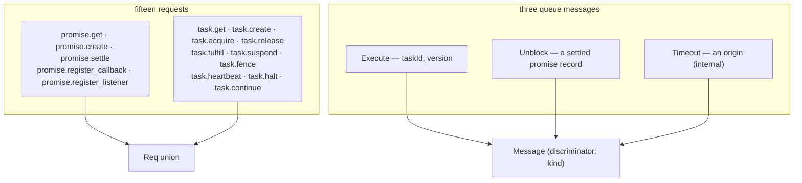
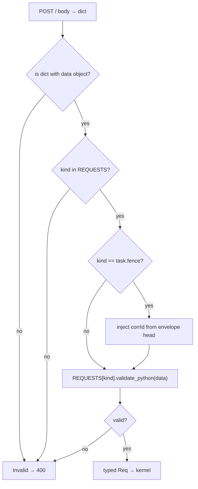

# 05 -- Types and Protocol: everything that can be said, and its form on a wire

The protocol is the set of things the system can be asked to do, written down once and shared by the
client, the queue, and the tests. `resonate/types.py` declares **fifteen requests** a client may send,
the **reply** that comes back, the **three messages** a queue carries (`Execute`, `Unblock`,
`Timeout`), and the parsing that turns a dict into one of them. Nothing here decides anything —
`kernel.py` does that, and what it decides *about* is this. This document enumerates all fifteen, shows
how the nested `task.*` requests carry actions, and traces one envelope through `parse_request` to a
typed value or a 400.

# Part 1 -- Two Seams, Both JSON

The protocol has two seams, and both are JSON. Requests in, messages in and out: these are where the
system stops being Python objects and becomes something another implementation could sit on the other
side of. The simulated queue carries the same JSON the real one does, so the thing the tests drive and
the thing production drives differ in where the bytes go and nowhere else.

Everything on a wire is the protocol's camelCase (`timeoutAt`, `corrId`), and every dataclass that goes
on one says so with `@wire`:

```python
# resonate/types.py (shape, abbreviated)
wire = with_config(ConfigDict(alias_generator=to_camel))

@functools.cache
def adapter(cls: type) -> TypeAdapter:
    return TypeAdapter(cls)

def record(x, exclude=frozenset()) -> dict:
    return adapter(type(x)).dump_python(x, mode="json", by_alias=True,
                                        exclude_none=True, exclude=exclude)

@wire
@dataclass
class Value:
    headers: dict[str, str] | None = None
    data: str | None = None
```

`record` is the single rule for serialisation: camelCase, JSON types, no nulls. A `Value` is a payload
— optional headers plus a JSON string — which is why a promise's `param` and `value` are `Value`s, and
why "serialisable values" is the only data requirement the programming model imposes. The protocol's
own version is a single constant, a date string rather than a number:

```python
# resonate/types.py (verbatim)
PROTOCOL_VERSION = "2026-04-01"

# A non-empty string: every id, pid, address and state.
Id = Annotated[str, StringConstraints(strict=True, min_length=1)]
```

# Part 2 -- The Fifteen Requests

Fifteen requests split into five for promises and ten for tasks. Five are bare reads or writes on a
single id; the interesting ones are the task requests that carry a nested action and are therefore
validated in two passes — first the envelope, then the action it wraps.

```python
# resonate/types.py (shape, abbreviated — the five promise requests)
@wire
@dataclass(frozen=True)
class PromiseGet:
    id: Id

@wire
@dataclass(frozen=True)
class PromiseCreate:
    id: Id
    timeout_at: StrictInt
    param: Value = field(default_factory=Value)
    tags: dict[str, str] = field(default_factory=dict)

@wire
@dataclass(frozen=True)
class PromiseSettle:
    id: Id
    state: Id   # RESOLVED | REJECTED | REJECTED_CANCELED
    value: Value = field(default_factory=Value)

@wire
@dataclass(frozen=True)
class PromiseRegisterCallback:
    awaited: Id
    awaiter: Id  # same origin as `awaited`, and not equal to it

@wire
@dataclass(frozen=True)
class PromiseRegisterListener:
    awaited: Id
    address: Id
```

`PromiseSettle.state` is an `Id` — a non-empty string — not an enum, because the valid set
(`RESOLVED | REJECTED | REJECTED_CANCELED`) is a kernel concern and the kernel rejects anything else
with a 400. The protocol layer enforces shape, not meaning; the semantic doors, the ones the
catalogue shadows, are the kernel's own.

The ten task requests are where the nesting lives. `TaskCreate` wraps a `PromiseCreate` as its action;
`TaskFulfill` wraps a `PromiseSettle`; `TaskSuspend` takes many awaited ids on the wire as one
`register_callback` action each; `TaskFence` wraps either a create or a settle:

```python
# resonate/types.py (shape, abbreviated — the nested task requests)
@wire
@dataclass(frozen=True)
class TaskCreate:
    pid: Id
    ttl: StrictInt
    # must carry resonate:target, must not carry resonate:delay
    action: Annotated[PromiseCreate, BeforeValidator(_data)]

@wire
@dataclass(frozen=True)
class TaskFulfill:
    id: Id
    version: StrictInt
    action: Annotated[PromiseSettle, BeforeValidator(_data)]  # action.id == id

@wire
@dataclass(frozen=True)
class TaskSuspend:
    id: Id
    version: StrictInt
    awaited: Annotated[
        tuple[Id, ...],
        Field(validation_alias="actions", min_length=1),
        BeforeValidator(lambda actions: [_data(a)["awaited"] for a in actions]),
    ]

def _promise_action(action: dict) -> PromiseCreate | PromiseSettle:
    kind = "promise.create" if action.get("kind") == "promise.create" else "promise.settle"
    return REQUESTS[kind].validate_python(_data(action))

@wire
@dataclass(frozen=True)
class TaskFence:
    id: Id
    version: StrictInt
    corr_id: str  # the envelope's, echoed in the nested response head
    action: Annotated[PromiseCreate | PromiseSettle, BeforeValidator(_promise_action)]
```

`_data(action)` peels a nested action, which is `{kind, head, data}`, down to just the `data`. The
validation is genuinely two passes: `TaskFence` first validates itself, then hands the action to the
appropriate request adapter. The full set, in one union and one dispatch table:

```python
# resonate/types.py (shape, abbreviated)
Req = (
    PromiseGet | PromiseCreate | PromiseSettle | PromiseRegisterCallback | PromiseRegisterListener
    | TaskGet | TaskCreate | TaskAcquire | TaskRelease | TaskFulfill | TaskSuspend | TaskFence
    | TaskHeartbeat | TaskHalt | TaskContinue
)

REQUESTS = {kind: TypeAdapter(cls) for kind, cls in {
    "promise.get": PromiseGet,
    "promise.create": PromiseCreate,
    "promise.settle": PromiseSettle,
    "promise.register_callback": PromiseRegisterCallback,
    "promise.register_listener": PromiseRegisterListener,
    "task.get": TaskGet,
    "task.create": TaskCreate,
    "task.acquire": TaskAcquire,
    "task.release": TaskRelease,
    "task.fulfill": TaskFulfill,
    "task.suspend": TaskSuspend,
    "task.fence": TaskFence,
    "task.heartbeat": TaskHeartbeat,
    "task.halt": TaskHalt,
    "task.continue": TaskContinue,
}.items()}
```



# Part 3 -- The Reply and the Three Messages

The reply is deliberately minimal — a status and untyped data — so the kernel can return `200 {…}`
data, a `300` for "the decision you made is already moot", or a `404`/`409`/`422` error without
inventing a type for every shape:

```python
# resonate/types.py (shape, abbreviated)
@dataclass(frozen=True)
class Reply:
    status: int
    data: Any

    @staticmethod
    def ok(data: Any) -> Reply:
        return Reply(200, data)

    @staticmethod
    def err(status: int, message: str) -> Reply:
        return Reply(status, message)

def encode_reply(reply: Reply) -> dict:
    return {"head": {"status": reply.status}, "data": reply.data}
```

The three messages are what a queue carries, discriminated on a `kind` field so `decode_message` can
turn one JSON body into one typed value. `Timeout` is the odd one out: it is *not* a protocol request —
no client can send one — but a transition on the origin's document all the same, fired by a deadline
this origin armed for itself:

```python
# resonate/types.py (shape, abbreviated)
@wire
@dataclass(frozen=True)
class Execute:
    task_id: Id
    version: StrictInt
    kind: Literal["execute"] = "execute"

@wire
@dataclass(frozen=True)
class Unblock:
    promise: dict[str, Any]
    kind: Literal["unblock"] = "unblock"

@wire
@dataclass(frozen=True)
class Timeout:
    origin: Id
    kind: Literal["timeout"] = "timeout"

Message = Annotated[Execute | Unblock | Timeout, Field(discriminator="kind")]

#: The address of this service's own endpoint, for a message the service
#: sends to itself. A queue resolves it against its base URL.
HERE = "/"
```

`HERE = "/"` is the one literal address in the whole protocol: when the engine arms a deadline it
creates a queue task at `HERE` carrying a `Timeout`, and the queue resolves `"/"` against the service's
own base URL. The `not_before` on that create is how a "deadline" becomes a scheduled push.

# Part 4 -- parse_request: one envelope to one typed request

Parsing is where a malformed request becomes a 400 and never reaches the state machine. `parse_request`
takes an envelope that is already a dict — whoever turned the body into one (Flask, a test, a queue)
did that — and produces a typed request or `Invalid`:

```python
# resonate/types.py (verbatim)
def parse_request(envelope: dict) -> Req:
    """One envelope to one typed request, or `Invalid`."""
    if not isinstance(envelope, dict) or not isinstance(envelope.get("data"), dict):
        raise Invalid("an envelope is an object with a data object")
    kind, data = envelope.get("kind"), envelope["data"]
    if kind not in REQUESTS:
        raise Invalid(f"unknown request kind {kind!r}")
    if kind == "task.fence":
        data = {**data, "corrId": str(envelope.get("head", {}).get("corrId", ""))}
    try:
        return REQUESTS[kind].validate_python(data)
    except (ValidationError, KeyError, TypeError, AttributeError) as e:
        raise Invalid(f"{kind}: {e}") from None
```

`task.fence` is the one special case: its `corrId` comes from the *envelope's* head, not its data, so
`parse_request` copies it in before validation. That correlation id is how the nested fence response
echoes which request it answers, and it exists so a worker can match a reply to the write it made even
when many fences are in flight.



# The Aha Moment

**Aha:** The protocol is a *shapes* layer, not a *rules* layer. Pydantic validates that a
`promise.settle` has an id, a state, and a value — but it does not know that the state must be
`RESOLVED | REJECTED | REJECTED_CANCELED`, that a timer must not name a target, or that an awaiter
must share an origin with its awaited. All of that is the kernel's business, encoded as `Reply.err`
returns. The split is what keeps the catalogue *complete*: the specification shadows the semantic
doors in `kernel.py`, because a shape that fails is a transport concern, but a shape that passes and a
rule that fails is a correctness concern, and only the second one is worth 93 entries.

# Cross-References

- The kernel that decides what these requests *mean*: [06-kernel.md](./06-kernel.md).
- The engine that maps each request to its origin's document: [07-engine.md](./07-engine.md).
- The queue messages turned into pushes by the adapter: [11-ports-adapters.md](./11-ports-adapters.md).
- The catalogue whose entries shadow the kernel's semantic doors: [14-properties.md](./14-properties.md).

Continue to [06-kernel.md](./06-kernel.md).
