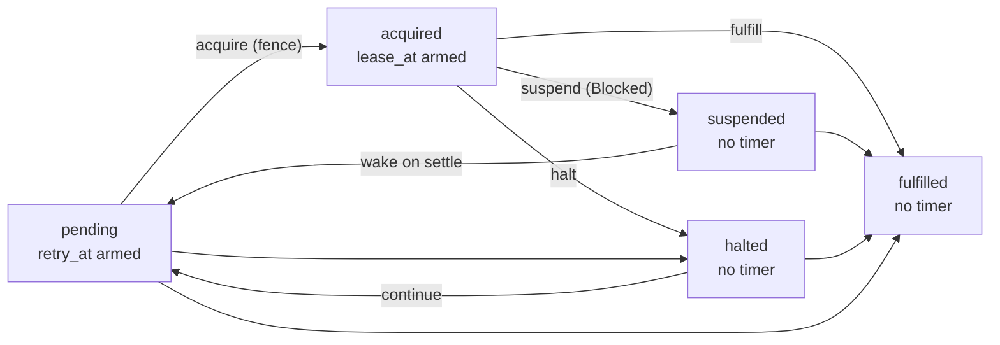
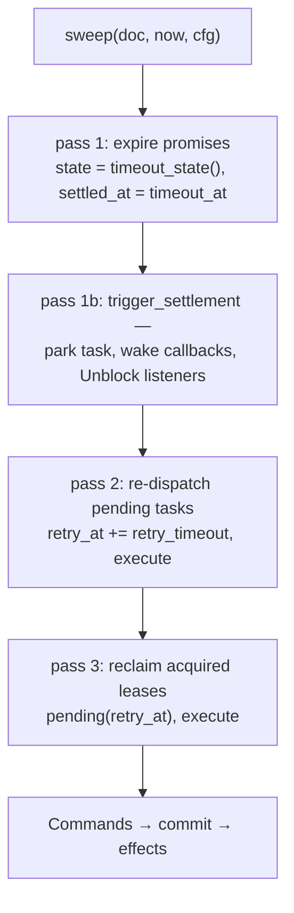

# 06 -- The Kernel: a pure state machine

The kernel is the protocol's state machine, and its purity is the design's load-bearing fact: every
function here takes a `Document`, a request (or a clock tick), and an instant, and returns a reply plus
the objects it changed — never performing I/O, never reading a clock, never generating an id. The
engine wraps it with the store and the queue; the kernel only *decides*. This document walks the three
pieces: the document it decides about, the sweep that advances time, and the fifteen operations that
handle requests, with the invariants that hold every document to its shape.

# Part 1 -- The Document, the Object, the Two Records

The unit of state is the **origin**: every promise and task of one run lives in one origin, and the
whole origin lives in one `Document` — one object in the bucket. The document carries its objects, a
logical `clock`, a generation counter, and the *one* deadline it has armed:

```python
# resonate/kernel.py (shape, abbreviated)
@wire
@dataclass
class Document:
    objects: list[Object] = field(default_factory=list)
    clock: int = 0
    gen: int = 0
    timer_at: int | None = None
    timer_name: str | None = None

    def get(self, id: str) -> Object | None:
        for o in self.objects:
            if o.id == id:
                return o
        return None

    def insert(self, o: Object) -> Object:
        insort(self.objects, o, key=lambda x: dewey(x.id))
        return o
```

The objects are kept sorted by Dewey id (`bisect.insort` with the `dewey` key from
[01-the-promise.md](./01-the-promise.md)), so a store that lists lexicographically serves the document
in the numeric order the execution unfolded. Each `Object` holds a `Promise` and, for calls with a
target, a `Task`:

```python
# resonate/kernel.py (shape, abbreviated)
@wire
@dataclass
class Promise:
    state: str = PENDING
    param: Value = field(default_factory=Value)
    value: Value = field(default_factory=Value)
    tags: dict[str, str] = field(default_factory=dict)
    timeout_at: int = 0
    created_at: int = 0
    settled_at: int | None = None
    callbacks: list[str] = field(default_factory=list)
    listeners: list[str] = field(default_factory=list)

@wire
@dataclass
class Task:
    state: str = T_PENDING
    version: int = 0
    pid: str | None = None
    ttl: int | None = None
    resumes: set[str] = field(default_factory=set)
    retry_at: int | None = None
    lease_at: int | None = None
```



A task's five states are `pending`, `acquired`, `suspended`, `halted`, `fulfilled`; its two timers are
`retry_at` (when a pending task is re-dispatched) and `lease_at` (when an acquired task's lease runs
out). The invariants pin them down later. The kernel's only configuration is two numbers:

```python
# resonate/kernel.py (verbatim)
@dataclass(frozen=True)
class KernelCfg:
    retry_timeout: int = 30_000
    preload_limit: int = 10
```

# Part 2 -- The Sweep: time passing, applied in three passes

A clock tick is the internal message `Timeout(origin)`, and `handle_internal` is the whole of what it
means: sweep, then commit:

```python
# resonate/kernel.py (verbatim)
def handle_internal(doc: Document, now: int, cfg: KernelCfg) -> list[Effect]:
    return commit(doc, sweep(doc, now, cfg))
```

The sweep is three passes, each asking "is anything due now?" against the document as it stands after
the previous pass:

```python
# resonate/kernel.py (verbatim)
def sweep(doc: Document, now: int, cfg: KernelCfg) -> Commands:
    expired = [o for o in doc.objects
               if o.promise.state == PENDING and now >= o.promise.timeout_at]
    c = Commands(add=[
        replace(o, promise=replace(o.promise, state=o.promise.timeout_state(),
                                   settled_at=o.promise.timeout_at))
        for o in expired])
    for o in expired:
        c = c.merge(trigger_settlement(c.view(doc), o.id, now, cfg))

    for o in c.view(doc).objects:
        t = o.task
        if t is not None and t.state == T_PENDING and t.retry_at is not None and t.retry_at <= now:
            o = replace(o, task=replace(t, retry_at=now + cfg.retry_timeout))
            c = c.merge(Commands([o], execute(o)))

    for o in c.view(doc).objects:
        t = o.task
        if t is not None and t.state == T_ACQUIRED and t.lease_at is not None and t.lease_at <= now:
            o = replace(o, task=pending(t, now + cfg.retry_timeout))
            c = c.merge(Commands([o], execute(o)))
    return c
```

Three passes, in order:

1. **Expire promises.** Any pending promise whose `timeout_at` has passed settles at its
   `timeout_state()` — a timer resolves, everything else becomes `rejected_timedout` — and its
   settlement chain runs: its callbacks are woken, its listeners get an `Unblock`.
2. **Re-dispatch pending tasks.** A pending task past its `retry_at` has its retry re-armed one
   `retry_timeout` later, and its `execute` message is (re)sent. This is how a dropped `execute`
   recovers: the retry deadline was committed before the message left.
3. **Reclaim acquired leases.** An acquired task past its `lease_at` is made pending again with a fresh
   retry and re-dispatched. This is how a worker that died mid-run is replaced.

Each pass reads through `c.view(doc)` — the document plus the commands accumulated so far — so a task
expired in pass 1 is seen as such in pass 3, and a single `Timeout` can advance many objects in one
write.



# Part 3 -- The Operations: sweep, then decide

Every *external* request (a client POST) is handled by the same shape: sweep first, match the request
to its operation, run it against the swept document, filter the sweep's sends, then commit:

```python
# resonate/kernel.py (shape, abbreviated)
def handle_external(doc, req, now, cfg) -> tuple[list[Effect], Reply]:
    swept = sweep(doc, now, cfg)
    mid = swept.view(doc)
    match req:
        case PromiseGet():       reply, c = promise_get(mid, req)
        case PromiseCreate():    reply, c = promise_create(mid, req, now, cfg)
        case PromiseSettle():    reply, c = promise_settle(mid, req, now, cfg)
        case PromiseRegisterCallback(): reply, c = promise_register_callback(mid, req)
        case PromiseRegisterListener(): reply, c = promise_register_listener(mid, req)
        case TaskGet():          reply, c = task_get(mid, req)
        case TaskCreate():       reply, c = task_create(mid, req, now, cfg)
        case TaskAcquire():      reply, c = task_acquire(mid, req, now, cfg)
        case TaskRelease():      reply, c = task_release(mid, req, now, cfg)
        case TaskFulfill():      reply, c = task_fulfill(mid, req, now, cfg)
        case TaskSuspend():      reply, c = task_suspend(mid, req, cfg)
        case TaskFence():        reply, c = task_fence(mid, req, now, cfg)
        case TaskHeartbeat():    reply, c = task_heartbeat(mid, req, now)
        case TaskHalt():         reply, c = task_halt(mid, req)
        case TaskContinue():     reply, c = task_continue(mid, req, now, cfg)
    final = c.view(mid)
    kept = []
    for e in swept.send:
        if isinstance(e.msg, Execute):
            o = final.get(e.msg.task_id)
            if o is None or o.task is None or o.task.state != T_PENDING or o.task.version != e.msg.version:
                continue
        kept.append(e)
    return commit(doc, Commands(swept.add + c.add, kept + c.send)), reply
```

Sweeping *first* matters: a `promise.get` answered after its deadline should see the deadline's
effect, and a `task.acquire` for a lease the sweep just reclaimed must not succeed. The `kept` filter is
the subtle bit — the sweep may have produced an `execute` for a task that the request's operation then
superseded (settled, suspended, fulfilled), and that stale dispatch is dropped rather than delivered.
The reply comes from the operation; the effects come from the sweep plus the operation, in one commit.

A representative operation, `promise_create`, shows the pattern of "validate, then either idempotent
return or new objects":

```python
# resonate/kernel.py (shape, abbreviated)
def promise_create(doc, r, now, cfg) -> tuple[Reply, Commands]:
    address = r.tags.get(TAG_TARGET)
    if address is not None and not is_valid_address(address):
        return Reply.err(400, "Invalid resonate:target address"), NOTHING
    if r.tags.get(TAG_TIMER) == "true" and address is not None:
        return Reply.err(400, "A timer promise must not have a resonate:target tag"), NOTHING
    delay = r.tags.get(TAG_DELAY)
    if delay is not None:
        if not delay.isdigit():
            return Reply.err(400, "resonate:delay must be a non-negative integer"), NOTHING
        if int(delay) >= r.timeout_at:
            return Reply.err(400, "resonate:delay must be less than timeoutAt"), NOTHING
        if address is None:
            return Reply.err(400, "resonate:delay requires a resonate:target tag"), NOTHING
    o = doc.get(r.id)
    if o is not None:
        return Reply.ok({"promise": o.promise.to_record(r.id)}), NOTHING   # idempotent
    p = new_promise(r, now)
    reply = Reply.ok({"promise": p.to_record(r.id)})
    if p.target() is None:
        return reply, Commands([Object(r.id, p)])
    if p.state != PENDING:
        return reply, Commands([Object(r.id, p, Task(state=T_FULFILLED))])
    if delay is not None and now < int(delay):
        return reply, Commands([Object(r.id, p, Task(state=T_PENDING, retry_at=int(delay)))])
    o = Object(r.id, p, Task(state=T_PENDING, retry_at=p.created_at + cfg.retry_timeout))
    return reply, Commands([o], execute(o))
```

The chain of cases is the whole of durable call semantics in miniature: a promise with no target is a
pure value, no task; a promise already past its deadline is born settled; a delayed dispatch is born
pending with a `retry_at` of the delay; otherwise the task is born pending with a retry one
`retry_timeout` later and an `execute` queued. The idempotence is explicit — if the id already exists,
return what is there and add nothing.

# Part 4 -- Settle and Its Chain

`settle` is the one place a promise stops being pending, and it always runs `trigger_settlement`, which
is where the "callbacks" and "listeners" fields finally pay off:

```python
# resonate/kernel.py (shape, abbreviated)
def settle(doc, id, state, value, now, cfg) -> tuple[dict, Commands]:
    o = doc.get(id)
    assert o is not None and o.promise.state == PENDING
    o = replace(o, promise=replace(o.promise, state=state, value=copy.deepcopy(value), settled_at=now))
    c = Commands([o])
    return o.promise.to_record(id), c.merge(trigger_settlement(c.view(doc), id, now, cfg))

def trigger_settlement(doc, id, now, cfg) -> Commands:
    o = doc.get(id)
    assert o is not None
    task = o.task
    if task is not None and task.state != T_FULFILLED:
        task = parked(task, T_FULFILLED)
    c = Commands([replace(o, task=task, promise=replace(o.promise, callbacks=[], listeners=[]))])

    for awaiter in o.promise.callbacks:
        ao = doc.get(awaiter)
        if ao is None or ao.task is None:
            continue
        if ao.promise.state != PENDING or now >= ao.promise.timeout_at:
            continue
        t = ao.task
        if t.state == T_SUSPENDED:
            ao = replace(ao, task=replace(t, state=T_PENDING, resumes={id},
                                          retry_at=now + cfg.retry_timeout))
            c = c.merge(Commands([ao], execute(ao)))
        elif t.state in (T_PENDING, T_ACQUIRED, T_HALTED) and id not in t.resumes:
            c = c.merge(Commands([replace(ao, task=replace(t, resumes=t.resumes | {id}))]))

    record = o.promise.to_record(id)
    return c.merge(Commands(send=[Send(address, Unblock(record)) for address in o.promise.listeners]))
```

When a promise settles, its own task is parked fulfilled, its callback list is consumed — each
suspended awaiter is re-pended and dispatched, each still-running awaiter records the id in its
`resumes` so its next `task.suspend` can answer `300` — and every listener gets an `Unblock` carrying
the settled record. That is the "first settlement wakes the parent" mechanism
[03-rpc-and-gather.md](./03-rpc-and-gather.md) relies on.

# Part 5 -- The Invariants

Every document is checked against the same rules the catalogue asserts, in `check_invariants` — the
kernel's own self-audit:

```python
# resonate/kernel.py (shape, abbreviated)
def check_invariants(doc: Document) -> str | None:
    ids = {o.id for o in doc.objects}
    if [o.id for o in doc.objects] != sorted(ids, key=dewey):
        return "objects are not sorted by dewey id"
    for o in doc.objects:
        p, t = o.promise, o.task
        if p.state == PENDING and p.settled_at is not None:
            return f"promise {o.id}: pending but has settled_at"
        if p.state != PENDING and p.settled_at is None:
            return f"promise {o.id}: settled but has no settled_at"
        ...
        if t.state == T_PENDING and (t.retry_at is None or t.lease_at is not None):
            return f"task {o.id}: pending without exactly a retry timer"
        if t.state == T_ACQUIRED and (t.lease_at is None or t.retry_at is not None):
            return f"task {o.id}: acquired without exactly a lease timer"
        if t.state in (T_SUSPENDED, T_HALTED, T_FULFILLED) and (t.retry_at or t.lease_at) is not None:
            return f"task {o.id}: {t.state} with an armed timer"
        ...
    if doc.timer_at != min_deadline(doc):
        return f"timer_at {doc.timer_at} != min_deadline {min_deadline(doc)}"
    return None
```

Read the task-timer invariants carefully: a pending task has *exactly* a retry timer and no lease; an
acquired task has *exactly* a lease and no retry; a suspended, halted, or fulfilled task has neither.
That is the entire lifecycle discipline in four lines — a task is either waiting to run, running, or
done, and never any two of them.

# The Aha Moment

**Aha:** The kernel is a *pure* state machine not because purity is elegant but because it is the only
way to test the thing. A function that has already written to a bucket cannot be replayed, so it cannot
be graded against 93 catalogue entries or explored exhaustively; one that only returns effects can be
run against the same document a million times for free. The `if not c.add: return []` in `commit` is
the payoff: a decision that changed nothing owes no effects, which is exactly the property that makes
"replay" and "idempotent timeout" and "a read writes nothing" all fall out of the same rule.

# Cross-References

- The promise and task records the kernel operates on: [01-the-promise.md](./01-the-promise.md).
- The engine that arms, commits, disarms, and sends the kernel's effects: [07-engine.md](./07-engine.md).
- The request shapes the kernel matches on: [05-types-and-protocol.md](./05-types-and-protocol.md).
- The catalogue that shadows exactly these invariants: [14-properties.md](./14-properties.md).

Continue to [07-engine.md](./07-engine.md).
