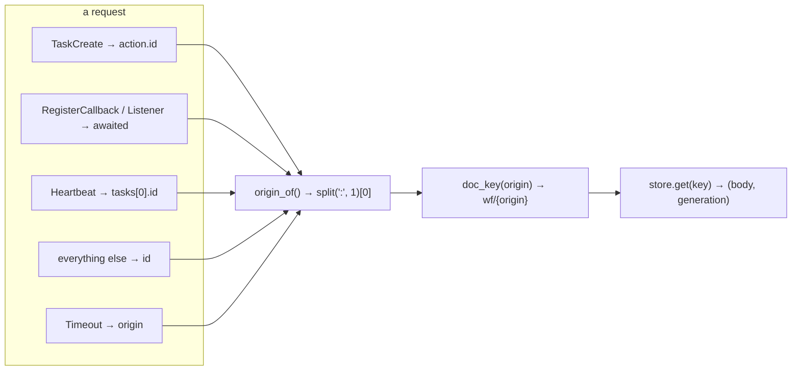
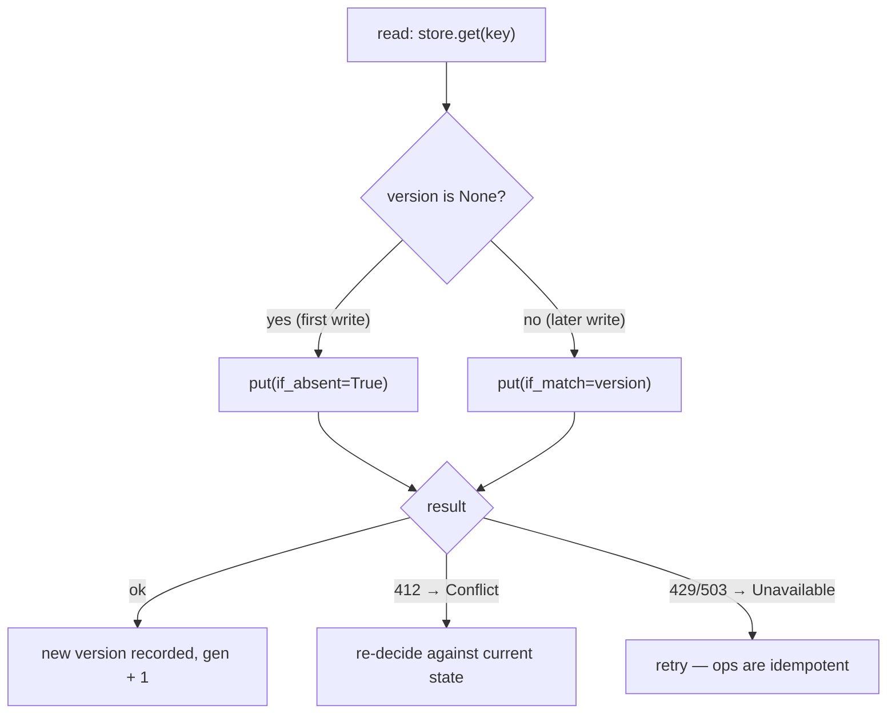

# 07 -- The Engine: the document, on disk

The engine is 98 lines and does exactly one job: turn a message into the right object in the bucket,
run the kernel against it, and write the whole object back with one conditional write. Where
[04-architecture.md](./04-architecture.md) covered the *order* of the effects and
[06-kernel.md](./06-kernel.md) covered the *decisions*, this document covers the *state on disk*: how an
origin becomes a key, how a `Document` becomes bytes and back, how a message names its origin, and what
the two write modes (`if_absent` and `if_match`) actually protect. It is the boundary between the pure
kernel and the impure world, and every line of it exists to keep that boundary exact.

# Part 1 -- How an Origin Becomes a Key

A run's whole state lives in one Cloud Storage object at `wf/{origin}`. The origin is the first segment
of a promise id — `research` in `research:1` — and it is a *name*, so it can contain characters that
are not object names. `doc_key` escapes it byte by byte, keeping only ASCII alphanumerics and `.`/`-`:

```python
# resonate/engine.py (verbatim)
def doc_key(origin: str, prefix: str = "") -> str:
    escaped = []
    for b in origin.encode("utf-8"):
        c = chr(b)
        escaped.append(c if (c.isalnum() and b < 128) or c in ".-" else f"%{b:02X}")
    return f"{prefix}wf/{''.join(escaped)}"
```

A non-ASCII byte or a path-unfriendly character becomes `%XX`, uppercase hex — so `wf/` is the single
namespace for every run's object, and the origin is recoverable only by the code that knows it. The
optional `prefix` is the escape hatch for running several engines against one bucket without their
origins colliding, and it is the only thing `Engine.__init__` adds to the kernel's configuration:

```python
# resonate/engine.py (shape)
class Engine:
    def __init__(self, store: StoreP, queue: QueueP,
                 cfg: KernelCfg = KernelCfg(), prefix: str = "") -> None:
        self.store, self.queue = store, queue
        self.cfg, self.prefix = cfg, prefix
```

# Part 2 -- Encode and Decode: Pydantic All the Way Down

The document round-trips through one Pydantic `TypeAdapter`, with `by_alias` so the camelCase names on
the wire match the kernel's snake_case fields:

```python
# resonate/engine.py (verbatim)
DOCUMENT = TypeAdapter(Document)

def encode(doc: Document) -> str:
    return DOCUMENT.dump_json(doc, by_alias=True).decode("utf-8")

def decode(raw: str) -> Document:
    return DOCUMENT.validate_json(raw)
```

There is no hand-rolled serialisation anywhere: the same `@wire` dataclasses that define the protocol
([05-types-and-protocol.md](./05-types-and-protocol.md)) define the document, so the bytes in the
bucket are the same JSON the protocol speaks. That is why "serialisable values" is the only data
constraint the programming model imposes — a run's argument and result are just `Value`s inside a
`Promise` inside an `Object` inside a `Document`, all of them Pydantic dataclasses.

The store returns the document as `(body, generation)` — the raw string and the object's generation
number. The engine reads the generation even when it does not yet know whether it will write:

```python
# resonate/engine.py (shape, abbreviated — the read)
found = self.store.get(key)
version = None if found is None else found[1]
doc = Document() if found is None else decode(found[0])
now = max(now, doc.clock)
```

`now = max(now, doc.clock)` is the one concession to time: the document's clock is the last instant at
which it was written, and a request must never be answered as if the past were still present, so the
engine advances its notion of "now" to at least the document's clock.

# Part 3 -- How a Message Names Its Origin

Before the engine can read anything it must know which origin a message belongs to, and the mapping is
not always `msg.id` — the nested task requests hide their origin one field deeper:

```python
# resonate/engine.py (verbatim)
def origin_of_msg(msg: Req | Timeout) -> str:
    match msg:
        case Timeout():
            return msg.origin
        case TaskCreate():
            return origin_of(msg.action.id)
        case PromiseRegisterCallback() | PromiseRegisterListener():
            return origin_of(msg.awaited)
        case TaskHeartbeat():
            return origin_of(msg.tasks[0][0])
        case (PromiseGet() | PromiseCreate() | PromiseSettle() | TaskGet() | TaskAcquire()
              | TaskRelease() | TaskFulfill() | TaskSuspend() | TaskFence() | TaskHalt()
              | TaskContinue()):
            return origin_of(msg.id)
        case _:
            raise TypeError(f"no origin for {type(msg).__name__}")
```

`TaskCreate` names its origin through the *action's* id (the promise being created), not the task's own
— they are the same id in practice, but the action is where the promise lives. `TaskHeartbeat` names it
through the first task in the batch, having already been validated to be one origin. `origin_of` itself
is the one-line `id.split(":", 1)[0]` from [01-the-promise.md](./01-the-promise.md).



# Part 4 -- The Two Write Modes

The conditional write is the engine's commit point, and it has two spellings for two different
moments in a run's life:

```python
# resonate/engine.py (shape, abbreviated — the write)
if version is None:
    self.store.put(key, body, if_absent=True)
else:
    self.store.put(key, body, if_match=version)
```



`if_absent` is for the *first* write of a run: the object does not exist yet, and the write must fail
if someone else created it in the meantime — two clients racing to create the same run must both agree
on which creation won, and first-writer-wins is exactly that. `if_match` is for every *subsequent*
write: the write must fail if the generation moved since the read, because the decision was made
against a document that no longer exists, and re-deciding is the only correct response. The two modes
are the protocol's whole concurrency story, rendered as storage semantics — no locks, no leases on the
document itself, just a precondition the bucket enforces.

The engine never checks *which* of the two refusals happened at this layer; it returns the `Reply` and
lets the store translate a `412` into `Conflict` and a `429`/`503` into `Unavailable`
([11-ports-adapters.md](./11-ports-adapters.md)). What the engine does do is keep the *generation* and
the *clock* moving forward together:

```python
# resonate/engine.py (verbatim)
new.clock, new.gen = now, doc.gen + 1
```

The clock is the logical time; the generation is the storage precondition. Both are committed in the
same write, so a reader can tell "this document is newer" from either, and the store's generation
precondition is always exactly one ahead of the read.

# The Aha Moment

**Aha:** The engine's 98 lines are the entire answer to "where does the state live?" — and the answer
is *in the bucket, whole, under a name derived from the run's own id*. There is no separate index, no
journal, no checkpoint table; the origin *is* the key, and the document *is* the state. That single
decision is what makes "a container that never saw this run before" able to answer a step of it: it
reads `wf/{origin}`, and everything the run knows is in that one object. The `if_absent`/`if_match`
split is the same idea applied to time — a run's first write protects against a race to create, and
every later write protects against a race to advance.

# Cross-References

- The effect ordering this document's write sits inside: [04-architecture.md](./04-architecture.md).
- The kernel that decides what goes into the document: [06-kernel.md](./06-kernel.md).
- The store contract whose `get`/`put` the engine uses, and the generations it enforces: [10-spec-interfaces.md](./10-spec-interfaces.md).
- The Google adapter that turns a `412` into `Conflict`: [11-ports-adapters.md](./11-ports-adapters.md).

Continue to [08-worker.md](./08-worker.md).
