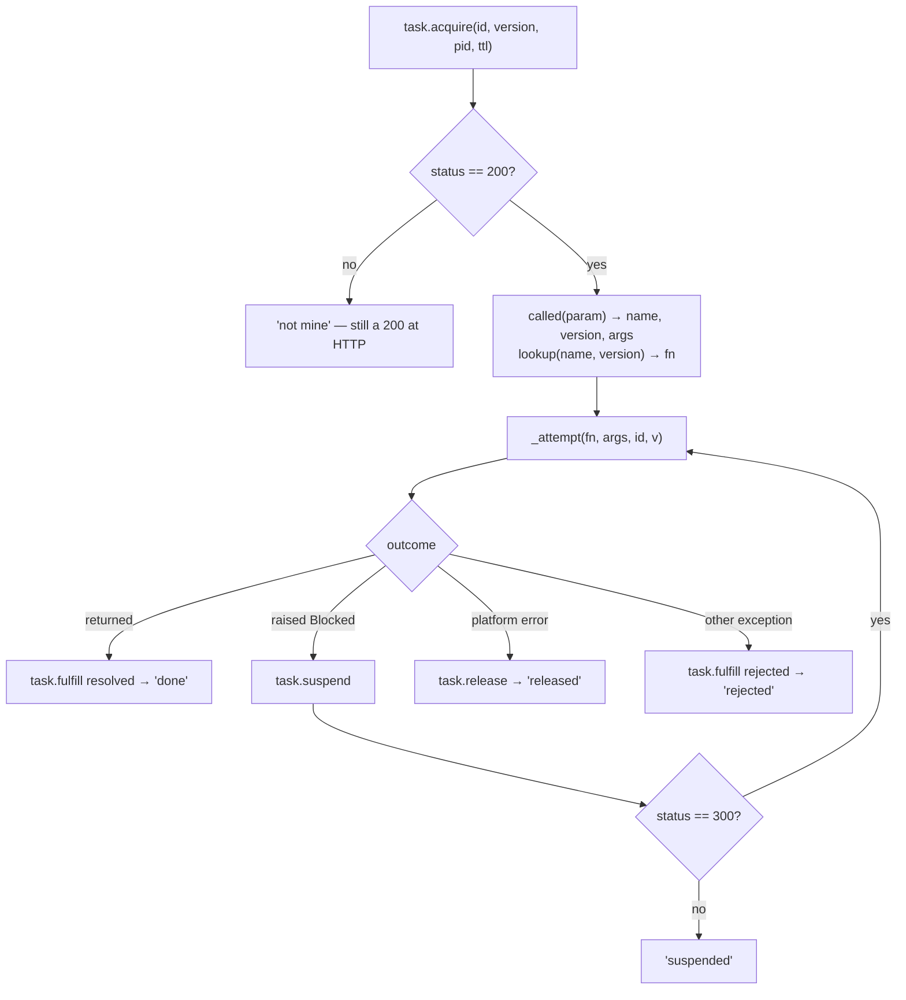
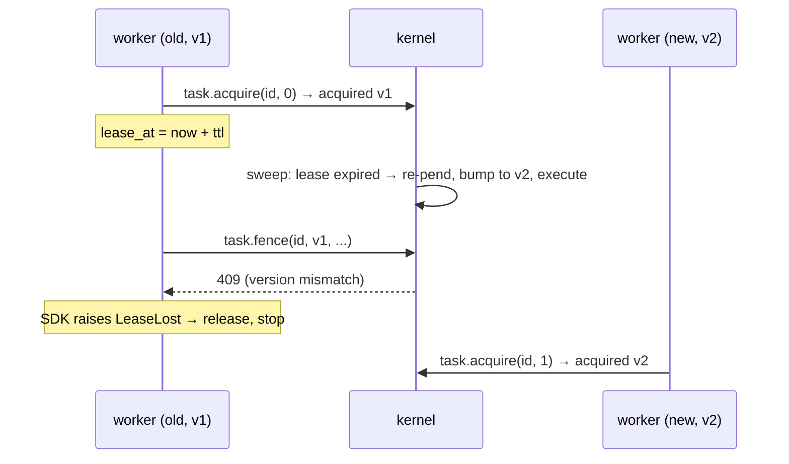

# 08 -- The Worker: claim a task, run until it blocks or finishes

The worker is not a service; it is an object with one method, `run`, and its whole life is the
duration of one `execute` delivery. It claims a task, runs the user's function from the top, and tells
the engine which of four things happened — the function returned, blocked, hit a platform failure, or
raised. The reason the function can be run from the top *every* time without running its calls twice
is that each durable call creates its own promise at its own position, and a call whose promise already
settled reads back instead of running. This document is `Worker.run` and `_attempt`, in the protocol's
own words.

# Part 1 -- The Shape of One Claim

The module docstring is the whole control flow, and `run` implements it directly:

```python
# resonate/worker.py (module docstring, verbatim)
    run        task.acquire, then loop over _attempt:
                 returned        -> task.fulfill (resolved)
                 raised Blocked  -> task.suspend  (again if nothing to wait for)
                 platform error  -> task.release
                 anything else   -> task.fulfill (rejected)
    _attempt   one run of the function from the top
```

`run` begins by claiming — not by running — and the claim is a protocol request, `task.acquire`:

```python
# resonate/worker.py (shape, abbreviated)
class Worker:
    def __init__(self, engine, clock, pid, ttl=30_000) -> None:
        self.engine, self.clock, self.pid, self.ttl = engine, clock, pid, ttl
        self.ran: list[str] = []   # which task ids this worker picked up, for tests

    def run(self, task_id: str, version: int) -> str:
        reply = self.engine.process(
            TaskAcquire(task_id, version, self.pid, self.ttl), self.clock())
        if reply.status != 200:
            # Somebody else holds it, or it has moved on. Not an error: this
            # is what at-least-once delivery looks like from the inside.
            return "not mine"
        self.ran.append(task_id)
        task, promise = reply.data["task"], reply.data["promise"]
        v = task["version"]
        name, version, args = called(loads(promise["param"]))
        fn = lookup(name, version)
        ...
```

Three things happen at the claim. First, the acquire carries this worker's `pid` and `ttl`, so the
kernel can mark the task `acquired` with a lease and a bumped version — two deliveries racing for the
same task resolve to one owner, and the loser gets a 409 that `run` reports as `"not mine"` (still a
200 at the HTTP layer: re-delivering would not change the answer, and the refusal *is* the fence doing
its job). Second, the function's name, version, and arguments are read back out of the promise's
parameter — the promise is the only place the call is recorded, so the worker derives everything from
it rather than from the dispatch. Third, `lookup(name, version)` finds the body; a task created before
a deploy still names the body it was written against, and a worker that no longer carries that version
raises `UnknownFunction` rather than running the nearest thing.

# Part 2 -- The Loop: four ways out

After the claim, `run` loops over `_attempt`, and each pass ends in exactly one of four outcomes:

```python
# resonate/worker.py (verbatim)
        while True:
            try:
                result = self._attempt(fn, args, task_id, v)
            except Blocked as b:
                # Not a failure. Waiting for a value you do not have is
                # how this system makes progress.
                suspend = self.engine.process(
                    TaskSuspend(task_id, v, tuple(b.ids)), self.clock())
                if suspend.status == 300:
                    # One of them settled while we were deciding to wait
                    # for it. Nothing to wait for, so carry on from the top.
                    continue
                return "suspended"
            except PLATFORM:
                # Not the function's answer: this attempt could not
                # produce one. Hand the task back at the same version so
                # it is offered again, to this worker or another.
                self.engine.process(TaskRelease(task_id, v), self.clock())
                return "released"
            except Exception as e:
                # The function's answer, and an unwelcome one. A rejection
                # is a result: it is recorded, it wakes whoever was
                # awaiting it, and replay reads it back rather than
                # running again.
                self.engine.process(TaskFulfill(
                    task_id, v, PromiseSettle(task_id, REJECTED, dumps(describe(e)))),
                    self.clock())
                return "rejected"
            self.engine.process(TaskFulfill(
                task_id, v, PromiseSettle(task_id, RESOLVED, dumps(result))),
                self.clock())
            return "done"
```

The four outcomes, and why the loop can run more than once:

| the function | what the worker sends | outcome |
|---|---|---|
| returned | `task.fulfill` resolved | `"done"` |
| raised its own exception | `task.fulfill` **rejected** | `"rejected"` |
| raised `Blocked` | `task.suspend` | `"suspended"` — or `continue` on a 300 |
| hit a platform failure | `task.release` at the same version | `"released"` |

`Blocked` is the interesting one. `TaskSuspend` returns `300` when one of the awaited promises settled
while the worker was deciding to wait for it — the kernel's `task_suspend` answers `300` if any awaited
promise is no longer pending, handing back a `preload` so the retry can read the settled values
immediately. The worker's answer is `continue`: nothing to wait for, so run from the top again. A
`200` means the task is now parked `suspended`, with a callback registered on every awaited promise,
and the worker reports `"suspended"`.

`PLATFORM` (`LeaseLost`, `Conflict`, `Unavailable`) is the "not an answer" case: the attempt could not
produce a result at all, so the task is released at the same version and offered again — to this worker
or another — rather than settling anything. The lease is the mechanism behind `LeaseLost` in
particular: every write the running function makes goes through the task's fence at the version it
acquired, so a worker whose lease was reclaimed by the sweep gets a 409 on its next write, the SDK
raises `LeaseLost`, and the attempt stops rather than recording a result that a new owner is already
producing.



# Part 3 -- _attempt: one run, from the top, on its own loop

`_attempt` is where the durable function actually runs, and it owns the event loop because a durable
function is async and a worker is not:

```python
# resonate/worker.py (verbatim)
    def _attempt(self, fn, args, task_id: str, version: int):
        async def attempt():
            _INVOCATION.set(Invocation(self.engine, task_id, version, self.clock))
            _FRAME.set(_Call(task_id))
            return await fn.invoke(*args)

        return asyncio.run(attempt())
```

The two context variables are what make a durable call durable. `_INVOCATION` carries the task id and
the version every write is fenced at — so `inv.fence(...)` can raise `LeaseLost` when the lease is
gone. `_FRAME` carries the position the next call's id comes from — so `frame.child()` yields
`task_id:1`, `task_id:2`, and so on in program order. `asyncio.run` creates a fresh loop per attempt,
so a leaf that does real I/O can await it while everything outside stays synchronous, and
`asyncio` copies the context into each task `gather` creates, so concurrent branches each get their own
frame and cannot tread on each other's counters.

`Invocation.fence` is the other half, and it is worth seeing next to `_attempt` because it is what
turns "run the function" into "run the function, but only while the lease holds":

```python
# resonate/sdk.py (shape, abbreviated — the fence every write goes through)
@dataclass
class Invocation:
    engine: Any
    task_id: str
    version: int
    now: Callable[[], int]
    corr: int = 0

    def fence(self, action):
        self.corr += 1
        reply = self.engine.process(
            TaskFence(self.task_id, self.version, f"c{self.corr}", action), self.now())
        if reply.status != 200:
            raise LeaseLost(f"{self.task_id} at version {self.version}: {reply.data}")
        inner = reply.data["action"]
        return inner["head"]["status"], inner["data"]
```

Every `promise.create` and `promise.settle` a running function makes goes through this fence, at the
version the task was acquired. The version is the point: the kernel's `task_fence` refuses a fence at
a version that no longer matches the task's, which is exactly what happens when the sweep reclaims a
lease and re-dispatches the task at a bumped version. The old worker's next write then raises
`LeaseLost` instead of committing a stale result.



The fence does not *prevent* a stale worker from running; it prevents it from *recording*, which is the
only thing that matters.

# The Aha Moment

**Aha:** A worker does not *execute a task*; it *replays a function and stops at the first promise that
is not there yet*. The loop over `_attempt` is not a retry loop, it is the same run resuming with more
of its promises settled. That is why the function is always run from the top and never "continued"
— the only difference between the first attempt and the hundredth is how many of the `read_back`
branches in `Durable.__call__` return immediately. The worker has no notion of "where the run was";
it only knows which promises are still pending, and that is all the state that exists.

# Cross-References

- The `Blocked` exception and `PLATFORM` tuple the worker matches on: [03-rpc-and-gather.md](./03-rpc-and-gather.md).
- The `Invocation.fence` mechanism and `LeaseLost`, in the SDK: [02-programming-model.md](./02-programming-model.md).
- The kernel's `task.acquire`, `task.suspend`, `task.fulfill`, `task.release` the worker drives: [06-kernel.md](./06-kernel.md).
- The server that hands the worker its `execute` messages: [09-server-and-config.md](./09-server-and-config.md).

Continue to [09-server-and-config.md](./09-server-and-config.md).
