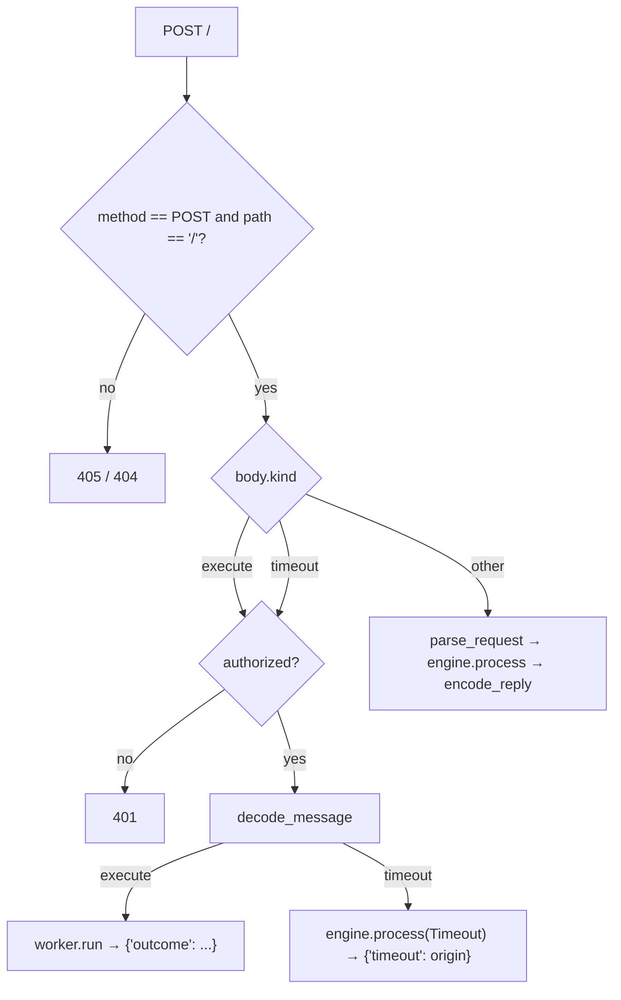
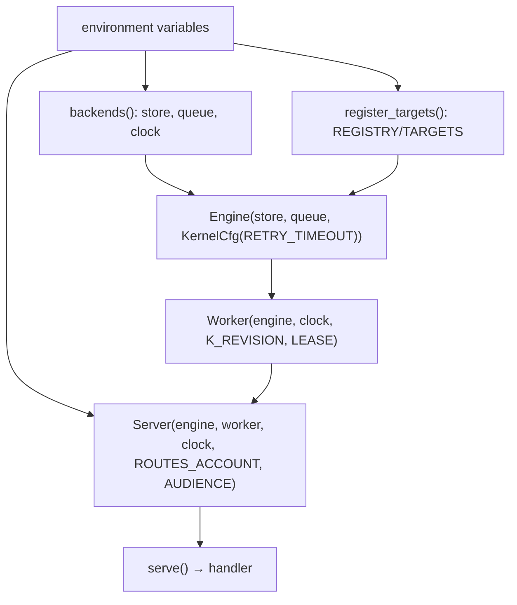

# 09 -- Server and Config: one route, built from the environment

The service is one HTTP route, `POST /`, and the body's `kind` says what it is: an `execute` dispatch
from the queue, a `timeout` deadline from the queue, or a protocol request from a client. `resonate/server.py`
is that route; `resonate/config.py` is how it gets built. Together they are the entire surface between
the outside world and the engine — and because Cloud Tasks pushes, this one route *is* the worker's
entry point, the client's entry point, and the scheduler's entry point all at once. This document
covers both files and the environment variables they read.

# Part 1 -- One Route, Dispatched on `kind`

`Server.dispatch` is the whole routing table, and it is four branches:

```python
# resonate/server.py (verbatim)
    def dispatch(self, method: str, path: str, body: dict,
                 authorization: str) -> tuple[dict, int]:
        if method != "POST":
            return {"error": "POST"}, 405
        if path != "/":
            return {"error": "no such route"}, 404
        match body.get("kind"):
            case "execute" | "timeout" if not self.authorized(authorization):
                return {"error": "unauthenticated"}, 401
            case "execute":
                return self.execute(decode_message(body))
            case "timeout":
                return self.timeout(decode_message(body))
            case _:
                return self.protocol(body)
```

The first two guards say "this service does one thing, in one place": any method but POST is a 405, any
path but `/` is a 404. The `match` then splits the world in two. `execute` and `timeout` are the
queue's messages, decoded with `decode_message` and gated by `authorized`; everything else is a client
protocol request, parsed with `parse_request`. That split is not cosmetic — a client is not the queue,
so the queue's messages carry an OIDC token for `ROUTES_ACCOUNT` and a client's request is protected by
whatever fronts the service instead.

The three handlers are each one line of real work:

```python
# resonate/server.py (verbatim)
    def protocol(self, envelope: dict) -> tuple[dict, int]:
        try:
            request = parse_request(envelope)
        except Invalid as e:
            return {"head": {"status": 400}, "data": str(e)}, 400
        reply = self.engine.process(request, self.clock())
        return encode_reply(reply), 200 if reply.status < 400 else reply.status

    def execute(self, message: Execute) -> tuple[dict, int]:
        outcome = self.worker.run(message.task_id, message.version)
        return {"outcome": outcome}, 200

    def timeout(self, message: Timeout) -> tuple[dict, int]:
        self.engine.process(message, self.clock())
        return {"timeout": message.origin}, 200
```

`protocol` parses then processes, and a malformed envelope becomes a 400 before it reaches the kernel.
`execute` hands the dispatch to the worker, and the worker's outcome — `"done"`, `"suspended"`,
`"released"`, `"rejected"`, `"not mine"` — is the response. `timeout` runs the sweep and reports the
origin; it is idempotent by construction, because a duplicate finds nothing due and the kernel returns
no effects. The whole thing is wrapped by `handle`, which is also where the three port exceptions
become status codes and where Flask is finally imported:

```python
# resonate/server.py (shape, abbreviated)
    def handle(self, request: flask.Request):
        import flask
        try:
            body, status = self.dispatch(
                request.method, request.path,
                request.get_json(silent=True) or {},
                request.headers.get("Authorization", ""))
        except Invalid as e:
            body, status = {"error": str(e)}, 400
        except Conflict as e:
            body, status = {"error": str(e)}, 409
        except Unavailable as e:
            body, status = {"error": str(e)}, 503
        return flask.jsonify(body), status
```

The Flask import is deliberately deferred to `handle` — it is the only method in the package that
needs the framework, and `resonate/__init__.py` re-exports `serve`, so a top-level import would have
made `import resonate.kernel` — and every simulation and every exploration — fail without a web
framework installed.



# Part 2 -- authorized: the OIDC Gate

`execute` and `timeout` are the only messages meant to come from the queue, and `authorized` is the
gate — unless `ROUTES_ACCOUNT` is unset, in which case auth is off entirely:

```python
# resonate/server.py (verbatim)
    def authorized(self, authorization: str) -> bool:
        """Whether the request carries an OIDC token for `account`."""
        if self.account is None:
            return True
        if not authorization.startswith("Bearer "):
            return False
        from google.auth.transport import requests
        from google.oauth2 import id_token

        try:
            claims = id_token.verify_oauth2_token(
                authorization.removeprefix("Bearer "), requests.Request(),
                audience=self.audience)
        except ValueError:
            return False
        return claims.get("email") == self.account and claims.get("email_verified", False)
```

The token is verified against the `AUDIENCE`, and the caller must be exactly the `ROUTES_ACCOUNT`
service account with a verified email. Cloud Tasks signs every push with the service account it is
configured to use, so this is the system telling its own queue apart from anyone else who can reach the
endpoint.

# Part 3 -- Config: the Only Reader of the Environment

`serve()` is the entry point the framework calls, and `build()` is the only place the environment is
read. The entire deployment surface is twelve variables, documented at the top of the file:

```python
# resonate/config.py (module docstring, verbatim — the environment surface)
    SIMULATED        in-memory store, queue and clock instead of GCP
    BUCKET           the Cloud Storage bucket holding the documents
    PROJECT          \
    LOCATION          > the Cloud Tasks queue
    QUEUE            /
    BASE_URL         where this service answers; every function runs here
                     unless ROUTES_WORKERS says otherwise
    ROUTES_WORKERS   JSON {function name: worker url}, for a split deployment
    ROUTES_ACCOUNT   the service account the queue signs with; unset turns
                     auth off for execute and timeout messages
    AUDIENCE         the audience that token is checked against
    RETRY_TIMEOUT    ms a claimed task may go quiet before it is offered again
    LEASE            ms a worker holds a task
    K_REVISION       this worker's id (set by Cloud Run)
```

`build` wires them into the objects from [04-architecture.md](./04-architecture.md):

```python
# resonate/config.py (verbatim)
def build(env: Mapping[str, str]) -> Server:
    store, queue, clock = backends(env)
    register_targets(env)
    engine = Engine(store, queue, KernelCfg(
        retry_timeout=int(env.get("RETRY_TIMEOUT", 30_000))))
    worker = Worker(engine, clock, pid=env.get("K_REVISION", "local"),
                    ttl=int(env.get("LEASE", 60_000)))
    return Server(engine, worker, clock,
                  account=env.get("ROUTES_ACCOUNT"),
                  audience=env.get("AUDIENCE"))
```

`RETRY_TIMEOUT` (default 30 000 ms) is how long a claimed task may go quiet before it is offered
again — the kernel's `retry_timeout`. `LEASE` (default 60 000 ms) is how long a worker holds a task —
the task's `ttl`, which becomes its `lease_at` on acquire. The two are separate because "go quiet"
and "hold the task" are different hazards: a worker that is alive but blocked past its retry is
re-offered while it may still be running, and a worker whose lease is reclaimed loses its fence. The
`pid` is `K_REVISION`, Cloud Run's revision id, so two revisions of one service are two distinct
workers as far as the lease machinery is concerned.

The `backends` and `register_targets` helpers complete the picture:

```python
# resonate/config.py (verbatim)
def backends(env):
    if env.get("SIMULATED"):
        return store_mem.Store(), queue_mem.Queue(), Clock()
    store = store_gcp.Store(env["BUCKET"])
    queue = queue_gcp.Queue(
        project=env["PROJECT"], location=env["LOCATION"], queue=env["QUEUE"],
        base_url=env["BASE_URL"], service_account=env.get("ROUTES_ACCOUNT"),
    )
    return store, queue, wall_clock

def register_targets(env) -> None:
    base = env.get("BASE_URL", "").rstrip("/")
    if base:
        for name, _version in REGISTRY:
            TARGETS.setdefault(name, f"{base}/")
    for name, url in json.loads(env.get("ROUTES_WORKERS", "{}")).items():
        TARGETS[name] = url
```

`SIMULATED` swaps the two Google adapters for the in-memory ones and the wall clock for the test-movable
`Clock` — the one switch that turns production into a deterministic simulator, and the reason
[12-simulators.md](./12-simulators.md) can test the real engine with the real protocol. `register_targets`
says where each function runs: here (`BASE_URL`), unless `ROUTES_WORKERS` names a split deployment,
which is what turns `search.rpc(q)` into a cross-container call in
[03-rpc-and-gather.md](./03-rpc-and-gather.md).



# The Aha Moment

**Aha:** "Cloud Tasks pushes" is not a deployment detail, it is the reason the server exists. There is
no polling loop, no long-lived worker process, no supervisor — the queue *is* the supervisor, and a
worker is just whatever code answers the next POST. One route handles three kinds of message because
all three are the same thing: a request to advance one origin's document by one step. The environment
variables are the whole configuration story because there is nothing else to configure — a store, a
queue, a base URL, and three timeouts.

# Cross-References

- The worker `run` that `execute` hands off to: [08-worker.md](./08-worker.md).
- The engine `process` that `protocol` and `timeout` both call: [07-engine.md](./07-engine.md).
- The OIDC token the queue signs with, from the queue's side: [11-ports-adapters.md](./11-ports-adapters.md).
- Deployment, versioning, and the buildpack, in full: [17-deployment.md](./17-deployment.md).

Continue to [10-spec-interfaces.md](./10-spec-interfaces.md).
