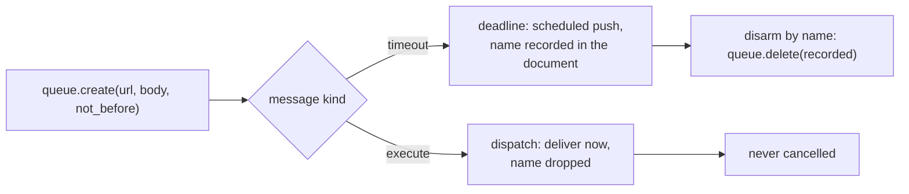
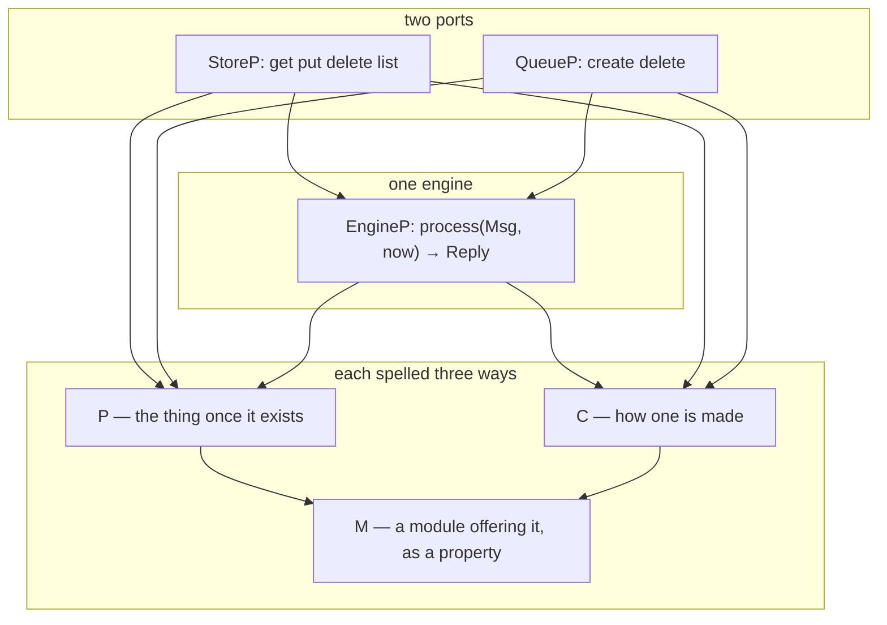

# 10 -- Spec Interfaces: what a port is, in three layers

The engine is written against two interfaces and nothing else — a store and a queue — and each
interface is spelled three ways, `P`/`C`/`M`. `P` is the thing once it exists; `C` is how one is made;
`M` is a module that offers one under a conventional name. The layering is not ceremony: it is the
seam that lets one engine run over a bucket in production and over a dict in a simulation, and it is
what the conformance suite hands around. This document reads the three protocol files
(`resonate/spec/store.py`, `queue.py`, `engine.py`) and explains why the engine's signature is pinned
while the ports' constructors are deliberately not.

# Part 1 -- The Store: four operations, two errors

`StoreP` is the shape of the thing the engine actually runs on, not the shape the engine happens to
want. GCS, S3, R2 and Azure all offer these four operations and a version token, and every one offers
the conditional writes the whole design rests on — so an adapter should be nearly empty, and if it is
not, the interface is wrong:

```python
# resonate/spec/store.py (shape, abbreviated)
@runtime_checkable
class StoreP(Protocol):
    def get(self, key: str) -> tuple[str, str] | None:
        """The body and its version, or `None`."""

    def put(self, key: str, body: str, *, if_match: str | None = None,
            if_absent: bool = False) -> str:
        """Write, conditionally, and return the new version."""

    def delete(self, key: str) -> None:
        """Remove. Removing what is not there succeeds."""

    def list(self, prefix: str, limit: int) -> list[str]:
        """At most `limit` keys under `prefix`, lexicographically ascending."""
```

Each operation encodes a decision. Text in, text out — the store does not interpret the body, because
the engine hands it JSON and a bucket stores bytes. `get` returns `(body, version)` or `None`. `put`
has two conditions that are *exclusive*, and passing both is a programming error: `if_match` replaces
exactly the version named, `if_absent` creates only if nothing is there, and neither is an
unconditional overwrite — the engine never uses it, but it is in the contract because every real store
offers it. `delete` is idempotent, removing what is not there succeeds, because a caller that crashed
and ran again must not fail. `list` returns at most `limit` keys under `prefix`, lexicographically
ascending, so a zero-padded key sorts in numeric order and a capped listing is the smallest — and
because some client libraries promise nothing about order, an adapter that cannot guarantee it sorts.

The two errors demand *opposite* responses, which is why they are not one:

```python
# resonate/errors.py (verbatim)
class Conflict(Exception):
    """The write lost a race: the object is not at the generation the write
    required. The decision was made against state that no longer exists, so it
    must be re-decided, never replayed."""

class Unavailable(Exception):
    """No answer. Nothing is known about whether the write landed."""
```

`Conflict` means the state has moved, so the decision was made against something that no longer
exists and must be re-decided — replaying it would produce answers no sequential execution gives.
`Unavailable` means nothing is known about whether the write landed, so the honest thing is to tell
the caller, whose operations are all idempotent, and let it retry. Neither is *in* the contract, and
that is not an oversight: a store that fails on demand is a simulator, and a contract every
implementation must pass can only claim what a real one can be asked to do.

# Part 2 -- The Queue: two operations, push only

`QueueP` is two methods, and one of them does double duty as both a deadline and a dispatch:

```python
# resonate/spec/queue.py (shape, abbreviated)
@runtime_checkable
class QueueP(Protocol):
    def create(self, url: str, body: Any, *, not_before: int = 0) -> str:
        """Enqueue, and return the name the service gave it."""

    def delete(self, name: str) -> None:
        """Cancel. Cancelling what is gone, or what is already out for
        delivery, succeeds and may be too late."""
```

A deadline is a task with an HTTP target and a time before which it must not be delivered; a dispatch
is a task whose time is now. Both are `create`, told apart by the message's `kind` (`timeout` or
`execute`) and by what the caller does with the returned name:



a deadline's name is recorded in the document because cancelling is by name, and a dispatch's is
dropped because a dispatch is never cancelled. *When* each happens — arm before the commit, send after —
is stated in the kernel's effects
(`SetTimeout`, `DelTimeout`, `Send`), not in the shape of the port. The returned name is the service's,
not the caller's, for a precise reason:

```python
# resonate/spec/queue.py (docstring, excerpt)
    The name is the service's, not the caller's. A caller-chosen name
    leaves a tombstone after deletion, so re-creating the same name
    within the hour is refused, which is exactly the trap a deadline
    re-armed at the same instant would fall into.
```

There is deliberately *no third operation for receiving* — not an omission but the defining choice:

```python
# resonate/spec/queue.py (docstring, excerpt)
    Cloud Tasks is push-only, a task is delivered by an HTTP POST to the URL
    it carries, and that is why `server.py` exists and why a worker is a
    service rather than a loop. Taking delivery belongs to whatever is being
    delivered to; a simulator adds `take`/`ack`/`nack` for its own tests and
    the interface stays two methods.
```

# Part 3 -- The Engine: one method, pinned signature

`EngineP` has one member and deliberately no more:

```python
# resonate/spec/engine.py (shape, abbreviated)
Msg = Req | Timeout

@runtime_checkable
class EngineP(Protocol):
    def process(self, msg: Msg, now: int) -> Reply: ...
```

One method because there is one thing to do: a request and a deadline differ in *which way* the state
machine is consulted and in nothing else, so a caller never has to know which kind of shell it is
talking to. An engine has no name, no identity and no lifecycle to manage — everything it knows is in
the bucket, so two of them are interchangeable, and a conformance report names the *module* it was
handed rather than asking the engine who it is. `process` returns the protocol's answer and raises only
when the world refused: `Conflict` when the write lost its race, and whatever the ports raise when they
cannot answer at all.

The three constructors differ in a way that is itself the point:

```python
# resonate/spec/engine.py (shape, abbreviated)
class EngineC(Protocol):
    def __call__(self, store: StoreP, queue: QueueP,
                 cfg: KernelCfg = ..., prefix: str = ...) -> EngineP: ...

# resonate/spec/store.py (shape, abbreviated)
class StoreC(Protocol):
    def __call__(self, *config: Any, **keywords: Any) -> StoreP: ...

# resonate/spec/queue.py (shape, abbreviated)
class QueueC(Protocol):
    def __call__(self, *config: Any, **keywords: Any) -> QueueP: ...
```

`EngineC`'s signature is *real*: every engine takes the same two ports, because a port is an interface
rather than a configuration. `StoreC` and `QueueC` cannot say as much, and say so — a store's arguments
are a deployment, not an interface: the simulated one needs nothing, the real one needs a bucket, a
client and a prefix, and no third implementation will need those either. Forcing a shape on them would
only mean writing the differences somewhere less honest, like a dict.

# Part 4 -- The M Layer, and Why the Conformance Suite Hands a Module

The `M` protocol is "a module that offers one, under the name `Store` / `Queue` / `Engine`", exposed as
a read-only *property* rather than a plain attribute. That is not a style choice: a protocol's mutable
attribute is invariant, so `Engine: EngineC` would demand a value that is *exactly* `EngineC`, and a
type checker rejects `class Engine:` for it; a property is covariant, and a class object satisfies it
by being callable with the right arguments, with no adapter (`test_types.py` checks it with mypy).

The conformance suite hands a module rather than a class or an instance because neither would work: a
contract cannot be handed a class, because an implementation may want to choose its class at import
time, and it cannot be handed an instance, because two implementations are configured differently and
only the caller knows how. So it is handed the module and reaches for `Engine`:



The types alone say nothing about behaviour. `testing/conformance/engine.py` is the part that does:
it drives an engine through a script and holds every state it commits to the catalogue, so an
implementation that passes has the same observable behaviour as the reference, whatever it does inside
— a different language, a different store, a kernel written from the specification rather than
transcribed from it. That is the payoff of drawing the line here: the *interface* is the product.

# The Aha Moment

**Aha:** The ports are the design's only seams, and they are seams because the engine is *parameterized*
by them, not because they are mocked. `EngineC.__call__(store, queue, ...)` means the conformance suite
supplies the world, and a simulated run is a real run — the same kernel, the same protocol, the same
effects, with bytes going to a dict instead of a bucket. Every other durability system tests a *mock*;
this one tests the *contract*, and holds the memory implementations to it too.

# Cross-References

- The Google adapters that implement `StoreP` and `QueueP`: [11-ports-adapters.md](./11-ports-adapters.md).
- The engine built on these two ports: [07-engine.md](./07-engine.md).
- The conformance suite that grades implementations against the contract: [13-conformance.md](./13-conformance.md).
- The simulators that implement the same ports in memory: [12-simulators.md](./12-simulators.md).

Continue to [11-ports-adapters.md](./11-ports-adapters.md).
