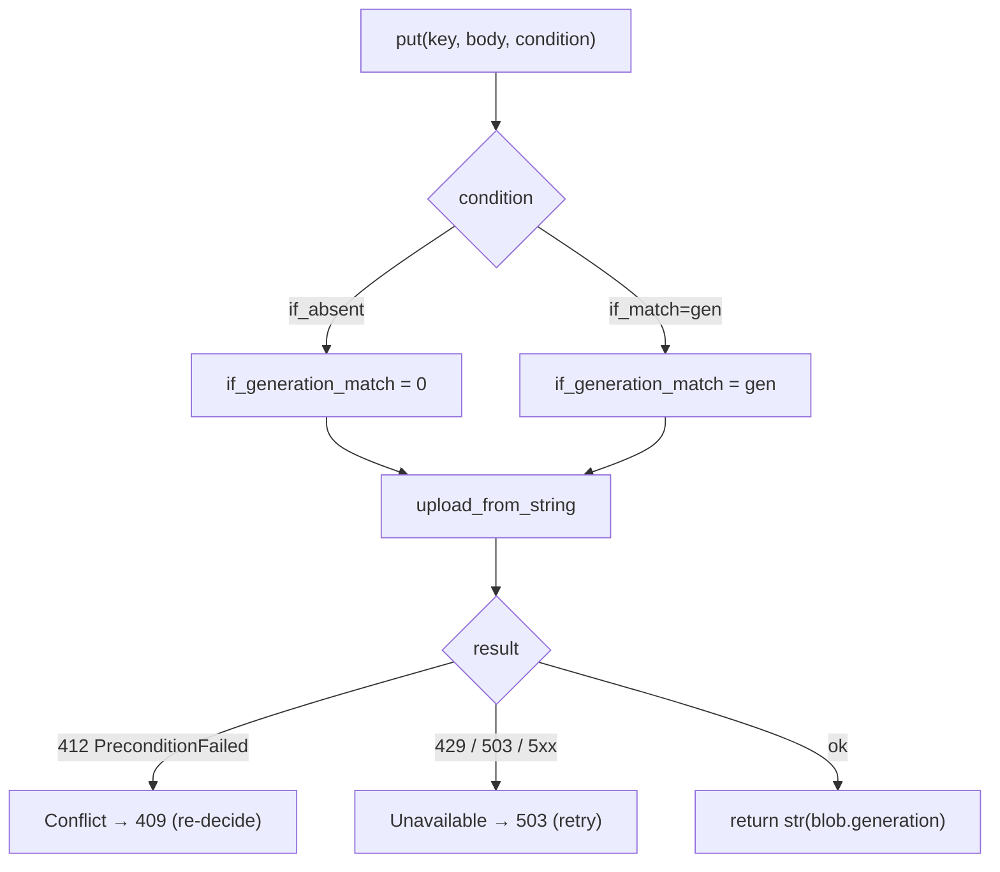
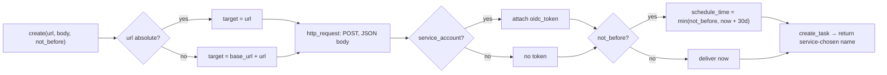

# 11 -- Port Adapters: Cloud Storage and Cloud Tasks, almost empty

The two real adapters are `resonate/store_gcp.py` and `resonate/queue_gcp.py`, and their smallness is
the test of whether the interface was drawn in the right place. `store_gcp` is 146 lines, most of it
docstring; `queue_gcp` is 58. Everything the design rests on is something Google already offers: a
generation per object, writes conditioned on it, and a push queue with a schedule time and an OIDC
token. The adapter's whole job is to translate — the store's two conditions into generation
preconditions, and the queue's `not_before` into a `schedule_time` — and to map the two kinds of
refusal onto `Conflict` and `Unavailable`. This document reads both files, and the measured write
numbers that live in the store's docstring.

# Part 1 -- The Store: generations as the whole concurrency story

A Cloud Storage object has a **generation** — a monotonically increasing number that changes on every
write — and writes can be conditioned on it. Those two facts are the entire concurrency mechanism:

```python
# resonate/store_gcp.py (docstring, excerpt)
    if_generation_match=0      create only if nothing is there
    if_generation_match=<gen>  replace only what was read
```

The four operations translate directly:

```python
# resonate/store_gcp.py (shape, abbreviated)
class Store:
    def __init__(self, bucket: str, client=None, prefix: str = "") -> None:
        if client is None:
            from google.cloud import storage
            client = storage.Client()
        self.client = client
        self.bucket = client.bucket(bucket)
        self.prefix = prefix

    def get(self, key: str) -> tuple[str, str] | None:
        from google.api_core import exceptions as gcp
        blob = self._blob(key)
        try:
            body = blob.download_as_bytes()
        except gcp.NotFound:
            return None
        except (gcp.TooManyRequests, gcp.ServiceUnavailable, gcp.ServerError) as e:
            raise Unavailable(str(e)) from None
        if blob.generation is None:
            blob.reload()   # one more round trip beats inventing a version
        return body.decode("utf-8"), str(blob.generation)

    def put(self, key: str, body: str, *, if_match=None, if_absent=False) -> str:
        from google.api_core import exceptions as gcp
        if if_match is not None and if_absent:
            raise ValueError("if_match and if_absent are exclusive")
        blob = self._blob(key)
        precondition: dict = {}
        if if_absent:
            precondition["if_generation_match"] = 0
        elif if_match is not None:
            precondition["if_generation_match"] = int(if_match)
        try:
            blob.upload_from_string(body, content_type=CONTENT_TYPE, **precondition)
        except gcp.PreconditionFailed as e:
            raise Conflict(f"{key}: {e}") from None
        except (gcp.TooManyRequests, gcp.ServiceUnavailable, gcp.ServerError) as e:
            raise Unavailable(str(e)) from None
        return str(blob.generation)
```

`if_absent` becomes `if_generation_match=0` — the object must not exist, which is the bucket's native
"create only once". `if_match` becomes `if_generation_match=<gen>` — replace only what was read. A
`412` (`PreconditionFailed`) becomes `Conflict`: the state moved, so the decision must be re-decided,
never replayed. A `429`/`503`/`5xx` becomes `Unavailable`: nothing is known about whether the write
landed, which the protocol already tolerates because every operation is idempotent. `delete` swallows
`NotFound` because removing what is not there succeeds, and `list` imposes the sort the contract
promises rather than trusting the client library to:

```python
# resonate/store_gcp.py (shape, abbreviated — delete and list)
    def delete(self, key: str) -> None:
        from google.api_core import exceptions as gcp
        try:
            self._blob(key).delete()
        except gcp.NotFound:
            pass                                    # removing what is not there succeeds
        except (gcp.TooManyRequests, gcp.ServiceUnavailable, gcp.ServerError) as e:
            raise Unavailable(str(e)) from None

    def list(self, prefix: str, limit: int) -> list[str]:
        ...
        return sorted(names)[:limit]   # the contract says so; imposed, not assumed
```



# Part 2 -- The Store's Numbers: the one to design around

The store's docstring carries real measurements — one bucket, one region, one day, one machine, dated
2026-09-22 — and two of them are more important than the headline:

```python
# resonate/store_gcp.py (docstring, verbatim — the measurements)
    30 sequential conditional writes to one object   2.1 writes/sec
      latency p50 432 ms, p95 1253 ms, max 1526 ms
      throttled 0, lost 0

    8 concurrent writers x 5 read-modify-write        2.0 writes/sec
      final counter 40 of 40, LOST UPDATES 0
      412 conflicts 106, i.e. 2.6 retries per success
      throttled 0
```

Every promise and task of one run lives in one object, so a single object's write rate is the ceiling
on a single run's *transitions*, not on the system. Eight writers moved the counter no faster than one
did — the object serialises, and the extra concurrency turned into 106 retries rather than throughput,
which is the argument for making fan-out its own origin, now measured. And nothing was ever throttled —
146 write attempts to one object drew no 429 — so at this scale the ceiling is round-trip latency, not
a quota. Documentation that quotes "about one write per second per object" describes a limit this
run did not reach; it was slower than that for a simpler reason.

# Part 3 -- The Queue: a deadline is a scheduled push

`queue_gcp` turns the queue's `create(url, body, not_before)` into a Cloud Tasks task, and the one
constant is the horizon beyond which Cloud Tasks cannot schedule:

```python
# resonate/queue_gcp.py (verbatim, the horizon)
HORIZON_MS = 30 * 24 * 60 * 60 * 1_000
```

The `create` method does three things — resolve the target, attach the OIDC token, clamp the schedule:

```python
# resonate/queue_gcp.py (shape, abbreviated)
    def create(self, url: str, body: Any, *, not_before: int = 0) -> str:
        from google.api_core import exceptions as gcp
        from google.cloud import tasks_v2

        target = url if url.startswith(("http://", "https://")) \
            else f"{self.base_url}/{url.lstrip('/')}"
        request: dict = {
            "http_method": tasks_v2.HttpMethod.POST,
            "url": target,
            "headers": {"Content-Type": "application/json"},
            "body": json.dumps(body).encode("utf-8"),
        }
        if self.service_account is not None:
            request["oidc_token"] = {"service_account_email": self.service_account}
        task: dict = {"http_request": request}
        if not_before:
            at = min(not_before, self.now() + HORIZON_MS)
            task["schedule_time"] = datetime.fromtimestamp(at / 1_000, tz=timezone.utc)
        try:
            created = self.client.create_task(parent=self.parent, task=task)
        except (gcp.TooManyRequests, gcp.ServiceUnavailable, gcp.ServerError) as e:
            raise Unavailable(str(e)) from None
        return created.name
```

`url` starting with `http://`/`https://` is taken literally; anything else — including `HERE = "/"` —
is resolved against `base_url`. The `oidc_token` is attached only when a service account is set, which
is exactly the token `Server.authorized` verifies on the receiving end
([09-server-and-config.md](./09-server-and-config.md)). The `not_before` is clamped to
`now + HORIZON_MS` so a deadline beyond Cloud Tasks' 30-day horizon is scheduled as far out as the
service allows rather than refused. `delete` swallows `NotFound`, because cancelling what is already
out for delivery succeeds and may be too late — which is why "disarm the old" is a best-effort and the
sweep must tolerate a stale timer.



# Part 4 -- Why the Adapters Are So Small

The whole design leans on Google's primitives rather than papering over them. The store's generation
*is* the concurrency control; the queue's schedule time *is* the deadline; the queue's OIDC token *is*
the auth. That is what makes the adapters near-empty and the interface testable — an adapter that had
to reimplement conditional writes or scheduled delivery would be the sign that the interface was drawn
around the wrong backend. The two exceptions the whole system tolerates are exactly the two the
backends natively offer: a refused precondition (`Conflict`) and a throttled/no-answer response
(`Unavailable`). Nothing else in the outside world is allowed to say anything to the engine.

# The Aha Moment

**Aha:** The port adapters are *translators*, not *implementations*. The engine already knows how to
do conditional writes and scheduled pushes — it only knows them abstractly, as `if_match` and
`not_before`. The adapter's job is to notice that Google's `if_generation_match` and `schedule_time`
are the same two ideas with different names, and to map a `412` to "the state moved" and a `429` to "I
don't know". That is why the conformance suite can grade the *memory* implementations against the
*real* ones: both are just translations of the same four-plus-two operations, and the truth lives in
the contract, not in the backend.

# Cross-References

- The two ports' contracts these adapters implement: [10-spec-interfaces.md](./10-spec-interfaces.md).
- The engine that calls `put(if_absent | if_match)` and `create(HERE, ...)`: [07-engine.md](./07-engine.md).
- The `Conflict`/`Unavailable` mapping surfacing at the server: [09-server-and-config.md](./09-server-and-config.md).
- The memory store and queue held to the same contract: [12-simulators.md](./12-simulators.md).

Continue to [12-simulators.md](./12-simulators.md).
