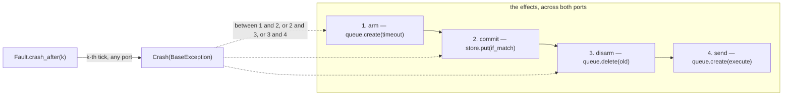
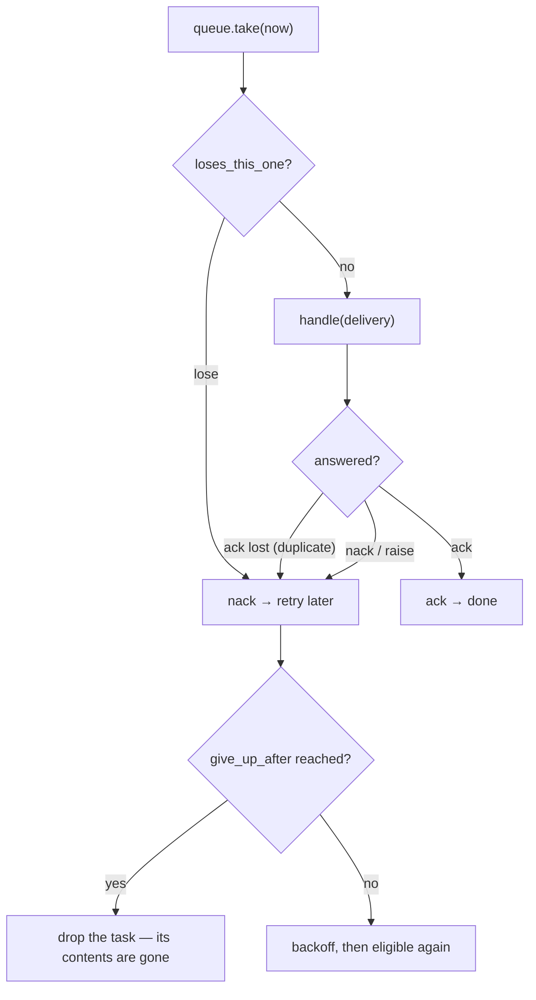

# 12 -- Simulators: a clock you move, a queue that bites, a power cut

Testing a durable-execution engine means testing the parts that are not deterministic, so the
`resonate/testing/` package builds them as *knobs* rather than mocking them away: a clock a test can
move, an in-memory store and queue with the failure modes a real one has, and a fault injector that
cuts the power between two effects. The key idea is that these are the same ports as production — the
memory store and queue implement the same `StoreP`/`QueueP` and are held to the same contracts — so a
simulated run is a *real* run with the bytes going to a dict instead of a bucket. This document reads
the four files: `sim.py`, `faults.py`, `store_mem.py`, `queue_mem.py`.

# Part 1 -- The Clock and the Runtime

`Clock` is time as something a test can move, and it is the one thing the model tells the user's code
*not* to read:

```python
# resonate/testing/sim.py (shape, abbreviated)
@dataclass
class Clock:
    now: int = 0

    def __call__(self) -> int:
        return self.now

    def advance(self, by: int) -> int:
        self.now += by
        return self.now
```

The runtime and the workers read it; a durable function must not, because reading a clock between two
calls is exactly the non-determinism that breaks replay. `Runtime` is one process playing the parts
Cloud Run and Cloud Tasks play — everything is a delivery to a URL, which is what Cloud Tasks does — so
the runtime is only a loop that takes what the queue offers, calls the handler, and says whether it
worked:

```python
# resonate/testing/sim.py (shape, abbreviated)
@dataclass
class Runtime:
    engine: Any
    queue: Any
    clock: Clock
    workers: dict[str, Worker] = field(default_factory=dict)
    notified: dict[str, dict] = field(default_factory=dict)
    swept: int = 0

    def serve(self, address: str, worker: Worker, *functions) -> None:
        self.workers[address] = worker
        for fn in functions:
            route(fn, address)

    def handle(self, delivery) -> bool:
        msg = decode_message(delivery.body)
        if isinstance(msg, Timeout):
            self.swept += 1
            self.engine.process(msg, self.clock())
            return True
        if isinstance(msg, Execute):
            worker = self.workers.get(delivery.url)
            if worker is not None:
                worker.run(msg.task_id, msg.version)
            return True
        if isinstance(msg, Unblock):
            self.notified[msg.promise["id"]] = msg.promise
            return True
        return True
```

`handle` is the dispatch table of [09-server-and-config.md](./09-server-and-config.md) again, but with
no HTTP: a `Timeout` goes to the engine, an `Execute` to the worker served at its URL, an `Unblock` is
recorded in `notified` so a test can assert that a listener was woken. The `step`/`drain` loop is where
the queue's own semantics — duplicate, lose, give up — are honoured:

```python
# resonate/testing/sim.py (shape, abbreviated)
    def step(self) -> bool:
        delivery = self.queue.take(self.clock())
        if delivery is None:
            return False
        if self.queue.loses_this_one():
            self.queue.nack(delivery, self.clock())
            return True
        try:
            answered = self.handle(delivery)
        except Exception:
            self.queue.nack(delivery, self.clock())
            return True
        if answered:
            self.queue.ack(delivery, self.clock())
        else:
            self.queue.nack(delivery, self.clock())
        return True

    def drain(self, budget: int = 2_000) -> int:
        for did in range(budget):
            if not self.step():
                return did
        raise AssertionError("the queue never ran out of eligible work")
```

A delivery that loses the race, a handler that raises, and a handler that answers are all handled the
same way the real queue would: `ack` ends it, `nack` schedules a retry. `drain` delivers everything
eligible *now* — what is scheduled later stays there until the clock moves, which is the difference
between a queue and a list.

# Part 2 -- Fault: cutting the power between two effects

The crash injector is 20 lines and its entire purpose is to stop the engine *between* effects, because
a crash window is a gap between two effects and the effects are spread over both ports:

```python
# resonate/testing/faults.py (verbatim)
class Crash(BaseException):
    """Injected: the process stopped here. Not something production raises.
    A `BaseException` on purpose. A power cut is not an error the program
    gets to handle, and if it were an `Exception` the engine's own error
    handling would catch it and turn a dead process into a rejected promise,
    which is the opposite of what happened."""

class Fault:
    def __init__(self) -> None:
        self.budget: int | None = None
        self.log: list[str] = []

    def crash_after(self, n: int) -> None:
        self.budget = n
        self.log = []

    def heal(self) -> None:
        self.budget = None

    def tick(self, what: str) -> None:
        if self.budget is not None:
            if self.budget <= 0:
                raise Crash(what)
            self.budget -= 1
        self.log.append(what)
```

`Crash` is a `BaseException` *on purpose*: a power cut is not an error the program gets to handle, and
an `Exception` would be caught by the engine's own error handling and turned into a rejected promise —
the opposite of "the process died". `Fault` counts a budget of writes *across both ports* rather than
per port, because the effects are spread over the store and the queue: the arm, then the commit, then
the disarm and the sends. `crash_after(k)` stops the engine at the k-th write it attempts, whichever
port that lands on, so a test walks every crash window by looping `k`.



# Part 3 -- The Memory Store: real conditional writes, opaque versions

`store_mem.Store` is what every test in the project runs on, so it is not a toy — the conditional
writes are real, the versions are opaque, and the power can go out in the middle:

```python
# resonate/testing/store_mem.py (shape, abbreviated)
class Store:
    def __init__(self, fault: Fault | None = None) -> None:
        self.objects: dict[str, tuple[str, str]] = {}
        self._n = 0
        self.fault = fault
        self.land_then_fail = False

    def put(self, key, body, *, if_match=None, if_absent=False) -> str:
        if if_match is not None and if_absent:
            raise ValueError("if_match and if_absent are exclusive")
        current = self.objects.get(key)
        if if_absent and current is not None:
            raise Conflict(f"{key} already exists")
        if if_match is not None:
            if current is None:
                raise Conflict(f"{key} does not exist")
            if current[1] != if_match:
                raise Conflict(f"{key} is at {current[1]}, not {if_match}")
        self._n += 1
        version = f"v{self._n}"
        if self.land_then_fail and self.fault is not None and self.fault.budget == 0:
            self.objects[key] = (body, version)
        if self.fault is not None:
            self.fault.tick(f"commit {key}")
        self.objects[key] = (body, version)
        return version
```

Versions are strings and deliberately not numbers a caller could do arithmetic on: an adapter over an
ETag has nothing to count with, so neither does this. `land_then_fail` exists to model the one window a
simple "raise before writing" cannot: a faulted write that *lands and then raises*, where nothing is
known about whether the write landed. The other order — raise before writing — is the ordinary one and
is what `fault` alone does.

# Part 4 -- The Memory Queue: the parts that bite

`queue_mem.Queue` is a queue with the failures a queue really has rather than a heap, and every one of
those failures is a knob, off by default so a test can turn on one at a time and say which one it is
about:

```python
# resonate/testing/queue_mem.py (shape, abbreviated)
@dataclass
class Queue:
    seed: int = 0
    duplicate: float = 0.0     # chance an ack is lost, so the task is delivered again
    shuffle: bool = False       # eligible tasks come out in an order nobody promised
    lateness: int = 0           # how much later than scheduled a task may become eligible
    lose: float = 0.0           # chance a delivery never reaches the handler
    give_up_after: int = 20     # attempts before the queue drops the task
    backoff: int = 1_000        # how long a failed attempt waits
    fault: Fault | None = None
```

The four behaviours the docstring names are the ones a real queue has and a list does not:
**at-least-once** (a delivery is retried until the handler acknowledges, and an ack can be lost after
the handler acted — duplicate delivery is the contract, not an edge case), **no order** (an `execute`
for version 0 can arrive after the task already moved to version 1), **not-before is a floor** (a
scheduled time says when a task becomes eligible, not when it is delivered — late is normal), and
**it gives up** (a task that failed enough times is dropped, and what was in it is gone). The knobs are
deterministic under a seed, so a run that finds something can be run again and find it again.



`take`, `ack`, and `nack` are deliberately *not* part of `spec.queue.QueueP` — Cloud Tasks is
push-only, and taking delivery belongs to whatever is being delivered to — they exist here because
something has to play the queue's own side in a test. And the docstring states plainly the one thing
the whole design cannot paper over:

```python
# resonate/testing/queue_mem.py (docstring, excerpt)
    A dropped `execute` is recoverable: the task's retry deadline was committed
    before the message left, so the timeout offers it again. A dropped
    *timeout* is not recoverable by anything in this design — the deadline it
    carried is the only thing that was going to fire. A deployment needs either
    a retry policy generous enough that this does not happen, or a periodic
    sweep over the bucket that does not depend on any single queued task.
```

# The Aha Moment

**Aha:** The simulators are not mocks, they are *models* — a model of the queue with its failures
turned up to the test's liking, and a model of the store whose version strings are as opaque as an
ETag. The single `Fault` object shared by both is what makes this honest: it counts writes across
both ports because a crash window is a gap between *effects*, not between calls to one backend. That is
why the crash-window tests in [13-conformance.md](./13-conformance.md) can claim to have exercised the
real engine — the only difference from production is which dict the bytes land in.

# Cross-References

- The two ports these implement: [10-spec-interfaces.md](./10-spec-interfaces.md).
- The Google adapters they are held to the same contract as: [11-ports-adapters.md](./11-ports-adapters.md).
- The conformance suite that grades the memory store and queue: [13-conformance.md](./13-conformance.md).
- The exhaustive search that runs on top of the simulator: [15-explore-and-machine.md](./15-explore-and-machine.md).

Continue to [13-conformance.md](./13-conformance.md).
