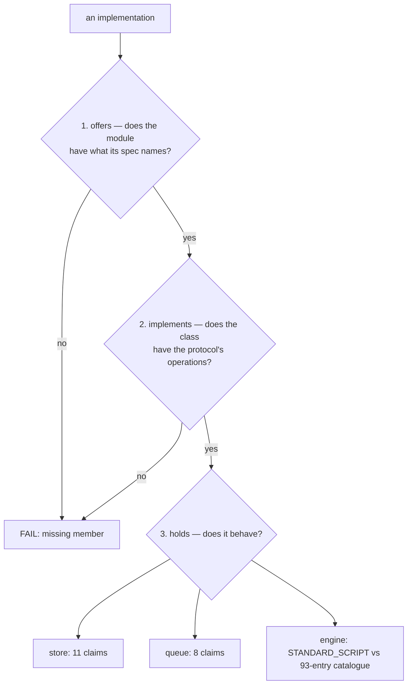
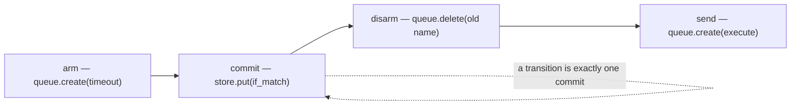

# 13 -- Conformance: three questions, and every state held to the catalogue

The types alone say nothing about behaviour, so the conformance suites are the part that does. Each
implementation — the engine, and both stores and both queues — is asked **three questions in order**:
does the module offer what its spec names, does the thing have the operations, and does it behave.
The third question is where the specification's 93-entry catalogue comes in for the engine, and where
11 and 8 claims come in for the store and the queue. This document reads `check.py`, the three
contracts, and the engine script, and explains why the effect order and the write law are graded
rather than assumed.

# Part 1 -- Three Questions, Top to Bottom

`check.py` is the entry point (`python -m resonate.testing.conformance.check`), and its structure is
three questions per implementation, in order, because each only makes sense if the one before it
passed:

```python
# resonate/testing/conformance/check.py (docstring, verbatim)
1. **Does the module offer what its spec names?** `StoreM` says a store
   module has `Store`; this asks whether it does. A type checker asks the
   same question better (`test_types.py` runs mypy over the module specs),
   but it asks at a moment nobody is watching.
2. **Does the thing have the operations?** Every member of `StoreP` present
   on the class. Structural, so it catches a rename and nothing subtler.
3. **Does it behave?** The contract from `conformance/` — 11 claims for a
   store, 8 for a queue, and for the engine a script graded against the
   specification's own 93-entry catalogue.
```

The three are `offers`, `implements`, and `holds` in the code, and each prints an `ok`/`FAIL`/`skip`
line. A store or queue run against the real backend *skips* rather than fails when the credential
variable is unset — `GCS_BUCKET` for the bucket, `TASKS_QUEUE` for the queue — because an adapter's
shape is checked here and its behaviour against Google is checked in `test_conformance.py`. The shared
reporting format is one dataclass:

```python
# resonate/testing/conformance/violation.py (verbatim)
@dataclass
class Violation:
    step: int
    msg: str
    detail: str

    def __str__(self) -> str:
        return f"step {self.step} ({self.msg}): {self.detail}"
```



# Part 2 -- The Store Contract: eleven claims

The store's eleven claims are the things a bucket can fail, and they are written to run against *any*
`StoreM` — the memory store, the real bucket, or a rival implementation:

| # | claim | what it pins down |
|---|---|---|
| 1 | nothing is there until something is | `get` of an absent key is `None` |
| 2 | a create wins once | `if_absent` twice → second is `Conflict`, loser's bytes do not land |
| 3 | a replacement needs the version it read | `if_match` succeeds only at the version read, and the version changes |
| 4 | a replacement of nothing is refused | `if_match` on an absent key is `Conflict` |
| 5 | the two conditions are exclusive | `if_match` + `if_absent` together is a `ValueError` |
| 6 | an unconditional write needs no version | bare `put` overwrites |
| 7 | removing is idempotent | deleting twice, and deleting the absent, succeed |
| 8 | a key is free again once it is removed | `if_absent` after `delete` re-creates |
| 9 | listing is lexicographic ascending and capped | `list` sorts and honours `limit` |
| 10 | a document survives the round trip unchanged | bytes in, bytes out |
| 11 | a version is opaque and belongs to one key | a version is a non-empty string; another key's version is refused |

Each claim is a small function registered with the `@claim` decorator, and the suite hands every claim
its own prefix and cleans up after it — so a store that fails one is still graded on the rest, and a
run against a real bucket leaves nothing behind. The `refused` helper asserts not just that something
failed but that it failed *that way*: a store that raises the wrong error is a store that did not pass.

```python
# resonate/testing/conformance/store.py (shape, abbreviated)
@claim("a create wins once")
def _create(store: StoreP, p: str) -> None:
    version = store.put(p + "o", "one", if_absent=True)
    assert store.get(p + "o") == ("one", version)
    with refused(Conflict, "a second create was allowed"):
        store.put(p + "o", "two", if_absent=True)
    assert store.get(p + "o")[0] == "one", "the loser's bytes landed anyway"
```

# Part 3 -- The Queue Contract: eight claims

The queue's eight claims are the things a real queue can be asked to do *without being watched* — which
is why a run against a live queue is made harmless by using a *paused* queue, which accepts creation
and deletion (the whole contract) and dispatches nothing:

| # | claim | what it pins down |
|---|---|---|
| 1 | a create returns the name the service gave it | the name is a non-empty string |
| 2 | two creates are two tasks | names are distinct — the tombstone trap |
| 3 | cancelling what was created succeeds | `delete` of a real name is fine |
| 4 | cancelling is idempotent | `delete` twice is fine |
| 5 | cancelling what was never there succeeds | `delete` of a ghost name is fine |
| 6 | a dispatch carries no schedule and is still a task | `execute` with no `not_before` works |
| 7 | a schedule in the past is accepted rather than refused | `not_before=1` is fine |
| 8 | a schedule past any horizon is clamped rather than refused | `not_before=10**15` is fine |

What the contract deliberately does *not* claim — that a deadline carries its instant, that a dispatch
carries none, that the thirty-day horizon is clamped — are claims about the *request* an adapter
builds, and are checked against a double in `test_conformance.py`, not against a live service.

# Part 4 -- The Engine Script: every state, every transition, the effect order

The engine's conformance is a *script* — a list of 14 messages the engine can be asked to process —
and at every step three independent things are checked:

```python
# resonate/testing/conformance/engine.py (docstring, excerpt)
    - **The catalogue.** Every document the engine commits is a state the
      specification admits, and every consecutive pair is a transition it
      admits. A `Timeout` step is additionally held to the sweeper
      properties, which are strictly stronger.
    - **The effect order**, because it is what the crash windows rest on.
    - **The write law**, because a read that writes is a read that costs a
      conditional write per poll.
```

The script is long enough that an implementation cannot pass it by accident — births, a lease taken
and expiring, a suspension, a wake, a settlement that fans out to a listener, a replay, and a deadline
that fires:

```python
# resonate/testing/conformance/engine.py (shape — STANDARD_SCRIPT, 14 steps)
STANDARD_SCRIPT: list[tuple[Msg, int]] = [
    (_targeted("run"), 0),                                   # birth
    (TaskAcquire("run", 0, "w1", 5_000), 1),                 # a lease
    (_targeted("run:1"), 2),
    (PromiseRegisterListener("run:1", "http://l"), 3),        # a listener
    (TaskSuspend("run", 1, ("run:1",)), 4),                   # a suspension
    (TaskAcquire("run:1", 0, "w2", 5_000), 5),
    (Timeout(ORIGIN), 10_000),                                # the lease on run:1 expires
    (TaskAcquire("run:1", 1, "w3", 5_000), 10_001),
    (TaskFulfill("run:1", 2, PromiseSettle("run:1", RESOLVED, Value(data="42"))), 10_002),
    (TaskAcquire("run", 1, "w4", 5_000), 10_003),
    (_targeted("run:1"), 10_004),                             # replay: create reads back
    (PromiseCreate("run:2", 10_100, Value(), {"resonate:timer": "true"}), 10_005),
    (Timeout(ORIGIN), 200_000),                               # the timer resolves
    (TaskFulfill("run", 2, PromiseSettle("run", RESOLVED, Value(data="done"))), 200_001),
]
```

The effect order and the write law are claims about *when* the engine wrote, so the suite wraps the
ports it hands over and reads the log back: `_Recorded` wraps the store and appends `"commit {key}"` to
the fault log on every `put`, and `_Watched` wraps the queue and decodes each created body back into a
typed `Send` (skipping `Timeout`). That wrapping is what lets the same suite grade the same engine over
the simulated store, over a real bucket, or over anything else that passes `store.conformance`.

The effect-order grader is the "arm → commit → disarm → send" rule made executable:

```python
# resonate/testing/conformance/engine.py (shape, abbreviated)
def _kind(write: str) -> str:
    if write.startswith("commit "):
        return "commit"
    if write.startswith("delete "):
        return "disarm"
    if write.startswith("create "):
        return "arm" if write.startswith("create timeout ") else "send"
    return "?"

def _effect_order(segment: list[str]) -> str | None:
    kinds = [_kind(w) for w in segment]
    commits = [i for i, k in enumerate(kinds) if k == "commit"]
    if len(commits) > 1:
        return f"{len(commits)} writes for one message; a transition is one commit"
    if not commits:
        return None if not segment else f"effects without a commit: {segment}"
    before, after = kinds[: commits[0]], kinds[commits[0] + 1:]
    if any(k != "arm" for k in before):
        return f"something other than an arm before the commit: {segment}"
    i = 0
    while i < len(after) and after[i] == "disarm":
        i += 1
    if any(k != "send" for k in after[i:]):
        return f"a disarm after a send, or worse: {segment}"
    return None
```

Nothing before the commit but arms, nothing after the disarms but sends, exactly one commit — that is
the whole crash-window argument, checked mechanically. The write law is the other half: if the
document's objects and `timer_at` are unchanged and yet something wrote, that is a violation, because
the document's clock is not state and advancing it alone owes no write.



The grader walks the fault log and asserts the *positions* of these four kinds, not their count: arms
before the commit, disarms before the sends, and a single commit between them. Any other order is a
crash window the run could not survive.

# The Aha Moment

**Aha:** Conformance is *observational equivalence*, not code review. The suite does not look at the
implementation — it drives an engine through the same 14 messages it would receive in production and
asks only "is every state you committed a state the specification admits, and every step a transition
it admits?" An implementation in another language, over another store, with a kernel written from the
specification rather than transcribed from it, passes or fails on the same observations. That is the
difference between "we tested our code" and "we proved our interface", and it is why the two memory
ports are graded against the two Google ones rather than trusted as mocks.

# Cross-References

- The catalogue the engine's states and transitions are checked against: [14-properties.md](./14-properties.md).
- The ports whose contracts these claims test: [10-spec-interfaces.md](./10-spec-interfaces.md).
- The simulators the engine script runs over by default: [12-simulators.md](./12-simulators.md).
- The exhaustive search that goes beyond the script: [15-explore-and-machine.md](./15-explore-and-machine.md).

Continue to [14-properties.md](./14-properties.md).
