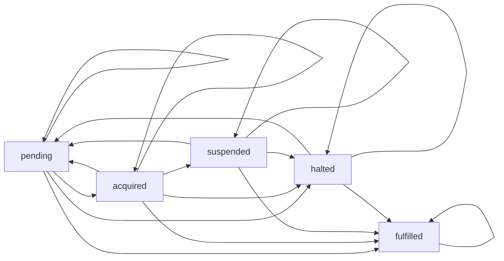
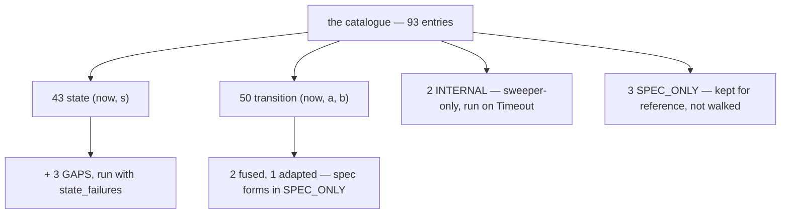

# 14 -- Properties: the 93-entry catalogue, transcribed from Lean

The catalogue is the specification made executable. `resonate/testing/properties.py` transcribes
`resonatehq/resonate-specification` (`spec/02-abstract/properties.lean`) into Python predicates, and
the conformance suite runs every committed state and every consecutive pair against them. It is **43
state and 50 transition entries** — 93 in all — plus three known gaps, two sweeper-only properties,
and three specification forms kept for reference but not walked. The names are the specification's
own, so a violation means the same thing here as in Lean, Go or TypeScript. This document explains the
abstraction the predicates are stated over, the two predicate shapes, the three adapted entries, and
the state machine the edge sets encode.

# Part 1 -- The State the Predicates Are Stated Over

A predicate is a statement about a `State`, which is the document plus the outbox the shell has
accumulated from the kernel's `Send` effects:

```python
# resonate/testing/properties.py (shape, abbreviated)
@dataclass
class State:
    doc: Document
    outbox: list[Send] = field(default_factory=list)   # upserted by key, never dropped
    schedules: tuple = ()    # not implemented; the schedule properties hold vacuously
    retry_timeout: int = 30_000

    def after(self, doc: Document, sends: list[Send]) -> State:
        entries = {outbox_key(e): e for e in self.outbox}
        for e in sends:
            entries[outbox_key(e)] = e
        return State(doc, list(entries.values()), self.schedules, self.retry_timeout)
```

The outbox is the set of queued messages, *upserted by key*: an `execute` is keyed by task id alone, so
a redispatch replaces the row it repeats; an `unblock` by promise and address. It is "never dropped"
because the catalogue asserts things about what the system *told the world it would do*, not just what
it wrote to the store. Two helper views matter throughout: `project_state(p, now)` — a pending promise
past its deadline reads as settled by that deadline — and the "external/awaitable" notion, which is the
same `Promise.is_external()` the kernel uses.

# Part 2 -- Two Predicate Shapes

Every property is one of two shapes, and the shape is in the function's arity:

```python
# resonate/testing/properties.py (docstring, excerpt)
    state(now, s)      true at every state the kernel passes through
    trans(now, a, b)   true at every pair of consecutive states, one step apart
```

A **state** property holds at every state; a **transition** property holds at every pair. Two
representative entries show the flavour:

```python
# resonate/testing/properties.py (verbatim — two state properties)
def well_formed_promise_settled_at_iff_not_pending(_now, s):
    return all((p.state != PENDING) == (p.settled_at is not None) for p in s.promises)

def consistent_task_iff_kind_task(_now, s):
    return all((o.task is not None) == runnable(o.promise) for o in s.doc.objects)
```

The first pins the promise's fundamental well-formedness: a promise is settled exactly when it has a
`settled_at`. The second pins the coupling that makes the whole design work: *a promise has a task
exactly when it has a `resonate:target` tag* — a local call is a pure value, a targeted call is work to
dispatch. A transition property asserts something about *movement*, like the fencing invariant:

```python
# resonate/testing/properties.py (verbatim — the fencing property)
def monotone_task_version_increases_only_on_acquisition(_now, a, b):
    """The fencing property: exactly +1 on pending -> acquired, unchanged otherwise."""
    for o in a.doc.objects:
        t, u = o.task, b.task(o.id)
        if t is None or u is None:
            continue
        if t.state == T_PENDING and u.state == T_ACQUIRED:
            if u.version != t.version + 1:
                return False
        elif u.version != t.version:
            return False
    return True
```

That is the entire lease/fence discipline in one predicate: a task's version changes *only* on
`pending → acquired`, by exactly one, and is frozen at all other times. It is why a worker that lost
its lease cannot write — its fence names a stale version, and the kernel refuses it.

# Part 3 -- The Edge Sets: the state machine as data

The state machine the predicates describe is also written down explicitly, as three sets of admissible
edges. The task set is the one worth seeing whole:

```python
# resonate/testing/properties.py (verbatim — the task state machine)
TASK_EDGES = {
    (T_PENDING, T_PENDING), (T_PENDING, T_ACQUIRED), (T_PENDING, T_HALTED), (T_PENDING, T_FULFILLED),
    (T_ACQUIRED, T_PENDING), (T_ACQUIRED, T_ACQUIRED), (T_ACQUIRED, T_SUSPENDED),
    (T_ACQUIRED, T_HALTED), (T_ACQUIRED, T_FULFILLED),
    (T_SUSPENDED, T_PENDING), (T_SUSPENDED, T_SUSPENDED), (T_SUSPENDED, T_HALTED), (T_SUSPENDED, T_FULFILLED),
    (T_HALTED, T_PENDING), (T_HALTED, T_HALTED), (T_HALTED, T_FULFILLED),
    (T_FULFILLED, T_FULFILLED),
}
```



Read it as a lifecycle: a task is born pending, becomes acquired when a worker claims it, suspends when
it blocks, halts when told to stop, is re-pended (pending) from acquired/suspended/halted, and reaches
fulfilled — the one terminal state, from which there is no exit. The sweeper is held to a *strictly
stronger* subset of these edges, `TASK_EDGES_INTERNAL`: it may re-pend, fulfil, resume or refresh, and
may never acquire, suspend, halt or continue a task — because a background sweep has no worker behind
it. The promise edges are the same idea, with one subtlety encoded: a promise may go from `pending` to
any of the four settled states, but from a settled state there is no edge out — settlement is one-way.

# Part 4 -- Three Adapted Entries, and What They Mean

Three entries are adapted from the specification's form, and the docstring explains each:

- **Two `_fused`.** The abstract machine's request steps only arm a task's retry deadline at `now`,
  and the internal retry step then sends the execute and re-arms at `now + retry_timeout`. This kernel
  *fuses* those two steps into one (as the Rust kernel does), so on entry to `pending` the deadline is
  already `now + retry_timeout` and the execute is already in the outbox. `consistent_task_pending_entry_arms_retry_fused`
  and `consistent_task_wake_records_resume_fused` assert the fused form.
- **One `_adapted`.** `consistent_suspension_registers_callback` demands a callback NEW in the step, but
  a task that suspends, is halted, continued, re-acquired, and suspends on the same promise again
  registers nothing new, because registration is idempotent in the specification's own `taskSuspend`.
  The specification samples that entry on scripts of length three, which never reach that five-step
  path. The adapted form asks only that the task hold a registration on a pending promise after the
  step.

The originals are kept beside them as `SPEC_ONLY` for reference and are not walked. The three known
gaps are the properties the protocol enforces at *this* implementation's doors rather than in the
catalogue — a positive task ttl, a non-empty target tag, a delay before its deadline — and they are run
as part of `state_failures`. The two sweeper-only properties run only on `Timeout` steps, because they
assert the stronger internal edge set:

```python
# resonate/testing/properties.py (shape, abbreviated — the runners)
def state_failures(now, s) -> list[str]:
    return [name for name, f in STATE + GAPS if not f(now, s)]

def trans_failures(now, a, b) -> list[str]:
    return [name for name, f in TRANS if not f(now, a, b)]

def internal_failures(now, a, b) -> list[str]:
    return [name for name, f in INTERNAL if not f(now, a, b)]
```

The runners return the *names* of the broken properties, not booleans — so a violation names the
specification's own entry, and a reader in any language knows exactly which theorem failed.



# The Aha Moment

**Aha:** The catalogue is a *theorem library*, and the conformance suite is a *proof checker*. The
properties do not describe what the code does — they describe what the *protocol* is, transcribed from
a Lean formalisation, and the code is held to them like an implementation to a spec. That is why three
entries are adapted and documented rather than silently changed: when the code and the specification
disagree, the disagreement is recorded, argued, and named — the `_fused` and `_adapted` suffixes are a
paper trail, not a confession. A kernel in another language would be graded against the same 93 names.

# Cross-References

- The conformance suite that runs these predicates: [13-conformance.md](./13-conformance.md).
- The kernel whose states and transitions are being graded: [06-kernel.md](./06-kernel.md).
- The exhaustive search that explores beyond the script: [15-explore-and-machine.md](./15-explore-and-machine.md).
- The promise and task records whose fields these predicates inspect: [01-the-promise.md](./01-the-promise.md).

Continue to [15-explore-and-machine.md](./15-explore-and-machine.md).
