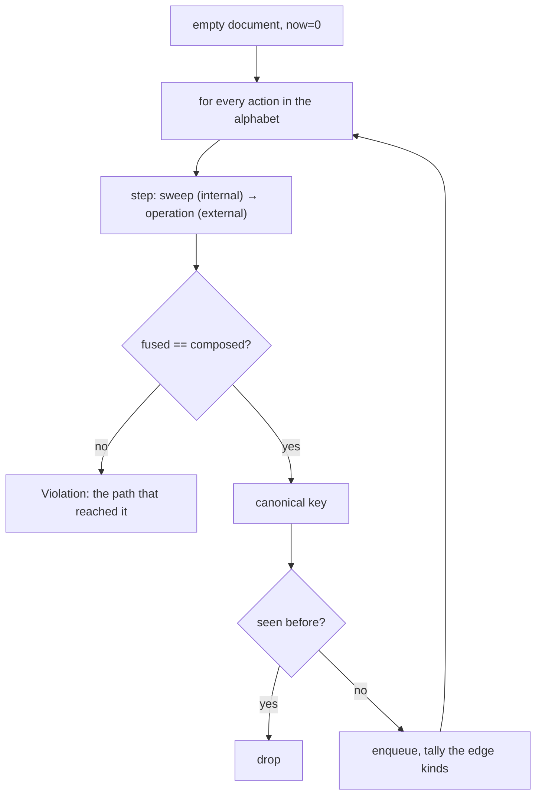
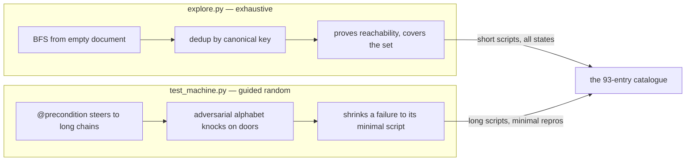

# 15 -- Explore and Machine: exhaustive search and a Hypothesis state machine

The conformance script in [13-conformance.md](./13-conformance.md) is a fixed sequence; the catalogue in
[14-properties.md](./14-properties.md) is the rules. The two remaining instruments *search for violations
that no fixed script would find* — and they are complementary by design. `explore.py` does bounded
exhaustive breadth-first search from the empty document, covering the reachable set rather than
sampling it; `test_machine.py` is a Hypothesis state machine that randomly builds scripts, guided
toward the long chains and shrinking any failure to its minimal form. The docstring of the machine
states the split precisely: *a random search is the wrong instrument for proving a state is reachable,
and an exhaustive one is the wrong instrument for scripts longer than its bound.*

# Part 1 -- Exhaustive Search: every reachable state, once

`explore.py` walks breadth-first from the empty document over a finite alphabet, deduplicating states by
a canonical key so it covers the reachable set rather than sampling it:

```python
# resonate/testing/explore.py (docstring, excerpt)
    Breadth-first from the empty document over a finite alphabet: every request
    the document makes sensible, a timeout, and a few clock advances. States are
    deduplicated by a canonical key, so the search covers the reachable set
    rather than sampling it, which is what the specification's own sweep does at
    script length three; this goes deeper.
```

The alphabet is bounded — a finite set of ids, tags, timeouts and clock advances — because breadth and
depth trade against each other, so there are two:

```python
# resonate/testing/explore.py (shape, abbreviated — the two alphabets)
BROAD = Alphabet(
    ids=("o", "o:1", "o:2"),
    tags=({"resonate:target": W}, {"resonate:scope": "global"}, {"resonate:timer": "true"},
          {"resonate:target": W, "resonate:delay": "60"}),
    timeouts=(50, 1_000),
    clock=(5, 100, 1_000),
)

NARROW = Alphabet(
    ids=("o", "o:1"),
    tags=({"resonate:target": W}, {"resonate:scope": "global"}),
    timeouts=(100_000,),
    clock=(100,),
    relative=True,
)
```

`BROAD` says many things a few steps deep; `NARROW` says few things far enough to reach the long
chains (acquire, suspend, settle, wake, halt, continue), which no broad search gets to. The `relative`
flag decides whether a deadline is `now + timeout` (outlives the script) or the timeout itself
(falls into the past as the clock advances, reaching the born-dead and expiry shapes).

The heart of the search is `step`, and its most important check is the **fused == composed** equality.
Every request edge is checked as its two abstract halves — the sweep as an internal step, then the
operation as an external step — and the fused result is held equal to the composition:

```python
# resonate/testing/explore.py (shape, abbreviated — the fused check)
def step(now, s, action, tally, ab=BROAD):
    if isinstance(action, Advance):
        return now + action.by, s
    swept = handle_internal(s.doc, now, CFG)
    mid = s.after(document_after(s.doc, swept), [e for e in swept if isinstance(e, Send)])
    bad = check_invariants(mid.doc)
    if bad or P.state_failures(now, mid) or P.trans_failures(now, s, mid) or P.internal_failures(now, s, mid):
        raise Violation(("sweep", bad, ...))
    if isinstance(action, Timeout):
        tally_edge(s, mid, ..., internal=True)
        return now, mid
    fx, reply = handle_external(mid.doc, action, now, CFG)
    doc = document_after(mid.doc, fx)
    nxt = mid.after(doc, [e for e in fx if isinstance(e, Send)])
    ...
    fused, _ = handle_external(s.doc, action, now, CFG)
    if document_after(s.doc, fused) != doc:
        raise Violation(("fused != composed",))
    ...
```

The `fused != composed` assertion is the deepest claim in the whole test suite: it says the kernel's
single fused step (sweep-then-operation in one call) is *observationally identical* to sweeping first
and then applying the operation — that the sweep commutes with the operation the way the specification
says it must. Any failure stops the search with the path that reached it, so the report is a minimal
repro, not a state dump.

The state key is the deduplication engine — the clock, every object field, and the outbox by key:

```python
# resonate/testing/explore.py (shape, abbreviated — the canonical key)
def key(now, s):
    objs = []
    for o in s.doc.objects:
        p, t = o.promise, o.task
        objs.append((
            o.id, p.state, p.param.data, p.value.data, tuple(sorted(p.tags.items())),
            p.timeout_at, p.created_at, p.settled_at, tuple(p.callbacks), tuple(p.listeners),
            None if t is None else (t.state, t.version, t.pid, t.ttl,
                                    tuple(sorted(t.resumes)), t.retry_at, t.lease_at),
        ))
    outbox = tuple(sorted((P.outbox_key(e), e.address, repr(e.msg)) for e in s.outbox))
    return (now, tuple(objs), outbox)
```

`explore(depth)` runs it, printing states and edges per depth and a `tally` of every interesting edge
kind — born-pending, born-dead, delayed, wake, lease-expired, retry, halted-buffer, expired,
carry-on-300, refused, unblock, execute. The tally is the "did the search mean anything" signal, the
same idea the machine asserts at the end of a campaign.



# Part 2 -- The Hypothesis Machine: guided random, shrinking

`test_machine.py` is the other instrument, and its *reason for existing* is the shrinking Hypothesis
gives: when a script violates the catalogue, Hypothesis shrinks it to its minimal form and stores it,
so the next run replays it first, and what a failure hands over is the shortest script that breaks.

The machine is a `RuleBasedStateMachine` with the same id/tag/deadline alphabet but made *adversarial* —
including a foreign origin and a set of refused-at-the-door tags:

```python
# resonate/testing/test_machine.py (shape, abbreviated — the adversarial alphabet)
IDS = ["o", "o:1", "o:2", "o:3", "o:1.1", "o:2.1"]
FOREIGN = "x:1"   # another origin: every door that compares origins must refuse it
TAGS = [
    {}, {"resonate:target": W}, {"resonate:target": W, "resonate:branch": "o"},
    {"resonate:timer": "true"}, {"resonate:scope": "global"}, {"resonate:external": "true"},
    {"resonate:target": W, "resonate:delay": "DELAY"},
    {"resonate:timer": "true", "resonate:target": W},   # refused at the door
    {"resonate:target": ""},                            # refused at the door
    {"resonate:target": "not a url"},                   # refused at the door
]
```

Rules are *grouped by what they need* rather than by which operation they send, and gated with
`@precondition`, because Hypothesis samples a rule and then filters it — a rule gated on a task state
the document rarely holds costs a retry every time it is drawn. The always-enabled rules (`advance`,
`timeout`, `promise_create`, `create_something_long_lived`, `task_create`, `read`,
`a_request_that_may_be_refused`) knock on the doors; the gated rules (`on_an_awaitable_promise`,
`settle_what_a_task_awaits`, `on_a_pending_task`, `on_an_acquired_task`, `on_a_parked_task`) steer
toward the long chains — acquire, suspend, settle, wake, re-acquire, fulfil. Each `do` runs one request
through both abstract halves, as the other suites do, with the whole catalogue on each and the fused
result held equal to the composition.

Two invariants are checked after every step, and one of them is the kernel's own:

```python
# resonate/testing/test_machine.py (shape, abbreviated)
    @invariant()
    def the_state_properties_hold(self):
        assert P.state_failures(self.now, self.s) == [], P.state_failures(self.now, self.s)

    @invariant()
    def the_kernels_own_invariants_hold(self):
        assert check_invariants(self.s.doc) is None, check_invariants(self.s.doc)
```

The campaign is then asserted to be *non-vacuous* — it must reach a fixed list of interesting
transitions, or the run proves nothing:

```python
# resonate/testing/test_machine.py (shape, abbreviated)
REQUIRED = [
    "born_pending", "born_acquired", "acquired", "suspended", "settled", "expired",
    "retry", "ok", "refused", "execute", "unblock",
]

def test_the_campaign_reaches_every_interesting_transition():
    SEEN.clear()
    run_state_machine_as_test(
        KernelMachine,
        settings=settings(max_examples=400, stateful_step_count=40, deadline=None, ...),
    )
    missing = [k for k in REQUIRED if SEEN[k] == 0]
    assert not missing, (missing, dict(SEEN))
```

And the targeted deep profile — gated behind `DEEP=1` because it takes minutes and its job is to look
for what short campaigns cannot reach — uses Hypothesis's `target` to hill-climb toward *wide*
documents (many tasks in flight, many obligations registered), and additionally requires the rare
transitions (`wake`, `halted_buffer`, `lease_expired`, `carry_on_300`) that the short campaign only
samples.



# The Aha Moment

**Aha:** The two searches split the problem exactly where "reachable" and "minimal" stop being the same
question. Exhaustive BFS answers *is this state reachable* by enumerating, and its `fused == composed`
check is the one property a random search could never assert — it holds at *every* reachable state, not
at a sample. The Hypothesis machine answers *what is the shortest script that breaks*, by shrinking
whatever it finds. Neither can do the other's job, and the docstring's refusal to pretend otherwise —
"a random search is the wrong instrument for proving a state is reachable" — is what makes the pair
honest: together they cover both ends of the space, and each reports the thing only it can see.

# Cross-References

- The catalogue both searches run at every step: [14-properties.md](./14-properties.md).
- The conformance script, the fixed-sequence sibling of these searches: [13-conformance.md](./13-conformance.md).
- The kernel whose `fused == composed` property is being checked: [06-kernel.md](./06-kernel.md).
- The simulators the searches run on top of: [12-simulators.md](./12-simulators.md).

Continue to [16-examples.md](./16-examples.md).
