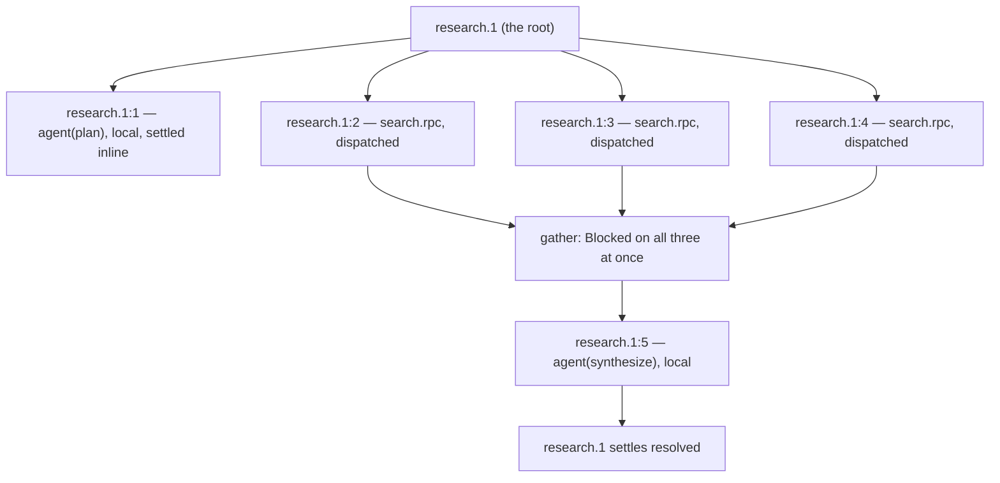
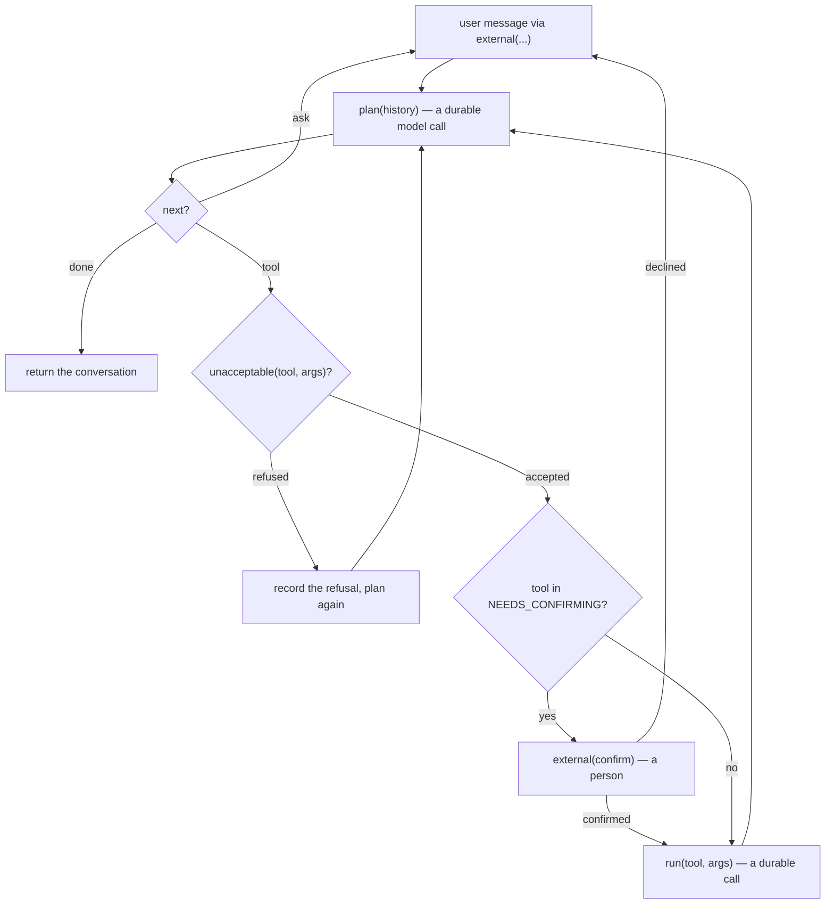

# 16 -- Examples: two durable agents, one file each

The two examples under `examples/` are deliberately *not part of the engine*. They are the file a user
would write — the same `main.py` that `test_http.py` serves, so the example and the thing under test
are one file rather than two that drift. `research-agent/main.py` is the smallest durable program worth
deploying: a fan-out and a durable sleep. `travel-agent/main.py` is the same idea at full size — a
conversation that runs for a month, waits on a person, and refuses to let a language model decide what
is safe. Together they teach the whole programming model of [02-programming-model.md](./02-programming-model.md)
as *shape*: where the durable boundaries fall, and where the state does not live.

# Part 1 -- The Research Agent: fan-out and a durable sleep

The whole of a user's program is three durable functions and a handler:

```python
# examples/research-agent/main.py (verbatim — the three functions)
@resonate
async def agent(prompt: str):
    """A model call. Async, because that is what a model call is."""
    if prompt.startswith("Plan"):
        return ["durable execution", "workflow recovery", "sagas"]
    return {"report": prompt}


@resonate
def search(query: str):
    """A leaf with nothing to await. It does not have to pretend."""
    return f"finding about {query}"


@resonate
async def research(question: str):
    # Plan the searches
    queries = await agent(f"Plan the searches for: {question}")

    # Fan out the searches
    results = await gather(search.rpc(q) for q in queries)

    # Synthesize the results
    return await agent(f"Write a cited report. {question}: {results}")
```

`search` is a plain synchronous `@resonate` function — a leaf with nothing to await, and it does not
have to pretend otherwise. `research` is the interesting one: it awaits a plan, then fans out over the
plan with `gather(search.rpc(q) for q in queries)`, then synthesises. The fan-out is where the position
naming of [01-the-promise.md](./01-the-promise.md) pays for itself — each `search.rpc(q)` is a remote
call at its own position, so the three searches run concurrently and each answer lands in its own
promise.



The three searches are siblings at `:2`, `:3`, `:4` — the positions the caller's `_Call` counter handed
out in program order — and the synthesis is `:5`, a fresh position that runs only on the final replay.

The second thing `main.py` teaches is the durable sleep, and its docstring is the whole argument in
miniature:

```python
# examples/research-agent/main.py (verbatim — the durable sleep)
@resonate
async def nap(ms: int):
    """A durable sleep, as small as one can be and still be worth deploying.

    Nothing runs while this waits. The worker suspends, the container is
    free to go away, and what brings the run back is a deadline in the
    document that the engine handed to the queue as a scheduled `timeout`
    message. On a laptop that is a clock a test moves; on Cloud Run it is
    Cloud Tasks deciding the time has come, which is the only version of
    the claim that is not a simulation.
    """
    await sleep(ms)
    return {"slept": ms}
```

`handler = serve()` on the last line is the entire deployment surface: the name `handler` is Google's,
because the Python buildpack looks for `main.py` at the root and `--function handler` looks for a
module-level function by that name. Beside it, a `requirements.txt` naming this package, and that is
the end of the list.

# Part 2 -- The Travel Agent: signals, a person, and a model that cannot waive it

`travel-agent/main.py` is a translation of Temporal's "Build a Durable AI Agent" tutorial, and its
docstring is a translation table — the point is what *disappears*:

```python
# examples/travel-agent/main.py (docstring, excerpt — the translation)
    Temporal                        here
    ------------------------------  ------------------------------------
    @workflow.defn class            @resonate async def
    self.conversation_history       a local list, rebuilt on every replay
    @workflow.signal user_prompt    await external(...)
    @workflow.signal confirm        await external(...)
    @workflow.signal end_chat       a message that says so
    workflow.wait_condition(...)    the await itself
    self.confirmed / waiting_for_   nothing; the promise is the state
    @workflow.query history         read the document
    @activity.defn                  @resonate
    execute_activity(name, args)    TOOLS[name](*args)
    continue_as_new                 a new run, started from outside
```

Three signals, a wait condition, and two boolean fields become **one thing**: `external`, a promise
something outside settles. There is no handler to register because there is nothing to hold — a
suspended run has no memory, so the question *has* to be a promise in the bucket, and once it is, the
handler has nothing left to do.

The conversation loop is the durable boundaries laid bare:

```python
# examples/travel-agent/main.py (verbatim, excerpt — the conversation loop)
    history: list[tuple[str, object]] = []
    if opening:
        history.append(("summary of earlier", opening))

    for _turn in range(MAX_TURNS):
        said = await external(ask={"for": "message"}, timeout=PATIENCE)
        if not isinstance(said, str) or said.strip().lower() == END:
            return {"ended": "the user said so", "conversation": history}
        history.append(("user", said))

        while True:
            step = await plan(history)
            history.append(("agent", step["say"]))

            if step["next"] == "done":
                return {"ended": "the goal is met", "conversation": history,
                        "said": step["say"]}
            if step["next"] == "ask":
                break

            tool, args = step.get("tool"), step.get("args") or {}
            refusal = unacceptable(tool, args)
            if refusal:
                history.append(("tool", {"tool": tool, "refused": refusal}))
                continue

            if tool in NEEDS_CONFIRMING:
                answer = await external(
                    ask={"confirm": tool, "args": args, "why": step["say"]},
                    timeout=PATIENCE)
                if str(answer).strip().lower() not in ("yes", "y", "ok", "true"):
                    history.append(("user", f"declined {tool}"))
                    break
                history.append(("user", f"confirmed {tool}"))

            history.append(("tool", {**await run(tool, args), "tool": tool}))
```

`history` is a plain local list and is **never stored** — and the docstring pauses on why that looks
like a bug and is not: every value in it came from a durable call, so replay rebuilds it identically.
It is thrown away every time the function suspends and reconstructed from the document when it resumes.
That is the single most important thing the example teaches about where state lives: the *promise* is
the state, the local list is just a derived view.

The safety boundary is `unacceptable`, and it is the part that refuses to let the planner's opinion be
an instruction:

```python
# examples/travel-agent/main.py (verbatim — the gate)
def unacceptable(tool, args: dict) -> str | None:
    """Whether this agent is willing to carry the model's proposal out.

    A planner is a language model's opinion about what to do next. It
    arrives as data, over the same wire as everything else, and it is
    checked here against what these functions actually are -- not because
    the model is expected to lie, but because a step that runs only when
    it type-checks is one fewer thing that can go wrong at three in the
    morning.
    """
    if tool not in TOOLS:
        return f"no such tool; this agent has {', '.join(sorted(TOOLS))}"
    if not isinstance(args, dict):
        return "arguments must be an object"
    takes = set(inspect.signature(TOOLS[tool].fn).parameters)
    missing, extra = takes - set(args), set(args) - takes
    if missing:
        return f"missing {', '.join(sorted(missing))}"
    if extra:
        return f"{tool} does not take {', '.join(sorted(extra))}"
    return None
```

`NEEDS_CONFIRMING` — which tools need a person's yes — is a property of the tool in `tools.py`, not an
opinion the model gets to hold; a planner that could waive it would be a planner that could be talked
into waiving it. The model proposes a step; this file decides whether a human sees it first.



# Part 3 -- The Planner, and Why a Model's Non-Determinism Is Fine

`planner.py` is where the one non-deterministic step lives, and its docstring says exactly why that is
allowed:

```python
# examples/travel-agent/planner.py (docstring, excerpt)
    A durable function may do anything it likes *inside* a call; what replay
    requires is that the sequence of durable calls is the same every time. A
    model's answer is recorded in a promise the moment it is produced, so the
    replay reads the answer back rather than asking again -- the run is
    deterministic even though the planner is not.
```

The planner is one durable call either way. With credentials it asks Claude
(`MODEL = "claude-opus-5"`, structured output via `output_config.format` with a JSON schema, so the API
returns JSON that validates rather than text to repair); with none it follows `SCRIPT`, a scripted
planner that can complete this one goal and nothing else. The script exists so the example runs — and
`test_example_agent.py` passes — on a laptop with no key and no network, testing the agent rather than
the weather inside a model.

`tools.py` holds the three things the agent can actually do — `find_events`, `search_flights`,
`create_invoice` — each an ordinary durable function, no tool class, no handler registry, no dynamic
dispatch. The planner names one, `main.py` looks it up in `TOOLS`, and calling it is a durable call
like any other. The tools are fixtures rather than live integrations on purpose: what the example is
about is the shape of the conversation and where the durable boundaries fall, and a live flight API
would make the interesting part untestable.

# The Aha Moment

**Aha:** The travel agent's `history` is never stored, and that is the whole idea in one variable. A
durable program's state is not "everything the function touched" — it is "everything that was not
derivable from the document." Every answer came from a durable call, so the answers *are* the document,
and the list is a cache you can throw away. The moment a value would not be rebuilt identically on
replay — a clock read, a fresh random, an un-recorded model answer — it must be a durable call instead.
The example does not just show the syntax; it draws the line, and the line is the difference between a
run that survives a crash and one that merely finishes.

# Cross-References

- The programming model these examples use: [02-programming-model.md](./02-programming-model.md).
- The `.rpc` fan-out in `research`: [03-rpc-and-gather.md](./03-rpc-and-gather.md).
- `external` as a promise someone outside settles: [02-programming-model.md](./02-programming-model.md).
- The `serve()` handler and how these deploy: [17-deployment.md](./17-deployment.md).

Continue to [17-deployment.md](./17-deployment.md).
