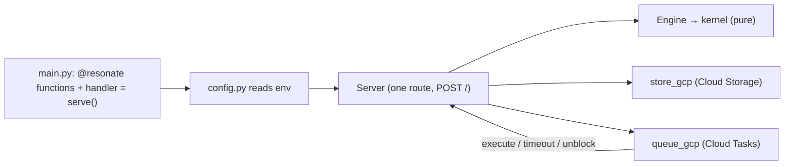
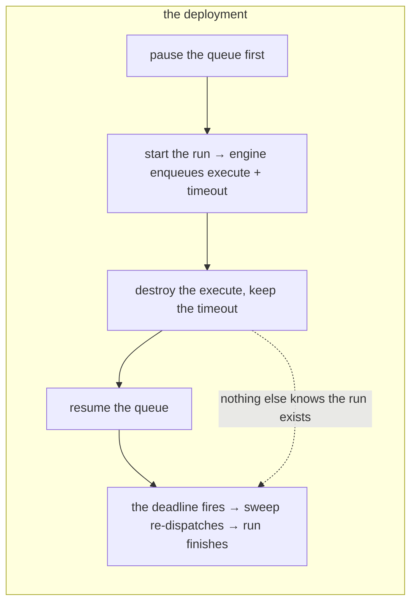

# 17 -- Deployment: serve(), two env vars, versions, and the live proof

A durable program deploys as one Cloud Run service over a Cloud Storage bucket and a Cloud Tasks
queue, and the entire wiring is one line: `handler = serve()`. The public surface is seven names —
`serve`, `resonate`, `gather`, `sleep`, `external`, `Failed`, `Durable` — and everything else in the
package is the engine, which a user should never need to import. This document reads the deployment
surface: `config.py` (the only module that reads environment variables), the versioning story, and the
two files under `live/` that prove the durability claim against Google rather than a simulator. The two
guarantees the whole thing owes are stated once, at the end.

# Part 1 -- serve(): the whole wiring in one line

`serve()` builds a `Server` ([09-server-and-config.md](./09-server-and-config.md)) from the environment
and returns a module-level function named `handler` — the name Google's buildpack looks for, because
`main.py` at the root is what the Python buildpack loads:

```python
# resonate/__init__.py (docstring, excerpt)
    Call it `main.py`, deploy it, and the run is durable. `handler = serve()`
    is the whole of the wiring: Google's buildpack looks for a module-level
    function named `handler`, and `serve()` builds the service from the
    environment and returns one. It goes last, after the functions it serves.
```

Two things the file cannot know, because they are infrastructure rather than code, must be provided as
environment variables: `BUCKET`, the Cloud Storage bucket that holds the documents, and `QUEUE`, the
Cloud Tasks queue that carries the work. `config.py` lists the rest and what each is derived from when
it is absent. That is the entire deployment contract, and the research agent's docstring spells it as
one `gcloud` command:

```python
# examples/research-agent/main.py (docstring, excerpt — the deploy command)
    gcloud run deploy my-agent --source . --function handler \
      --set-env-vars BUCKET=...,PROJECT=...,LOCATION=...,QUEUE=...,BASE_URL=...
```

Beside `main.py`, a `requirements.txt` naming this package, and that is the end of the list.



# Part 2 -- config.py: the environment, and the defaults that are silent

`config.py` is the only module that reads environment variables, and every one has a default derived
from the two that are not derivable:

| variable | what it is | absence |
|---|---|---|
| `BUCKET` | the bucket holding the documents | must be set |
| `QUEUE` | the queue carrying the work | must be set |
| `PROJECT` / `LOCATION` | the GCP project and region | derived from the bucket/queue |
| `BASE_URL` | the service's own URL, used to resolve `HERE = "/"` | derived |
| `ROUTES_WORKERS` | map of function name → worker URL | derived |
| `ROUTES_ACCOUNT` | the service account whose OIDC token the queue must present | unset → no auth check |
| `AUDIENCE` | the audience a token must name | unset → no auth check |
| `RETRY_TIMEOUT` | how long a pending task waits before the deadline re-dispatches it | `30_000` ms |
| `LEASE` | how long a worker holds a task before the sweep can take it back | `60_000` ms |
| `K_REVISION` | the Cloud Run revision, used for anything that names the deployment | derived |

`SIMULATED=1` switches the whole thing to the memory store and queue — the same ports, the same
contracts, no Google — which is how `test_http.py` serves the real program over a bound socket and how
the examples run on a laptop. The defaults matter because they are what the engine assumes when nothing
is said: `RETRY_TIMEOUT` is the arm-the-deadline horizon, and `LEASE` is the fence's lifetime, and both
are the constants the kernel's `KernelCfg` carries into every sweep.

# Part 3 -- Versions: the one thing the deployment still has to get right

A durable function's name is not a label; it is a promise field. A promise records the call it stands
for as `{"f": "process"}`, and a worker looks the code up by that name, so two functions answering to
one name means a dispatch created for one runs the other:

```python
# resonate/__init__.py (docstring, excerpt — two names, and versions)
    A durable function's name is not a label. A promise records the call it
    stands for as `{"f": "process"}` and a worker looks the code up by it, so
    two functions answering to one name means a dispatch created for one runs
    the other. `@resonate` refuses that rather than letting the last import
    win -- a `billing.py` and an `orders.py` both defining `process` is a
    `DuplicateFunction` at start-up instead of a wrong answer in production.
```

If they really are two generations of one function, the deployment says so — `@resonate(version=1)` —
and both stay deployed. A run replays from the top and reads its earlier calls back *by position*, so
inserting a durable call or reordering two moves every position after it, and a run already in flight
would resume into a body that disagrees with its own history. Under a version, it finishes on the body
it started on, and new runs take the new one. Unversioned means version 0, which a promise records by
leaving the version out, and is what you want until the day you change a durable function with runs in
the air. The research agent's docstring states the same rule as the day to stop being casual:

```python
# examples/research-agent/main.py (docstring, excerpt)
    The day you change one of these bodies while runs of it are still in
    flight -- insert an `await`, reorder two -- the old runs replay by
    position into the new body and read the wrong answers back. That is when
    you write `@resonate(version=1)` above the new one and leave the old one
    where it is, so runs finish on the body they started on. Changing what a
    call *does* without changing which calls are made needs no version.
```

# Part 4 -- live/: the claim, proved against Google, not a simulator

`test_e2e.py` proves the durability claim against a simulator and `test_http.py` against a bound socket
— both worth having, and neither involves Google deciding when a message is delivered. The two files
under `live/` close that gap. `latency.py` measures the floor: a transition is one `get` and one `put`,
so the floor on how fast a run can proceed is their sum, and only the write half had ever been measured
before:

```python
# live/latency.py (docstring, excerpt)
    `store_gcp.py` records a write rate -- about two per second to one object --
    and nothing about reads, which is half the question. A transition is one
    `get` and one `put`: the engine reads the document, decides, and writes once
    under a precondition. So the floor on how fast a run can proceed is the sum
    of the two, and only one of them has ever been measured.
```

It measures through `store_gcp.Store` — not the library underneath — so what comes out is what the
engine experiences including its own decoding: a get miss (the first transition of every run), a get
hit, a conditional `put`, and a refused `412` (the path a busy origin takes), each with the first call
reported separately because a cold start pays for a TLS handshake and a token mint that a long-lived
container pays once. Its conclusion is printed, not stored: "That is the floor for one origin. It is a
latency bound, not a quota: nothing here is throttled, the writes are simply serial."

`crash_recovery.sh` is the durability claim *on the deployment*: destroy a run's only dispatch and see
whether its deadline brings it back. The trick is the pause, and the trick to the pause is doing it
first — a dispatch carries no schedule, so Cloud Tasks delivers it within a second, and deleting it
afterwards proves nothing. The queue is paused *before* the run starts, turning a race into a sequence:
the engine enqueues, nothing is delivered, the dispatch is deleted at leisure, and only the armed
deadline still knows the run exists:

```bash
# live/crash_recovery.sh (excerpt — the sequence)
say "0. clean slate, and pause before anything is running"
gcloud storage rm "gs://$BUCKET/wf/$ORIGIN" --project="$PROJECT" 2>/dev/null || true
gcloud tasks queues purge "$QUEUE" --location="$REGION" --project="$PROJECT" --quiet
gcloud tasks queues pause "$QUEUE" --location="$REGION" --project="$PROJECT" --quiet
sleep "$SETTLE"

say "4. destroy every dispatch, keep the deadline"
# ... deletes the execute, leaves the timeout ...
say "5. resume, and wait out the retry deadline ($WAIT s)"
gcloud tasks queues resume "$QUEUE" --location="$REGION" --project="$PROJECT" --quiet
sleep "$WAIT"

say "6. did the deadline bring it back?"
gcloud storage cat "gs://$BUCKET/wf/$ORIGIN" --project="$PROJECT"
```

The pause is not politeness: `queues pause` returns before it takes effect, and the script documents the
failure that taught it — on 2026-09-24 a run started immediately after a successful pause had its
dispatch delivered anyway and finished in eight seconds, which proves nothing and looks like a pass. The
verdict is read from the document's root promise: `resolved, six promises` means the deadline rescued a
run whose only dispatch was destroyed; `still pending` means the recovery path does not work in the
deployment, worth reporting as-is.



# Part 5 -- The Two Guarantees

Everything above exists to make two statements true, and they are the whole contract:

1. **The run finishes with the same answer.** The deadline is armed before the commit, so a committed
   run always has a timer that will re-awaken it, and replay reconstructs the answer identically because
   every durable call's result is read back rather than re-made.
2. **Each durable call runs at most once.** A call that already settled is never re-executed — its
   promise is the answer, and replay reads it. Only the *in-flight* call, the one that had not yet
   committed when the process stopped, may run again.

The second is the one the README states in the e2e test's own words: "Each time it still finishes with
the same answer, and at most the in-flight call is repeated." The first is what `crash_recovery.sh`
destroys a dispatch to show. Together they are durable execution, and the deployment is the thing that
turns the simulator's claims into Google's.

# The Aha Moment

**Aha:** Deployment is two environment variables and a version number, and that is the entire
surface — because the *hard* parts of durable execution are not deployment concerns at all. The
bucket, the queue, the auth, the retry horizon and the lease are all either Google's primitives or
defaults derived from them; the one decision that is genuinely yours is `@resonate(version=1)`, the
moment you change a durable function with runs in the air. The reason `serve()` can be one line is the
same reason the port adapters are almost empty: the design leans on Cloud Run, Cloud Storage and Cloud
Tasks instead of papering over them, so "deploy" collapses to "name the two things you created."

# Cross-References

- The server and config this wraps: [09-server-and-config.md](./09-server-and-config.md).
- The two ports whose env vars name the backends: [11-ports-adapters.md](./11-ports-adapters.md).
- The versioning's underlying position naming: [01-the-promise.md](./01-the-promise.md).
- The examples this deploys: [16-examples.md](./16-examples.md).

Continue to [18-data-flow.md](./18-data-flow.md).
