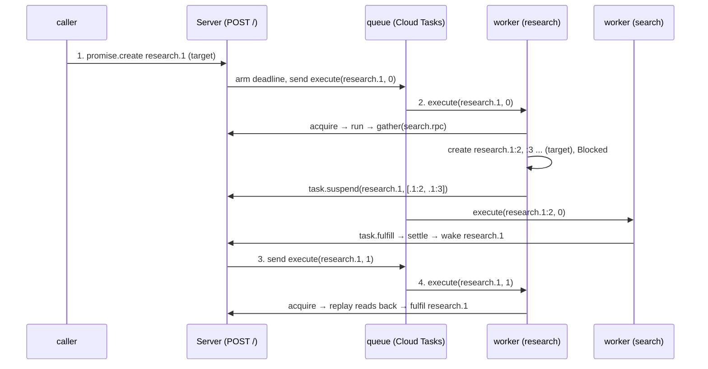
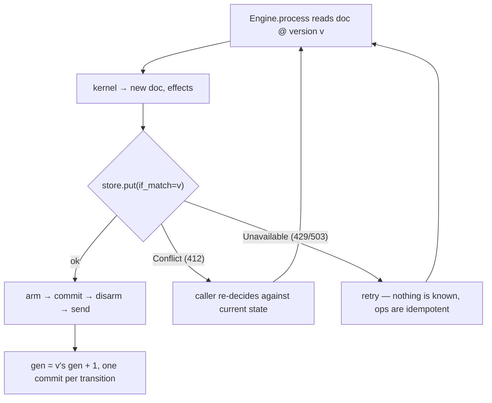

# 18 -- Data Flow: one run, four deliveries, one conditional write

A run of the research agent is not a process that stays alive — it is four deliveries to the server's
single `POST /`, and each delivery is one conditional write to one bucket object. Trace `research`
through them and the whole architecture of [04-architecture.md](./04-architecture.md) falls out: the
caller knocks (`promise.create`), the queue delivers the dispatch (`execute`), the worker suspends and
the callees settle (`promise.settle` → a fresh `execute`), and the worker fulfils. The armed deadline
runs underneath all four as the safety net that would bring the run back if any of them were lost. This
document traces one run precisely, then reads the concurrency story that makes the four deliveries
race-proof.

# Part 1 -- The Four Deliveries

Every delivery lands at `POST /`, whose `kind` decides what it is, and everything routes through one
entry point — `Engine.process`, which reads the origin's document, runs the kernel, and applies the
effects in the fixed order:

```python
# resonate/engine.py (verbatim, abbreviated — the one entry point)
    def process(self, msg: Req | Timeout, now: int) -> Reply:
        origin = origin_of_msg(msg)
        key = doc_key(origin, self.prefix)
        found = self.store.get(key)
        version = None if found is None else found[1]
        doc = Document() if found is None else decode(found[0])
        now = max(now, doc.clock)

        if isinstance(msg, Timeout):
            fx, reply = handle_internal(doc, now, self.cfg), Reply.ok({})
        else:
            fx, reply = handle_external(doc, msg, now, self.cfg)
        if not fx:
            return reply
        new = next(e.doc for e in fx if isinstance(e, SetDocument))

        new.clock, new.gen = now, doc.gen + 1
        for e in fx:
            if isinstance(e, SetTimeout):
                new.timer_name = self.queue.create(
                    HERE, encode_message(Timeout(origin)), not_before=e.at)
        ...
        if version is None:
            self.store.put(key, body, if_absent=True)
        else:
            self.store.put(key, body, if_match=version)
        ...
```

**Delivery 1 — create.** A caller POSTs `promise.create` for `research.1` with a `resonate:target` tag,
so it is *runnable*. The kernel's `promise_create` sees a target, a pending state, and no delay, so it
makes the promise pending, makes the task pending with a retry deadline, and sends an execute:

```python
# resonate/kernel.py (verbatim, excerpt — the runnable birth)
    o = Object(r.id, p, Task(state=T_PENDING, retry_at=p.created_at + cfg.retry_timeout))
    return reply, Commands([o], execute(o))
```

The effects are `SetTimeout` (the task's retry deadline), `SetDocument`, and `Send(execute)`, and the
engine applies them as arm → commit → send: it arms the deadline in the queue, commits the document with
a conditional write, then sends the dispatch. The document is `gen 1`, with one pending task and an
armed timer.

**Delivery 2 — execute.** Cloud Tasks delivers the `execute` to the worker's URL. The worker acquires
the task — fencing it from version 0 to 1, which is what makes a lost lease a refused write — and runs
`research` from the top. The local `agent(...)` call creates and settles `research.1:1` inline. Then
`gather(search.rpc(q) for q in queries)` creates each callee promise with a target tag, dispatches it,
and raises `Blocked` with every pending id:

```python
# resonate/sdk.py (verbatim, excerpt — the fan-out that blocks)
    async def rpc(self, *args) -> Any:
        target = TARGETS.get(self.name)
        ...
        _, data = inv.fence(PromiseCreate(
            id, inv.now() + DEFAULT_TIMEOUT, call_param(self, args),
            {TAG_TARGET: target}))
        record = data["promise"]
        if record["state"] == PENDING:
            raise Blocked([id])
        return read_back(record)
```

`gather` collects every `Blocked` into a single `Blocked` and re-raises it, so a fan-out suspends once
rather than once per branch. `Worker.run` catches it and issues one `task.suspend` naming all of them,
and the kernel registers a callback from each awaited promise back to `research.1` and parks the task
as suspended:

```python
# resonate/kernel.py (verbatim, excerpt — the suspension registers the callback)
    rungs = [replace(x, promise=replace(x.promise, callbacks=[*x.promise.callbacks, r.id]))
             for x in awaited if r.id not in x.promise.callbacks]
    return Reply.ok({}), Commands([*rungs, replace(o, task=parked(o.task, T_SUSPENDED))])
```

Now the worker returns `"suspended"`, the container is free to go away, and the document holds a
suspended task and several pending callee promises, each with a callback pointing at the parent.

**Delivery 3 — settle, then a fresh execute.** Each callee worker runs `search`, a leaf, and fulfils its
promise. `task_fulfill` calls `settle`, and `trigger_settlement` wakes the suspended awaiter: it moves
`research.1` back to pending with a `resumes` set naming the settled promise, and sends a *new* execute
for the parent:

```python
# resonate/kernel.py (verbatim, excerpt — the wake)
        if t.state == T_SUSPENDED:
            ao = replace(ao, task=replace(t, state=T_PENDING, resumes={id},
                                          retry_at=now + cfg.retry_timeout))
            c = c.merge(Commands([ao], execute(ao)))
```

The engine applies the settle and the wake as one transition — one conditional write — so the settle
and its consequence are atomic, and the new execute leaves the queue only after the wake is committed.

**Delivery 4 — resume and fulfil.** The parent worker receives the new `execute`, acquires `research.1`
again (version 1 → 2), and runs it from the top. Replay is what makes this cheap and correct: the local
`agent` call reads `research.1:1` back, each `.rpc` finds its callee already settled and reads it back
rather than re-dispatching, and only the final synthesis — a new position, `research.1:5` — runs fresh.
The worker fulfils `research.1`, the promise resolves, and the run is done.



# Part 2 -- The Concurrency Story: one write, never a loop

Four deliveries over one object would race without one property: **every transition is a single
conditional write**, and a write that loses the race is refused rather than retried. `Engine.process`
reads the document, computes the next one, and writes it under `if_match=version` — so two writers who
read the same version cannot both commit; the second gets `Conflict`:

```python
# resonate/engine.py (verbatim, excerpt — the conditional write)
        body = encode(new)
        if version is None:
            self.store.put(key, body, if_absent=True)
        else:
            self.store.put(key, body, if_match=version)
```

`Conflict` is one of the two exceptions the whole system tolerates ([11-ports-adapters.md](./11-ports-adapters.md)),
and it means "the state moved, so re-decide rather than replay." The engine never loops, because a loop
would be choosing a retry policy before anything has said what it should be — the caller re-decides, and
idempotence is what makes that safe: a `promise.settle` replayed against a settled promise returns the
settled record rather than settling again, and a `task.acquire` replayed against a moved task is refused.
Every operation reads the *current* state and reports it, so a retry after a conflict is a fresh
decision, never a re-application.

The fence is the other half. A running function never writes directly — every write goes through
`Invocation.fence`, which sends a `task.fence` carrying the task's *version*:

```python
# resonate/sdk.py (verbatim, excerpt — every write is fenced)
    def fence(self, action):
        """Every write a running function makes goes through its task's
        version, so a worker that lost its lease cannot write."""
        self.corr += 1
        reply = self.engine.process(
            TaskFence(self.task_id, self.version, f"c{self.corr}", action), self.now())
        if reply.status != 200:
            raise LeaseLost(f"{self.task_id} at version {self.version}: {reply.data}")
        inner = reply.data["action"]
        return inner["head"]["status"], inner["data"]
```

The kernel refuses a `task.fence` whose version no longer matches — the monotone-version property of
[14-properties.md](./14-properties.md) — so a worker that has lost its lease (the sweep reclaimed the
task, the lease expired) cannot record anything: its write is a `409`, and the SDK raises `LeaseLost`,
which is a *platform* failure, not the function's answer, so the task goes back to be offered again. That
is the difference between "durable" and "merely persistent": the run survives, and no stale worker can
overwrite the work a fresher one is doing.



# The Aha Moment

**Aha:** A durable run has no "thread of execution" — it has a *position*, and the position is what the
four deliveries share. The caller, the worker, the callees and the deadline all address the same
promises by the same Dewey ids (`research.1`, `research.1:2`), derived the same way on every replay, so
each delivery is stateless and self-contained: it reads the document, decides, and writes once. The
run's identity is not a process, a socket, or a session — it is a sorted list of objects in a bucket,
and every delivery is just someone else reading that list and advancing it by one conditional write.
That is why a worker can die between delivery 2 and delivery 3 and nothing is lost: there was never a
thread to lose, only a document waiting for the next delivery.

# Cross-References

- The one rule the four deliveries apply in order: [07-engine.md](./07-engine.md).
- The worker's four outcomes inside deliveries 2 and 4: [08-worker.md](./08-worker.md).
- The kernel's operations behind each delivery: [06-kernel.md](./06-kernel.md).
- The two ports the deliveries pass through: [10-spec-interfaces.md](./10-spec-interfaces.md).

Continue to [19-cross-cutting.md](./19-cross-cutting.md).
