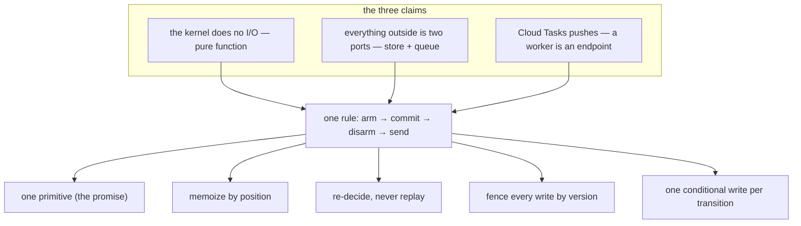

# 19 -- Cross-Cutting: the idioms, what makes it production-grade, and the recipe

Every document so far has been a piece; this one is the whole. Durable execution in this codebase is
**three claims and one rule**, and everything else — the promise, the ports, the push model, the
versioning, the OIDC auth, the crash windows — is a consequence of them. The three claims: the kernel
does no I/O (a pure function from a document, a request, and an instant to effects and a reply);
everything outside is two ports (four store operations, two queue operations); and Cloud Tasks pushes,
so a worker is an endpoint, not a loop. The one rule the arrows do not show: **arm the deadline →
commit → disarm the old → send**. This document names the idioms that recur, lists the things that make
the difference between a demo and a deployment, and reconstructs the recipe from first principles.

# Part 1 -- The Idioms

Eight moves recur across the codebase, and each one is the same answer appearing in a different file:

1. **One primitive, used for everything.** A local call, a remote call, a sleep, a signal, and a timer
   are all the same thing — a promise with different tags. `sleep` is a `resonate:timer` promise;
   `external` is a `resonate:external` promise; `.rpc` is a promise with a `resonate:target`. The kernel
   has one operation for all of them, and that is what keeps it small.
2. **Memoize by position.** Call ids are Dewey positions (`research.1:2:1`), derived from the same
   counter on every replay, so the id is *computed*, never stored, and replay derives the same id and
   reads the same answer back.
3. **Re-decide, never replay.** A `Conflict` means the state moved, so the caller reads the current
   state and decides again. The engine never loops; the SDK retries a `409`, because every operation is
   idempotent and reports current state.
4. **Fence every write by version.** A running function writes only through `task.fence`, which carries
   the task's version, so a worker that lost its lease cannot record anything — the kernel refuses a
   stale version, and the SDK raises `LeaseLost`.
5. **One conditional write per transition.** The engine reads the document, computes the next one, and
   writes once under `if_match`. Two writers cannot both commit; the second is refused.
6. **The arm before the commit.** The deadline is armed in the queue *before* the document is committed,
   so a committed run always has a timer that will bring it back. It is the one ordering nothing else
   repairs.
7. **The pure kernel, the impure engine.** The kernel is functions that return effects; the engine is
   the only code that touches the ports and applies them in order. That split is what makes the kernel
   testable with a simulated clock and the effect order checkable.
8. **A worker is an endpoint.** There is no loop waiting for work; the queue POSTs, and the worker runs
   one function until it blocks or finishes. That is why a container may not exist between two steps of
   the same run.



# Part 2 -- What Makes It Production-Grade

A demo and a deployment differ in the details the examples do not show but the engine insists on. The
name-vs-version distinction is the first: a durable function's name is the protocol's identifier, and
two functions answering to one name is a wrong answer in production, so `@resonate` refuses the second
import rather than letting the last one win:

```python
# resonate/sdk.py (shape, abbreviated — the name collision is an error)
class DuplicateFunction(Exception):
    """Two functions answering to one name. ..."""
```

Two *generations* are allowed — `@resonate(version=1)` — and both stay deployed, so a run finishes on
the body it started on. Unversioned is version 0.

The security boundary is the OIDC token. `execute` and `timeout` messages must carry the queue's OIDC
token when `ROUTES_ACCOUNT` is set, and `Server.authorized` verifies it — which is the same token
`queue_gcp` attaches on the sending end. Unset, the check is off, which is the on-a-laptop default. The
thirty-day horizon is the other production constant: Cloud Tasks will not schedule further out, so
`queue_gcp` clamps `not_before` to `now + HORIZON_MS` rather than refusing a far deadline.

And the codebase is honest about the one thing the design cannot paper over, stated in the memory
queue's docstring and worth repeating for a deployment:

```python
# resonate/testing/queue_mem.py (docstring, excerpt)
    A dropped `execute` is recoverable: the task's retry deadline was committed
    before the message left, so the timeout offers it again. A dropped
    *timeout* is not recoverable by anything in this design — the deadline it
    carried is the only thing that was going to fire. A deployment needs either
    a retry policy generous enough that this does not happen, or a periodic
    sweep over the bucket that does not depend on any single queued task.
```

That sentence is production-grade thinking in one breath: the design is durable *because of* the
deadline, and the deadline is itself a queued message, so the deployment must guarantee delivery of the
one message everything else depends on. The measured numbers in [11-ports-adapters.md](./11-ports-adapters.md)
and [17-deployment.md](./17-deployment.md) are the same discipline applied to performance: the floor is
latency (about one transition per `get` + `put`), not quota, and nothing was ever throttled — the
bottleneck is the single object's serial writes, measured rather than assumed.

The test pyramid is the last production signal: unit tests over the memory store, the conformance
catalogue (93 entries) over every implementation, the exhaustive search, the Hypothesis state machine,
`test_http.py` over a bound socket, and `live/crash_recovery.sh` over Google itself — each layer asking
a question the layer below cannot answer.

# Part 3 -- The Recipe: a durable-execution engine from first principles

Strip the code away and the argument is this, in order:

1. **Start from the promise.** A call's identity plus its arguments plus its outcome, in a database.
   Two operations, `create` and `settle`, both first-writer-wins. Idempotence falls out for free.
2. **Name calls by position.** The call's id is derived from the parent id and a counter, so replay
   reconstructs the same id and finds the same promise. Memoization is automatic.
3. **Split local and remote by one tag.** A promise without a target runs here; one with a target is
   dispatched. The same `create` serves both; only the outcome differs.
4. **Suspend by raising.** A frame that needs a value it does not have raises `Blocked(id)` to unwind,
   the worker turns it into `task.suspend`, and the suspended task waits on callbacks. Nothing runs
   while it waits.
5. **Make the kernel pure.** It is a function from `(document, request, now)` to `(effects, reply)`.
   It reads no clock, generates no id, calls nothing. The engine alone does I/O.
6. **Draw two ports.** Four store operations, two queue operations. Everything Google offers is a
   translation of those six; the adapters are near-empty because the primitives match.
7. **Let the queue push.** A deadline and a dispatch are the same object — a scheduled HTTP push — so
   both go through one port, and a worker is an endpoint that exists only while it runs.
8. **Apply the one rule.** Arm the deadline, commit, disarm the old, send. Every crash window in
   between is recoverable, which is the difference between durable and merely persistent.
9. **Grade it.** Transcribe the specification's properties into predicates, and hold every state and
   transition to them. Search for the violations no fixed script finds, and shrink what you find.

```mermaid
flowchart LR
    A["1. the promise<br/>create / settle, first-writer-wins"] --> B["2. name by position<br/>memoize for free"]
    B --> C["3. one tag splits local / remote"]
    C --> D["4. suspend by raising Blocked"]
    D --> E["5. pure kernel, impure engine"]
    E --> F["6. two ports, six operations"]
    F --> G["7. the queue pushes; a worker is an endpoint"]
    G --> H["8. arm → commit → disarm → send"]
    H --> I["9. grade against the catalogue"]
```



Each step is necessary and none is optional complexity: skip the pure kernel and you cannot test the
state machine; skip the position naming and replay cannot find its calls; skip the arm-before-commit and
there is a committed document nothing can repair; skip the two ports and you cannot swap a simulator for
Google. The result is the ~5,500-line engine this documentation has walked end to end.

# The Aha Moment

**Aha:** Durable execution is not a library feature bolted onto async Python — it is a *change of
where the state lives*. An ordinary function's state lives in the stack, the heap, and the thread that
is running; a durable function's state lives in a sorted list of objects in a bucket, and the stack is a
cache that is rebuilt on every resume. Everything that looks like clever engineering — the position
ids, the fence, the one conditional write, the arm-before-commit, the push model — is just the minimum
set of rules that lets a program treat a database object the way it used to treat a call stack. Once
you see that, the whole design is one idea stated nine times.

# Cross-References

- The three claims and one rule, stated and argued: [04-architecture.md](./04-architecture.md).
- The promise the whole thing reduces to: [01-the-promise.md](./01-the-promise.md).
- The programming model the user's code obeys: [02-programming-model.md](./02-programming-model.md).
- The evidence that the design holds: [13-conformance.md](./13-conformance.md).
- The examples that show the idioms in use: [16-examples.md](./16-examples.md).

Continue to [README.md](./README.md).
