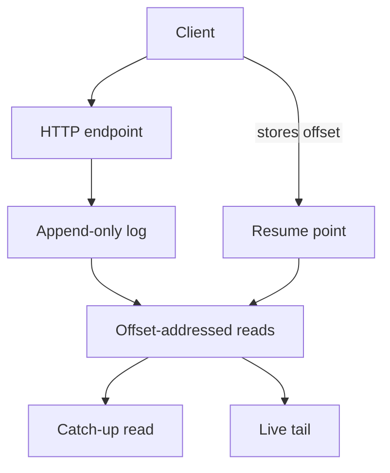
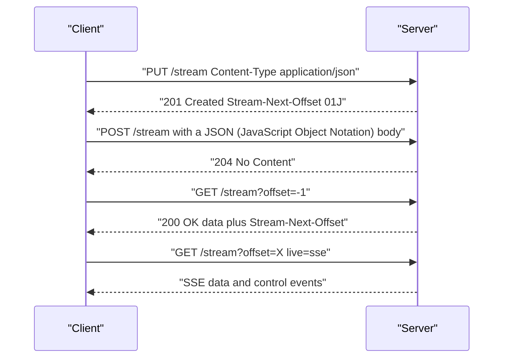

# 00 -- Overview: the data primitive for the agent loop

Durable Streams is a protocol and a set of libraries for ordered, replayable byte streams served over plain HTTP (Hypertext Transfer Protocol). A stream is a URL (Uniform Resource Locator). Clients create streams, append bytes, read them back from any offset, and tail them live. The framing in the repository README is direct: Durable Streams is "the data primitive for the agent loop."

```text
# Source: README.md, lines 23-27
# Durable Streams

Durable Streams are the data primitive for the agent loop.

Persistent, addressable, real‑time streams for building resilient agent sessions and collaborative multi-user, multi-agent systems.
```

## The problem it solves

WebSocket and SSE (Server-Sent Events) connections are easy to open but fragile in practice. A tab can be suspended, a network can drop, a device can switch, and a page can refresh. When a connection breaks, the client either loses in-flight data or the team builds a custom resume protocol on top of a database. The repository states the problem and its cost.

```text
# Source: README.md, lines 52-56
While durable streams exist throughout backend infrastructure (database WALs, Kafka topics, event stores), they aren't available as a first-class primitive for client applications. There's no simple, HTTP-based durable stream that sits alongside databases and object storage as a standard cloud primitive.

WebSocket and SSE connections are easy to start, but they're fragile in practice: tabs get suspended, networks flap, devices switch, pages refresh. When that happens, you either lose in-flight data or build a bespoke backend storage and client resume protocol on top.

AI products make this painfully visible. Token streaming is the UI for chat and copilots, and agentic apps stream progress events, tool outputs, and partial results over long-running sessions. When the stream fails, the product fails—even if the model did the right thing.
```

The answer is an append-only log exposed as a service. Bytes are written once, acknowledged, and never change. A client that reconnects reads again from the last offset it stored. The work is never re-run because the log kept the bytes.



## The shape of the protocol

The protocol is byte-oriented. It defines six primary operations on any stream URL. The protocol specification lists them in its overview section.

```text
# Source: PROTOCOL.md, lines 100-107
The protocol defines operations to create, append to, read, close, delete, and query metadata for streams. Reads have three modes: catch-up, long-poll, and Server-Sent Events (SSE). The primary operations are:

1. **Create**: Establish a new stream at a URL with optional initial content (PUT)
2. **Append**: Add bytes to the end of an existing stream (POST)
3. **Close**: Transition a stream to closed state, optionally with a final append (POST with `Stream-Closed: true`)
4. **Read**: Retrieve bytes starting from a given offset, with support for catch-up and live modes (GET)
5. **Delete**: Remove a stream (DELETE)
6. **Head**: Query stream metadata without transferring data (HEAD)
```

The same six operations appear in the concepts document, written as concrete HTTP calls.

```text
# Source: docs/concepts.md, lines 19-24
PUT /streams/my-stream          # Create
POST /streams/my-stream         # Append
GET /streams/my-stream?offset=… # Read
HEAD /streams/my-stream         # Metadata
POST /streams/my-stream         # Close (with Stream-Closed: true)
DELETE /streams/my-stream       # Delete
```

Four ideas give the protocol its power:

- **Streams** are durable, append-only, URL-addressable byte sequences with a content type set at creation.
- **Offsets** are opaque, lexicographically sortable tokens. A client resumes by passing the last offset it received.
- **Catch-up plus live reads.** A GET with an offset replays history. A GET with `live=long-poll` or `live=sse` waits for new data.
- **Idempotent producers.** Three headers — `Producer-Id`, `Producer-Epoch`, `Producer-Seq` — give exactly-once appends across client retries.



## What the protocol does not prescribe

The protocol does not prescribe a URL structure. A server may use `/v1/stream/{path}`, `/streams/{id}`, or domain-specific paths. The protocol is defined by HTTP methods, query parameters, and headers. The protocol also leaves authentication and authorization out of scope, and it allows servers to implement read and write paths independently.

## The packages

The repository is a pnpm monorepo with a TypeScript (a typed superset of JavaScript) core and a Go production server. The reference client is `@durable-streams/client`. There are ten client libraries total (TypeScript, Python, Go, Elixir, C#/.NET, Swift, PHP, Java, Rust, Ruby), three server implementations (the Node.js reference server, the Go Caddy plugin, and a Cloudflare Workers server), and higher-level packages for Durable Proxy, Durable State, StreamDB, Yjs CRDT (Conflict-free Replicated Data Type) sync, and AI SDK (Artificial Intelligence Software Development Kit) transports. Each of these is covered in a later document in this series.

## The Aha Moment
**Aha:** A stream is just a URL with an offset. Once you have an append-only, offset-addressed log behind an ordinary HTTP GET, resume, sharing, multi-device sync, and massive CDN (Content Delivery Network) fan-out all fall out of the same primitive. The client never needs a custom protocol — it only needs to remember the last `Stream-Next-Offset` it saw.

## Cross-References

- [01-stream-model.md](01-stream-model.md) — the stream, offset, epoch, and addressing model in detail.
- [02-catch-up-reads.md](02-catch-up-reads.md) — how offset-based catch-up reads work.
- [03-live-tailing.md](03-live-tailing.md) — long-poll and SSE live tailing.

Continue to [01-stream-model.md](01-stream-model.md)
