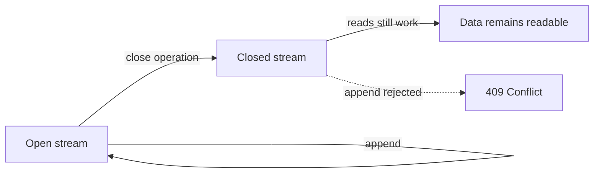
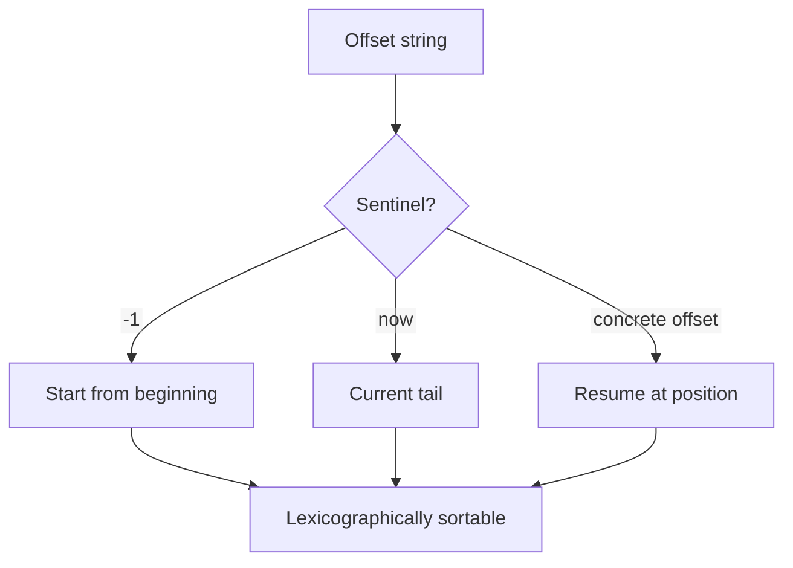

# 01 -- Stream Model: streams, offsets, addressing, and closure

A Durable Stream is an append-only sequence of bytes addressed by a Uniform Resource Locator (URL). The protocol specification defines the core vocabulary in its terminology section.

```text
# Source: PROTOCOL.md, lines 76-84
**Stream**: A URL-addressable, append-only byte stream that can be read and written to. A stream is simply a URL; the protocol defines how to interact with that URL using HTTP methods, query parameters, and headers. Streams are durable and immutable by position; new data can only be appended.

**Offset**: An opaque, lexicographically sortable token that identifies a position within a stream. Clients use offsets to resume reading from a specific previously reached point.

**Content Type**: A MIME type set on stream creation that describes the format of the stream's bytes. The content type is returned on reads and may be used by clients to interpret message boundaries.

**Tail Offset**: The offset immediately after the last byte in the stream. This is the position where new appends will be written.

**Closed Stream**: A stream that has been explicitly closed by a writer. Once closed, a stream is in a terminal state: no further appends are permitted, and readers can observe the closure as an end-of-stream (EOF) signal. Closure is durable and monotonic — once closed, a stream remains closed.
```

## A stream is a URL

The protocol does not prescribe a URL structure. A server may organize streams as `/v1/stream/{path}`, `/streams/{id}`, or domain-specific paths. What defines the protocol is the set of HTTP (Hypertext Transfer Protocol) methods, query parameters, and headers applied to any stream URL. Because a stream is a URL, sharing a stream is sharing a link.

## Stream properties

The stream model has a fixed set of properties: durability, immutability by position, ordering, a content type, optional expiry, and a two-state lifecycle.

```text
# Source: PROTOCOL.md, lines 119-125
- **Durability**: Once written and acknowledged, bytes persist until the stream is deleted or expired
- **Immutability by Position**: Bytes at a given offset never change; new data is only appended
- **Ordering**: Bytes are strictly ordered by offset
- **Content Type**: Each stream has a Multipurpose Internet Mail Extensions (MIME) content type set at creation
- **TTL/Expiry**: Streams may have a sliding time-to-live window (resets on each read or write) or an absolute expiry time
- **Retention**: Servers **MAY** implement retention policies that drop data older than a certain age while the stream continues. If a stream is deleted a new stream **SHOULD NOT** be created at the same URL.
- **Stream State**: A stream is either **open** (accepts appends) or **closed** (no further appends permitted). Streams start in the open state and transition to closed via an explicit close operation. This transition is **durable** (persisted) and **monotonic** (once closed, a stream cannot be reopened).
```



## The offset

An offset is an opaque, case-sensitive string token. Clients must never parse or construct offsets; they only pass back what the server returned. The protocol lists the required properties.

```text
# Source: PROTOCOL.md, lines 1188-1192
1. **Opaque**: Clients **MUST NOT** interpret offset structure or meaning
2. **Lexicographically Sortable**: For any two valid offsets for the same stream, a lexicographic comparison determines their relative position in the stream. Clients **MAY** compare offsets lexicographically to determine ordering.
3. **Persistent**: Offsets remain valid for the lifetime of the stream (until deletion or expiration)
4. **Unique**: Each offset identifies exactly one position in the stream. No two positions **MAY** share the same offset.
5. **Strictly Increasing**: Offsets assigned to appended data **MUST** be lexicographically greater than all previously assigned offsets. Server implementations **MUST NOT** use schemes (such as raw UTC timestamps) that can produce duplicate or non-monotonic offsets. Time-based identifiers like ULIDs, which combine timestamps with random components to guarantee uniqueness and monotonicity, are acceptable.
```

The Go production server makes the format concrete: an offset is a fixed-width `readseq_byteoffset` pair, zero-padded to sixteen digits each, so string comparison matches numeric ordering. The `readseq` half is a generation counter — it identifies one incarnation of the stream's log, starting at zero and available to increment on log rotation or recreation — while the `byteoffset` half is the byte position within that incarnation.

```go
// Source: packages/caddy-plugin/store/offset.go, lines 9-24
// Offset represents a position within a stream.
// Format: "0000000000000000_0000000000000000" (16 digits each, zero-padded)
// The format is lexicographically sortable.
type Offset struct {
	ReadSeq    uint64 // For future log rotation support
	ByteOffset uint64 // Bytes of actual data (not framing)
}

// ZeroOffset is the starting offset for a new stream
var ZeroOffset = Offset{ReadSeq: 0, ByteOffset: 0}

// String returns the offset as a formatted string.
// Format: "%016d_%016d"
func (o Offset) String() string {
	return fmt.Sprintf("%016d_%016d", o.ReadSeq, o.ByteOffset)
}
```

Two sentinel values are reserved. `-1` means the start of the stream and is equivalent to omitting the offset. `now` means the current tail position, which skips all existing data. The Go parser maps both.

```go
// Source: packages/caddy-plugin/store/offset.go, lines 48-68
// ParseOffset parses an offset string.
// Special cases:
//   - "-1" returns ZeroOffset (meaning "start from beginning")
//   - "now" returns NowOffset (meaning "current tail position, skip historical data")
//
// Returns error for invalid formats.
func ParseOffset(s string) (Offset, error) {
	// Handle empty string as zero offset
	if s == "" {
		return ZeroOffset, nil
	}

	// Handle "-1" as "start from beginning"
	if s == "-1" {
		return ZeroOffset, nil
	}

	// Handle "now" as "current tail position"
	if s == "now" {
		return NowOffset, nil
	}
```



## The cursor epoch

Separate from the offset is the cursor, a small decimal interval counter used for CDN (Content Delivery Network) cache collapsing. The reference server computes it by dividing time into fixed intervals counted from a fixed epoch. The epoch is not an offset; it is a wall-clock reference point.

```ts
// Source: packages/server/src/cursor.ts, lines 60-73
export function calculateCursor(options: CursorOptions = {}): string {
  const intervalSeconds =
    options.intervalSeconds ?? DEFAULT_CURSOR_INTERVAL_SECONDS
  const epoch = options.epoch ?? DEFAULT_CURSOR_EPOCH

  const now = Date.now()
  const epochMs = epoch.getTime()
  const intervalMs = intervalSeconds * 1000

  // Calculate interval number since epoch
  const intervalNumber = Math.floor((now - epochMs) / intervalMs)

  return String(intervalNumber)
}
```

The default epoch is October 9, 2024, 00:00:00 Coordinated Universal Time (UTC), and the default interval is twenty seconds. Cursors are covered further in the live-tailing document. The producer epoch (the `Producer-Epoch` header used for idempotent appends) is a different concept and is covered in the idempotent-producers document.

## The byte and content-type model

Most content types are byte-oriented. The server stores a raw concatenation of bytes and does not interpret message boundaries; the application is responsible for framing. The `application/json` (JavaScript Object Notation) content type is the exception, with message-boundary preservation described in the JSON-mode document.

## The Aha Moment
**Aha:** Offset opacity is the design that makes every optimization possible. Because clients treat offsets as strings and the server mints them, a server can encode a chunk-file identifier inside an offset and serve a catch-up request directly from object storage — while clients stay completely indifferent to the format. The Go `readseq_byteoffset` pair shows the same idea in miniature: a lexicographically sortable string that carries a log-generation counter and a byte count.

## Cross-References

- [00-overview.md](00-overview.md) — the protocol at a glance.
- [02-catch-up-reads.md](02-catch-up-reads.md) — how offsets drive catch-up reads.
- [03-live-tailing.md](03-live-tailing.md) — cursors and live reads.

Continue to [02-catch-up-reads.md](02-catch-up-reads.md)
