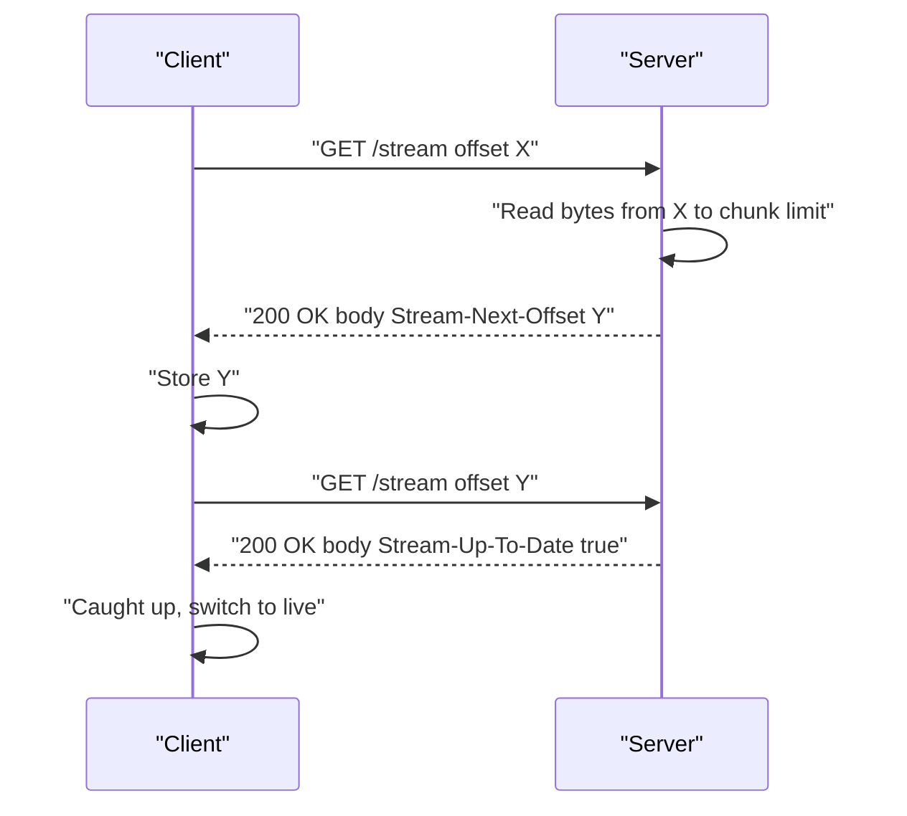
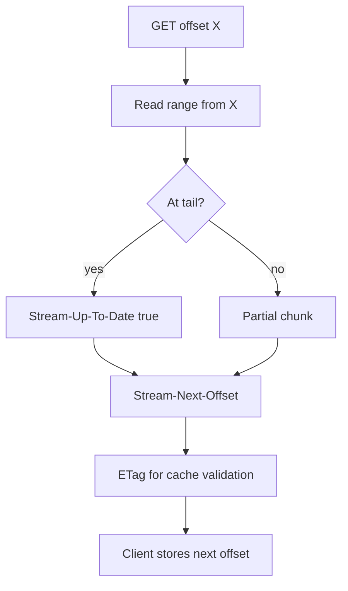

# 02 -- Catch-up Reads: offset-based replay over GET

A catch-up read is a GET request with an `offset` query parameter. It returns the bytes from that offset forward, up to a server-defined chunk size. The protocol specification defines the query parameter, response codes, and response headers.

```text
# Source: PROTOCOL.md, lines 586-595
- `offset` (optional)
  - Start offset token. If omitted, defaults to the stream start (offset -1).

#### Response Codes

- `200 OK`: Data available (or empty body if offset equals tail)
- `400 Bad Request`: Malformed offset or invalid parameters
- `404 Not Found`: Stream does not exist
- `410 Gone`: Offset is before the earliest retained position (retention/compaction), or stream is soft-deleted
- `429 Too Many Requests`: Rate limit exceeded
```

The response headers are what let a client resume. The `Stream-Next-Offset` value is the next offset to request; `Stream-Up-To-Date: true` means the client has reached the tail; `Stream-Closed: true` means no more data will ever arrive.

```text
# Source: PROTOCOL.md, lines 601-612
- `Cache-Control`: Derived from TTL/expiry (see Section 9)
- `ETag: {internal_stream_id}:{start_offset}:{end_offset}`
  - Entity tag for cache validation
- `Stream-Cursor: <cursor>` (optional for catch-up, required for live modes)
  - Cursor to echo on subsequent long-poll requests to improve CDN collapsing. Servers **MAY** include this on catch-up reads; it is **required** for live modes when the stream is open (see Sections 5.7, 5.8). Servers **MAY** omit it when `Stream-Closed` is true. Clients **MUST** tolerate its absence when `Stream-Closed` is present.
- `Stream-Next-Offset: <offset>`
  - The next offset to read from (for subsequent requests)
- `Stream-Up-To-Date: true`
  - **MUST** be present and set to `true` when the response includes all data available in the stream at the time the response was generated (i.e., when the requested offset has reached the tail and no more data exists).
  - **SHOULD NOT** be present when returning partial data due to server-defined chunk size limits (when more data exists beyond what was returned).
  - Clients **MAY** use this header to determine when they have caught up and can transition to live tailing mode.
  - **Important:** `Stream-Up-To-Date: true` does **NOT** imply EOF. More data may be appended in the future. Only `Stream-Closed: true` indicates that no more data will ever arrive.
```



## The Go production server

The Caddy plugin implements catch-up reads in `handleRead`. It parses the offset strictly, rejects empty or duplicated offset parameters, and maps the special `now` value to the tail.

```go
// Source: packages/caddy-plugin/handler.go, lines 326-345
	// Check for explicit empty offset parameter (different from missing offset)
	query := r.URL.Query()
	offsetValues, offsetProvided := query["offset"]
	offsetStr := ""
	if offsetProvided {
		if len(offsetValues) > 1 {
			return newHTTPError(http.StatusBadRequest, "multiple offset parameters not allowed")
		}
		offsetStr = offsetValues[0]
		// Reject empty offset string when explicitly provided
		if offsetStr == "" {
			return newHTTPError(http.StatusBadRequest, "offset parameter cannot be empty")
		}
	}

	// Parse offset
	offset, err := store.ParseOffset(offsetStr)
	if err != nil {
		return newHTTPError(http.StatusBadRequest, "invalid offset")
	}
```

After reading, the handler sets the next offset, up-to-date and closed headers, the ETag, and a public cache header for historical data.

```go
// Source: packages/caddy-plugin/handler.go, lines 509-535
	// Set response headers
	w.Header().Set("Content-Type", meta.ContentType)
	w.Header().Set(HeaderStreamNextOffset, nextOffset.String())

	// Always set Stream-Up-To-Date when at tail
	if upToDate {
		w.Header().Set(HeaderStreamUpToDate, "true")
	}

	// Include Stream-Closed when stream is closed AND client is at tail AND upToDate
	if currentMeta.Closed && upToDate {
		w.Header().Set(HeaderStreamClosed, "true")
	}

	// Generate Stream-Cursor for long-poll responses (CDN cache collision prevention)
	if liveMode == "long-poll" {
		responseCursor := generateResponseCursor(cursor)
		w.Header().Set(HeaderStreamCursor, responseCursor)
	}

	// Set ETag for caching
	w.Header().Set("ETag", fmt.Sprintf(`"%s"`, nextOffset.String()))

	// Set caching headers for historical reads
	if !upToDate && len(messages) > 0 {
		w.Header().Set("Cache-Control", "public, max-age=60, stale-while-revalidate=300")
	}
```

The response body depends on the content type. JSON (JavaScript Object Notation) streams produce a JSON array; every other content type concatenates raw bytes.

```go
// Source: packages/caddy-plugin/handler.go, lines 1029-1044
func (h *Handler) formatResponse(path string, messages []store.Message, contentType string) ([]byte, error) {
	if store.IsJSONContentType(contentType) {
		return store.FormatJSONResponse(messages), nil
	}

	// Non-JSON: concatenate raw data
	var total int
	for _, msg := range messages {
		total += len(msg.Data)
	}
	result := make([]byte, 0, total)
	for _, msg := range messages {
		result = append(result, msg.Data...)
	}
	return result, nil
}
```



## The Cloudflare server

The Cloudflare Workers server computes the same headers in its Durable Object. It re-reads metadata after any wait, sets `Stream-Next-Offset`, `Stream-Up-To-Date`, `Stream-Closed`, the ETag, and the public cache header for non-live reads.

```ts
// Source: packages/server-cloudflare/src/stream-object.ts, lines 1073-1119
    // Build the response. Re-read meta: it may have changed during a wait.
    const freshMeta = this.store.getMetaRaw() ?? meta
    const headers: Record<string, string> = {}
    if (freshMeta.contentType !== undefined) {
      headers[`content-type`] = freshMeta.contentType
    }

    const lastMessage = messages[messages.length - 1]
    const responseOffset = lastMessage?.offset ?? freshMeta.currentOffset
    headers[STREAM_OFFSET_HEADER] = responseOffset

    if (live === `long-poll`) {
      headers[STREAM_CURSOR_HEADER] = generateResponseCursor(cursor)
    }
    if (upToDate) {
      headers[STREAM_UP_TO_DATE_HEADER] = `true`
    }

    const clientAtTail = responseOffset === freshMeta.currentOffset
    const closedSuffix = freshMeta.closed && clientAtTail && upToDate
    if (closedSuffix) {
      headers[STREAM_CLOSED_HEADER] = `true`
    }

    const startOffset = offsetParam ?? `-1`
    const etag = this.makeEtag(startOffset, responseOffset, closedSuffix)
    headers[`etag`] = etag

    const ifNoneMatch = request.headers.get(`if-none-match`)
    if (ifNoneMatch !== null && ifNoneMatch === etag) {
      return this.respond(304, { etag })
    }

    // Recommended shared-cache headers for catch-up reads (§10.1);
    // live-mode responses stay uncached.
    if (live !== `long-poll`) {
      headers[`cache-control`] =
        `public, max-age=60, stale-while-revalidate=300`
    }

    const fragments = messages.map((m) => m.data)
    const body =
      normalizeContentType(freshMeta.contentType) === `application/json`
        ? formatJsonMessages(fragments)
        : concatBytes(fragments)

    return this.respond(200, headers, body)
```

## The client side

The TypeScript (a typed superset of JavaScript) client always starts with a plain catch-up request. It sets the offset to `-1` when none is provided and never sets `live` on the first request, because catch-up responses are cacheable by CDNs (Content Delivery Networks) and browsers.

```ts
// Source: packages/client/src/stream-api.ts, lines 135-141
  // Set offset query param
  const startOffset = options.offset ?? `-1`
  fetchUrl.searchParams.set(OFFSET_QUERY_PARAM, startOffset)

  // Never set live on the initial request — catch-up responses without live
  // are cacheable by CDNs/browsers. Live mode activates only after catching up.
  const live: LiveMode = options.live ?? true
```

For JSON streams, the client parses each response body as an array and flattens it into the result list. It stops as soon as a response that was up-to-date has been consumed.

```ts
// Source: packages/client/src/response.ts, lines 918-959
  async json<T = TJson>(): Promise<Array<T>> {
    this.#ensureNoConsumption(`json`)
    this.#ensureJsonMode()
    this.#stopAfterUpToDate = true
    const reader = this.#getResponseReader()
    const items: Array<T> = []

    try {
      let result = await reader.read()
      while (!result.done) {
        // Capture upToDate BEFORE parsing (to avoid race with prefetch)
        const wasUpToDate = this.upToDate
        // Get response text first (handles empty responses gracefully)
        const text = await result.value.text()
        const content = text.trim() || `[]` // Default to empty array if no content or whitespace
        let parsed: T | Array<T>
        try {
          parsed = JSON.parse(content) as T | Array<T>
        } catch (err) {
          const preview =
            content.length > 100 ? content.slice(0, 100) + `...` : content
          throw new DurableStreamError(
            `Failed to parse JSON response: ${err instanceof Error ? err.message : String(err)}. Data: ${preview}`,
            `PARSE_ERROR`
          )
        }
        if (Array.isArray(parsed)) {
          items.push(...parsed)
        } else {
          items.push(parsed)
        }
        // Check if THIS response had upToDate set when we started reading it
        if (wasUpToDate) break
        result = await reader.read()
      }
    } finally {
      reader.releaseLock()
    }

    this.#markClosed()
    return items
  }
```

## The Aha Moment
**Aha:** Catch-up is just a loop of identical GETs. The server does not need any client session state — the client carries its own resume position in the URL query string. That is why a CDN can cache historical chunks forever: the data at a given offset never changes, so the same offset always returns the same bytes, and the only live signal a client needs is the `Stream-Next-Offset` header on each response.

## Cross-References

- [01-stream-model.md](01-stream-model.md) — the offset model behind these reads.
- [03-live-tailing.md](03-live-tailing.md) — what the client does after catching up.
- [10-cloudflare-server.md](10-cloudflare-server.md) — the full Durable Object read path.

Continue to [03-live-tailing.md](03-live-tailing.md)
