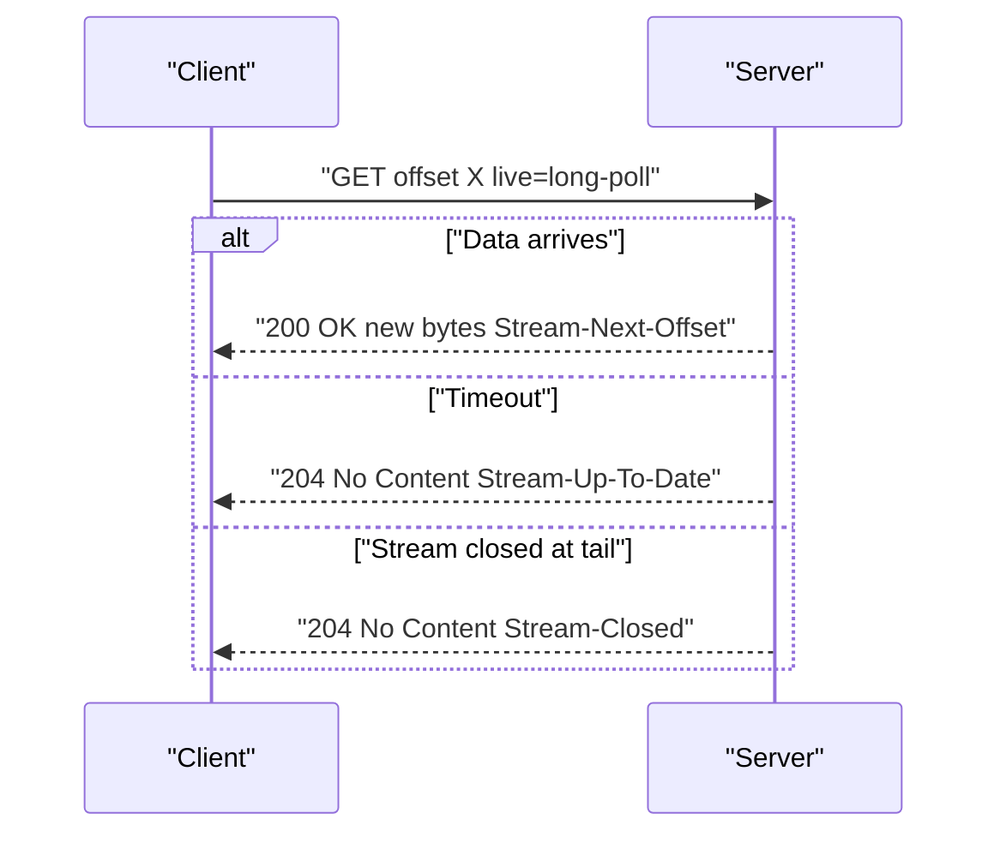
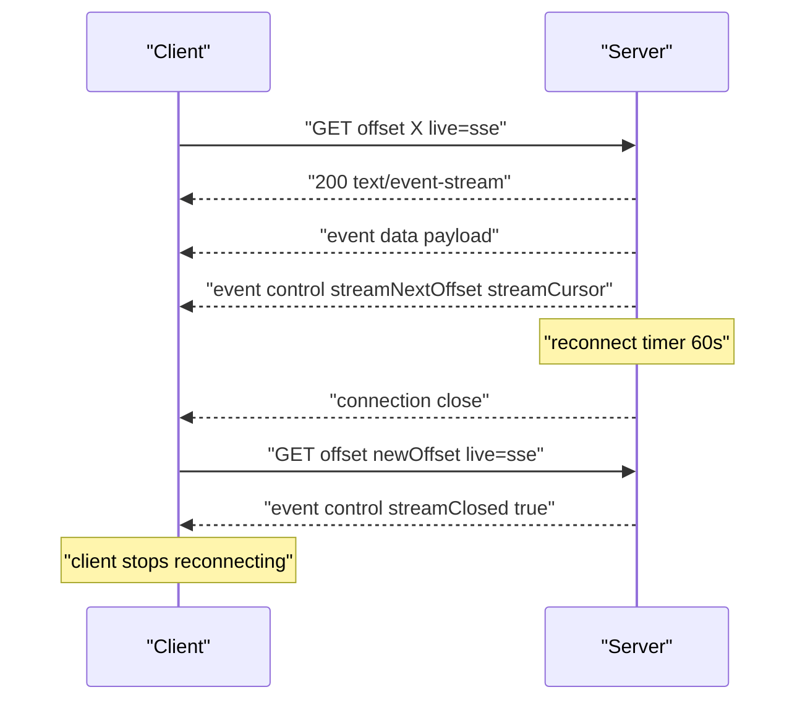

# 03 -- Live Tailing: long-poll and SSE

Once a client has caught up, it can tail the stream live. The protocol defines two live modes: long-poll and SSE (Server-Sent Events). Both accept an `offset` query parameter and differ in their transport shape.

## Long-poll

A long-poll request holds the connection open until new data arrives or a timeout expires. The server returns `200 OK` with data, or `204 No Content` on timeout.

```text
# Source: PROTOCOL.md, lines 638-654
- `offset` (required)
  - The offset to read from. **MUST** be provided.

- `live=long-poll` (required)
  - Indicates long-polling mode.

- `cursor` (optional)
  - Echo of the last `Stream-Cursor` header value from a previous response.
  - Used for collapsing keys in CDN/proxy configurations.

#### Response Codes

- `200 OK`: Data became available within the timeout
- `204 No Content`: Timeout expired with no new data
- `400 Bad Request`: Invalid parameters
- `404 Not Found`: Stream does not exist
- `429 Too Many Requests`: Rate limit exceeded
```

The key closure rule: when the stream is closed and the client is already at the tail, the server must not wait for the timeout. It returns immediately with the EOF (end-of-stream) signal.

```text
# Source: PROTOCOL.md, lines 680-685
When the stream is closed and the client is already at the tail offset:

- Servers **MUST NOT** wait for the long-poll timeout
- Servers **MUST** immediately return `204 No Content` with `Stream-Closed: true` and `Stream-Up-To-Date: true`

This ensures clients observing a closed stream do not have hanging connections waiting for data that will never arrive.
```



## SSE

SSE mode streams a `text/event-stream` body with two event kinds: `data` events carry the payload, and `control` events carry cursor and offset metadata.

```text
# Source: PROTOCOL.md, lines 739-753
- `data`: Emitted for each batch of data
  - Each line prefixed with `data:`
  - For binary streams (where `stream-sse-data-encoding: base64` is present), the `data` event payload represents bytes encoded using standard base64 per [Request for Comments (RFC) 4648](https://www.rfc-editor.org/rfc/rfc4648) (alphabet: A-Z, a-z, 0-9, +, /).
    - Servers **MAY** split the base64 text across multiple `data:` lines within the same SSE `data` event.
    - Clients **MUST** concatenate the `data:` lines for the event (per SSE rules) and **MUST** remove all `\n` and `\r` characters inserted between lines before base64-decoding.
    - The resulting string (after removing `\n` and `\r`) **MUST** be valid base64 text with length that is a multiple of 4 (or empty).
    - If a `data` event's byte payload length is 0, the base64 text **MUST** be the empty string.
  - Base64 encoding affects only `event: data` payloads. `event: control` events remain JSON as specified and are not encoded.
  - When the stream content type is `application/json`, implementations **MAY** batch multiple logical messages into a single SSE `data` event by streaming a JSON array across multiple `data:` lines, as in the example below.
- `control`: Emitted after every data event
  - **MUST** include `streamNextOffset`. See Section 10.1.
  - **MUST** include `streamCursor` when the stream is open. Servers **MAY** omit `streamCursor` when `streamClosed` is true (cursor is unnecessary when no reconnection is expected).
  - **MUST** include `upToDate: true` when the client is caught up with all available data. Note: `streamClosed: true` implies `upToDate: true` (a closed stream at the final offset is by definition up-to-date), so `upToDate` **MAY** be omitted when `streamClosed` is true.
  - **MUST** include `streamClosed: true` when the stream is closed and all data up to the final offset has been sent.
  - Format: JSON object with offset, cursor (when applicable), up-to-date status, and optionally closed status. Field names use camelCase: `streamNextOffset`, `streamCursor`, `upToDate`, and `streamClosed`.
```

## Connection lifecycle

SSE connections are short-lived by design. The server closes them roughly every sixty seconds so a CDN (Content Delivery Network) can collapse new clients onto edge requests, and the client reconnects from the last received offset.

```text
# Source: PROTOCOL.md, lines 810-812
- Server **SHOULD** close connections roughly every ~60 seconds to enable CDN collapsing
- Client **MUST** reconnect using the last received `streamNextOffset` value from the control event
- Client **MUST NOT** reconnect if the last control event included `streamClosed: true`
```

## The Go server SSE loop

The Caddy plugin writes the SSE headers, then loops reading new messages and emitting `data` and `control` events until the stream closes or the reconnect timer fires.

```go
// Source: packages/caddy-plugin/handler.go, lines 615-624
	// Set SSE headers
	w.Header().Set("Content-Type", "text/event-stream")
	w.Header().Set("Cache-Control", "no-cache")
	w.Header().Set("Connection", "keep-alive")
	w.Header().Set("X-Accel-Buffering", "no")

	// Add encoding header when base64 encoding is used for binary streams
	if useBase64 {
		w.Header().Set(HeaderStreamSSEDataEncoding, "base64")
	}
```



## The client SSE parser

The TypeScript (a typed superset of JavaScript) client parses the event stream into `data` and `control` events. Control events are parsed as JSON (JavaScript Object Notation) and carry the offset, cursor, and closed state.

```ts
// Source: packages/client/src/sse.ts, lines 63-98
      for (const line of lines) {
        if (line === ``) {
          // Empty line signals end of event
          if (currentEvent.type && currentEvent.data.length > 0) {
            const dataStr = currentEvent.data.join(`\n`)

            if (currentEvent.type === `data`) {
              yield { type: `data`, data: dataStr }
            } else if (currentEvent.type === `control`) {
              try {
                const control = JSON.parse(dataStr) as {
                  streamNextOffset: Offset
                  streamCursor?: string
                  upToDate?: boolean
                  streamClosed?: boolean
                }
                yield {
                  type: `control`,
                  streamNextOffset: control.streamNextOffset,
                  streamCursor: control.streamCursor,
                  upToDate: control.upToDate,
                  streamClosed: control.streamClosed,
                }
              } catch (err) {
                // Control events contain critical offset data - don't silently ignore
                const preview =
                  dataStr.length > 100 ? dataStr.slice(0, 100) + `...` : dataStr
                throw new DurableStreamError(
                  `Failed to parse SSE control event: ${err instanceof Error ? err.message : String(err)}. Data: ${preview}`,
                  `PARSE_ERROR`
                )
              }
            }
            // Unknown event types are silently skipped per protocol
          }
          currentEvent = { data: [] }
```

## The proxy forwards live reads

Durable Proxy is a thin pass-through for live reads. It authenticates the caller, then forwards the `offset` and `live` query parameters to the upstream durable streams server and streams the body back unchanged.

```ts
// Source: packages/proxy/src/server/read-stream.ts, lines 83-92
  // Forward query parameters
  const offset = url.searchParams.get(`offset`)
  const live = url.searchParams.get(`live`)

  if (offset) {
    dsUrl.searchParams.set(`offset`, offset)
  }
  if (live) {
    dsUrl.searchParams.set(`live`, live)
  }
```

## The Aha Moment
**Aha:** Live tailing is not a separate protocol — it is a catch-up read with a wait. The long-poll and SSE modes reuse the same offset token, the same `Stream-Next-Offset` field, and the same closure signal. That single reuse is why the proxy can forward live reads by copying two query parameters, and why the client reconnect loop is just the catch-up loop with a different `live` flag.

## Cross-References

- [02-catch-up-reads.md](02-catch-up-reads.md) — the catch-up loop that precedes live mode.
- [11-durable-proxy.md](11-durable-proxy.md) — the proxy that forwards live reads.
- [01-stream-model.md](01-stream-model.md) — the cursor and offset model.

Continue to [04-appends.md](04-appends.md)
