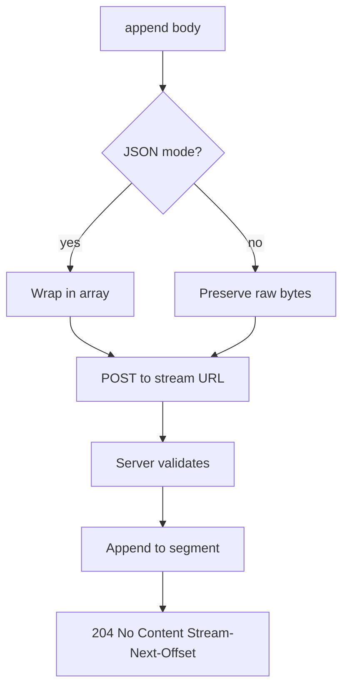
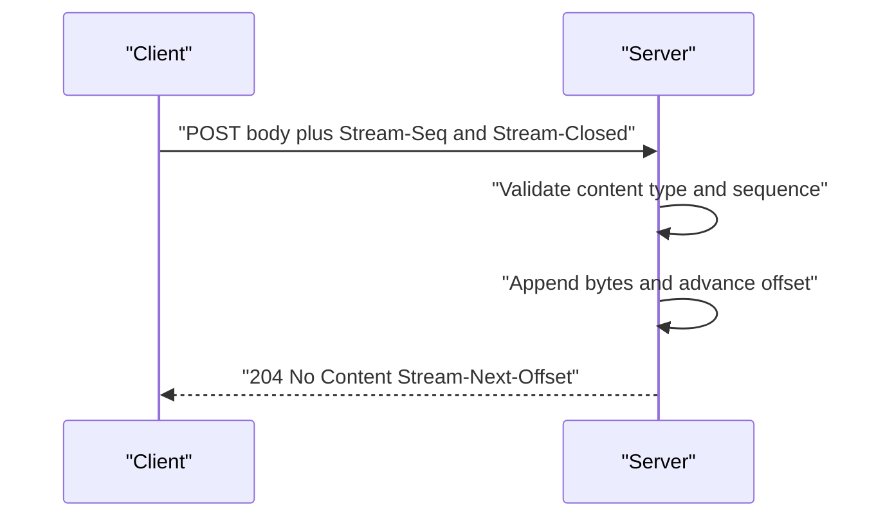

# 04 -- Appends: bytes, content types, and the write path

An append is a POST to a stream URL. It adds bytes to the end of the stream and may also close the stream atomically. The protocol supports both full-body and streaming (chunked) appends.

```text
# Source: PROTOCOL.md, lines 300-302
Appends bytes to the end of an existing stream. Supports both full-body and streaming (chunked) append operations. Optionally closes the stream atomically with the append.

Servers that do not support appends for a given stream **SHOULD** return `405 Method Not Allowed` or `501 Not Implemented` to `POST` requests on that URL.
```

## Append request headers

The append request carries a content type that must match the stream's, an optional transfer encoding, an optional application-layer sequence number, and an optional close flag.

```text
# Source: PROTOCOL.md, lines 306-316
- `Content-Type: <stream-content-type>`
  - **MUST** match the stream's existing content type when a body is provided. Servers **MUST** return `409 Conflict` when the content type is valid but does not match the stream's configured type.
  - **MAY** be omitted when the request body is empty (i.e., close-only requests with `Stream-Closed: true`). When the request body is empty, servers **MUST NOT** reject based on `Content-Type` and **MAY** ignore it entirely. This ensures close-only requests remain robust even when clients/libraries attach default `Content-Type` headers.

- `Transfer-Encoding: chunked` (optional)
  - Indicates a streaming body. Servers **SHOULD** support HTTP/1.1 chunked encoding and HTTP/2 streaming semantics.

- `Stream-Seq: <string>` (optional)
  - A monotonic, lexicographic writer sequence number for coordination.
  - `Stream-Seq` values are opaque strings that **MUST** compare using simple byte-wise lexicographic ordering. Sequence numbers are scoped per authenticated writer identity (or per stream, depending on implementation). Servers **MUST** document the scope they enforce.
  - If provided and less than or equal to the last appended sequence (as determined by lexicographic comparison), the server **MUST** return `409 Conflict`. Sequence numbers **MUST** be strictly increasing.
```

## Content types

Most content types operate at the byte level. The `application/json` content type is the one with special semantics.

```text
# Source: PROTOCOL.md, lines 1256-1262
Clients **MAY** use any content type for their streams, including:

- `application/json` for JSON mode with message boundary preservation
- `application/ndjson` for newline-delimited JSON
- `application/x-protobuf` for Protocol Buffer messages
- `text/plain` for plain text
- Custom types for application-specific formats
```

## The client write path

The TypeScript (a typed superset of JavaScript) client encodes the body differently by content type. For JSON (JavaScript Object Notation) mode it wraps the already-serialized value in an array so the server flattens exactly one level; for byte mode it preserves raw bytes.

```ts
// Source: packages/client/src/stream.ts, lines 492-540
  async #appendDirect(
    body: Uint8Array | string,
    opts?: AppendOptions
  ): Promise<void> {
    const { requestHeaders, fetchUrl } = await this.#buildRequest()

    const contentType =
      opts?.contentType ?? this.#options.contentType ?? this.contentType
    if (contentType) {
      requestHeaders[`content-type`] = contentType
    }

    if (opts?.seq) {
      requestHeaders[STREAM_SEQ_HEADER] = opts.seq
    }

    // For JSON mode, wrap body in array to match protocol (server flattens one level)
    // Input is pre-serialized JSON string
    const isJson = normalizeContentType(contentType) === `application/json`
    let encodedBody: BodyInit
    if (isJson) {
      // JSON mode: decode as UTF-8 string and wrap in array
      const bodyStr =
        typeof body === `string` ? body : new TextDecoder().decode(body)
      encodedBody = `[${bodyStr}]`
    } else {
      // Binary mode: preserve raw bytes
      // Use ArrayBuffer for cross-platform BodyInit compatibility
      if (typeof body === `string`) {
        encodedBody = body
      } else {
        encodedBody = body.buffer.slice(
          body.byteOffset,
          body.byteOffset + body.byteLength
        ) as ArrayBuffer
      }
    }

    const response = await this.#fetchClient(fetchUrl.toString(), {
      method: `POST`,
      headers: requestHeaders,
      body: encodedBody,
      signal: opts?.signal ?? this.#options.signal,
    })

    if (!response.ok) {
      await handleErrorResponse(response, this.url)
    }
  }
```

The batching path applies the same JSON array flattening when it joins multiple messages into one POST.

```ts
// Source: packages/client/src/stream.ts, lines 631-643
    const isJson = normalizeContentType(contentType) === `application/json`

    // Batch data based on content type
    let batchedBody: BodyInit
    if (isJson) {
      // For JSON mode: always send as array (server flattens one level)
      // Single append: [value] → server stores value
      // Multiple appends: [val1, val2] → server stores val1, val2
      // Input is pre-serialized JSON strings, join them into an array
      const jsonStrings = batch.map((m) =>
        typeof m.data === `string` ? m.data : new TextDecoder().decode(m.data)
      )
      batchedBody = `[${jsonStrings.join(`,`)}]`
```





## The server write path

The Go file store validates producer headers, checks closure and soft-delete state, validates the content type, checks the application-layer sequence, and then appends to the current segment.

```go
// Source: packages/caddy-plugin/store/file_store.go, lines 697-741
	dirName := s.dirCache[path]

	// Validate content type
	if opts.ContentType != "" && !ContentTypeMatches(meta.ContentType, opts.ContentType) {
		return AppendResult{}, ErrContentTypeMismatch
	}

	// Validate producer FIRST (if headers provided)
	// This must happen before Stream-Seq validation so that retries
	// are deduplicated at the transport layer even if Stream-Seq would conflict.
	var producerState *ProducerState
	var producerResult ProducerResult = ProducerResultNone
	var producerLastSeq int64
	if opts.HasAllProducerHeaders() {
		result, newState, err := s.validateProducer(meta, opts)
		if err != nil {
			result.Offset = meta.CurrentOffset
			return result, err
		}
		if result.ProducerResult == ProducerResultDuplicate {
			// Duplicate - return current offset, no append needed
			return AppendResult{
				Offset:         meta.CurrentOffset,
				ProducerResult: ProducerResultDuplicate,
				LastSeq:        result.LastSeq,
			}, nil
		}
		producerState = newState
		producerResult = result.ProducerResult
		producerLastSeq = result.LastSeq
	}

	// Validate sequence number (Stream-Seq - application layer)
	// Only checked for non-duplicate appends.
	if opts.Seq != "" {
		if meta.LastSeq != "" && opts.Seq <= meta.LastSeq {
			return AppendResult{}, ErrSequenceConflict
		}
	}

	// Append to segment
	newOffset, err := s.appendToStream(meta, dirName, data, opts, false) // Don't allow empty arrays on append
	if err != nil {
		return AppendResult{}, err
	}
```

After the append, the store advances `meta.CurrentOffset` to the new offset and, when the request included `Stream-Closed: true`, marks the stream closed and records which producer tuple closed it. The handler then returns `204 No Content` with the new `Stream-Next-Offset` header.

## The Aha Moment
**Aha:** The append path is deliberately boring: POST bytes, get back the new tail offset. All the interesting machinery — exactly-once deduplication, sequence fencing, JSON array flattening, atomic close — is layered on top of that one call, and each layer can be understood (and tested) independently because the core is just "append bytes, advance the offset."

## Cross-References

- [05-idempotent-producers.md](05-idempotent-producers.md) — the producer validation layer on appends.
- [06-json-mode.md](06-json-mode.md) — the JSON array flattening semantics.
- [08-store-layer.md](08-store-layer.md) — segments and offset advancement in the store.

Continue to [05-idempotent-producers.md](05-idempotent-producers.md)
