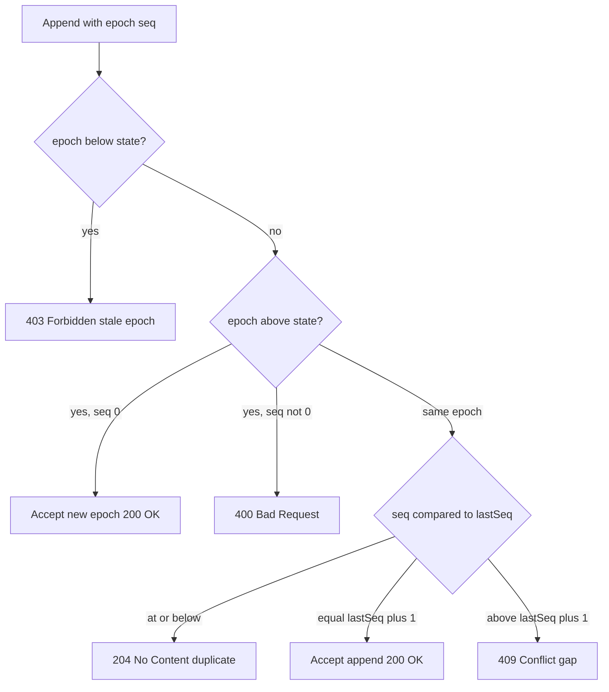
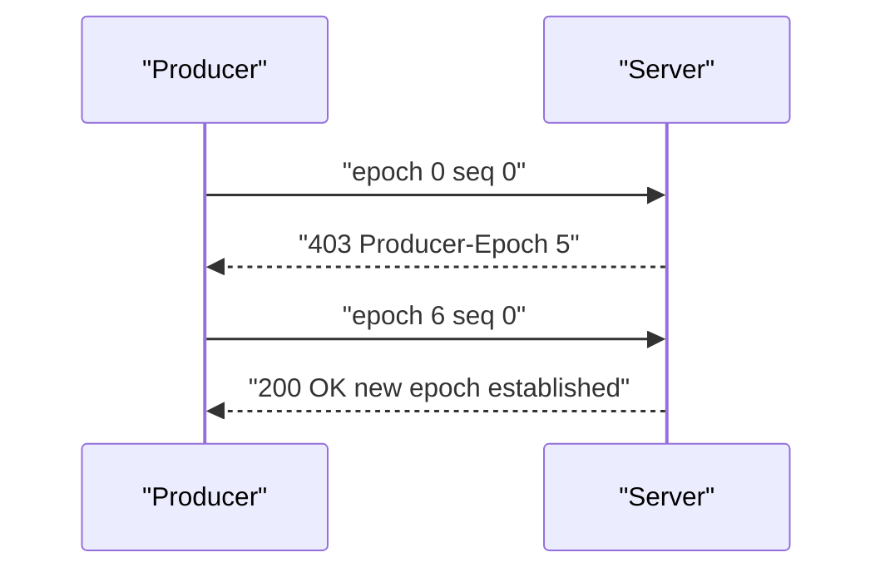

# 05 -- Idempotent Producers: exactly-once via producerId, epoch, seq

Durable Streams supports Kafka-style idempotent producers for exactly-once writes. A client that retries an append is deduplicated by the server instead of writing duplicate data. The identity is a three-part tuple carried in headers.

```text
# Source: PROTOCOL.md, lines 378-393
- `Producer-Id: <string>`
  - Client-supplied stable identifier (e.g., "order-service-1", UUID)
  - **MUST** be a non-empty string; empty values result in `400 Bad Request`
  - Identifies the logical producer across restarts

- `Producer-Epoch: <integer>`
  - Client-declared epoch, starting at 0
  - Increment on producer restart to establish a new session
  - Server validates that epoch is monotonically non-decreasing
  - **MUST** be a non-negative integer ≤ 2^53-1 (for JavaScript interoperability)

- `Producer-Seq: <integer>`
  - Monotonically increasing sequence number per epoch
  - Starts at 0 for each new epoch
  - Applies per-batch (per HTTP request), not per-message
  - **MUST** be a non-negative integer ≤ 2^53-1 (for JavaScript interoperability)
```

## Validation logic

The epoch is client-declared but server-validated. A stale epoch is fenced with `403 Forbidden`; a same-epoch sequence that was already seen is a duplicate; a gap is a `409 Conflict`.

```text
# Source: PROTOCOL.md, lines 405-426
# Epoch validation (client-declared, server-validated)
if epoch < state.epoch:
  → 403 Forbidden
  → Headers: Producer-Epoch: <current epoch>

if epoch > state.epoch:
  if seq != 0:
    → 400 Bad Request (new epoch must start at seq=0)
  → Accept: update state.epoch = epoch, state.lastSeq = 0
  → 200 OK (new epoch established)

# Same epoch: sequence validation
if seq <= state.lastSeq:
  → 204 No Content (duplicate, idempotent success)

if seq == state.lastSeq + 1:
  → Accept, update state.lastSeq = seq
  → 200 OK

if seq > state.lastSeq + 1:
  → 409 Conflict
  → Headers: Producer-Expected-Seq: <lastSeq + 1>, Producer-Received-Seq: <seq>
```



## The reference validation function

The Cloudflare server extracts validation into a pure function. It returns a proposed state but does not mutate anything — the caller commits the state only after the append succeeds, so a failed append never advances the producer.

```ts
// Source: packages/server-cloudflare/src/producer.ts, lines 32-89
export function validateProducer(
  state: ProducerState | undefined,
  producerId: string,
  epoch: number,
  seq: number,
  now: number
): ProducerValidationResult {
  // New producer - accept only if seq is 0
  if (!state) {
    if (seq !== 0) {
      return { status: `sequence_gap`, expectedSeq: 0, receivedSeq: seq }
    }
    return {
      status: `accepted`,
      isNew: true,
      producerId,
      proposedState: { epoch, lastSeq: 0, lastUpdated: now },
    }
  }

  // Epoch validation (client-declared, server-validated)
  if (epoch < state.epoch) {
    return { status: `stale_epoch`, currentEpoch: state.epoch }
  }

  if (epoch > state.epoch) {
    // New epoch must start at seq=0
    if (seq !== 0) {
      return { status: `invalid_epoch_seq` }
    }
    return {
      status: `accepted`,
      isNew: true,
      producerId,
      proposedState: { epoch, lastSeq: 0, lastUpdated: now },
    }
  }

  // Same epoch: sequence validation
  if (seq <= state.lastSeq) {
    return { status: `duplicate`, lastSeq: state.lastSeq }
  }

  if (seq === state.lastSeq + 1) {
    return {
      status: `accepted`,
      isNew: false,
      producerId,
      proposedState: { epoch, lastSeq: seq, lastUpdated: now },
    }
  }

  return {
    status: `sequence_gap`,
    expectedSeq: state.lastSeq + 1,
    receivedSeq: seq,
  }
}
```

The Go file store implements the same rules inline.

```go
// Source: packages/caddy-plugin/store/file_store.go, lines 582-637
	// Epoch validation (client-declared, server-validated)
	if epoch < state.Epoch {
		// Stale epoch - zombie fencing
		return AppendResult{
			ProducerResult: ProducerResultNone,
			CurrentEpoch:   state.Epoch,
		}, nil, ErrStaleEpoch
	}

	if epoch > state.Epoch {
		// New epoch - must start at seq=0
		if seq != 0 {
			return AppendResult{
				ProducerResult: ProducerResultNone,
			}, nil, ErrInvalidEpochSeq
		}
		// Accept new epoch
		newState := &ProducerState{
			Epoch:       epoch,
			LastSeq:     0,
			LastUpdated: time.Now().Unix(),
		}
		return AppendResult{
			ProducerResult: ProducerResultAccepted,
			LastSeq:        0,
		}, newState, nil
	}

	// Same epoch - sequence validation
	if seq <= state.LastSeq {
		// Duplicate - idempotent success
		return AppendResult{
			ProducerResult: ProducerResultDuplicate,
			LastSeq:        state.LastSeq,
		}, nil, nil
	}

	if seq == state.LastSeq+1 {
		// Accept - update state
		newState := &ProducerState{
			Epoch:       epoch,
			LastSeq:     seq,
			LastUpdated: time.Now().Unix(),
		}
		return AppendResult{
			ProducerResult: ProducerResultAccepted,
			LastSeq:        seq,
		}, newState, nil
	}

	// seq > lastSeq + 1 - gap detected
	return AppendResult{
		ProducerResult: ProducerResultNone,
		ExpectedSeq:    state.LastSeq + 1,
		ReceivedSeq:    seq,
	}, nil, ErrProducerSeqGap
```

## Bootstrap, restart, and auto-claim

A producer starts at epoch 0 and sequence 0. On restart, the client increments the epoch and resets the sequence. If the producer has no persisted epoch (an ephemeral serverless worker), it can use the auto-claim flow: receive the current server epoch on a `403`, then retry with a higher epoch.

```ts
// Source: packages/client/src/idempotent-producer.ts, lines 764-782
    if (response.status === 403) {
      // Stale epoch
      const currentEpochStr = response.headers.get(PRODUCER_EPOCH_HEADER)
      const currentEpoch = currentEpochStr
        ? parseInt(currentEpochStr, 10)
        : epoch

      if (this.#autoClaim) {
        // Auto-claim: retry with epoch+1
        const newEpoch = currentEpoch + 1
        this.#epoch = newEpoch
        this.#nextSeq = 1 // This batch will use seq 0

        // Retry with new epoch, starting at seq 0
        return this.#doSendBatch(batch, 0, newEpoch)
      }

      throw new StaleEpochError(currentEpoch)
    }
```



## Concurrency and atomicity

The protocol requires servers to serialize validation plus append per `(stream, producerId)` pair, because HTTP (Hypertext Transfer Protocol) requests can arrive out of order. Without serialization, sequence 1 arriving before sequence 0 would cause a false gap. The Go store holds a per-producer lock around the append; the client uses an `AsyncQueue` with pipelining and a `maxInFlight` bound, and on a `409` gap it waits for the earlier sequences to complete and retries. For persistence, the protocol recommends committing producer state and the log append in one transaction.

## Producer state cleanup

In-memory stores may expire producer state after a time-to-live (TTL) window; persistent stores retain it as long as the stream data exists. The client cleans its own sequence-state map as batches complete, keeping only the last few sequences to handle late `409` retries.

## The Aha Moment
**Aha:** Exactly-once is two cheap comparisons layered on top of append. The client declares an epoch and a sequence; the server compares them to its last accepted pair. Because the tuple is the deduplication key, a retry of the same request is indistinguishable from the original — no handshake, no transaction needed on the client, and the same rule works across the Go, Cloudflare, and Node servers.

## Cross-References

- [04-appends.md](04-appends.md) — the append path these headers extend.
- [07-forking.md](07-forking.md) — why producer state does not cross fork boundaries.
- [10-cloudflare-server.md](10-cloudflare-server.md) — how the Durable Object commits producer state.

Continue to [06-json-mode.md](06-json-mode.md)
