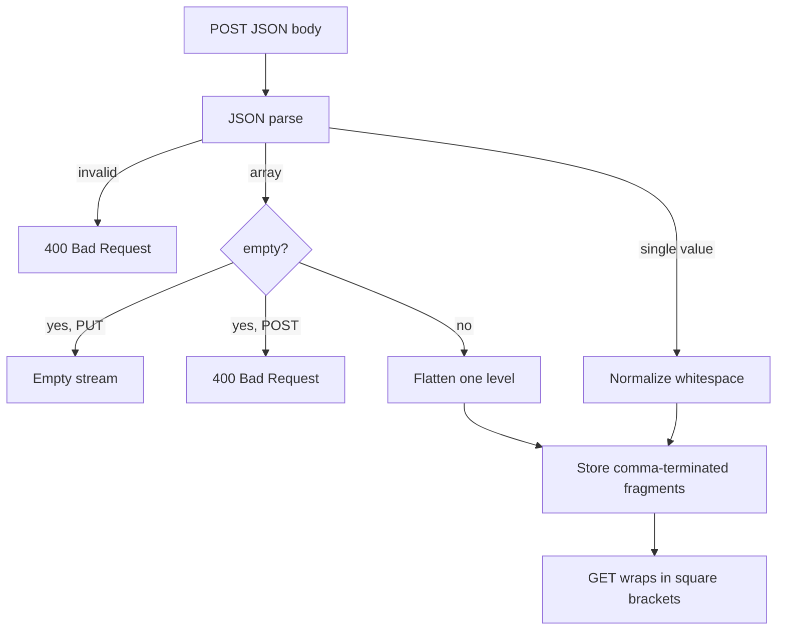
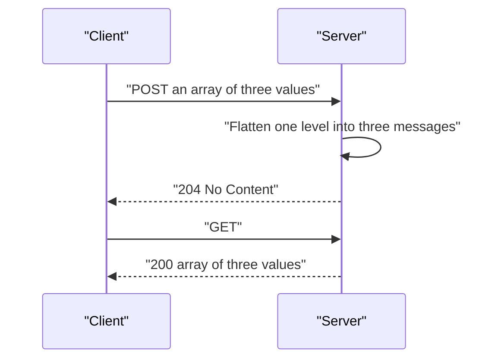

# 06 -- JSON Mode: message boundaries and array flattening

Streams created with `Content-Type: application/json` get special message-boundary semantics. Each POST stores a distinct message, and GET returns all messages as a JSON (JavaScript Object Notation) array.

```text
# Source: PROTOCOL.md, lines 1270-1281
For `application/json` streams, servers **MUST** preserve message boundaries. Each POST request stores messages as a distinct unit, and GET responses **MUST** return data as a JSON array containing all messages from the requested offset range.

#### 9.1.2. Array Flattening for Batch Operations

When a POST request body contains a JSON array, servers **MUST** flatten exactly one level of the array, treating each element as a separate message. This enables clients to batch multiple messages in a single Hypertext Transfer Protocol (HTTP) request while preserving individual message semantics.

**Examples (direct POST to server):**

- POST body `{"event": "created"}` stores one message: `{"event": "created"}`
- POST body `[{"event": "a"}, {"event": "b"}]` stores two messages: `{"event": "a"}`, `{"event": "b"}`
- POST body `[[1,2], [3,4]]` stores two messages: `[1,2]`, `[3,4]`
- POST body `[[[1,2,3]]]` stores one message: `[[1,2,3]]`
```

## Empty arrays and validation

An empty array is a no-op on append and is rejected; on create it is valid and produces an empty stream. Servers validate that appended data is valid JSON.

```text
# Source: PROTOCOL.md, lines 1285-1293
#### 9.1.3. Empty Arrays

Servers **MUST** reject POST requests containing empty JSON arrays (`[]`) with `400 Bad Request`. Empty arrays in append operations represent no-op operations with no semantic meaning and likely indicate a client bug.

PUT requests with an empty array body (`[]`) are valid and create an empty stream. The empty array simply means no initial messages are being written.

#### 9.1.4. JSON Validation

Servers **MUST** validate that appended data is valid JSON. If validation fails, servers **MUST** return `400 Bad Request` with an appropriate error message.
```

## Response format

A GET on a JSON stream returns a JSON array, or an empty array `[]` when there are no messages in the range.

````text
# Source: PROTOCOL.md, lines 1297-1306
GET responses for `application/json` streams **MUST** return `Content-Type: application/json` with a body containing a JSON array of all messages in the requested range:

```http
HTTP/1.1 200 OK
Content-Type: application/json

[{"event":"created"},{"event":"updated"}]
```

If no messages exist in the range, servers **MUST** return an empty JSON array `[]`.
````

## The Cloudflare implementation

The Cloudflare server stores each message as a comma-terminated fragment. `processJsonAppend` validates, flattens a top-level array one level, and appends a trailing comma so fragments can be concatenated and re-wrapped later.

```ts
// Source: packages/server-cloudflare/src/json.ts, lines 30-59
export function processJsonAppend(
  data: Uint8Array,
  isInitialCreate = false
): Uint8Array {
  const text = new TextDecoder().decode(data)

  let parsed: unknown
  try {
    parsed = JSON.parse(text)
  } catch {
    throw new JsonAppendError(`Invalid JSON`)
  }

  let result: string
  if (Array.isArray(parsed)) {
    if (parsed.length === 0) {
      if (isInitialCreate) {
        return new Uint8Array(0)
      }
      throw new JsonAppendError(`Empty arrays are not allowed`)
    }
    const elements = parsed.map((item) => JSON.stringify(item))
    result = elements.join(`,`) + `,`
  } else {
    // Single value - re-serialize to normalize whitespace
    result = JSON.stringify(parsed) + `,`
  }

  return new TextEncoder().encode(result)
}
```

On read, the stored fragments are joined and wrapped in square brackets.

```ts
// Source: packages/server-cloudflare/src/json.ts, lines 72-79
export function formatJsonMessages(fragments: Array<Uint8Array>): Uint8Array {
  if (fragments.length === 0) {
    return new TextEncoder().encode(`[]`)
  }

  const items = fragments.map((data) => decodeStoredJsonFragment(data))
  return new TextEncoder().encode(`[${items.join(`,`)}]`)
}
```





## The Go implementation

The Go store formats JSON responses the same way: concatenate the stored fragments, separating them with commas, and wrap in brackets. Because each stored message already carries the outer object braces, no per-message re-parsing is needed.

```go
// Source: packages/caddy-plugin/store/store.go, lines 362-387
// FormatJSONResponse formats messages as a JSON array
func FormatJSONResponse(messages []Message) []byte {
	if len(messages) == 0 {
		return []byte("[]")
	}

	// Calculate total size
	total := 2 // for [ and ]
	for i, msg := range messages {
		if i > 0 {
			total++ // comma
		}
		total += len(msg.Data)
	}

	result := make([]byte, 0, total)
	result = append(result, '[')
	for i, msg := range messages {
		if i > 0 {
			result = append(result, ',')
		}
		result = append(result, msg.Data...)
	}
	result = append(result, ']')
	return result
}
```

## The Aha Moment
**Aha:** JSON mode preserves boundaries by storing each POST as its own fragment and re-wrapping on read, so the server never needs to re-parse stored bytes. Array flattening is the trick that lets a client batch `[a, b, c]` and still get three separate messages back — one level of unwrapping on write, one level of wrapping on read.

## Cross-References

- [04-appends.md](04-appends.md) — the append path that flattens JSON arrays.
- [12-durable-state.md](12-durable-state.md) — structured state built on JSON mode.
- [07-forking.md](07-forking.md) — how JSON sub-offsets work at fork boundaries.

Continue to [07-forking.md](07-forking.md)
