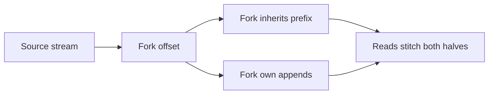
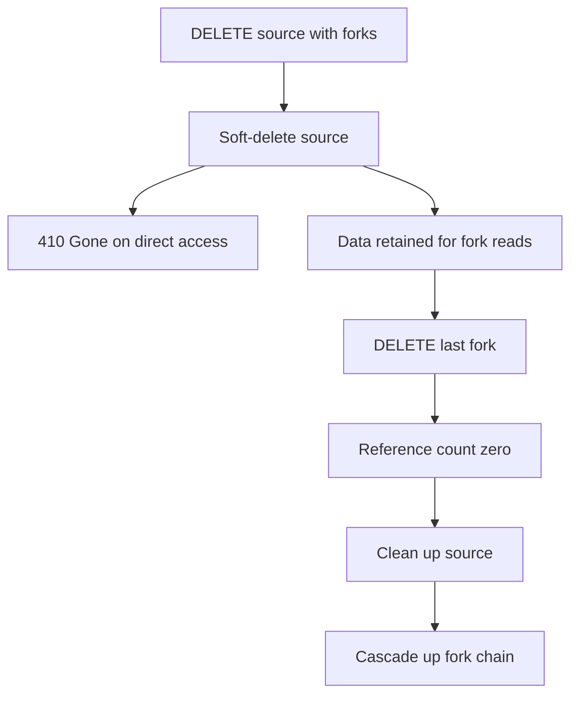

# 07 -- Forking: branching a stream at an offset

A fork is a stream created by referencing a source stream and a divergence offset. The fork inherits the source's data up to the fork offset without copying it, then diverges. Reads on a fork transparently stitch the two halves.

```text
# Source: PROTOCOL.md, lines 157-165
These headers are used on `PUT` requests to create a forked stream:

- `Stream-Forked-From: <source-path>`: The path component of the source stream's URL, relative to the same server. When present, the `PUT` creates a fork rather than a new empty stream. Cross-service forking is not supported — the source stream must be on the same server as the fork.
- `Stream-Fork-Offset: <offset>`: The divergence point in the source stream. The fork inherits all data from the source up to (but not including) this offset. If omitted, defaults to the source stream's current tail offset.
- `Stream-Fork-Sub-Offset: <integer>` (optional): A non-negative integer that refines the divergence point to a sub-position past `Stream-Fork-Offset`. Interpreted per the source stream's content type:
  - For `application/json` streams: number of flattened messages (Section 7.1) to inherit past the anchor.
  - For all other content types: number of decoded entity body bytes to inherit past the anchor, exclusive of any framing the server uses internally and independent of any HTTP transfer or content encoding used in transit.
  - Default `0`. A request with sub-offset `0` is equivalent to a request with the header omitted.
  - The sub-offset is a separate addressing dimension and is not part of the offset value (see Section 6).
```

The docs capture the stitching visually.

```text
# Source: docs/fork.md, lines 20-25
source:  [0] [1] [2] [3] [4] [5] [6] [7]
                      │
                      │ fork at offset 4
                      ▼
fork:    [0] [1] [2] [3] [4'] [5'] [6']
         └── inherited ──┘└── fork's own ──┘
```



## Fork creation in the server

The Node reference server resolves the fork offset against the source and validates it: it must sit between the zero offset and the source's current tail.

```ts
// Source: packages/server/src/store.ts, lines 344-355
      // Resolve fork offset: use provided or source's currentOffset
      if (options.forkOffset) {
        forkOffset = options.forkOffset
      } else {
        forkOffset = sourceStream.currentOffset
      }

      // Validate: zeroOffset <= forkOffset <= source.currentOffset
      const zeroOffset = `0000000000000000_0000000000000000`
      if (forkOffset < zeroOffset || sourceStream.currentOffset < forkOffset) {
        throw new Error(`Invalid fork offset: ${forkOffset}`)
      }
```

The Go server maps the fork-specific errors from the store to HTTP (Hypertext Transfer Protocol) status codes.

```go
// Source: packages/caddy-plugin/handler.go, lines 194-217
	meta, wasCreated, err := h.store.Create(path, opts)
	if err != nil {
		if errors.Is(err, store.ErrStreamNotFound) {
			return newHTTPError(http.StatusNotFound, "source stream not found")
		}
		if errors.Is(err, store.ErrInvalidForkOffset) {
			return newHTTPError(http.StatusBadRequest, "fork offset beyond source stream length")
		}
		if errors.Is(err, store.ErrInvalidForkSubOffset) {
			return newHTTPError(http.StatusBadRequest, "fork sub-offset overshoots or is invalid")
		}
		if errors.Is(err, store.ErrStreamSoftDeleted) {
			return newHTTPError(http.StatusConflict, "source stream was deleted but still has active forks")
		}
		if errors.Is(err, store.ErrStreamExists) {
			return newHTTPError(http.StatusConflict, "stream already exists")
		}
		if errors.Is(err, store.ErrConfigMismatch) {
			return newHTTPError(http.StatusConflict, "stream exists with different configuration")
		}
		if errors.Is(err, store.ErrContentTypeMismatch) {
			return newHTTPError(http.StatusConflict, "fork content type does not match source stream")
		}
		return err
```

## Producer state across fork boundaries

A fork is a fresh stream from a writer-state perspective. It must not inherit idempotent producer state or per-writer `Stream-Seq` state from the source.

```text
# Source: PROTOCOL.md, lines 203-205
#### Producer state and fork boundaries

Forks **MUST NOT** inherit idempotent producer state (Section 5.2.1) or per-writer `Stream-Seq` state (Section 5.2) from the source. A fork is a new stream from a writer-state perspective; producers writing to the fork **MUST** re-bootstrap their state on the fork (typically by bumping their epoch). This applies to all forks, including those created with `Stream-Fork-Sub-Offset` whose boundary lies inside a producer batch on the source — the source's producer state is unchanged, and the fork's writer-state-fresh shape ensures retries against the fork cannot collide with the partial inherited data.
```

## Soft-delete and lifecycle

A stream with active forks is not hard-deleted when its owner deletes it. It transitions to soft-deleted, returning `410 Gone` on direct access but retaining its data for fork readers, and is cleaned up by a cascading garbage collection when the last fork goes away.

```text
# Source: PROTOCOL.md, lines 209-216
When a stream with active forks (reference count > 0) is deleted via `DELETE`, it transitions to a **soft-deleted** state:

- Direct client access to the stream's URL returns `410 Gone` for all operations (`GET`, `HEAD`, `POST`, `DELETE`)
- The stream's path is blocked from re-creation via `PUT` (`409 Conflict`)
- The server retains the stream's data internally so that fork reads can stitch inherited data — this is transparent to clients reading from forks
- When the last fork referencing the stream is deleted, the server cleans up the stream's data. This cleanup **MAY** occur asynchronously — clients **SHOULD NOT** assume the source returns `404` immediately after the fork's `DELETE` response.

Garbage collection cascades: if deleting a fork causes its source's reference count to reach zero and the source is also soft-deleted, the source is cleaned up too. This cascade continues up the fork chain. Cascade cleanup **MAY** also occur asynchronously.
```



## The Aha Moment
**Aha:** A fork is a view, not a copy. The fork stores only a reference to the source and its own divergence point, and reads join the two halves on the fly. That one reference-count bookkeeping rule — soft-delete while forks exist, then cascade the cleanup — gives you copy-free branching of an append-only log without any offset translation between source and fork.

## Cross-References

- [01-stream-model.md](01-stream-model.md) — offsets and closure, which forks share with their source.
- [05-idempotent-producers.md](05-idempotent-producers.md) — why producer state does not cross the fork boundary.
- [08-store-layer.md](08-store-layer.md) — the stores that track reference counts.

Continue to [08-store-layer.md](08-store-layer.md)
