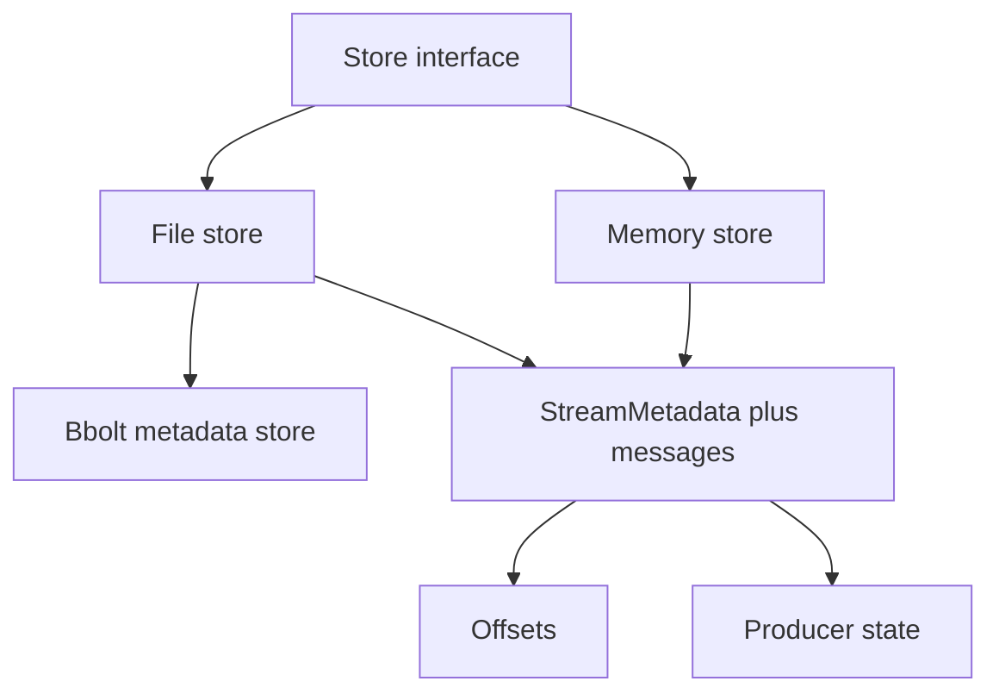
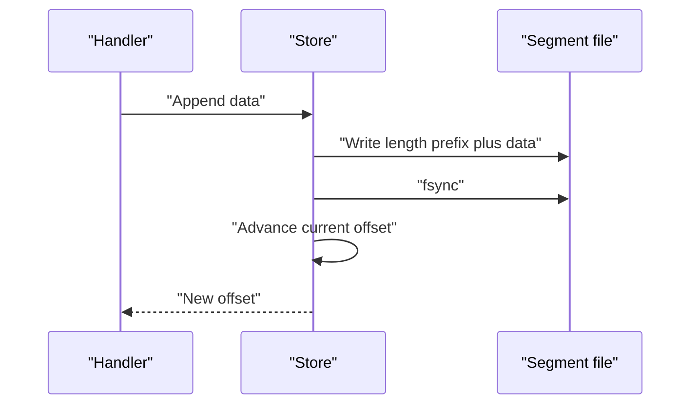

# 08 -- Store Layer: memory, file, segments, and offsets

Every Durable Streams server sits on a store abstraction. The store owns stream metadata, message data, offsets, producer state, and the long-poll waiters. The Go production server defines a single `Store` interface implemented by two backends, memory and file. The file backend persists its metadata through a separate bbolt metadata store (bbolt is a Bolt-derived key-value store), but bbolt is not itself a `Store` implementation.

```go
// Source: packages/caddy-plugin/store/store.go, lines 92-118
// Store is the interface for durable stream storage
type Store interface {
	// Create creates a new stream. Returns ErrStreamExists if stream exists with
	// different config, or nil if stream exists with same config (idempotent).
	// The bool return value indicates if the stream was newly created (true) or
	// already existed with matching config (false).
	Create(path string, opts CreateOptions) (*StreamMetadata, bool, error)

	// Get returns metadata for a stream, or ErrStreamNotFound if not found
	Get(path string) (*StreamMetadata, error)

	// Has returns true if the stream exists
	Has(path string) bool

	// Delete removes a stream. Returns ErrStreamNotFound if not found.
	Delete(path string) error

	// Append adds data to a stream. Returns AppendResult with the new offset.
	// Returns ErrStreamNotFound if stream doesn't exist.
	// Returns ErrSequenceConflict if seq is provided and <= last seq.
	// Returns ErrContentTypeMismatch if content type doesn't match.
	// Returns ErrStaleEpoch if producer epoch is less than current.
	// Returns ErrInvalidEpochSeq if new epoch doesn't start at seq 0.
	// Returns ErrProducerSeqGap if producer seq is greater than lastSeq + 1.
	// Returns ErrPartialProducer if only some producer headers are provided.
	// Returns ErrStreamClosed if stream is closed (unless opts.Close is true for close-only).
	Append(path string, data []byte, opts AppendOptions) (AppendResult, error)
```

The interface also exposes `Read`, `WaitForMessages`, and `GetCurrentOffset`, which together support catch-up and long-poll reads. The metadata struct holds the stream's content type, current offset, closure state, producer map, and fork bookkeeping.

```go
// Source: packages/caddy-plugin/store/store.go, lines 190-215
// Message represents a single message in a stream
type Message struct {
	Data   []byte
	Offset Offset
}

// StreamMetadata contains metadata about a stream
type StreamMetadata struct {
	Path                string
	ContentType         string
	CurrentOffset       Offset
	LastSeq             string // Last Stream-Seq value
	TTLSeconds          *int64
	ExpiresAt           *time.Time
	CreatedAt           time.Time
	LastAccessedAt      time.Time
	Producers           map[string]*ProducerState // Producer ID -> state
	Closed              bool                      // Stream is closed (no more appends allowed)
	ClosedBy            *ClosedByProducer         // Producer that closed the stream (for idempotent duplicate detection)
	ForkedFrom          string                    // Source stream path (empty if not a fork)
	ForkOffset          Offset                    // Internal divergence point: offsets < ForkOffset come from source. For JSON forks created with a sub-offset this is advanced past the user-supplied offset; ForkOffsetRequested holds the original.
	ForkOffsetRequested *Offset                   // The user-supplied Stream-Fork-Offset (nil if omitted). Differs from ForkOffset only for JSON forks created with sub-offset > 0; used for idempotent re-creation matching.
	ForkSubOffset       uint64                    // User-supplied Stream-Fork-Sub-Offset value: bytes for non-JSON forks, flattened message count for JSON forks (0 = no sub-offset slice). Stored verbatim for idempotent re-creation matching.
	RefCount            int32                     // Number of forks referencing this stream
	SoftDeleted         bool                      // Logically deleted but retained for fork readers
}
```





## Segments and framing

Data lives in a segment file. In the Go store each message is a four-byte big-endian length prefix followed by the raw bytes.

```go
// Source: packages/caddy-plugin/store/segment.go, lines 12-29
// Segment file format:
// Each message is stored as:
//   [4-byte big-endian length][data bytes]
// Messages are concatenated without separators.
//
// For JSON mode, each JSON value is stored as a separate message.
// For binary mode, all data is stored as a single message.

const (
	// SegmentFileName is the name of the segment file within a stream directory
	SegmentFileName = "data.seg"

	// LengthPrefixSize is the size of the length prefix in bytes
	LengthPrefixSize = 4

	// MaxMessageSize is the maximum allowed message size (64MB)
	MaxMessageSize = 64 * 1024 * 1024
)
```

```go
// Source: packages/caddy-plugin/store/segment.go, lines 39-58
// WriteMessage writes a single message to the segment file
// Returns the number of bytes written (including length prefix)
func WriteMessage(w io.Writer, data []byte) (int, error) {
	if len(data) > MaxMessageSize {
		return 0, ErrMessageTooLarge
	}

	// Write length prefix
	var lenBuf [LengthPrefixSize]byte
	binary.BigEndian.PutUint32(lenBuf[:], uint32(len(data)))

	n, err := w.Write(lenBuf[:])
	if err != nil {
		return n, err
	}

	// Write data
	n2, err := w.Write(data)
	return n + n2, err
}
```

The TypeScript (a typed superset of JavaScript) reference file store frames messages with a four-byte length prefix, the data, and a trailing newline — five bytes of overhead — then fsyncs the segment before committing metadata to LMDB (Lightning Memory-Mapped Database).

```ts
// Source: packages/server/src/file-store.ts, lines 1321-1363
    const parts = streamMeta.currentOffset.split(`_`).map(Number)
    const readSeq = parts[0]!
    const byteOffset = parts[1]!

    const FRAME_OVERHEAD = 5 // 4-byte length prefix + 1-byte newline
    const newByteOffset = byteOffset + FRAME_OVERHEAD + processedData.length
    const newOffset = `${String(readSeq).padStart(16, `0`)}_${String(newByteOffset).padStart(16, `0`)}`

    const segmentPath = segmentFile(this.dataDir, streamMeta.directoryName)

    const tAppendStart = performance.now()

    // Get write stream from pool
    const stream = this.fileHandlePool.getWriteStream(segmentPath)

    // 1. Write message with framing: [4 bytes length][data][\n]
    //    Combine into single buffer for single syscall, and wait for write
    //    to be flushed to kernel before calling fsync
    const lengthBuf = Buffer.allocUnsafe(4)
    lengthBuf.writeUInt32BE(processedData.length, 0)
    const frameBuf = Buffer.concat([
      lengthBuf,
      processedData,
      Buffer.from(`\n`),
    ])
    await new Promise<void>((resolve, reject) => {
      stream.write(frameBuf, (err) => {
        if (err) reject(err)
        else resolve()
      })
    })

    const tAfterWrite = performance.now()

    // 2. Create message object for return value
    const message: StreamMessage = {
      data: processedData,
      offset: newOffset,
      timestamp: Date.now(),
    }

    // 3. Flush to disk (blocks here until durable)
    await this.fileHandlePool.fsyncFile(segmentPath)
```

## File pooling

Many streams mean many open file handles. Both stores pool handles with least-recently-used (LRU) eviction. The Go file pool opens append-mode handles on demand and evicts the least recently used entry when it reaches capacity.

```go
// Source: packages/caddy-plugin/store/filepool.go, lines 9-33
// FilePool manages a pool of file handles with LRU eviction
type FilePool struct {
	mu      sync.Mutex
	maxSize int
	files   map[string]*poolEntry
	lru     *list.List // LRU list, front = most recently used
}

type poolEntry struct {
	path    string
	file    *os.File
	element *list.Element
}

// NewFilePool creates a new file pool with the given maximum size
func NewFilePool(maxSize int) *FilePool {
	if maxSize <= 0 {
		maxSize = 100 // default
	}
	return &FilePool{
		maxSize: maxSize,
		files:   make(map[string]*poolEntry),
		lru:     list.New(),
	}
}
```

## Expiry

Expiry is a sliding TTL (time-to-live) window or an absolute deadline, both checked against metadata. Reads and writes refresh the sliding window via `LastAccessedAt`.

```go
// Source: packages/caddy-plugin/store/store.go, lines 217-235
// IsExpired checks if the stream has expired based on TTL or ExpiresAt
func (m *StreamMetadata) IsExpired() bool {
	now := time.Now()

	// Check explicit expiry time
	if m.ExpiresAt != nil && now.After(*m.ExpiresAt) {
		return true
	}

	// Check TTL-based expiry
	if m.TTLSeconds != nil {
		expiryTime := m.LastAccessedAt.Add(time.Duration(*m.TTLSeconds) * time.Second)
		if now.After(expiryTime) {
			return true
		}
	}

	return false
}
```

## The two Go backends

- **Memory** keeps `StreamMetadata` and messages in process, with a long-poll waiter map. It is used for testing.
- **File** writes message data to `data.seg` files on disk, one directory per stream, with pooled handles. It persists metadata through a `BboltMetadataStore` (`bbolt.go`), serialized as JSON (JavaScript Object Notation), with an in-memory `metaCache` on top for fast reads. This survives restarts.

The TypeScript reference server has the same split: an in-memory store in `store.ts` and a file store in `file-store.ts` that uses LMDB for metadata and append-only log files for data.

## The Aha Moment
**Aha:** The store's entire job is to make offsets honest. Every append advances the offset by exactly the framed byte count, and every read seeks straight to a byte offset. Because the offset encodes a byte position, a catch-up read can skip the metadata database entirely and read the segment file directly — that is the server-side optimization the protocol's offset opacity was designed to enable.

## Cross-References

- [01-stream-model.md](01-stream-model.md) — the offset format the store maintains.
- [09-caddy-server.md](09-caddy-server.md) — how the Caddy plugin drives this store.
- [07-forking.md](07-forking.md) — reference counting in the metadata.

Continue to [09-caddy-server.md](09-caddy-server.md)
