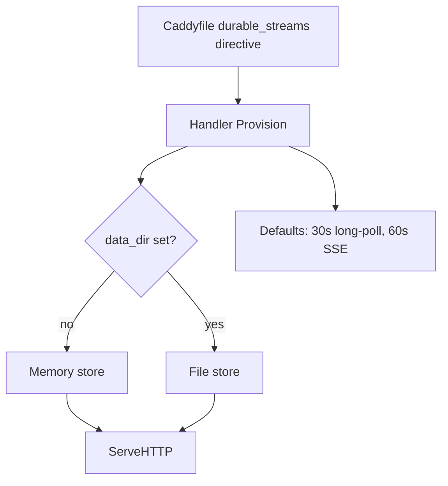
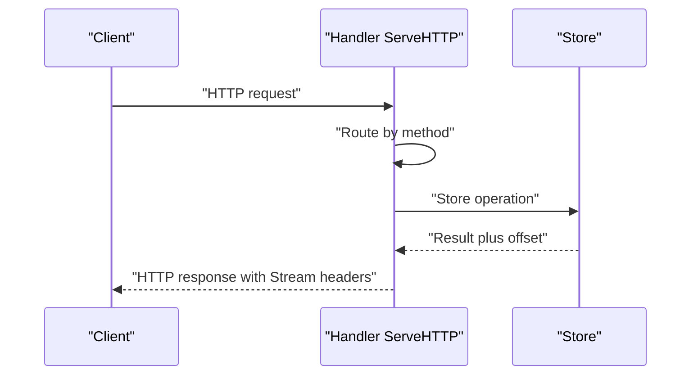

# 09 -- Caddy Server: the Go production server

The production server is a Caddy plugin. It registers an HTTP (Hypertext Transfer Protocol) handler module and a Caddyfile directive, so a Caddy instance can serve Durable Streams alongside any other routes. The module ID is `http.handlers.durable_streams`.

```go
// Source: packages/caddy-plugin/module.go, lines 16-19
func init() {
	caddy.RegisterModule(Handler{})
	httpcaddyfile.RegisterHandlerDirective("durable_streams", parseCaddyfile)
}
```

```go
// Source: packages/caddy-plugin/module.go, lines 46-52
// CaddyModule returns the Caddy module information
func (Handler) CaddyModule() caddy.ModuleInfo {
	return caddy.ModuleInfo{
		ID:  "http.handlers.durable_streams",
		New: func() caddy.Module { return new(Handler) },
	}
}
```

## Provisioning and configuration

Caddy calls `Provision` once at startup. It applies defaults (30-second long-poll timeout, 60-second SSE (Server-Sent Events) reconnect interval, 100 file handles) and picks the store: an in-memory store when `data_dir` is empty, or a file-backed store otherwise.

```go
// Source: packages/caddy-plugin/module.go, lines 55-74
func (h *Handler) Provision(ctx caddy.Context) error {
	h.logger = ctx.Logger()

	// Set defaults
	if h.MaxFileHandles == 0 {
		h.MaxFileHandles = 100
	}
	if h.LongPollTimeout == 0 {
		h.LongPollTimeout = caddy.Duration(30 * time.Second)
	}
	if h.SSEReconnectInterval == 0 {
		h.SSEReconnectInterval = caddy.Duration(60 * time.Second)
	}

	// Initialize store
	if h.DataDir == "" {
		// Use in-memory store for testing
		h.store = store.NewMemoryStore()
		h.logger.Info("using in-memory store (no data_dir configured)")
	} else {
```

The Caddyfile syntax maps subdirectives to fields.

```go
// Source: packages/caddy-plugin/module.go, lines 139-151
func (h *Handler) UnmarshalCaddyfile(d *caddyfile.Dispenser) error {
	for d.Next() {
		for d.NextBlock(0) {
			switch d.Val() {
			case "data_dir":
				if !d.Args(&h.DataDir) {
					return d.ArgErr()
				}
			case "max_file_handles":
				var val string
				if !d.Args(&val) {
					return d.ArgErr()
				}
```





## The HTTP handler

`ServeHTTP` is the request router. It sets CORS (Cross-Origin Resource Sharing) and browser security headers, handles preflight, and dispatches each HTTP method to its handler. The stream path is simply the URL path.

```go
// Source: packages/caddy-plugin/handler.go, lines 51-105
// ServeHTTP implements caddyhttp.MiddlewareHandler
func (h *Handler) ServeHTTP(w http.ResponseWriter, r *http.Request, next caddyhttp.Handler) error {
	// Set CORS headers
	w.Header().Set("Access-Control-Allow-Origin", "*")
	w.Header().Set("Access-Control-Allow-Methods", "GET, POST, PUT, DELETE, HEAD, OPTIONS")
	w.Header().Set("Access-Control-Allow-Headers", "Content-Type, Stream-Seq, Stream-TTL, Stream-Expires-At, Stream-Closed, If-None-Match, Producer-Id, Producer-Epoch, Producer-Seq, Stream-Forked-From, Stream-Fork-Offset, Stream-Fork-Sub-Offset, Authorization")
	w.Header().Set("Access-Control-Expose-Headers", "Stream-Next-Offset, Stream-Cursor, Stream-Up-To-Date, Stream-Closed, ETag, Location, Producer-Epoch, Producer-Seq, Producer-Expected-Seq, Producer-Received-Seq")

	// Browser security headers (Protocol Section 10.7)
	w.Header().Set("X-Content-Type-Options", "nosniff")
	w.Header().Set("Cross-Origin-Resource-Policy", "cross-origin")

	// Handle preflight
	if r.Method == http.MethodOptions {
		w.WriteHeader(http.StatusNoContent)
		return nil
	}

	// Check webhook routes before normal stream handling
	if h.webhookRoutes != nil {
		if h.webhookRoutes.HandleRequest(w, r) {
			return nil
		}
	}

	// Extract stream path from URL
	streamPath := r.URL.Path

	h.logger.Debug("handling request",
		zap.String("method", r.Method),
		zap.String("path", streamPath),
		zap.String("query", r.URL.RawQuery))

	var err error
	switch r.Method {
	case http.MethodPut:
		err = h.handleCreate(w, r, streamPath)
	case http.MethodHead:
		err = h.handleHead(w, r, streamPath)
	case http.MethodGet:
		err = h.handleRead(w, r, streamPath)
	case http.MethodPost:
		err = h.handleAppend(w, r, streamPath)
	case http.MethodDelete:
		err = h.handleDelete(w, r, streamPath)
	default:
		w.WriteHeader(http.StatusMethodNotAllowed)
		return nil
	}

	if err != nil {
		h.writeError(w, err)
	}
	return nil
}
```

## Protocol headers as constants

The handler names every protocol header as a constant, including the idempotent producer headers and the fork headers. Responses echo these header names, and the CORS expose list makes them readable from browsers.

```go
// Source: packages/caddy-plugin/handler.go, lines 21-45
// Protocol header names
const (
	HeaderStreamNextOffset      = "Stream-Next-Offset"
	HeaderStreamCursor          = "Stream-Cursor"
	HeaderStreamUpToDate        = "Stream-Up-To-Date"
	HeaderStreamSeq             = "Stream-Seq"
	HeaderStreamTTL             = "Stream-TTL"
	HeaderStreamExpiresAt       = "Stream-Expires-At"
	HeaderStreamClosed          = "Stream-Closed"
	HeaderStreamSSEDataEncoding = "Stream-SSE-Data-Encoding"

	// Idempotent producer headers
	HeaderProducerId          = "Producer-Id"
	HeaderProducerEpoch       = "Producer-Epoch"
	HeaderProducerSeq         = "Producer-Seq"
	HeaderProducerExpectedSeq = "Producer-Expected-Seq"
	HeaderProducerReceivedSeq = "Producer-Received-Seq"
)

// Fork headers (request headers only — not set on responses)
const (
	HeaderStreamForkedFrom    = "Stream-Forked-From"
	HeaderStreamForkOffset    = "Stream-Fork-Offset"
	HeaderStreamForkSubOffset = "Stream-Fork-Sub-Offset"
)
```

## How requests map to store operations

Each method handler maps one protocol operation to store calls. `handleCreate` maps PUT to `store.Create`; `handleRead` maps GET to `store.Read` and `store.WaitForMessages` for long-poll; `handleAppend` maps POST to `store.Append`; `handleDelete` maps DELETE to `store.Delete`. The handlers translate store errors into HTTP status codes and set response headers from the returned offsets. Live modes use the cursor functions to keep cursors monotonic, and `handleSSE` loops on `store.Read` plus `store.WaitForMessages` until the reconnect timer or stream closure.

## The Aha Moment
**Aha:** The Caddy plugin is a pure translation layer. Its handlers add no protocol logic of their own — every operation is a store call plus header plumbing. That separation is why the same store backs three different surfaces (catch-up, long-poll, SSE) and why testing the handler is mostly testing the store. The protocol lives in the store; the HTTP handler just names it.

## Cross-References

- [08-store-layer.md](08-store-layer.md) — the store interface this handler drives.
- [02-catch-up-reads.md](02-catch-up-reads.md) — the read path in detail.
- [03-live-tailing.md](03-live-tailing.md) — the SSE loop this handler runs.

Continue to [10-cloudflare-server.md](10-cloudflare-server.md)
