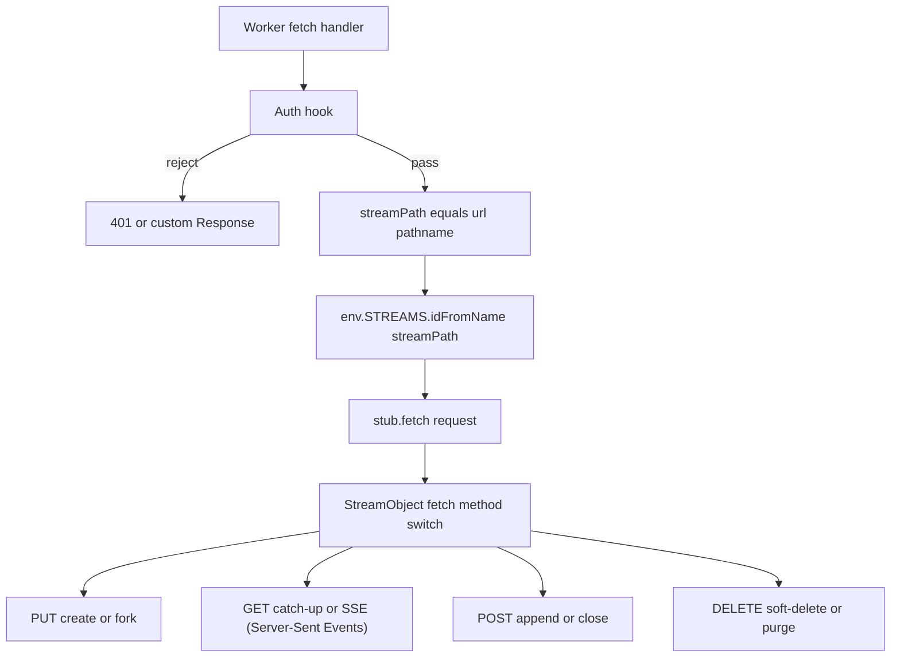
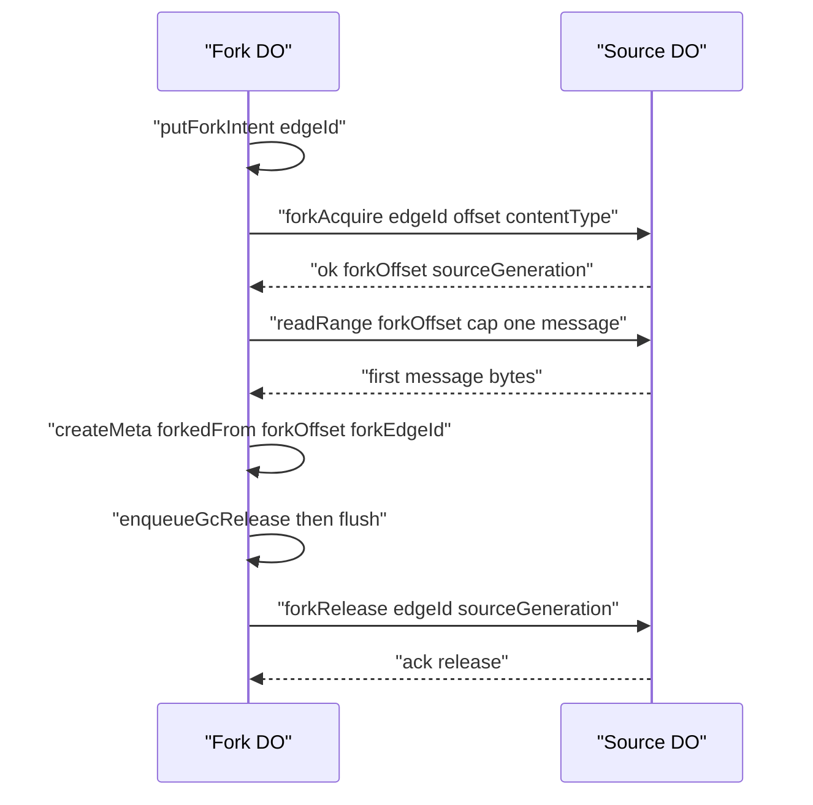

# 10 -- Cloudflare Server: one Durable Object per stream

The Cloudflare server splits the reference server in two. A Worker-level router maps every request to a Durable Object (DO), and the DO holds the protocol logic. There is exactly one DO per stream: the router derives the DO identity from the stream path with `idFromName`, so the same path always lands on the same object.

```ts
// Source: packages/server-cloudflare/src/handler.ts, lines 111-133
    const url = new URL(request.url)
    const streamPath = url.pathname

    // `__ds` is the protocol's reserved control-plane prefix (§6): route it
    // before stream ops. Subscriptions are not implemented, so it 404s
    // rather than being treated as a stream path.
    if (streamPath.endsWith(`/__ds`) || streamPath.includes(`/__ds/`)) {
      return new Response(`Subscription APIs are not supported`, {
        status: 404,
        headers: { ...cors, "content-type": `text/plain` },
      })
    }

    if (streamPath === `/` || streamPath === ``) {
      return new Response(`Durable Streams server. Streams live at /<path>.`, {
        status: 200,
        headers: { ...cors, "content-type": `text/plain` },
      })
    }

    const id = env.STREAMS.idFromName(streamPath)
    const stub = env.STREAMS.get(id)
    const response = await stub.fetch(request)
```

The DO binding must be named `STREAMS`, because fork semantics do DO-to-DO Remote Procedure Calls (RPC) through `this.env.STREAMS`. The DO's environment interface states this fixed name.

## The concurrency model: no locks

The reference Node server serializes validate-then-write blocks with per-producer promise locks. The Cloudflare DO gets the same guarantee for free: the DO input gate serializes storage-touching events, and Durable Object SQLite (a synchronous embedded Structured Query Language database) is synchronous. A block with no `await` between its read and its write is atomic with respect to other requests.

```ts
// Source: packages/server-cloudflare/src/store.ts, lines 7-10
 * re-implemented on Durable Object SQLite. The DO's single-threaded
 * execution replaces the reference server's promise-chain locks: every
 * read-modify-write here is synchronous (no awaits), so it is atomic
 * with respect to other requests.
```

The DO body is read before any state is examined, so a response is never sent mid-upload. Writes are committed to SQLite before the response escapes, so durability always precedes the acknowledgement.

```ts
// Source: packages/server-cloudflare/src/stream-object.ts, lines 260-280
  override async fetch(request: Request): Promise<Response> {
    const url = new URL(request.url)
    const path = url.pathname

    switch (request.method) {
      case `PUT`:
        return this.handlePut(request, url, path)
      case `HEAD`:
        return this.handleHead()
      case `GET`:
        return this.handleGet(request, url)
      case `POST`:
        return this.handlePost(request)
      case `DELETE`:
        return this.handleDelete(path)
      default:
        // Drain any body so the response never races the request stream.
        await this.drainBody(request.body)
        return this.text(405, `Method not allowed`)
    }
  }
```

## SQLite storage

All stream state lives in Durable Object SQLite. A single-row `meta` table holds the stream metadata; a `messages` table holds the data, keyed by offset. Three further tables carry fork bookkeeping: `fork_edges` (references from forks), `fork_intents` (durable intent to acquire an edge, written before the RPC), and `gc_releases` (fork releases that must not be lost).

```ts
// Source: packages/server-cloudflare/src/store.ts, lines 132-155
      CREATE TABLE IF NOT EXISTS meta (
        id INTEGER PRIMARY KEY CHECK (id = 1),
        gen TEXT NOT NULL,
        content_type TEXT,
        ttl_seconds INTEGER,
        expires_at TEXT,
        closed INTEGER NOT NULL DEFAULT 0,
        closed_by TEXT,
        current_offset TEXT NOT NULL,
        last_seq TEXT,
        created_at INTEGER NOT NULL,
        last_accessed_at INTEGER NOT NULL,
        forked_from TEXT,
        fork_offset TEXT,
        fork_sub_offset INTEGER,
        fork_edge_id TEXT,
        fork_source_gen TEXT,
        soft_deleted INTEGER NOT NULL DEFAULT 0
      );
      CREATE TABLE IF NOT EXISTS messages (
        msg_offset TEXT PRIMARY KEY,
        data BLOB NOT NULL,
        ts INTEGER NOT NULL
      );
```

Offsets advance by the framed byte count. The offset after an append is the current offset plus five bytes of frame overhead (a four-byte length prefix and a one-byte newline) plus the payload length.

```ts
// Source: packages/server-cloudflare/src/store.ts, lines 116-125
export function advanceOffset(
  currentOffset: string,
  payloadLength: number
): string {
  const parts = currentOffset.split(`_`)
  const readSeq = Number(parts[0])
  const byteOffset = Number(parts[1])
  const newByteOffset = byteOffset + FRAME_OVERHEAD + payloadLength
  return `${String(readSeq).padStart(16, `0`)}_${String(newByteOffset).padStart(16, `0`)}`
}
```

An append is two synchronous statements: insert the message at its new offset, then update the metadata's current offset. Both land in the same SQLite transaction because the DO executes them without yielding.

```ts
// Source: packages/server-cloudflare/src/store.ts, lines 507-521
  appendMessage(
    currentOffset: string,
    payload: Uint8Array,
    now: number
  ): string {
    const newOffset = advanceOffset(currentOffset, payload.length)
    this.sql.exec(
      `INSERT INTO messages (msg_offset, data, ts) VALUES (?, ?, ?)`,
      newOffset,
      toArrayBuffer(payload),
      now
    )
    this.sql.exec(`UPDATE meta SET current_offset = ? WHERE id = 1`, newOffset)
    return newOffset
  }
```

## Idempotent producers

Producer state is an upsert keyed by producer identifier. The DO validates the epoch and sequence with a pure function, appends the payload, then commits the proposed producer state only after the append succeeded. Producer rows expire after a seven-day time-to-live (TTL), matching the reference server.

```ts
// Source: packages/server-cloudflare/src/store.ts, lines 555-568
  commitProducerState(producerId: string, state: ProducerState): void {
    this.sql.exec(
      `INSERT INTO producers (producer_id, epoch, last_seq, last_updated)
       VALUES (?, ?, ?, ?)
       ON CONFLICT (producer_id) DO UPDATE SET
         epoch = excluded.epoch,
         last_seq = excluded.last_seq,
         last_updated = excluded.last_updated`,
      producerId,
      state.epoch,
      state.lastSeq,
      state.lastUpdated
    )
  }
```

JSON (JavaScript Object Notation) payloads are processed before any state is committed. This ordering matters: an invalid JSON body must never leave a producer advanced or a message half-written.

```ts
// Source: packages/server-cloudflare/src/stream-object.ts, lines 1456-1472
    // Process the payload (JSON validation) BEFORE committing any state.
    let payload = body
    if (normalizeContentType(meta.contentType) === `application/json`) {
      try {
        payload = processJsonAppend(body, false)
      } catch (err) {
        if (err instanceof JsonAppendError) {
          return this.text(400, err.message)
        }
        throw err
      }
      // JSON normalization can expand the payload (e.g. escaping); the
      // stored fragment must still fit SQLite's per-value cap.
      if (payload.length > MAX_BODY_BYTES) {
        return this.text(413, `Payload too large`)
      }
    }
```



## Forking across Durable Objects

A fork is a stream whose source lives in a different DO. Fork creation is therefore a DO-to-DO RPC: the fork DO persists a durable edge intent, calls `forkAcquire` on the source DO to take a reference, reads the sub-offset prefix via `readRange`, then records its own metadata. If the acquire commits but the create is interrupted, the alarm turns the intent into a compensating release. Releases are queued in `gc_releases` and retried from the alarm so a dropped release never pins the source.



The source DO checks the release's source generation, so a delayed release for a purged-and-recreated stream cannot consume a live fork's reference.

## Expiry

Expiry is lazy and lives in `getMeta`. An expired stream is purged and reads as absent, unless forks still reference it, in which case it is soft-deleted instead. The alarm re-checks expiry and re-arms for the next deadline, and it also drains pending fork intents and garbage-collection releases.

## The Aha Moment
**Aha:** The Durable Object collapses the reference server's locking discipline into its runtime. The Node server needs promise locks and fsync discipline because it is concurrent and its storage is asynchronous; the DO needs none because its input gate plus synchronous SQLite make every read-modify-write block atomic by construction. The hard part is no longer "how do I lock" but "where do I avoid an `await`" — and the answer is the same every time: read the body, then run a synchronous block from validation to commit.

## Cross-References

- [09-caddy-server.md](09-caddy-server.md) — the Go production server this port parallels.
- [05-idempotent-producers.md](05-idempotent-producers.md) — the validation function this DO calls and commits.
- [07-forking.md](07-forking.md) — the protocol semantics behind the fork RPCs.
- [03-live-tailing.md](03-live-tailing.md) — the SSE loop inside `handleGet`.

Continue to [11-durable-proxy.md](11-durable-proxy.md)
