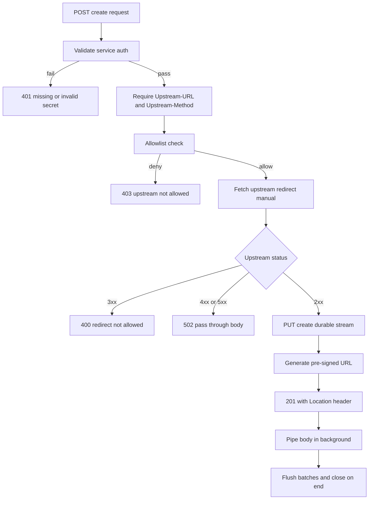
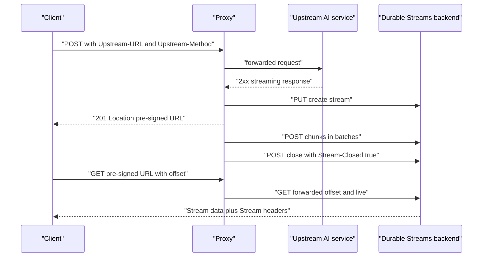

# 11 -- Durable Proxy: resumable AI token streams

The Durable Proxy sits between a client and an upstream service — typically an Artificial Intelligence (AI) inference API (Application Programming Interface) — and persists the upstream's streaming response into a durable stream. The client sends one request and receives a pre-signed URL; reading from that URL is automatically resumable. The specification is `packages/proxy/PROXY_PROTOCOL.md`, which extends the base protocol with a create-and-pipe operation, capability URLs, and an upstream allowlist.

```text
# Source: packages/proxy/PROXY_PROTOCOL.md, lines 122-125
**Two-phase flow:**

1. **Create** (POST): Client sends the upstream request details to the proxy. The proxy fetches from upstream. On success, it returns `201 Created` with a `Location` header containing a pre-signed Uniform Resource Locator (URL).
2. **Read** (GET): Client reads from the pre-signed URL, which delegates to the underlying durable stream. Supports offset-based resumption and live modes from the base protocol.
```

## Routing

The proxy exposes five operations on two URL patterns: create at the base path, and read/head/abort/delete at a stream path.

```ts
// Source: packages/proxy/src/server/proxy-handler.ts, lines 83-129
      // Route: POST /v1/proxy - Create stream
      if (PROXY_BASE.test(path) && method === `POST`) {
        await handleCreateStream(req, res, options, isAllowed, contentTypeStore)
        return
      }

      // Routes with streamId
      const match = path.match(PROXY_STREAM)
      if (match) {
        const streamId = decodeURIComponent(match[1]!)

        switch (method) {
          case `GET`:
            await handleReadStream(
              req,
              res,
              streamId,
              options,
              contentTypeStore
            )
            return

          case `HEAD`:
            await handleHeadStream(
              req,
              res,
              streamId,
              options,
              contentTypeStore
            )
            return

          case `PATCH`:
            handleAbortStream(req, res, streamId, options)
            return

          case `DELETE`:
            await handleDeleteStream(
              req,
              res,
              streamId,
              options,
              contentTypeStore
            )
            return
        }
      }
```

## Creating a proxy stream

Creation validates service authentication, requires the `Upstream-URL` and `Upstream-Method` headers, and checks the upstream URL against a glob allowlist before any request is made. This is the Server-Side Request Forgery (SSRF) defense.

```ts
// Source: packages/proxy/src/server/create-stream.ts, lines 156-171
  // Step 4: Validate upstream URL and check allowlist
  const parsedUrl = validateUpstreamUrl(upstreamUrl)
  if (!parsedUrl) {
    sendError(res, 403, `UPSTREAM_NOT_ALLOWED`, `Invalid upstream URL`)
    return
  }

  if (!isAllowed(upstreamUrl)) {
    sendError(
      res,
      403,
      `UPSTREAM_NOT_ALLOWED`,
      `Upstream URL is not in allowlist`
    )
    return
  }
```

The upstream fetch disables automatic redirect following, so a redirect cannot be used to hop from an allowed URL to an internal one. A 3xx is rejected; a non-2xx is passed through as a `502 Bad Gateway` with the upstream status.

```ts
// Source: packages/proxy/src/server/create-stream.ts, lines 223-243
  // 3xx Redirect - not allowed
  if (upstreamResponse.status >= 300 && upstreamResponse.status < 400) {
    sendError(res, 400, `REDIRECT_NOT_ALLOWED`, `Proxy cannot follow redirects`)
    return
  }

  // 4xx/5xx Error - pass through with Upstream-Status header
  if (!upstreamResponse.ok) {
    const errorBody = await readResponseBody(
      upstreamResponse,
      MAX_ERROR_BODY_SIZE
    )

    res.writeHead(502, {
      "Content-Type":
        upstreamResponse.headers.get(`content-type`) ?? `text/plain`,
      "Upstream-Status": String(upstreamResponse.status),
    })
    res.end(errorBody)
    return
  }
```

On a 2xx response, the proxy creates a real durable stream on the backend with `PUT`, using a server-generated universally unique identifier (UUID) as the stream path. The stream gets the proxy's configured time-to-live (TTL).

```ts
// Source: packages/proxy/src/server/create-stream.ts, lines 245-263
  // Step 9: Create durable stream (2xx success path)
  const upstreamContentType =
    upstreamResponse.headers.get(`content-type`) ?? `application/octet-stream`

  // Store upstream content type for GET/HEAD responses
  contentTypeStore.set(streamId, upstreamContentType)

  // Create stream on underlying durable streams server
  const streamPath = `/v1/streams/${streamId}`
  const fullStreamUrl = new URL(streamPath, options.durableStreamsUrl)

  try {
    const createResponse = await fetch(fullStreamUrl.toString(), {
      method: `PUT`,
      headers: {
        "Content-Type": `application/octet-stream`,
        "Stream-TTL": String(options.streamTtlSeconds ?? 86400),
      },
    })
```

## Pre-signed capability URLs

The `Location` header carries a pre-signed URL: a URL whose query string holds an expiry timestamp and a Hash-based Message Authentication Code (HMAC-SHA256) signature over the stream identifier and expiry. Possession of the URL grants read and abort access to that one stream, with no separate credentials.

```ts
// Source: packages/proxy/src/server/tokens.ts, lines 31-42
export function generatePreSignedUrl(
  origin: string,
  streamId: string,
  secret: string,
  expiresAt: number
): string {
  const signature = base64urlEncode(
    createHmac(`sha256`, secret).update(`${streamId}:${expiresAt}`).digest()
  )

  return `${origin}/v1/proxy/${encodeURIComponent(streamId)}?expires=${expiresAt}&signature=${signature}`
}
```

Verification checks expiry first, then recomputes the signature and compares with a timing-safe comparison. The service authentication path is a simple shared secret (called a JSON (JavaScript Object Notation) Web Token in the docs, but implemented as a plain secret comparison), accepted via `?secret=` or a bearer header.

## Piping the upstream body

After the `201` is sent, the proxy pipes the upstream body into the durable stream in the background. It batches chunks to reduce write overhead, flushing when either 4 kilobytes accumulate or 50 milliseconds elapse, and marks the stream closed when the upstream body ends. On abort or an inactivity timeout, buffered data is flushed but the stream is left open.

```ts
// Source: packages/proxy/src/server/upstream.ts, lines 194-235
    for (;;) {
      const { done, value } = await reader.read()

      if (done) {
        // Stream completed - flush remaining and close
        clearInactivityTimer()
        await flush()
        await closeStream()
        break
      }

      if (signal.aborted) {
        // Aborted - flush but do NOT close (data remains readable)
        clearInactivityTimer()
        await flush()
        break
      }

      // eslint-disable-next-line @typescript-eslint/no-unnecessary-condition -- Set by timeout callback
      if (inactivityTimedOut) {
        // Inactivity timeout - flush but do NOT close
        clearInactivityTimer()
        await flush()
        break
      }

      // Accumulate chunk
      buffer.push(value)
      bufferSize += value.length
      if (!batchStartTime) {
        batchStartTime = Date.now()
      }
      resetInactivityTimer()

      // Flush on size or time threshold
      if (
        bufferSize >= batchSizeThreshold ||
        Date.now() - batchStartTime >= batchTimeThreshold
      ) {
        await flush()
      }
    }
```

Reads simply forward `offset` and `live` to the underlying stream and copy the `Stream-*` headers back, plus the stored `Upstream-Content-Type`. This is why proxy streams support long-poll and Server-Sent Events (SSE) live modes for free: the read path is the base protocol's read path.



The abort operation is scoped to the pre-signed URL holder: `PATCH /v1/proxy/:id?action=abort` validates the signature and never falls back to service authentication. Delete and metadata reads, by contrast, require service authentication.



## The client library

The same package ships `@durable-streams/proxy/client`, a fetch-like wrapper. It sends the request to the proxy, persists the pre-signed URL and resume offset in storage keyed by proxy URL plus request identifier, and on interruption reads the durable stream from the saved offset. The caller's `Authorization` header is relabeled `Upstream-Authorization` and the request method becomes `Upstream-Method`, so a fetch call aimed at the AI service works unchanged through the proxy.

## The Aha Moment
**Aha:** The proxy collapses the resumable pattern from "client must create a stream and write into it" to "server does both". The client never learns that a durable stream exists — it holds a capability URL and reads. The upstream fetch, the write, the batching, and the closure all live server-side, so resumability is invisible to the caller and the read path remains exactly the base protocol's offset-based read.

## Cross-References

- [02-catch-up-reads.md](02-catch-up-reads.md) — the offset semantics the proxy's read path delegates to.
- [03-live-tailing.md](03-live-tailing.md) — the long-poll and SSE modes pass through unchanged.
- [15-yjs-ai-transports.md](15-yjs-ai-transports.md) — the AI SDK adapters built on this proxy.

Continue to [12-durable-state.md](12-durable-state.md)
