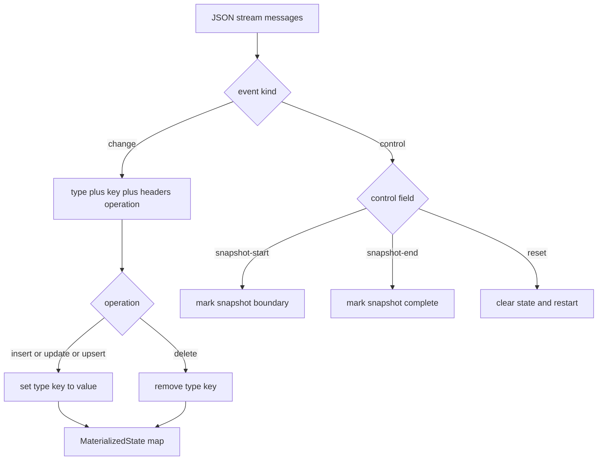
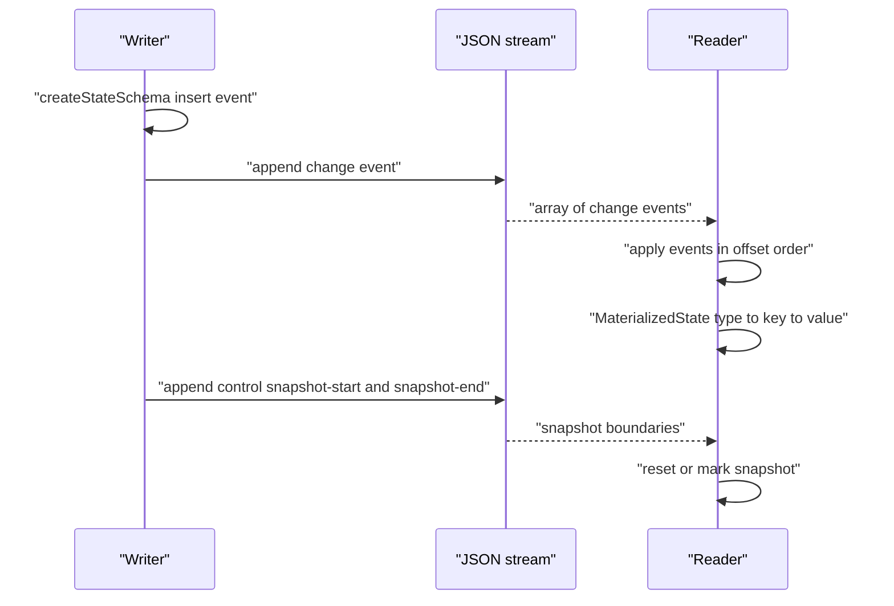

# 12 -- Durable State: structured events over streams

Durable State adds structured state changes on top of Durable Streams. Instead of raw bytes, a stream carries typed change events — insert, update, delete — that readers apply in order to build a materialized view. The wire format is specified in `packages/state/STATE-PROTOCOL.md`.

```text
# Source: packages/state/STATE-PROTOCOL.md, lines 74-77
1. **Change Messages**: Represent state mutations (insert/update/delete)
2. **Control Messages**: Provide stream management signals

Clients append change messages to streams using the base protocol's append operation. When reading from streams, clients receive JSON arrays of messages (per Section 7.1 of [PROTOCOL]) and apply them sequentially to materialize state.
```

A change message is a JavaScript Object Notation (JSON) object with a discriminator `type`, an entity `key`, an optional `value`, an optional `old_value`, and a `headers` object carrying the operation.

````text
# Source: packages/state/STATE-PROTOCOL.md, lines 260-284
Change messages **MUST** be valid JSON objects with the following structure:

```json
{
  "type": "<entity-type>",
  "key": "<entity-key>",
  "value": <any-json-value>,
  "old_value": <any-json-value>,  // optional
  "headers": {
    "operation": "insert" | "update" | "delete",
    "txid": "<transaction-id>",  // optional
    "timestamp": "<rfc3339-timestamp>"  // optional
  }
}
```

**Field Requirements:**

- `type`: **MUST** be a non-empty string
- `key`: **MUST** be a non-empty string
- `value`: **MUST** be a valid JSON value (string, number, boolean, null, array, or object)
- `old_value`: **MAY** be present; if present, **MUST** be a valid JSON value
- `headers.operation`: **MUST** be one of `"insert"`, `"update"`, or `"delete"`
- `headers.txid`: **MAY** be present; if present, **MUST** be a non-empty string
- `headers.timestamp`: **MAY** be present; if present, **MUST** be a valid RFC 3339 timestamp
````

The TypeScript (a typed superset of JavaScript) package mirrors this shape. Note that the implementation adds an `upsert` operation and `from`/`offset` header fields beyond the protocol's three operations.

```ts
// Source: packages/state/src/types.ts, lines 30-47
export type ChangeHeaders = {
  operation: Operation
  txid?: string
  timestamp?: string
  from?: string
  offset?: string
}

/**
 * A change event represents a state change event (insert/update/delete)
 */
export type ChangeEvent<T = unknown> = {
  type: string
  key: string
  value?: T
  old_value?: T
  headers: ChangeHeaders
}
```

## Materialization

Materialization is a fold over the stream. `MaterializedState` keeps a map from entity type to a map from key to value, and applies each event in stream order. Insert, update, and upsert all write the value; delete removes it.

```ts
// Source: packages/state/src/materialized-state.ts, lines 19-44
  apply(event: ChangeEvent): void {
    const { type, key, value, headers } = event

    // Get or create the type map
    let typeMap = this.data.get(type)
    if (!typeMap) {
      typeMap = new Map()
      this.data.set(type, typeMap)
    }

    // Apply the operation
    switch (headers.operation) {
      case `insert`:
        typeMap.set(key, value)
        break
      case `update`:
        typeMap.set(key, value)
        break
      case `upsert`:
        typeMap.set(key, value)
        break
      case `delete`:
        typeMap.delete(key)
        break
    }
  }
```

Because streams are append-only and ordered, every reader applying the same events in the same order converges on the same map. There is no conflict resolution in the fold itself — last write wins by stream order, and any stronger semantics (for example a Conflict-free Replicated Data Type) are layered above.

## The producer side

`createStateSchema` turns a collection definition into typed event helpers. Each helper validates the value with a Standard Schema validator and derives the key from the primary-key field when the caller does not supply one. This is the boundary where invalid data is rejected before it ever reaches the stream.

```ts
// Source: packages/state/src/schema.ts, lines 105-130
    insert: ({ key, value, headers }): ChangeEvent<T> => {
      // Validate value
      const result = schema[`~standard`].validate(value)
      if (`issues` in result) {
        throw new Error(
          `Validation failed for ${eventType} insert: ${result.issues?.map((i) => i.message).join(`, `) ?? `Unknown validation error`}`
        )
      }

      // Derive key from value if not explicitly provided
      const derived = (value as any)[primaryKey]
      const finalKey =
        key ?? (derived != null && derived !== `` ? String(derived) : undefined)
      if (finalKey == null || finalKey === ``) {
        throw new Error(
          `Cannot create ${eventType} insert event: must provide either 'key' or a value with a non-empty '${primaryKey}' field`
        )
      }

      return {
        type: eventType,
        key: finalKey,
        value,
        headers: { ...headers, operation: `insert` },
      }
    },
```

Control messages are separate from data. A `snapshot-start` and `snapshot-end` pair brackets a complete dump of state, and `reset` tells readers to clear their materialized state and restart from an offset. These let a server send a full snapshot on initial connection instead of replaying history.





## The Aha Moment
**Aha:** Durable State is a replayable event log with a deterministic fold. The protocol specifies only the event shape and the order guarantee; materialization is just applying insert, update, and delete against a `(type, key)` map. Because append-only order is inherited from the stream, there is no consensus or conflict machinery — every reader that applies the same events in the same order necessarily derives the same state.

## Cross-References

- [06-json-mode.md](06-json-mode.md) — the JSON stream semantics this layer builds on.
- [13-stream-db.md](13-stream-db.md) — the reactive query layer over the same events.
- [01-stream-model.md](01-stream-model.md) — append-only order that makes the fold deterministic.

Continue to [13-stream-db.md](13-stream-db.md)
