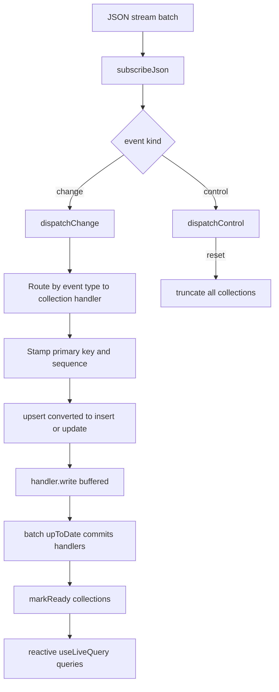
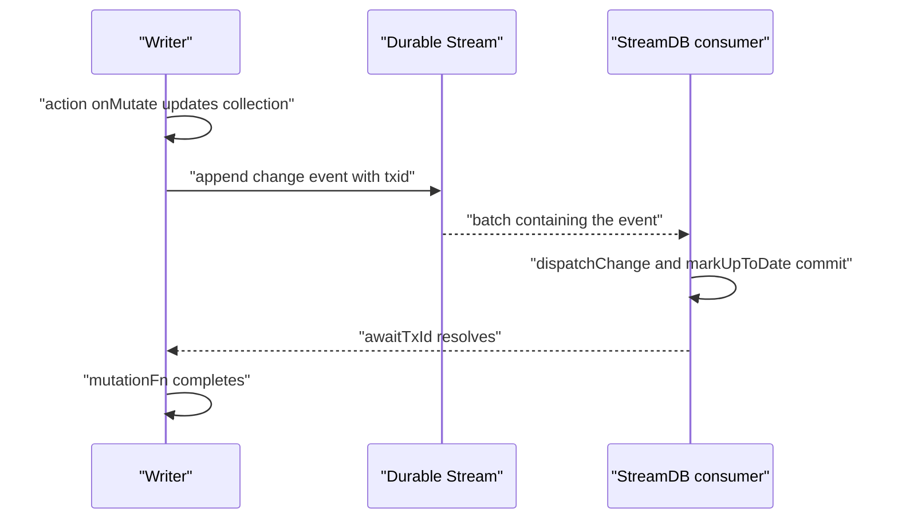

# 13 -- StreamDB: a reactive database in a stream

StreamDB is a reactive, type-safe database backed by a single Durable Stream. It maps Durable State change events onto TanStack DB collections, so readers get filtering, joins, aggregation, and live queries that update incrementally. There is no separate `@durable-streams/stream-db` package: StreamDB lives inside the `state` package at `packages/state/src/stream-db.ts` and is published under the `@durable-streams/state/db` subpath.

Collection identifiers are namespaced by stream URL. This matters because two streams that each define a `users` collection must not collapse into one logical source inside TanStack DB.

```ts
// Source: packages/state/src/stream-db.ts, lines 175-180
export function getStreamDBCollectionId(
  streamUrl: string,
  collectionName: string
): string {
  return `stream-db:${streamUrl}:${collectionName}`
}
```

## From change events to collections

An `EventDispatcher` routes each change event to the collection registered for its entity type. It stamps the primary key and a global sequence number onto the value, converts `upsert` into insert or update, and normalizes replayed inserts into updates so live reconnects stay idempotent.

```ts
// Source: packages/state/src/stream-db.ts, lines 296-330
    // Set the primary key field on the value object from the event key
    ;(value as any)[handler.primaryKey] = event.key

    // Stamp global insertion order for cross-collection sorting
    ;(value as any)._seq = this.seq++

    // Begin transaction on first write to this handler
    if (!this.pendingHandlers.has(handler)) {
      handler.begin()
      this.pendingHandlers.add(handler)
    }

    // Handle upsert by converting to insert or update
    if (operation === `upsert`) {
      const keys = this.existingKeys.get(event.type)
      const existing = keys?.has(event.key)
      operation = existing ? `update` : `insert`
    }

    const keys = this.existingKeys.get(event.type)

    // Live stream reconnects can replay an already-synced insert for the same
    // row. Normalize that case to update so observation replays remain
    // idempotent instead of tripping TanStack DB's duplicate-key path.
    if (operation === `insert` && keys?.has(event.key)) {
      operation = `update`
    } else if (operation === `insert` && typeof event.key === `string`) {
      const existingValue = handler.read(event.key)
      if (
        existingValue &&
        deepEquals(this.comparableRow(existingValue), this.comparableRow(value))
      ) {
        operation = `update`
      }
    }
```

Each collection is a TanStack DB `createCollection` whose sync config registers a handler with the dispatcher. Garbage collection is disabled on the collections, because all of them must be recovered together from the single log.

```ts
// Source: packages/state/src/stream-db.ts, lines 631-651
  for (const [name, definition] of Object.entries(state)) {
    // eslint-disable-next-line prefer-const -- self-referential: collection.get() used in its own sync config
    let collection: Collection<object, string> = createCollection({
      id: getStreamDBCollectionId(streamIdentity, name),
      schema: definition.schema as StandardSchemaV1<object>,
      getKey: (item: any) => String(item[definition.primaryKey]),
      sync: createStreamSyncConfig(
        definition.type,
        dispatcher,
        definition.primaryKey,
        (key) => collection.get(key) as object | undefined
      ),
      startSync: true, // Start syncing immediately
      // Disable GC - we manage lifecycle via db.close()
      // DB would otherwise clean up the collections independently of each other, we
      // cant recover one and not the others from a single log.
      gcTime: 0,
    })

    collectionInstances[name] = collection
  }
```

## The consumer

`createStreamDB` is synchronous: it builds the collections but does not connect. `preload()` starts the stream consumer, which reads the stream as JavaScript Object Notation (JSON) in the configured live mode — long-poll, Server-Sent Events (SSE), or none — and feeds each batch to the dispatcher. A batch marked up-to-date commits the pending writes and resolves the preload promise.

```ts
// Source: packages/state/src/stream-db.ts, lines 675-727
  const startConsumer = async (): Promise<void> => {
    if (consumerStarted) return
    consumerStarted = true

    // Start streaming (this is where the connection actually happens)
    streamResponse = await stream.stream<StateEvent>({
      live,
      json: true,
      signal: abortController.signal,
    })
    // StreamDB consumes batches via subscribeJson(); it does not await the
    // session's closed promise. Swallow that terminal rejection so aborting
    // the live session during db.close() doesn't surface as an unhandled
    // rejection after the real error has already been routed elsewhere.
    void streamResponse.closed.catch((err) => {
      if (isAbortLikeError(err)) {
        return undefined
      }
      const error = err instanceof Error ? err : new Error(String(err))
      console.error(`[StreamDB] Stream consumer closed unexpectedly:`, error)
      dispatcher.rejectAll(error)
      return undefined
    })
    lastConsumedOffset = streamResponse.offset

    // Process events as they come in
    streamResponse.subscribeJson((batch) => {
      try {
        lastConsumedOffset = batch.offset
        onBeforeBatch?.(batch)

        for (const event of batch.items) {
          if (isChangeEvent(event)) {
            dispatcher.dispatchChange(event, batch.offset)
            onEvent?.(event)
          } else if (isControlEvent(event)) {
            dispatcher.dispatchControl(event)
          }
        }

        onBatch?.(batch)

        if (batch.upToDate || dispatcher.ready) {
          dispatcher.markUpToDate()
        }
      } catch (error) {
        console.error(`[StreamDB] Error processing batch:`, error)
        dispatcher.rejectAll(error as Error)
        abortController.abort()
      }
      return Promise.resolve()
    })
  }
```

## Transaction confirmation and optimistic actions

A transaction identifier is the bridge between "I appended" and "everyone saw it". A writer appends an event with a `txid` header, then calls `awaitTxId`, which resolves only when the event comes back through the stream and is committed. Optimistic actions use this for confirmation: apply the change locally, append to the stream, and wait for the round trip.

```ts
// Source: packages/state/src/stream-db.ts, lines 760-780
  if (actionsFactory) {
    const actionDefs = actionsFactory({ db, stream })
    const wrappedActions: Record<
      string,
      ReturnType<typeof createOptimisticAction>
    > = {}
    for (const [name, def] of Object.entries(actionDefs)) {
      wrappedActions[name] = createOptimisticAction({
        onMutate: def.onMutate,
        mutationFn: def.mutationFn,
      })
    }

    Object.defineProperty(db, `actions`, {
      value: wrappedActions,
      enumerable: true,
      configurable: false,
      writable: false,
    })
    return db as any
  }
```





## The Aha Moment
**Aha:** StreamDB does not add a second database; it re-broadcasts the same log into TanStack DB collections. The stream's offset order becomes the collections' write order, and a transaction identifier turns "did my append land?" into a promise resolved by the echo of that append coming back through the live read. Confirmation is just the stream talking to itself, not a separate acknowledgement channel.

## Cross-References

- [12-durable-state.md](12-durable-state.md) — the event vocabulary these collections consume.
- [02-catch-up-reads.md](02-catch-up-reads.md) — what `preload()` does until up-to-date.
- [01-stream-model.md](01-stream-model.md) — append-only order that gives collections their write order.

Continue to [14-stream-fs.md](14-stream-fs.md)
