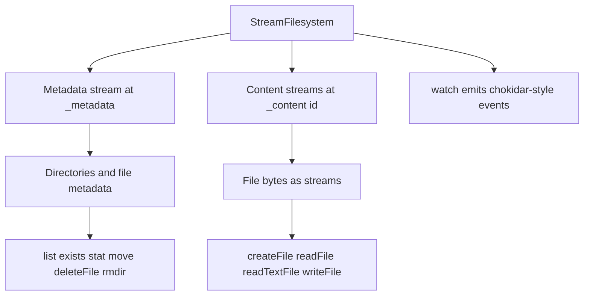
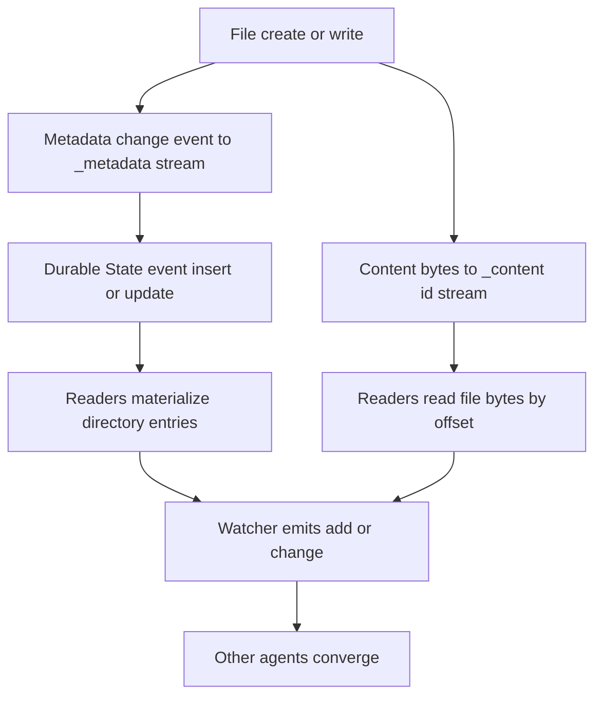

# 14 -- StreamFS: a filesystem in a stream

StreamFS is described as a shared filesystem for Artificial Intelligence (AI) agents, built on Durable Streams. It is important to state plainly: this exploration found no `@durable-streams/stream-fs` package in the repository's `packages/` tree. A grep for `StreamFilesystem` and `stream-fs` across `packages/` returns nothing. The only source of the API (Application Programming Interface) is the documentation page `docs/stream-fs.md`; there is no implementation to read, so the API below is documented intent, not shipped code.

The documented design splits state into a metadata stream at `/_metadata` and content streams at `/_content/{id}`.

```typescript
// Source: docs/stream-fs.md, lines 23-30
import { StreamFilesystem } from "@durable-streams/stream-fs"

const fs = new StreamFilesystem({
  baseUrl: "http://localhost:4437",
  streamPrefix: "/fs/myproject",
})

await fs.initialize()
```

## Files

The documented API reads and writes file content as text or raw bytes.

```typescript
// Source: docs/stream-fs.md, lines 41-44
await fs.createFile("/notes.md", "# My Notes\n\nHello, world!")

const content = await fs.readTextFile("/notes.md")
console.log(content)
```

`readFile()` returns raw bytes and `writeFile()` replaces content.

## Directories and metadata

Directory and file metadata is exposed through path-style operations.

```typescript
// Source: docs/stream-fs.md, lines 52-56
await fs.mkdir("/docs")

const entries = await fs.list("/")
const exists = fs.exists("/notes.md")
const stats = fs.stat("/notes.md")
```

The documentation also lists `move()`, `deleteFile()`, `rmdir()`, and `isDirectory()`.

## Watching

A watcher emits chokidar-style events as the underlying streams change, so multiple agents converge on the same filesystem view.

```typescript
// Source: docs/stream-fs.md, lines 64-76
const watcher = fs.watch({ path: "/", recursive: true })

watcher.on("all", (eventType, path, metadata) => {
  console.log(eventType, path, metadata)
})

watcher.on("ready", () => {
  console.log("watcher ready")
})

watcher.on("error", (error) => {
  console.error(error)
})
```

The documented event names are `add`, `change`, `unlink`, `addDir`, and `unlinkDir`.



## Relationship to implemented primitives

Even without a dedicated package, the design is a composition of two things the repository already ships. The metadata stream is a natural fit for the Durable State change events in `packages/state` — each file and directory entry is an entity with a type, key, and insert/update/delete operation. The content streams are plain byte streams, exactly the base protocol's `application/octet-stream` case. A "filesystem" is then an addressing convention (`/_metadata` plus `/_content/{id}`) and a set of helpers over those two primitives, not new storage machinery.

The documentation also mentions stale-write detection via a `PreconditionFailedError` and text patch support for efficient edits. Those would be protocol-level details built on the existing offset and content-type facilities.



## The Aha Moment
**Aha:** StreamFS is a name for a convention, not a new engine. A filesystem is a metadata log plus a set of content logs; both already exist as Durable State events and byte streams. The repository documents the API but has no package for it, which is consistent with the idea that the interesting work is the mapping — which stream holds directory state and which holds each file's bytes — rather than any new storage layer.

## Cross-References

- [12-durable-state.md](12-durable-state.md) — the metadata events a filesystem would use for entries.
- [13-stream-db.md](13-stream-db.md) — reactive queries over the same state events.
- [01-stream-model.md](01-stream-model.md) — the byte streams behind `/_content/{id}`.

Continue to [15-yjs-ai-transports.md](15-yjs-ai-transports.md)
