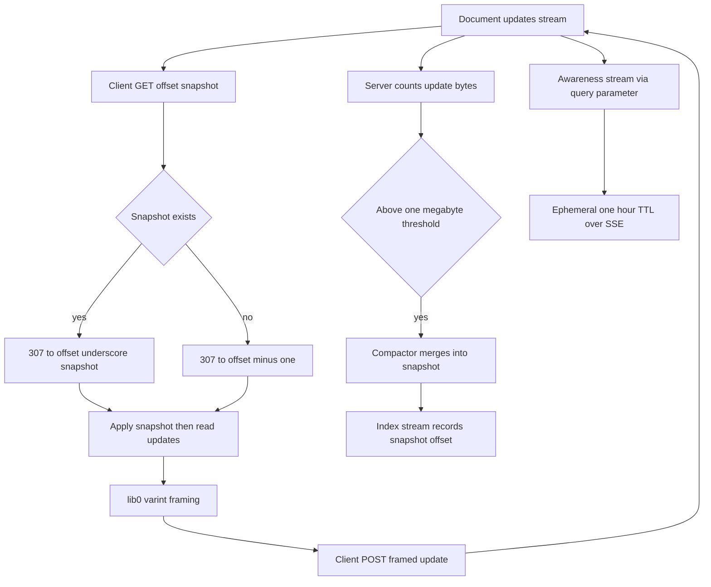
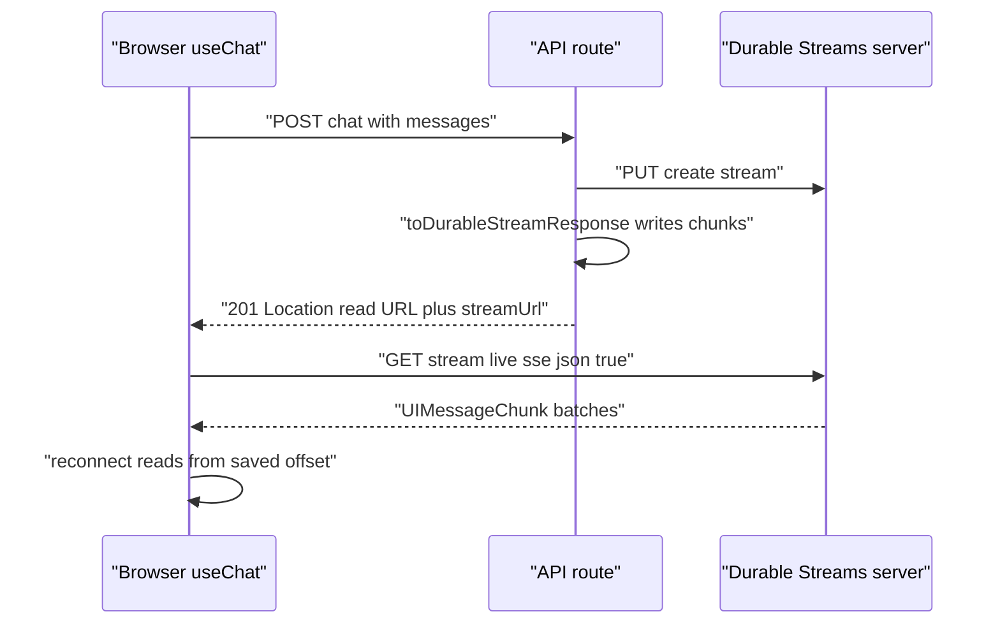

# 15 -- Yjs CRDT Sync and AI SDK Transports: resumable chat over the same byte streams

Two higher-level integrations share the same trick: they turn an asynchronous producer (a Conflict-free Replicated Data Type (CRDT) update stream, or an Artificial Intelligence (AI) token stream) into a durable stream and hand the reader a Uniform Resource Locator (URL) instead of a connection object. The Yjs package (`packages/y-durable-streams`) syncs Yjs documents over Hypertext Transfer Protocol (HTTP) streams. The two transport packages (`@durable-streams/aisdk-transport` for the Vercel AI Software Development Kit (SDK) and `@durable-streams/tanstack-ai-transport` for TanStack AI) make chat sessions resumable. Neither client manages offsets directly; the base protocol's read semantics do that work.

## The Yjs wire protocol

A Yjs document is one update stream. Snapshot discovery uses a sentinel offset: a client asks for `offset=snapshot` and the server redirects to either a compacted snapshot URL or the beginning of the stream. This keeps a fast reconnect path from replaying the whole history.

````text
# Source: packages/y-durable-streams/YJS-PROTOCOL.md, lines 213-232
GET {document-url}?offset=snapshot
```

#### Response (snapshot exists)

```
HTTP/1.1 307 Temporary Redirect
Location: {document-url}?offset=4782_snapshot
Cache-Control: private, max-age=5
```

#### Response (no snapshot)

```
HTTP/1.1 307 Temporary Redirect
Location: {document-url}?offset=-1
Cache-Control: private, max-age=5
```

When a snapshot exists, the server **MUST** redirect to the snapshot URL. When no snapshot exists, the server **MUST** redirect to `offset=-1` which uses standard Durable Streams behavior (read from beginning).
````

Awareness — presence data such as cursors and selections — is another stream addressed by a query parameter rather than a new path. It is ephemeral and is delivered over Server-Sent Events (SSE). The protocol specifies a one-hour time-to-live (TTL) for awareness streams, but the current implementation does not set a `Stream-TTL` header, so they live until deleted.

## lib0 framing: the load-bearing detail

Yjs updates are binary. The idempotent producer batches appends by concatenating bytes, so each update must be length-prefixed or the concatenation is unparseable. The provider frames with lib0's variable-length encoding on the way out, and reads the same framing on the way in.

```ts
// Source: packages/y-durable-streams/src/yjs-provider.ts, lines 682-699
  private static frameUpdate(data: Uint8Array): Uint8Array {
    const encoder = encoding.createEncoder()
    encoding.writeVarUint8Array(encoder, data)
    return encoding.toUint8Array(encoder)
  }

  /**
   * Apply lib0-framed updates from the server.
   */
  private applyUpdates(data: Uint8Array): void {
    if (data.length === 0) return

    const decoder = decoding.createDecoder(data)
    while (decoding.hasContent(decoder)) {
      const update = decoding.readVarUint8Array(decoder)
      Y.applyUpdate(this.doc, update, `server`)
    }
  }
```

The write side shows why framing exists: the comment states the exact failure it prevents. A local document update is framed before it enters the producer's batching queue.

```ts
// Source: packages/y-durable-streams/src/yjs-provider.ts, lines 728-745
  private handleDocumentUpdate = (
    update: Uint8Array,
    origin: unknown
  ): void => {
    if (origin === `server`) return
    const producer = this._ctx?.producer
    if (!producer || !this.connected) return

    // Mark as unsynced - will become true when our write echoes back
    this.synced = false

    // Frame update with lib0 encoding before appending.
    // This is critical because the IdempotentProducer batches multiple appends
    // by concatenating bytes. Without framing, concatenated raw Yjs updates
    // would be invalid. With framing, each update is length-prefixed so
    // concatenation produces valid lib0-framed data.
    producer.append(YjsProvider.frameUpdate(update))
  }
```

## Server-side compaction

The Yjs server is a proxy in front of a base Durable Streams server. After each successful write it counts the update bytes, and once they cross the one-megabyte default threshold it triggers the compactor to merge updates into a snapshot and record the snapshot offset in an index stream.

```ts
// Source: packages/y-durable-streams/src/server/yjs-server.ts, lines 852-872
    // Track for compaction on success
    if (dsResponse.status >= 200 && dsResponse.status < 300) {
      if (!this.documentStates.has(stateKey)) {
        this.documentStates.set(stateKey, {
          snapshotOffset: null,
          updatesSizeBytes: 0,
          compacting: false,
        })
      }
      const state = this.documentStates.get(stateKey)!
      state.updatesSizeBytes += body.length

      // Trigger compaction if thresholds met
      if (this.shouldTriggerCompaction(state)) {
        this.compactor
          .triggerCompaction(route.service, route.docPath)
          .catch((err) => {
            console.error(`[YjsServer] Compaction error:`, err)
          })
      }
    }
```



## The AI SDK transports

The Vercel AI SDK transport's client is small: it posts messages to the caller's Application Programming Interface (API) route, takes the stream URL from the `Location` header or the JavaScript Object Notation (JSON) body, and reads it back as UI message chunks over SSE with JSON mode on.

```ts
// Source: packages/aisdk-transport/src/client.ts, lines 79-91
async function readUiMessageChunksFromDurableStream(
  streamUrl: string,
  abortSignal?: AbortSignal
): Promise<ReadableStream<UIMessageChunk>> {
  const streamResponse = await stream<UIMessageChunk>({
    url: streamUrl,
    live: `sse`,
    json: true,
    signal: abortSignal,
  })

  return toReadableStream(streamResponse.jsonStream())
}
```

The server side owns the stream lifecycle. In immediate mode it returns `201` with the read URL and lets the write continue in a background task (registered with `waitUntil` on worker runtimes). In await mode it drains the source and closes the stream before responding.

```ts
// Source: packages/aisdk-transport/src/server.ts, lines 122-139
  const backgroundTask = writer.catch((error) => {
    console.error(`Durable stream write failed`, error)
  })
  options.waitUntil?.(backgroundTask)

  const responseHeaders = new Headers({
    Location: readUrl,
    "Cache-Control": `no-store`,
  })

  if (options.exposeLocationHeader !== false) {
    responseHeaders.set(`Access-Control-Expose-Headers`, `Location`)
  }

  return Response.json(
    { streamUrl: readUrl },
    { status: 201, headers: responseHeaders }
  )
```

The TanStack AI transport adds one more step: on first subscribe it folds streamed chunks into a message snapshot before yielding live chunks, so a reconnect that starts at offset zero can still reconstruct message history and then continue incrementally.

```ts
// Source: packages/tanstack-ai-transport/src/client.ts, lines 80-114
      const emitSnapshot = options.emitSnapshotOnSubscribe !== false
      const shouldEmitSnapshot = emitSnapshot && state.offset === undefined
      let hasEmittedSnapshot = !shouldEmitSnapshot
      let snapshotMessages: Array<any> = []

      for await (const batch of readJsonBatchesFromStream(
        streamResponse,
        abortSignal
      )) {
        state.offset = batch.offset
        if (abortSignal?.aborted) break

        if (!hasEmittedSnapshot) {
          snapshotMessages = applyChunksToMessages(
            snapshotMessages,
            batch.items
          )

          if (!batch.upToDate) {
            continue
          }

          hasEmittedSnapshot = true
          yield {
            type: `MESSAGES_SNAPSHOT`,
            messages: snapshotMessages,
          }
          continue
        }

        for (const chunk of batch.items) {
          if (abortSignal?.aborted) break
          yield chunk
        }
      }
```



## The Aha Moment
**Aha:** Yjs sync and AI chat transport are the same shape: a producer turns its output into a durable stream and gives the reader a URL, and resumability falls out of offset reads. The one piece that is easy to miss is Yjs's lib0 varint framing — it exists not for the wire but for the idempotent producer, which concatenates batched appends and would otherwise emit invalid binary. The transport clients, in contrast, need no framing at all because JSON mode already delimits messages; they only need to remember an offset and re-subscribe.

## Cross-References

- [03-live-tailing.md](03-live-tailing.md) — the SSE and long-poll reads both integrations subscribe with.
- [05-idempotent-producers.md](05-idempotent-producers.md) — why the producer concatenates appends and forces lib0 framing.
- [06-json-mode.md](06-json-mode.md) — the JSON stream mode the AI transports use for chunk boundaries.
- [11-durable-proxy.md](11-durable-proxy.md) — the server-side create-and-pipe pattern these transports re-implement.
- [02-catch-up-reads.md](02-catch-up-reads.md) — what the TanStack snapshot fold does before `upToDate`.

Continue to [16-clients-conformance-deployment.md](16-clients-conformance-deployment.md)
