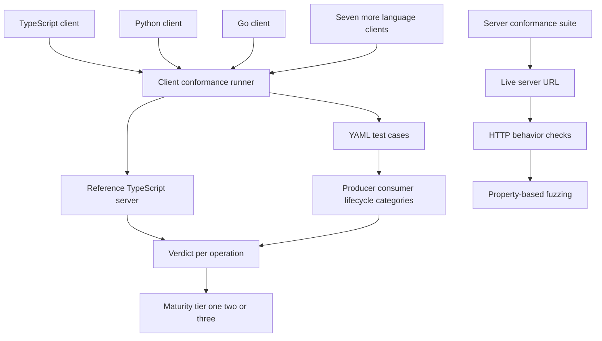
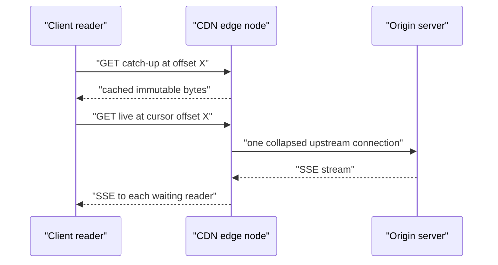

# 16 -- The Ten Clients, Conformance Suites, and CDN Fan-Out: one protocol, many languages, one edge

Durable Streams ships official client libraries in ten languages and two conformance suites — one for clients, one for servers — that turn the protocol specification into an executable checklist. The same property that makes the suites deterministic, append-only immutability, is what makes the read path cacheable by a Content Delivery Network (CDN).

## The ten clients

The repository contains ten client packages: `client` (TypeScript, the reference), `client-py` (Python), `client-go` (Go), `client-elixir` (Elixir), `client-dotnet` (C# / .NET), `client-swift` (Swift), `client-php` (PHP), `client-java` (Java), `client-rust` (Rust), and `client-rb` (Ruby). Maturity is tracked in three tiers. TypeScript is Production-Proven (1.5+ years in production at Electric); Python and Go are Expert-Reviewed; the other seven are Vibe-Engineered. All are expected to pass the client conformance suite regardless of tier; the tier describes API (Application Programming Interface) polish and battle-testing, not protocol coverage.

Every client exposes the same core: offset-based resumption, long-poll and Server-Sent Events (SSE) live modes, JavaScript Object Notation (JSON) mode with array flattening, and exactly-once writes through the `(producerId, epoch, seq)` tuple. A Go example shows the shape.

```go
// Source: docs/clients.md, lines 74-86
client := durablestreams.NewClient()
stream := client.Stream("https://streams.example.com/my-stream")

it := stream.Read(ctx)
defer it.Close()

for {
    chunk, err := it.Next()
    if errors.Is(err, durablestreams.Done) {
        break
    }
    fmt.Println(string(chunk.Data))
}
```

## Client conformance: one runner, any language

The client suite is language-agnostic. A Node.js runner reads YAML (YAML Ain't Markup Language) test cases, starts a reference TypeScript server, spawns a client adapter as a subprocess, and exchanges JSON-line commands over standard input and output. The adapter does not need to be TypeScript: it is any executable that speaks the adapter protocol.

```ts
// Source: packages/client-conformance-tests/src/runner.ts, lines 164-191
  async send(command: TestCommand, timeoutMs = 30000): Promise<TestResult> {
    if (!this.process.stdin) {
      throw new Error(`Client adapter stdin not available`)
    }

    return new Promise((resolve, reject) => {
      const timeout = setTimeout(() => {
        this.pendingResponse = null
        reject(
          new Error(`Command timed out after ${timeoutMs}ms: ${command.type}`)
        )
      }, timeoutMs)

      this.pendingResponse = {
        resolve: (result) => {
          clearTimeout(timeout)
          resolve(result)
        },
        reject: (error) => {
          clearTimeout(timeout)
          reject(error)
        },
      }

      const line = serializeCommand(command) + `\n`
      this.process.stdin!.write(line)
    })
  }
```

The YAML test cases are organized into `producer`, `consumer`, and `lifecycle` categories. Producer cases cover creation, appends, sequence ordering, batching, idempotent appends, and error handling. Consumer cases cover catch-up reads, long-poll, SSE, offset resumption, and fault injection. A case declares setup, operations with expectations, and cleanup, so the same script drives a Python adapter and a Rust adapter identically.

## Server conformance: the same checks against any server

The server suite runs against a live server URL. It is a large set of `describe`/`test` blocks that exercise the base Hypertext Transfer Protocol (HTTP) directly: create, append, read, long-poll, SSE, JSON mode, time-to-live (TTL) and expiry, caching and entity tags (ETag), chunking, byte-exactness, and property-based fuzzing with fast-check. A server implementer points the suite at a URL and gets a pass/fail verdict per behavior.

```ts
// Source: packages/server-conformance-tests/src/index.ts, lines 298-306
  describe(`Basic Stream Operations`, () => {
    test(`should create a stream`, async () => {
      const streamPath = `/v1/stream/create-test-${Date.now()}`
      const stream = await DurableStream.create({
        url: `${getBaseUrl()}${streamPath}`,
        contentType: `text/plain`,
      })

      expect(stream.url).toBe(`${getBaseUrl()}${streamPath}`)
```

The suite is the enforcement mechanism behind the "all clients pass" claim and the reference for anyone building a third-party server. Its property-based section (byte-exactness, operation sequences, immutability, offset validation, sequence ordering, concurrent writers, state hashes) targets properties that are hard to verify one case at a time.



## CDN fan-out

Catch-up reads are immutable: the bytes after a given offset never change, so an edge node can cache them indefinitely. Live readers at the same offset can be collapsed into fewer upstream connections. Entity tags enable conditional requests. The result is one origin serving many concurrent readers through the edge.

```text
# Source: docs/deployment.md, lines 302-312
## CDN integration

The Durable Streams protocol is designed for CDN-friendly fan-out. You don't need Electric Cloud to benefit from this -- the same properties apply when self-hosting behind any CDN.

**Cache-friendly historical reads.** Catch-up reads from a given offset return immutable content. A request for "everything after offset X" always returns the same response, making these requests safe to cache indefinitely at the edge.

**Cursor-based collapsing.** In live mode, multiple clients waiting at the same offset can be collapsed into fewer upstream connections by CDN edge nodes. This means read-heavy workloads scale horizontally without overwhelming origin servers.

**Conditional requests.** ETag support allows clients to make conditional requests, reducing unnecessary data transfer when content hasn't changed.

This architecture means a single origin server can serve a large number of concurrent readers through CDN fan-out, with the CDN absorbing the connection and bandwidth costs of the read path.
```

The servers expose the knobs this depends on: the Node reference server has `cursorIntervalSeconds` (default 20) for CDN cache collapsing, and the Caddy plugin has `sse_reconnect_interval` (default 60s) for closing SSE connections so edge nodes can collapse them. The live cursor gives the edge a stable key that advances only as data arrives.



## The Aha Moment
**Aha:** Client conformance, server conformance, and CDN fan-out are the same observation seen three times. A deterministic offset read is simultaneously a YAML expectation, a test assertion, and a cache key. That is why the ten clients do not need to be byte-for-byte ports — an adapter only has to produce the same bytes for the same offsets — and why a single origin can serve an edge full of readers. Append-only immutability is the load-bearing property, and everything else in this document is infrastructure built on top of it.

## Cross-References

- [01-stream-model.md](01-stream-model.md) — the offset immutability that makes CDN caching safe.
- [02-catch-up-reads.md](02-catch-up-reads.md) — the cache-friendly historical reads behind fan-out.
- [03-live-tailing.md](03-live-tailing.md) — the live cursor that CDN nodes collapse.
- [05-idempotent-producers.md](05-idempotent-producers.md) — the exactly-once tuple every client must implement.
- [09-caddy-server.md](09-caddy-server.md) — the `sse_reconnect_interval` knob on the production server.
- [10-cloudflare-server.md](10-cloudflare-server.md) — a second server target for the server conformance suite.

Continue to [README.md](README.md)
