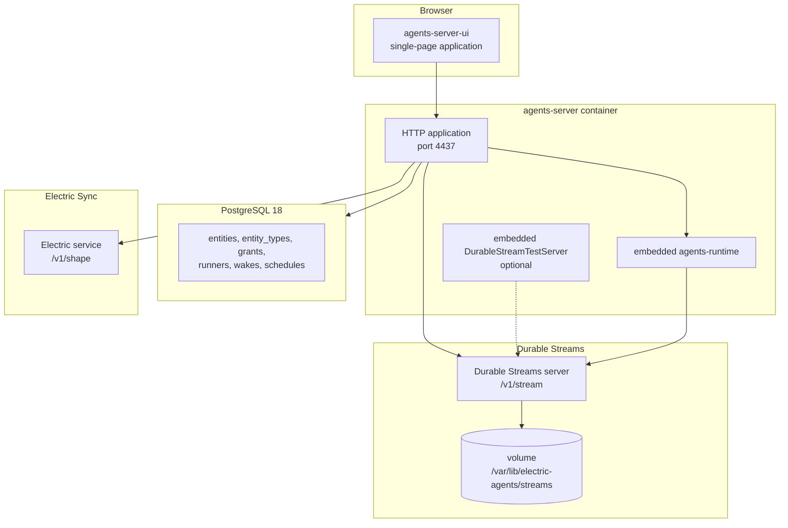
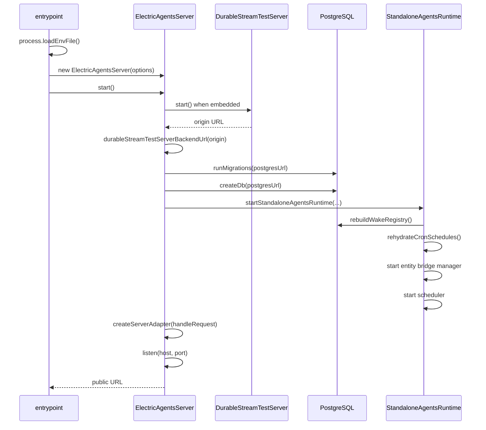
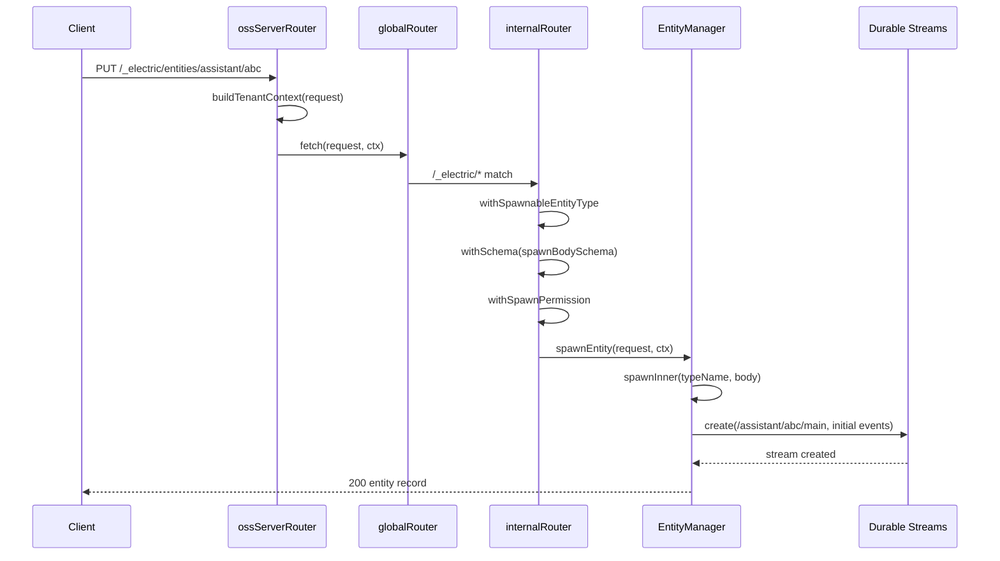
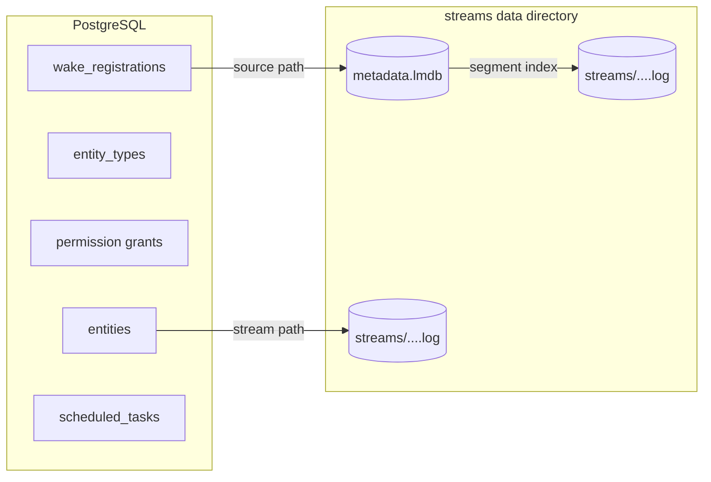

# System architecture: control plane, data plane, execution plane

Electric Agents has three planes. The **control plane** is a PostgreSQL-backed HTTP server. The **data plane** is a Durable Streams service. The **execution plane** is one or more agent runtimes. The planes communicate through HTTP and through signed webhooks. No plane shares memory with another.

This document shows the full process topology, the boot order, the request path, the stream namespace, and the configuration surface.

## Process topology

A production deployment runs four or more processes. The Docker Compose file `docker-compose.full.yml` defines three containers and one external service.



The embedded stream server is optional. When `ELECTRIC_AGENTS_DURABLE_STREAMS_URL` is set, the server does not start an embedded one. When the variable is absent, the server starts `DurableStreamTestServer` in its own process and uses it as the backend.

## Boot sequence

The entrypoint does six things in order. The order matters because the runtime needs the database before it can rebuild the wake registry, and it needs the stream server before it can serve any stream request.



### Step 1: environment load

`main()` calls `process.loadEnvFile()` and ignores the error when no `.env` file exists. Source: `packages/agents-server/src/entrypoint-lib.ts`.

### Step 2: option resolution

`resolveElectricAgentsEntrypointOptions(env, cwd)` reads every environment variable. It validates each URL and each port number. It returns a typed options object.

| Setting | Environment variable | Default |
|---------|---------------------|---------|
| Service identifier | `ELECTRIC_AGENTS_SERVICE` or `SERVICE` | `default` |
| Tenant identifier | `ELECTRIC_AGENTS_TENANT_ID` or `TENANT_ID` | none |
| Public base URL | `ELECTRIC_AGENTS_BASE_URL` or `BASE_URL` | derived from the listen address |
| Postgres URL | `ELECTRIC_AGENTS_DATABASE_URL` or `DATABASE_URL` | required |
| Durable Streams URL | `ELECTRIC_AGENTS_DURABLE_STREAMS_URL`, `DURABLE_STREAMS_URL`, `STREAMS_URL` | none; embedded server starts |
| Durable Streams bearer | `ELECTRIC_AGENTS_DURABLE_STREAMS_BEARER` | none |
| Streams data directory | `ELECTRIC_AGENTS_STREAMS_DATA_DIR` or `STREAMS_DATA_DIR` | `${cwd}/.streams-data` |
| Streams host | `ELECTRIC_AGENTS_STREAMS_HOST` | `127.0.0.1` |
| Streams port | `ELECTRIC_AGENTS_STREAMS_PORT` | `0` (operating system chooses) |
| Electric URL | `ELECTRIC_AGENTS_ELECTRIC_URL` or `ELECTRIC_URL` | none |
| Electric secret | `ELECTRIC_AGENTS_ELECTRIC_SECRET` | none |
| Webhook signing key | `ELECTRIC_AGENTS_WEBHOOK_SIGNING_PRIVATE_KEY` | generated at start |
| HTTP host | `ELECTRIC_AGENTS_HOST` or `HOST` | `0.0.0.0` |
| HTTP port | `ELECTRIC_AGENTS_PORT` or `PORT` | `4437` |
| Working directory | `ELECTRIC_AGENTS_WORKING_DIRECTORY` or `WORKING_DIRECTORY` | process working directory |
| Dispatch recovery interval | `ELECTRIC_AGENTS_DISPATCH_RECOVERY_INTERVAL_MS` | disabled |
| Stale wake age | `ELECTRIC_AGENTS_STALE_OUTSTANDING_WAKE_AFTER_MS` | equal to the recovery interval |

Source: `packages/agents-server/src/entrypoint-lib.ts:113-186`.

### Step 3: embedded stream server

`createEmbeddedStreamsServer` returns `undefined` when an external URL is set. Otherwise it constructs a `DurableStreamTestServer` with three settings:

```ts
return new DurableStreamTestServer({
  host: readEnv(env, [`ELECTRIC_AGENTS_STREAMS_HOST`, `STREAMS_HOST`]) ?? DEFAULT_STREAMS_HOST,
  port: readOptionalPort(env, [`ELECTRIC_AGENTS_STREAMS_PORT`, `STREAMS_PORT`], `embedded streams port`) ?? 0,
  dataDir,
  webhooks: true,
})
```

Source: `packages/agents-server/src/entrypoint-lib.ts:195-217`.

The `webhooks: true` flag is important. Without it, the stream server would not deliver subscription webhooks. The wake model depends on that delivery.

### Step 4: migrations and database handle

`runMigrations(postgresUrl)` applies migrations `0000` through `0016`. `createDb(postgresUrl)` opens a Drizzle database handle and a raw PostgreSQL client. Source: `packages/agents-server/src/server.ts:228-233`.

### Step 5: standalone runtime

`startStandaloneAgentsRuntime` constructs seven long-lived components:

| Component | Responsibility |
|-----------|----------------|
| `StreamClient` | HTTP client for the Durable Streams server |
| `PostgresRegistry` | Entity, type, permission, and runner records |
| `WakeRegistry` | In-memory wake conditions, synchronized from PostgreSQL |
| `Scheduler` | Delayed sends and cron ticks |
| `EntityBridgeManager` | Bridges between entity streams and external sources |
| `PgSyncBridgeManager` | Bridges that replicate entity events to PostgreSQL |
| `EntityManager` | Entity lifecycle operations |

It then runs `rebuildWakeRegistry`, `rehydrateCronSchedules`, and starts the bridge managers and the scheduler. Source: `packages/agents-server/src/standalone-runtime.ts:122-190`.

### Step 6: HTTP listen

The server builds a WHATWG `Request`/`Response` adapter with `createServerAdapter`. The Node.js `http.Server` wraps the adapter. The server listens on the configured host and port. Source: `packages/agents-server/src/server.ts:246-252`.

## Request path

A request passes through five stages.



### Stage 1: tenant context

`handleRequest` calls `buildTenantContext(request)`. This function resolves the calling principal. It calls the optional `authenticateRequest` hook first. If that returns nothing, it reads the `electric-principal` header. If no principal is found and the development fallback is allowed, it uses `system:dev-local`.

The fallback is allowed when any of three conditions is true:

- `ELECTRIC_INSECURE === 'true'`.
- `NODE_ENV !== 'production'`.
- The server owns an embedded Durable Streams server.

Source: `packages/agents-server/src/server.ts:389-405`.

### Stage 2: top-level routing

The `ossServerRouter` handles four cases in order:

1. `/` redirects to `/__agent_ui/`.
2. `/__agent_ui/*` serves the user interface.
3. `/_electric/mock-agent-handler` serves the mock agent webhook.
4. Everything else goes to `globalRouter`.

Source: `packages/agents-server/src/routing/oss-server-router.ts:33-41`.

### Stage 3: global routing

`globalRouter` routes by prefix:

| Prefix | Handler | Purpose |
|--------|---------|---------|
| `/_electric/shared-state/*` | `durableStreamsRouter` | Shared state streams |
| `/_electric/pg-sync/register` | `internalRouter` | Register a PostgreSQL sync bridge |
| `/_electric/pg-sync/*` | `durableStreamsRouter` | Read and write PostgreSQL sync streams |
| `/_electric/*` | `internalRouter` | All control-plane routes |
| `*` | `durableStreamsRouter` | Direct stream paths |

Source: `packages/agents-server/src/routing/global-router.ts:31-36`.

The last rule is the key to the data plane. A request to `/assistant/abc/main` is not a control-plane request. It is a stream request. `durableStreamsRouter` forwards it to the Durable Streams backend.

### Stage 4: internal routing

`internalRouter` has base path `/_electric`. It handles health, wake registration, subscription webhooks, wake callbacks, runners, entities, entity types, PostgreSQL sync, observations, and the Electric proxy.

```ts
internalRouter.get(`/health`, () => json({ status: `ok` }))
internalRouter.post(`/wake`, withSchema(wakeRegistrationBodySchema), registerWake)
internalRouter.post(`/wake/unregister`, withSchema(wakeUnregisterBodySchema), unregisterWake)
internalRouter.post(`/subscription-webhooks/:subscriptionId`, subscriptionWebhook)
internalRouter.post(`/wake-callbacks/:consumerId`, wakeCallback)
internalRouter.all(`/runners`, runnersRouter.fetch)
internalRouter.all(`/entities/*`, entitiesRouter.fetch)
internalRouter.all(`/entity-types/*`, entityTypesRouter.fetch)
```

Source: `packages/agents-server/src/routing/internal-router.ts:135-153`.

### Stage 5: entity operations

`entitiesRouter` has base path `/_electric/entities`. It exposes twenty-five routes. The most important routes are:

| Method and path | Operation |
|-----------------|-----------|
| `GET /` | List entities |
| `PUT /:type/:instanceId` | Spawn an entity |
| `GET /:type/:instanceId` | Get an entity |
| `HEAD /:type/:instanceId` | Check entity existence |
| `DELETE /:type/:instanceId` | Kill an entity |
| `POST /:type/:instanceId/signal` | Send a signal |
| `POST /:type/:instanceId/send` | Send a message |
| `POST /:type/:instanceId/collections/:collection` | Write to a collection |
| `POST /:type/:instanceId/fork` | Fork the entity subtree |
| `PUT /:type/:instanceId/schedules/:scheduleId` | Upsert a schedule |
| `POST /:type/:instanceId/grants` | Grant a permission |

Source: `packages/agents-server/src/routing/entities-router.ts:385-530`.

## Stream namespace

Every stream has a path. The path determines its purpose.

| Path pattern | Owner | Purpose |
|--------------|-------|---------|
| `/{entityType}/{instanceId}/main` | One entity | The entity event log |
| `/principal/{encodedPrincipalKey}` | One principal | The principal identity stream |
| `/_electric/shared-state/{sharedStateId}` | Several entities | Shared state between entities |
| `/_cron/{base64url spec}` | Scheduler | Cron tick stream |
| `/_entities/{sourceRef}` | Entity projector | Membership and tag projection |
| `/{entityType}/{instanceId}/attachments/{attachmentId}` | One entity | Attachment bytes |
| `{runnerWakeStream}` | One runner | Pull-wake delivery stream |

Source: `packages/agents-runtime/src/runtime-server-client.ts`, `packages/agents-runtime/src/cron-utils.ts`, `packages/agents-runtime/src/tags.ts`.

## Storage in one view

The data plane stores three kinds of bytes:

1. **Stream metadata.** Content type, current offset, producer state, reference count, fork parent, closure state. Stored in LMDB at `metadata.lmdb`.
2. **Stream event bytes.** Append-only segments. Stored as `.log` files under the data directory.
3. **Control-plane records.** Entities, types, permissions, wakes, schedules. Stored in PostgreSQL.



The full storage analysis is in [04-how-the-runtime-sets-up-a-stream.md](04-how-the-runtime-sets-up-a-stream.md) and [durable-streams/05-storage-and-durability.md](durable-streams/05-storage-and-durability.md).

## Aha: the server is also a stream proxy

The same HTTP port serves the control plane and the data plane. A request to `/_electric/entities/...` goes to the control plane. A request to `/assistant/abc/main` goes to the stream backend. The router chooses by prefix.

This design lets a browser read an entity stream without knowing the stream server address. The browser talks only to the agents-server. The server forwards the request with the correct bearer token. Source: `packages/agents-server/src/routing/durable-streams-router.ts`.

## Aha: the embedded server makes development instant

The default configuration needs one command and one database. The server starts its own stream server on an operating-system-chosen port. It stores data in `.streams-data` relative to the working directory. No container, no external service, and no network configuration are necessary.

The tradeoff is that the embedded server is called a *test server*. It is not designed for multi-node production. Production deployments set `ELECTRIC_AGENTS_DURABLE_STREAMS_URL` and use a dedicated stream service.

## Related documents

- [03-the-durable-stream-primitive.md](03-the-durable-stream-primitive.md) — the stream model.
- [04-how-the-runtime-sets-up-a-stream.md](04-how-the-runtime-sets-up-a-stream.md) — stream creation.
- [05-wake-dispatch-and-entity-lifecycle.md](05-wake-dispatch-and-entity-lifecycle.md) — wake delivery.
- [agents-server/01-boot-and-configuration.md](agents-server/01-boot-and-configuration.md) — server detail.
